```
Тема: Борная кислота
Здравствуйте!

Я обнаружил, что борной кислотой пытаются лечить воспаленный зубы. Видимо, такая медицина народная.

Сразу же вспомнил, что когда-то мне нужен был тетраборат и я чуть с дуба не рухнул, как много всего. Метабораты, бораты, в целом все свойства мне напоминали спирты из органики.
Я стал читать более точно и заметил, что правда пишут, что обычные свойства органических кислот с отдачей протона оно не проявляет. Я проверил лакмусовой бумагой, действительно, не проявляет. Бумага остается желтоватой. Это вообще буферный раствор.

Более того, я собирался содой пищевой проверить, но как обычно, она куда-то пропала. Классика. 
Ну это не страшно, так как сейчас я буду проверять кальцинированной содой. Так как с каустической будет неясно.
В википедии пишут, что оно проявляет кислотные свойства акцепторно-донорном уровне (кислота Льюиса. Где кислота это акцептор электронной пары, а донор это основание. То есть, где не идет H+ (отдача), а наоборот как основание. Запутаться в этом можно, но я так запоминаю, что аммиак это основание и там он как бы принимает на себя протон, то есть как акцептор... Но при этом в NH3 он существует и ещё у него 2 свободных электрона, которые он дает. Поэтому можно запутаться)
В общем, сейчас я буду проверять с кальцинированной содой.

Хм, отмена. Я проверил с обычной пищевой содой. Я посыпал щепотку её и сначала газ вообще не шёл и я думал википедия и ИИ мне накинули граммотно, что реакция с содой не будет идти. Но нет, ИИ обманули - реакция идет. Но лакмус показывает среду как буфер и при этом сразу же идет осадок, но не вниз, а всплывает. Газ выделяется в очень малом кол-ве. 

Мне кажется, почему-то, уже давно. Что борная кислота это подобие спиртов в органической химии. Можно проверить чуть позже, нужна прицепить какую жирную кислоту или тому подобное. Посмотреть, будет ли подобие жира, но потом займусь. 

Лакмус был выкинут в мусорку и сейчас был достан с целью того, что бы убедиться, что лакмус не среагировал. Неа, он всё же среагировал... Но только в местах и кажется где я трогал пальцами. То есть, если лакмус реагирует только на pH в целом, то всё же H+ там есть. Тогда википедия в целом вводит в заблуждение 

https://ru.wikipedia.org/wiki/%D0%9E%D1%80%D0%B3%D0%B0%D0%BD%D0%B8%D1%87%D0%B5%D1%81%D0%BA%D0%B8%D0%B5_%D0%B1%D0%BE%D1%80%D0%B0%D1%82%D1%8B

и причем как в органике с помощью серной кислоты делается, этерификация

Что бы не "дышать парами" (вряд-ли у чего есть явная кристаллическая решетка в обычном виде может делать пары, азеотропные смеси с водой, способные покрыть все легкие быстрее чем воздух на улице, но раз сказали) всё же закрыл в бутылке. Но, как я и раньше писал, стехиометрия в органике не особо используется. Либо берут недостаток, либо переизбыток, от необходимости нужной реакции. Я засыпал в бутылку стеклянную от есентуки соды пищевой и залил туда этот раствор, очень сильно размешал и уже такого не увидел. Сода уже толком и не растворяется. Оставляю на дольше. 

https://studfile.net/preview/7264660/page:11/ токсикология говорит, что сода пищевая связывает. То есть реакция идёт
Отравление даже задействует мозг. То есть, в целом проходит барьер, в который многие органические соединения нормально не попадают и взаимодействие с органикой есть. 

https://chemister.ru/Databases/Chemdatabase/properties.php?dbid=1&id=397

Летуча с паром. То есть, таки может ещё и вести себя как жидкость в растворе. Видимо, при нагреве. 

Летальная доза большая, то есть можно было в бутылку не убирать. Но уже ладно

Боялись что будет испарятся, хоть я сразу сказал, что должно скорее кристаллизоваться. Но сказали вдруг животные слопают. Я не знаю. Они только на кровати ссут, но растворы не пьют. 

Кстати, где цитрат меди должен быть, появилась Пенка похожаа на бактериальную жизнь 

c кислотами органическими реагирует видимо только через ангидрид. нашёл есть что-то вроде "триацетилбората"

Химия и Химики № 2 2008. Очистка органических ...

image.png
журнал Химия и Химики
... триацетилборатом охлаждают и образовавшиеся кристаллы отфильтровывают. После перегонки получают безводную кислоту. Уксусную кислоту обезвоживают также ...


(ЖУРНАЛ ЗоПРЕЩЕН В РФ. СЛИШКОМ НАУЧНО ДЛЯ ЭТОЙ СТРАНЫ.)
Вот, получается, есть такое соденине

нашёл на acrhive org https://archive.org/stream/djvu14519/djvu%3D14519_djvu.txt
Эти соединения, как я понял сразу обратно в кислоту превращаются и борную кислоту, что видимо в органике очень плохо растворяется и идет в осадок, тк при перегонке бы тогда оно оставалось. Первоночально не совсем понял зачем в обратном холодильнике держать в окислителе. Окислить не оокисленное, но как там и откуда растворимость такая перманганата. Думаю основное это перегонка и как раз триацетилборат 

фосфорные кислоты ж тоже эфиры делают, но это уже ядовитое и там не этерификацией обычно (был какой-то немецкий способ, есть при сильном нагреве сразу цепляют изопропиловый спирт например. Но я уже забыл, обычно к хлорпроизводным цепляют вроде. Подзабыл, нужно реакции Арбузова смотреть и другие.), а тут этерификацией
```
<h2> Фото: </h2>

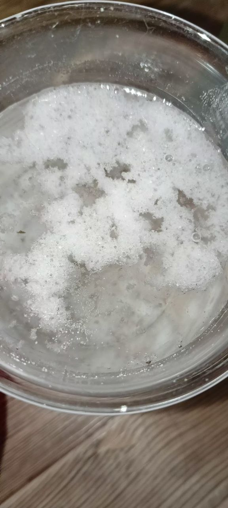 
<br/>
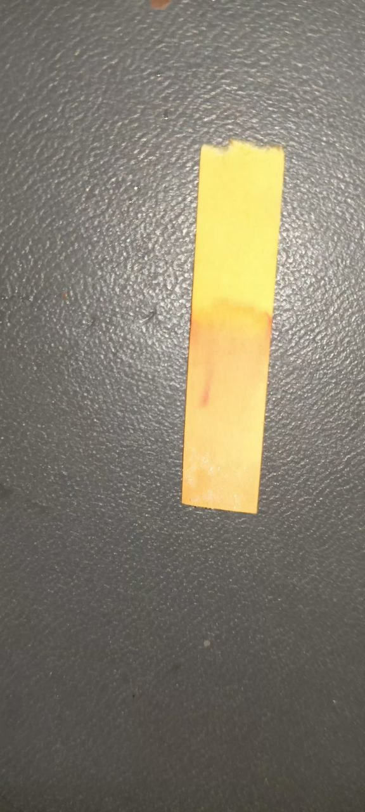
<br/>
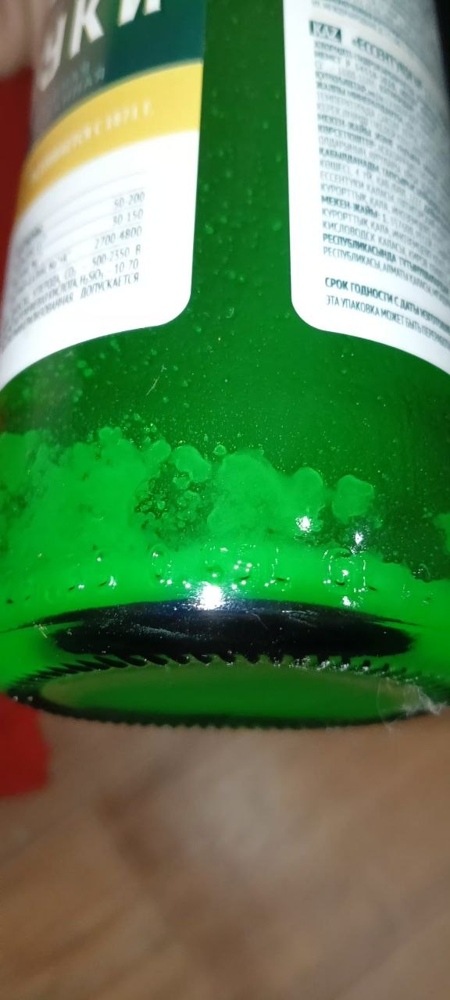
<br/>
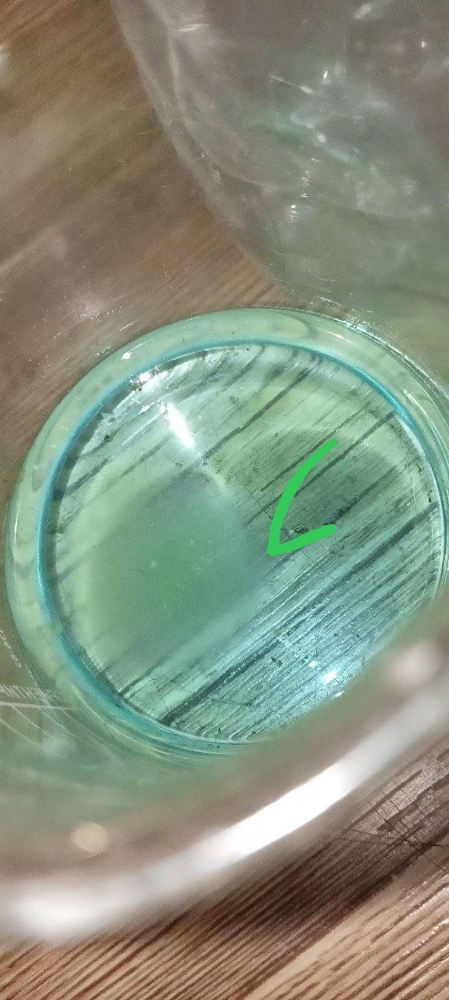
<br/>
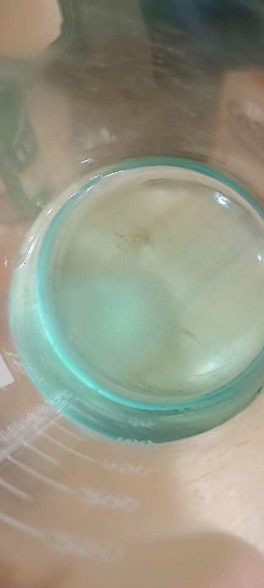
<hr/>

<h2> Ответ: </h2>

```
Здравствуйте!

Борная кислота умеет быть «настоящей» кислотой; в водных растворах она образует олигомеры; чаще всего, тетраборную кислоту. Это продукт поликонденсации, формула H2B4O7. Структурную формулу натриевой соли этой кислоты (натрия тетраборат) прикрепил во вложении. Соды (и Na2CO3, и NaHCO3) в борной кислоте «шипят», образуя тетраборат натрия в виде гидрата; потому что тетраборная кислота немного сильнее угольной. Но именно «немного», потому и лакмус они «не сильно впечатляют». Борные кислоты НЕ летучи АБСОЛЮТНО; их водные растворы, как и сами эти кислоты (они все твёрдые), можно открыто держать в спальне; никаких «паров» от них НЕ будет. Ядовиты — ДА; но речь не про «запах» (они НЕлетучие, пахнуть НЕ могут), а про то, что внутрь организма лучше, чтобы они НЕ попадали. ЭФИРЫ ортоборной кислоты можно получать так же, как эфиры фосфорной, мышьяковой, серной или карбоновых кислот. Их свойства показывают огромную разницу между бором и его гомологом по периодической таблице — алюминием. Алкоголяты алюминия — это типичные алкоголяты металла. А с бором получаются вещества со свойствами сложных эфиров. Кстати, Я ПОЛУЧАЛ супер экзотику (возможно, впервые в мире): взрывчатые эфиры пероксиборных кислот. Получал я их, растворяя борную кислоту в ацетоне, аккуратно растворяя в полученном растворе 94% серную кислоту и затем добавляя туда сухой гидроперит и перемешивая. Получался пропилиденпероксиборат — борный сложный эфир «кисы». Это белый твёрдый взрывчатый продукт, по пиротехническим свойствам уступающий «кисе». Про сходство борных кислот со спиртами — да, сходство есть, как и у кремниевых кислот. Потому что бор и кремний по свойствам близки к углероду. Алкилпроизводные бора и кремния могут образовывать подобия простых эфиров; например, (CH3)2BOCH3. Сходство в том, что кислотность (CH3)2BOH не очень уж отличается от кислотности спиртов, например, метанола CH3OH. Для сравнения, олово и свинец (тяжёлые гомологи углерода), в отличие от кремния, образуют подобные соединения, но по свойствам их можно назвать ониевыми, потому что соответствующие структуры ведут себя как катионы, подобные весьма щелочным; например, (CH3)3PbCl и (CH3)3SnCl — ведут себя как соли (хлориды) весьма не слабых щелочей, чего не скажешь о (CH3)3SiCl, который подобен алкилхлоридам.
```

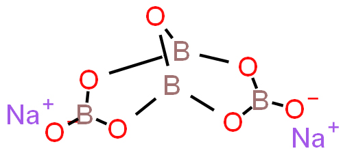

<hr/>

<h2>Попытка получение пероксиборатной кислоты</h2>
```
Смешал 50 мл перекиси, туда насыпал борную кислоту у меня целый 1кг есть сейчас где-то. Налил туда 50 мл 95% ортофосфорной кислоты. У меня появился осадок. Этот осадок я через колбу бунзена профильтровал, шприцом плохо фильтруется (декантация плохо работает), если только сеточкой отделять с раствора и так даже лучше будет. Так вот, взял частично высушенное, направил на зажигалку, оно кипело и заметных изменений пламени я не замечал после. Только в начале и видимо от перекиси, а полученное обуглилось. Скорее всего сажа от зажигалки. Потом рассыпал и пробовал на кристаллы, очень слабо часть пламени становилось зеленой. Больше не было изменений. Буду пробовать ещё вместо кислоты щелочь. Но факт того, что смешав кислоту и борную кислоту с перекисью, само по себе оно не горючее.
"
ICSC 1046 - ПЕРБОРАТ НАТРИЯ

International Labour Organization
https://chemicalsafety.ilo.org › icsc › showcard.display
Не горючее, но способствует возгоранию других веществ. При пожаре выделяет раздражающие
"
```

(p.s серная кислота, так как я предположил, что можно протонировать OH группу, что бы она была уходящей и следовательно замещалась OOH группой, но это в теории, на практике, может получилось BPO5/BPO4 и скорее всего это и был фосфат бора, более чем его пероксид)

<hr/>

Попытка сделать из буры. Взял тетраборат натрия его кристаллогидрат, налил следовые кол-ва ортофосфорной кислоты. Залил 25 мл перекиси и поддержал. Была мутная вода как от коллоида. Прилил следовое кол-во ацетона и коллоид разъединился. Дальше сливал лишнию воду и кашу уже налил на бумагу и с неё сошкрябал.
Жидкая смесь, что при нагреве зажигалкой плавится и огонь подпрыгивает будто, так же следы тетрабората появлялись тк шли брызги. Далее из жидкой формы сплавилась такая форма на зажигалке. Немного горит, но это не похоже на следы ацетона, может остатки перекиси или пероксид бората натрия.

Как вывод: не то и не другое не могло дать реакцию похожее на органические пероксиды, тогда либо у нас аддукт или новое соединение. 

<hr/>
Фото:

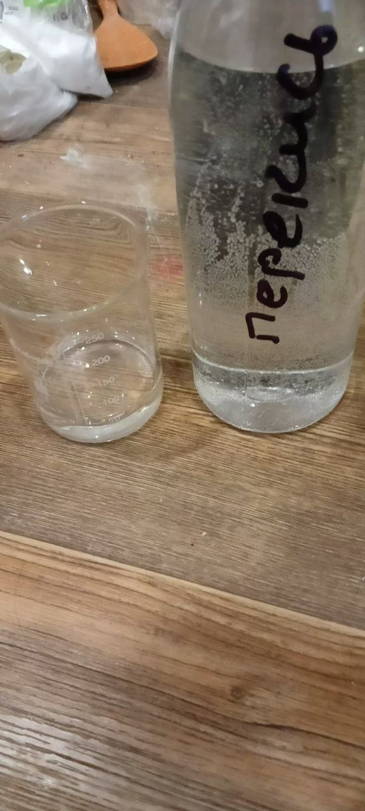
<br/>
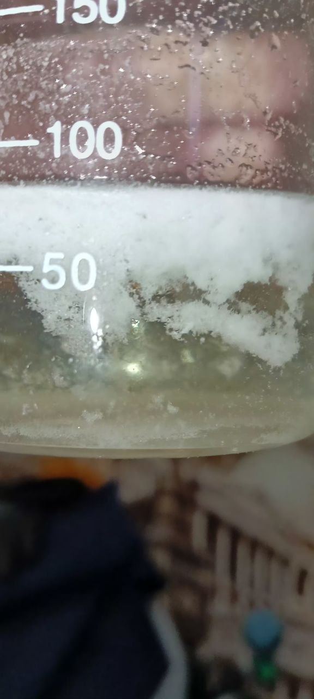
<br/>
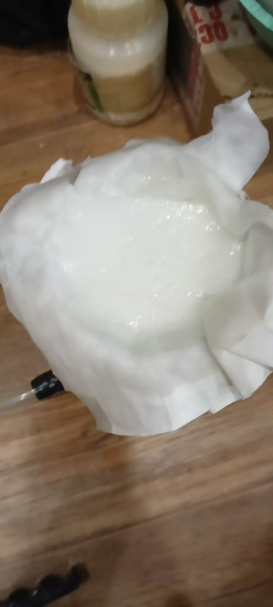
<br/>
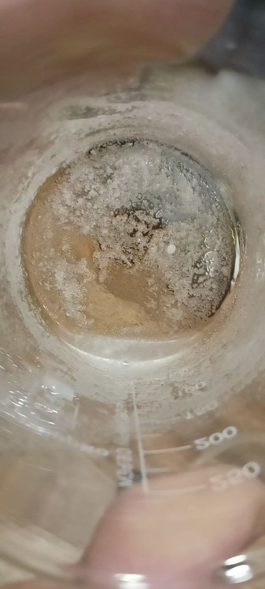
<br/>
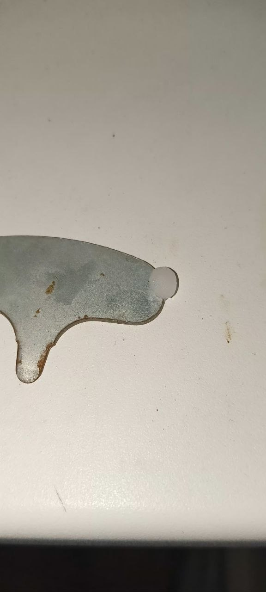
<br/>
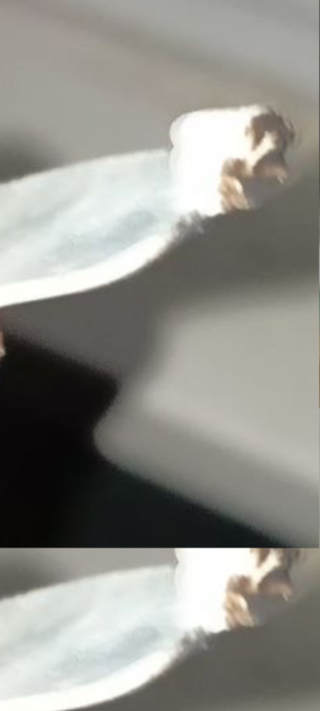
<br/>
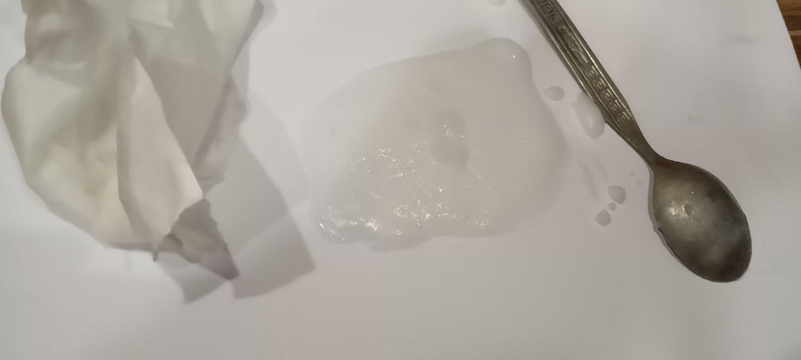
<br/>
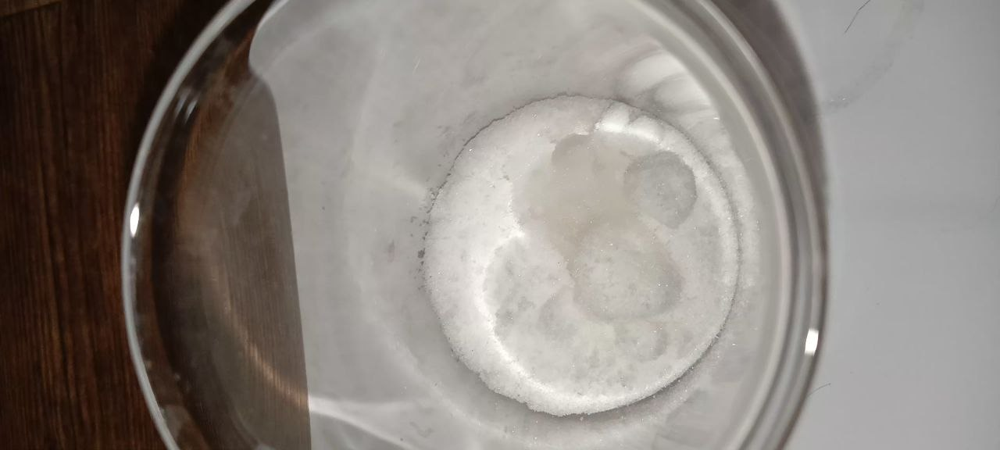
<br/>
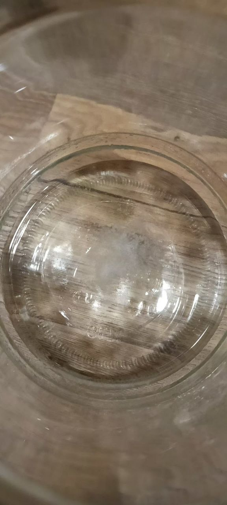
<br/>
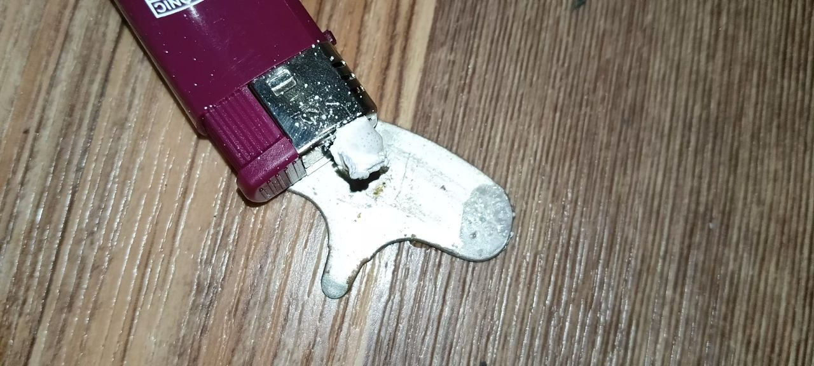
<br/>
<hr/>

TODO: ** ответ(ы) **


<h4>Важные замечания</h4>
Ортфосфорная кислота + Борная кислота = фосфат борной кислоты (точно ли она кислота, а не основание?) [https://ru.wikipedia.org/wiki/%D0%A4%D0%BE%D1%81%D1%84%D0%B0%D1%82_%D0%B1%D0%BE%D1%80%D0%B0]
Неорганические соединения могут и проявляют органические свойства, как пример AgCl (хлорид серебра), у него связь полярно ковалентная, а не ионная, как нас учит школьная химия. Для этого можно проверить по электроотрицательности, 
при определенном кол-ве электроотрицательности будет ковалетная связь.

delta X = |Xa - Xb|
delta X ~ 0-.4 -> Ковалетная неполярная
delta X ~ .4-1.7 -> Полярная ковалетная
delta X > 1.7 -> ионная
Xa (Ag) По Полингу -> 1.93
Xb (Cl) -> 3.16
|3.16 - 1.93| => 1.23 -> ковалетная полярная связь, но школа учит что всегда ионная будет. Как-то так.

Конец статьи.
