# Кристаллогидрат сульфата меди

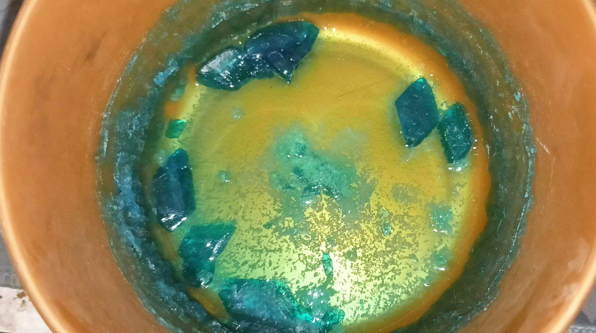
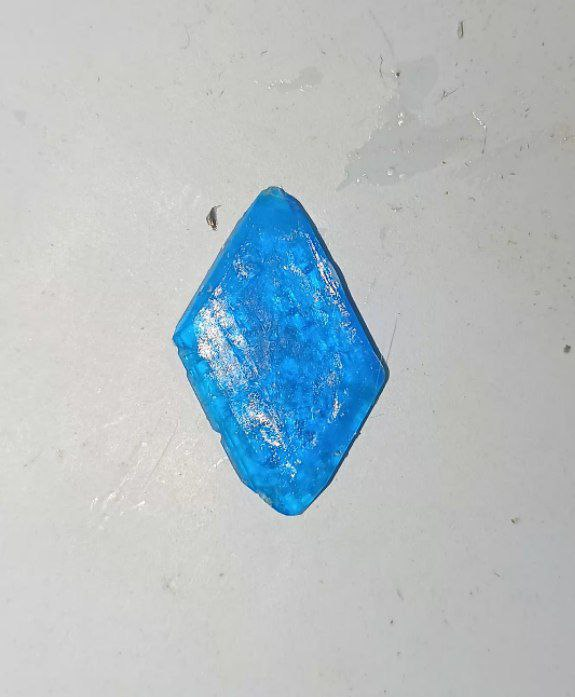

## Частично обезвоженный

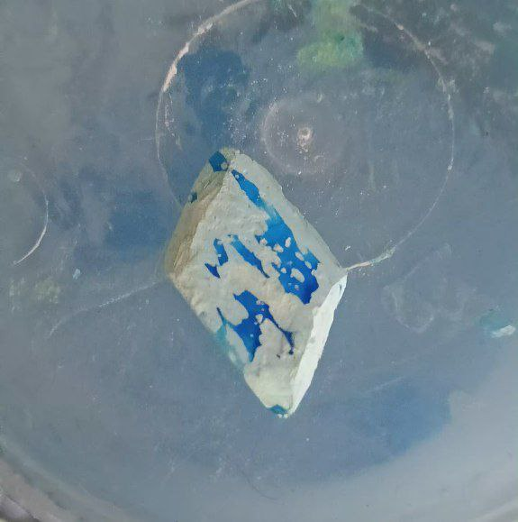

## Через множество дней гидратированный в обычных комнатных условиях (прошло 14 дней)

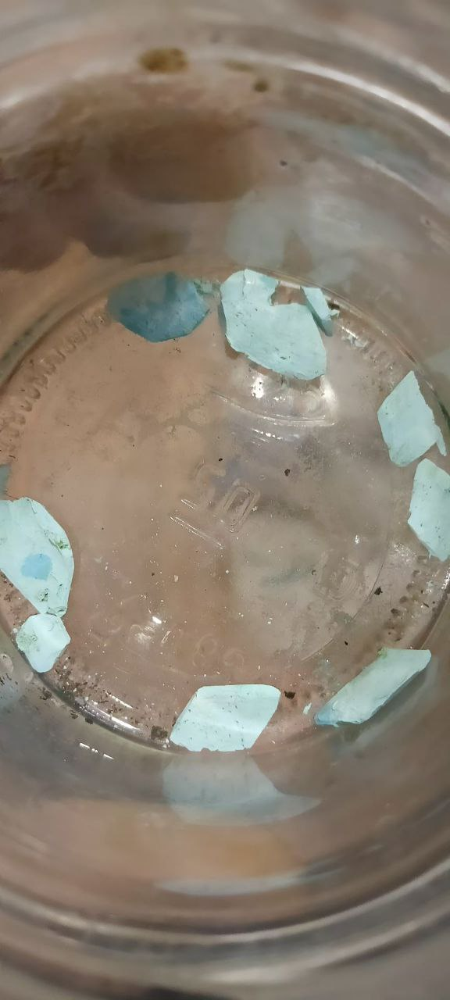

# Кристаллогидрат нитрата меди

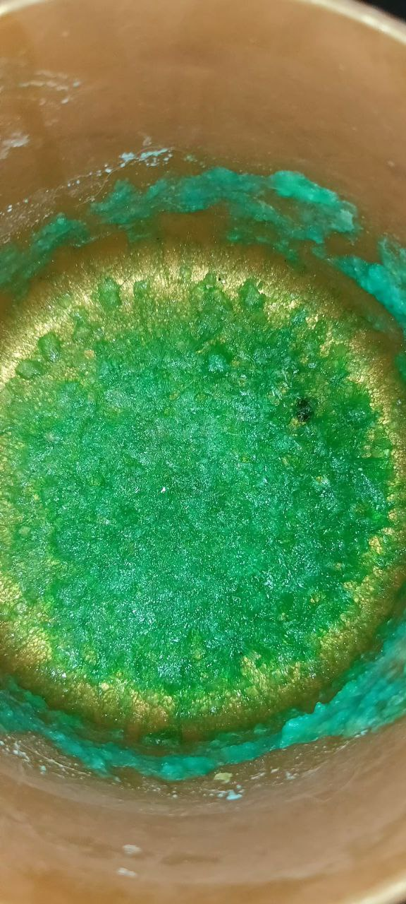

## После микроволновки (снова растворил и профильтровав засунул в микроволновку на кристаллизацию, 1:30 минут)

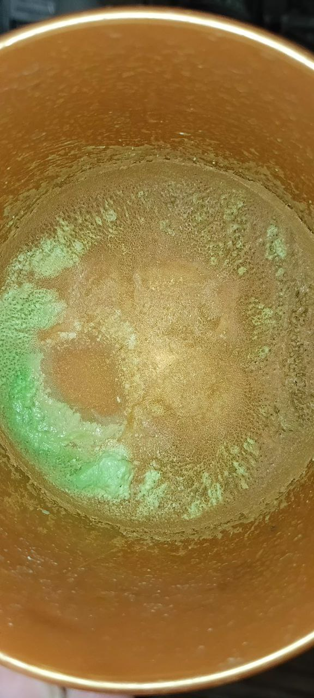
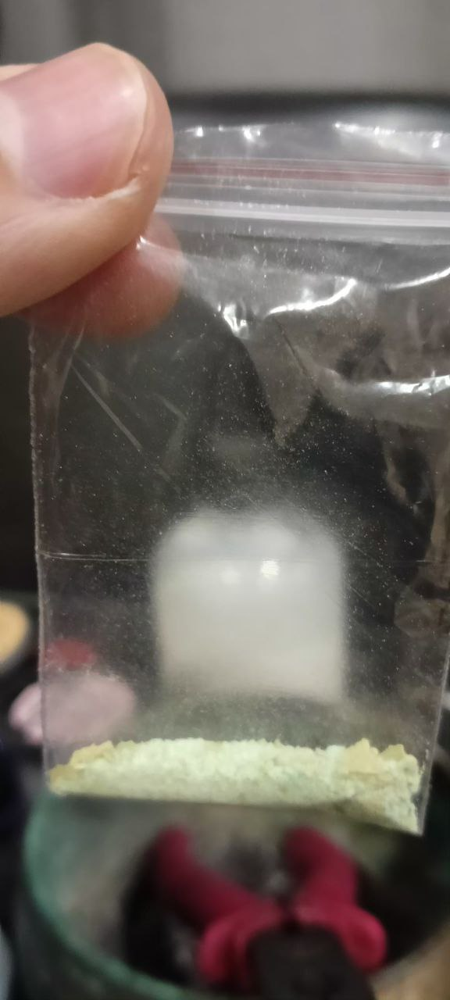

Можно увидеть, что часть побелело, а часть вообще пожелтело. После прибавлении воды сама жидкость стала не зеленой, а синей! Хотя первоночально, раствор был зеленым до микроволновки. А ещё после микроволновки чувствуется кислотный запах. Возможно получилась основная даже соль частично. Потому-что появился остаток, что не растворяется:

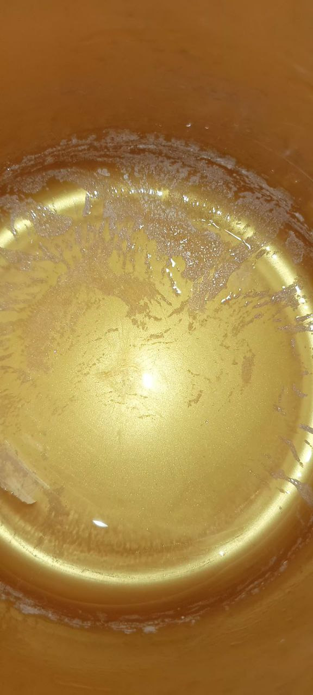

После добавление воды:

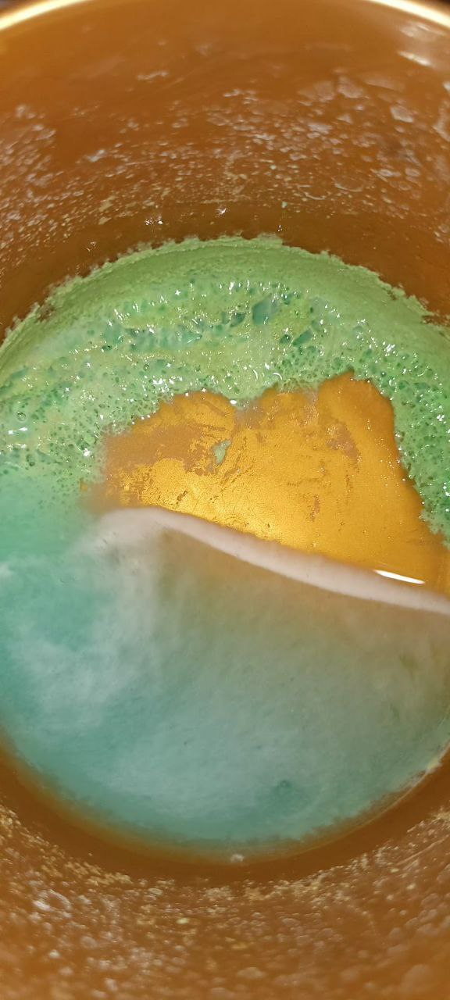
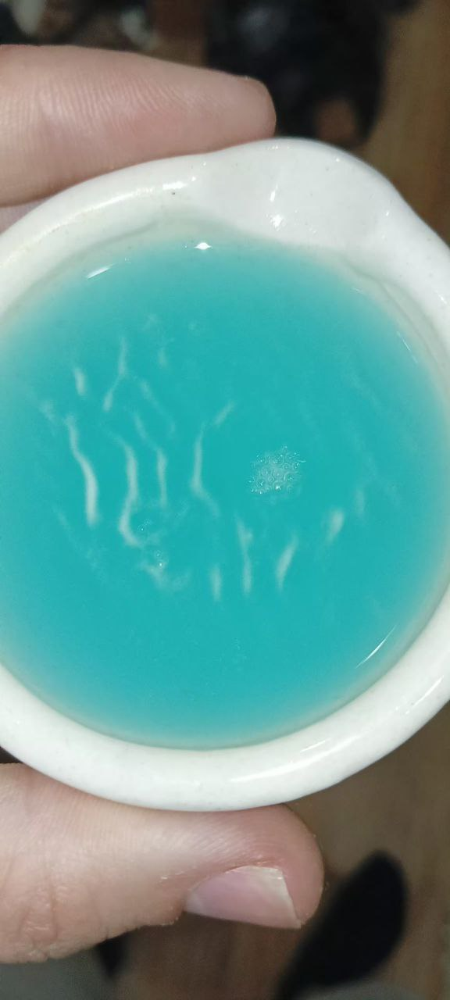

Варианты - нитрат меди, свеже приготовленный, из азотной кислоты. Концетрированный, раствор зеленый. После разрушения кристаллогидрата, видимо другая форма кристаллогидрата, который дает зеленый цвет сложнее получить. Остаток не растворившийся - возможно, продукты взаимодействия с пластиком или примеси или просто раньше не замечал, но это вряд-ли. Кислотный запах, скорее всего окислы азота. Но чем-то напоминало соляную кислоту по жжению, но там не могло быть соляной кислоты. Тогда это окислы азота. Но тогда, куда делся оксид меди. А желтое, возможно примеси какие-то, что были в серебре. Так как нитрат меди получен из 925 пробы серебрянной. Но до того как я сушил в микроволновке всё зеленное было. А сейчас кристаллы кристаллизуются в зеленый цвет. При этом, я долил синий прозрачный раствор в выпаренную часть на автоупарыватиле (батарее) и он стал гуще. Менее голубым-прозрачным, а более темно-ярким насыщеным цветом. Просто улучшил свет. А сильно разбавленные почти что как сульфат меди раствор, синий, только голубой. Чем более насыщенный, тем сильнее меняется цвет. Буду наблюдать. Сами кристаллы кристаллизуются зелёные. 

На батарее так же желтеет, часть зеленная. При этом если её ломать на ступке, снова становится жидкой. Приходилось упарывать в микроволновке по 15 секунд. По итогу получен такой же бледно-зеленный порошок (для больших кристаллов нужно что бы при комнатной температуре кристаллизовывалось и долго)

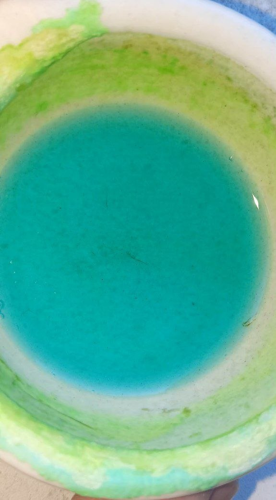
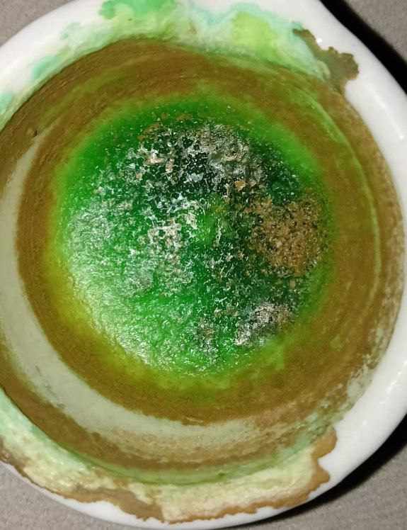
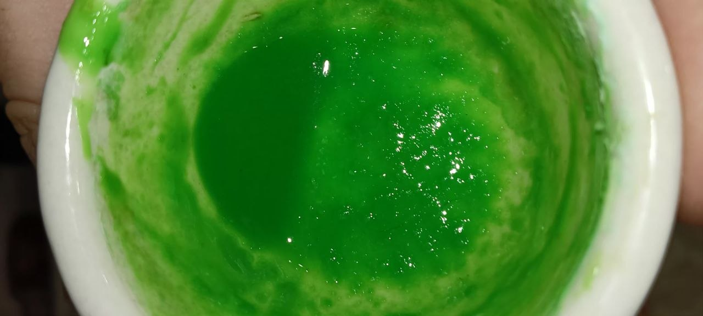

# Ацетат Серебра (по краям)

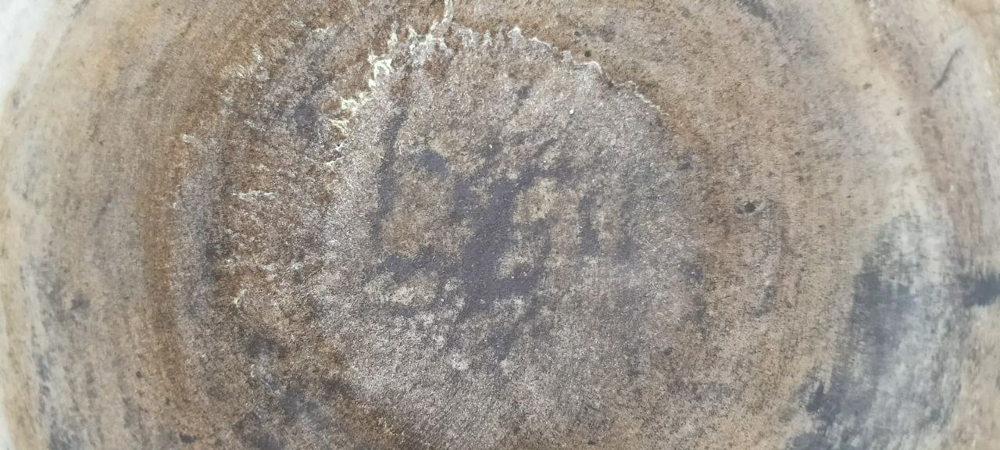

# Радиация от соли калия (радиактивный изотоп)

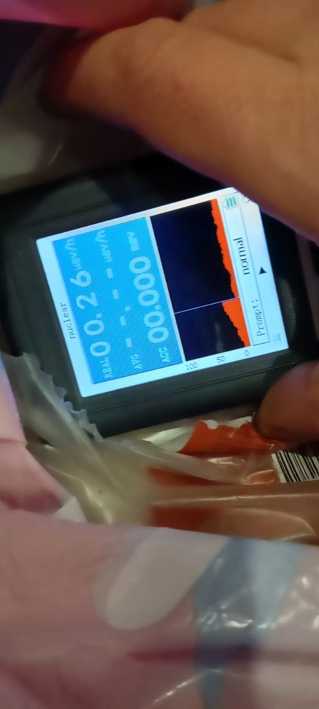

# Железо, восстановленное с окисла

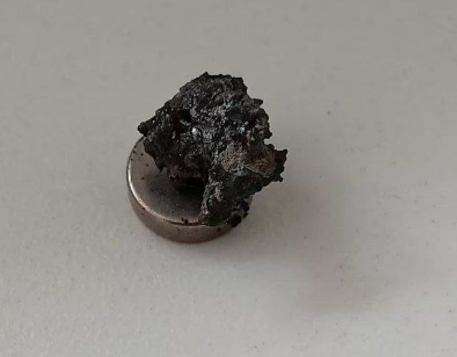
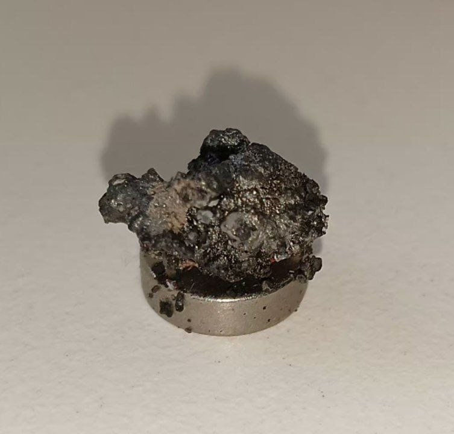

# Сироп лимонной кислоты с примесью цитрата меди (перенасыщение кислотой)

В микроволновке перегрел и у меня получилось разложение, запах был сладковатым, так не понял чего. Сразу обжигает нос и глаза. По разрушительности неизвестно, но кратковременный контакт не из приятных будет в большом кол-ве и лучше что бы в глаза не попадало, но в целом, думаю аммиак опаснее, чем органика. На сколько мне известно, при нагревании лимонной кислоты сухой, происходит её разложение на аконитовую кислоту. Её дальше можно гидролизовать кислотой минеральной и водой в изолимонную. Так, кстати, цикл Кребса идет. CoA:(-)CH2CHOOH
дальше цепляется в щавелевоуксусную кислоту, у неё в ряд 3 оксо группы. Это не предельная кислота у неё появляется сильно положительный заряд напротив углерода где C-OH группа, там плюс. и получается лимонная, добавляется CH2COOH группа. Лимонная кислота схожая по формуле и дальше так как это бета-гидроксикислота, то при нагреве она декарбоксилируется, а дальше при обратной гидратации превращается в изолимонную. В случае аконитовой кислоты, может быть и лимонная, зависит от цис/транс положения.
В википедии пишут, ещё могут быть при какой то сухой перегонке ангидриды, но я думаю такие будут сразу реагировать, а не получаться и тем самым у нас, возможно, окраска поэтому. Я думал ещё из-за меди может, нужно сверять. В органике некоторые реакции, что у учебнике, не предусматривают иногда особых условий, как если кто-то перегреет на столько. Но у нас было много воды в растворе, так что основное, думаю, аконитовая кислота.
По итогу кристаллы согреб, они между собой липнут. Так же были зафиксированный газы при кристаллизации аморфного кристалла. Проверкой железным гвоздем не дало результата на медь значимого. Ну там и так первоночально переизбыток кислоты был. Гвоздь, зато, реагировал с кислотой и шли газы. Скорее всего, тут у нас смесь цитрата/аконитата меди (кислого), аконитовой кислоты, лимоной, немного может непонятно чего. Но нужно больше литературы читать, может аконитовая кислота и должна быть желтой.
Про цикгл гребса, в самом цикле гребса есть минимум 1-2 реакции, которую в пробирке не получить, только ферментами/коферментами. Остальное большинство объясняется обычными свойствами кислот. Там не сильно сложно.

Альфа-гидроксикислоты дают лактиды
Бета-гидроксикислоты дают непредельные RC(=O)C(O)O[H] ; RCH2-HC(OH)-COOH => RCH=CH-COOH
Гамма - лактоны
альфа-оксикислоты разлагаются до альдегидов серной кислотой
бета - декарбоксилируются почти мгновенно
гамма - не помню. Но что-то там делают. 
https://ru.wikipedia.org/wiki/%D0%9E%D0%BA%D1%81%D0%BE%D0%BA%D0%B8%D1%81%D0%BB%D0%BE%D1%82%D1%8B 
Судя по википедии, гамма никак не влияет особо.
(ИИ можете не спрашивать перепроверить, он бредит. Проверенно на ChatGPT. Он даже не понимает что там оксо написано, а не гидрокси... И считает что дальше гамма как-то влияют группы... никак... А ещё считает, что там декарбоксилируется это до непредельный. То есть у него удаления COOH группы, это зафиксируем сейчас, непредельное ДЕКАРБОКсилирование...). Лучше учебник тут открыть и перепроверить, так как минимум по гаммаоксикислоте я мог ошибиться.
Про кофермент CoA:Ацетил. Скажу лишь, что так и должно быть, только по строению щавелевоуксной.

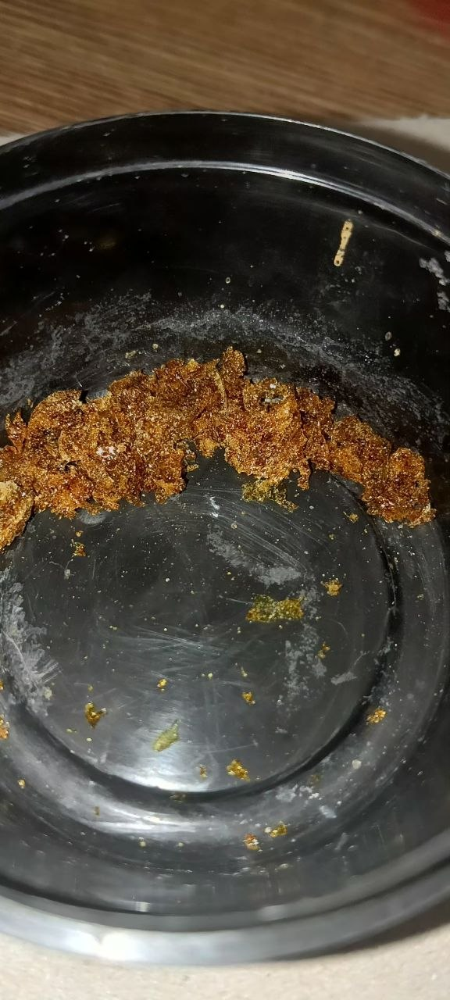
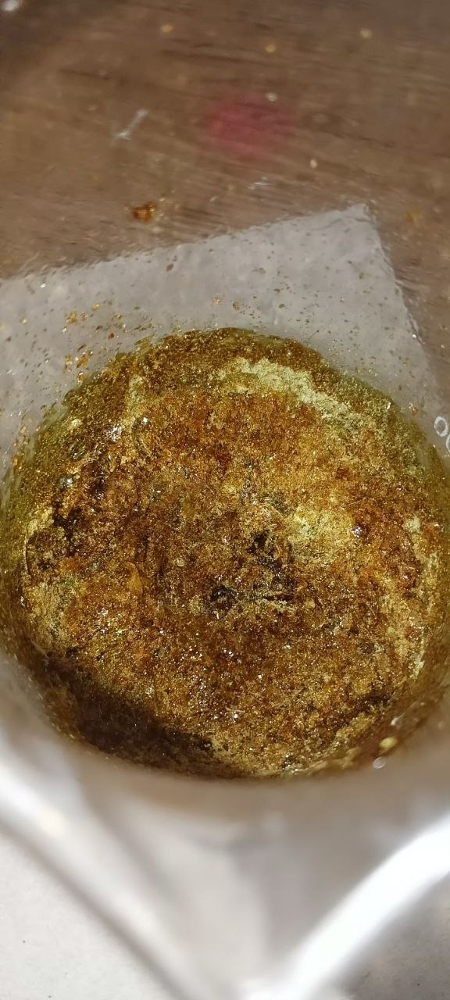
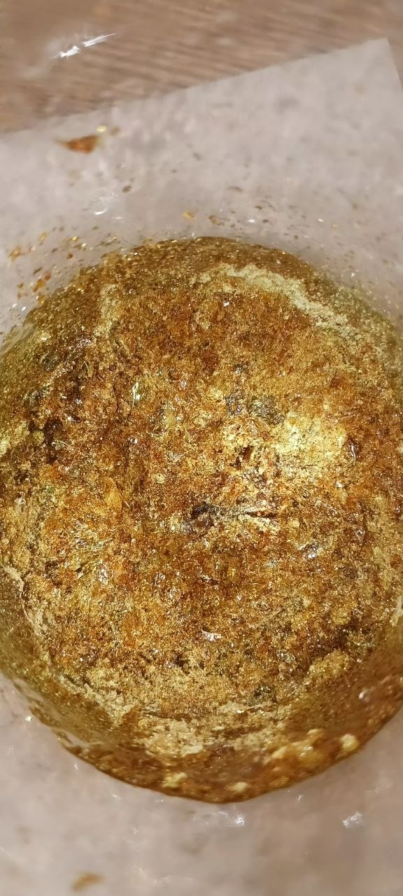
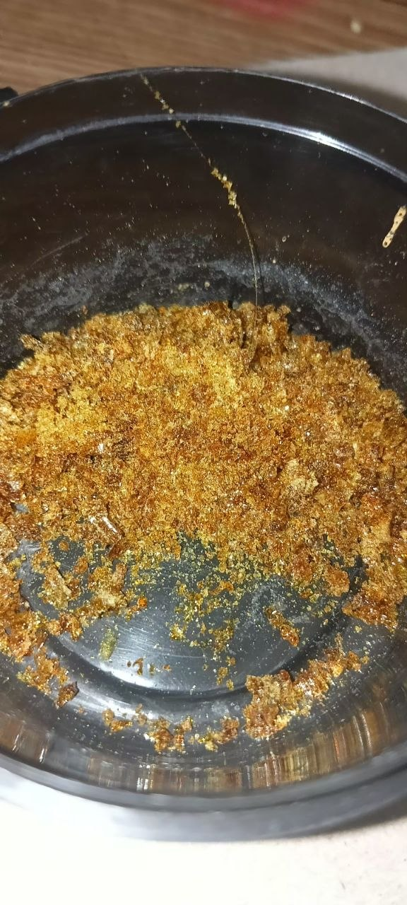
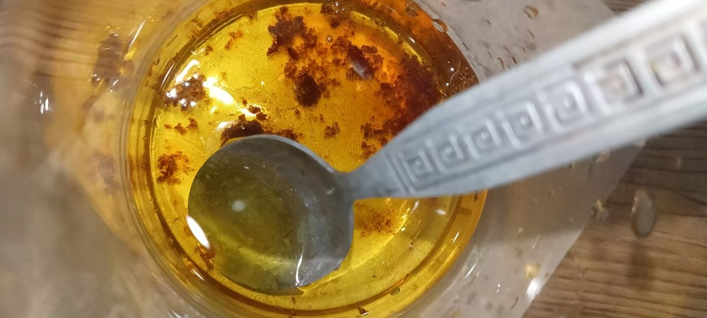
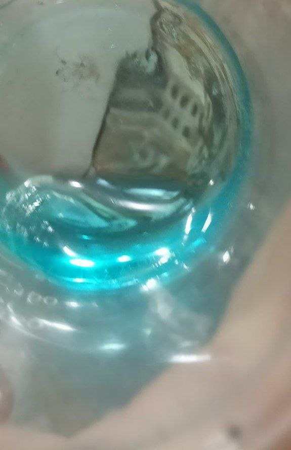
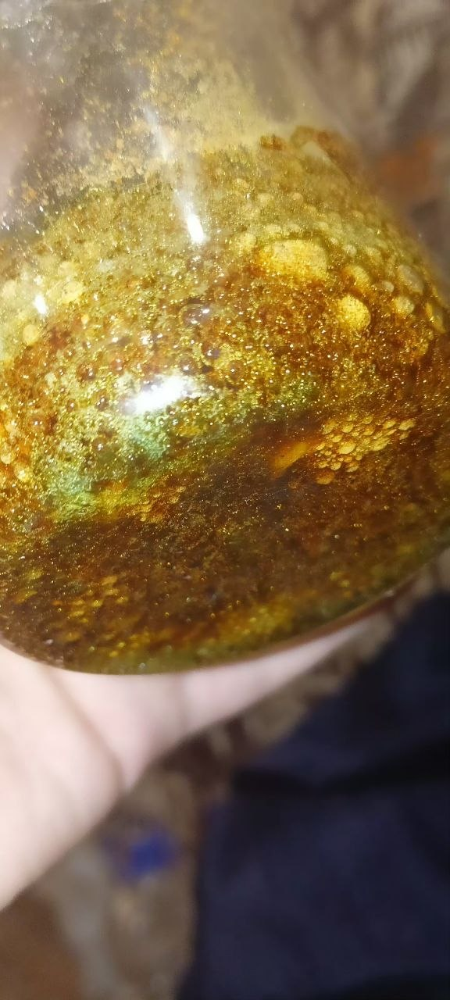
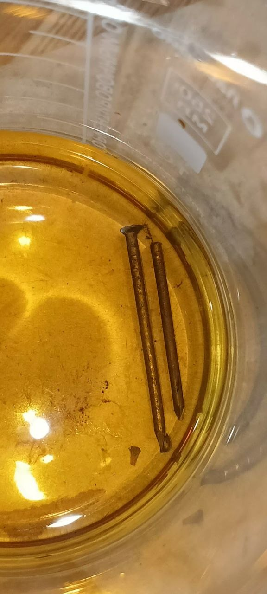
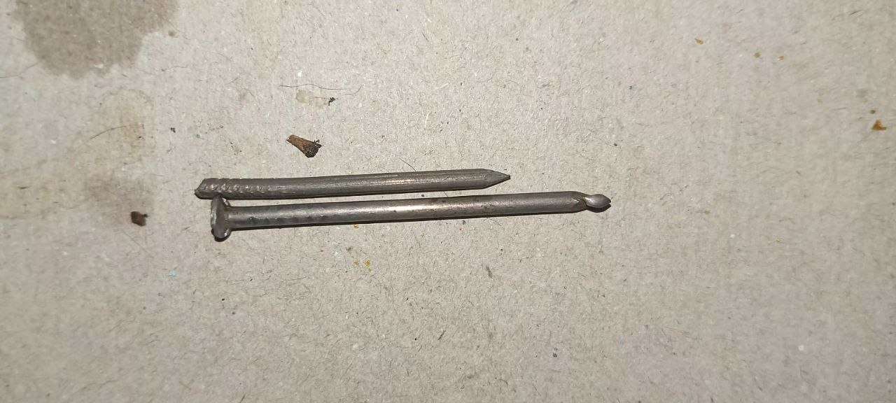

