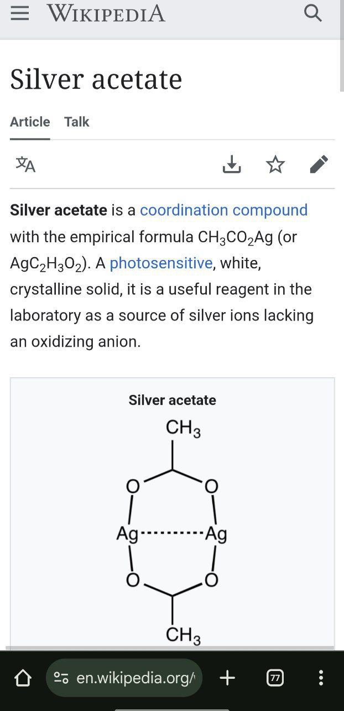
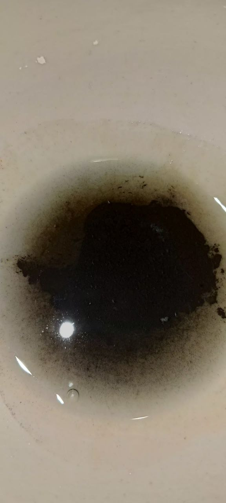
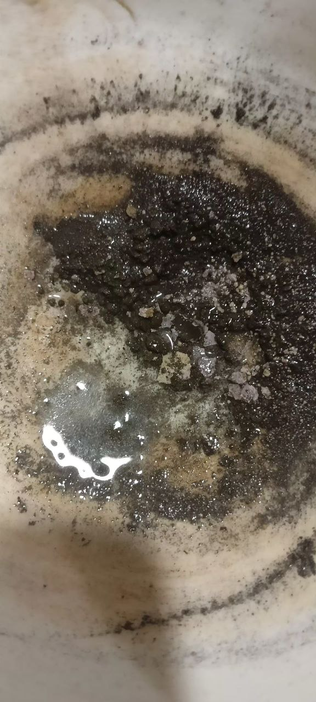
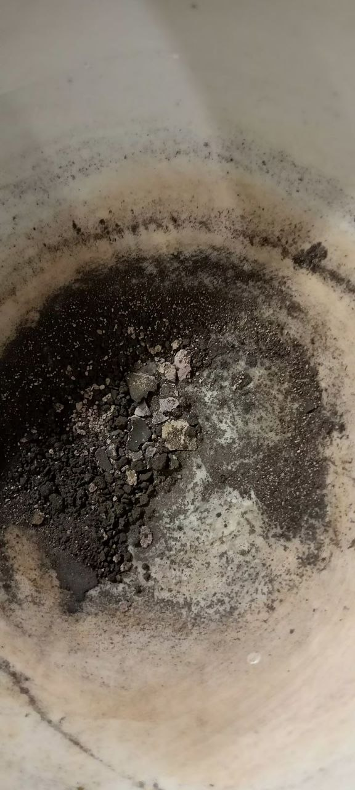
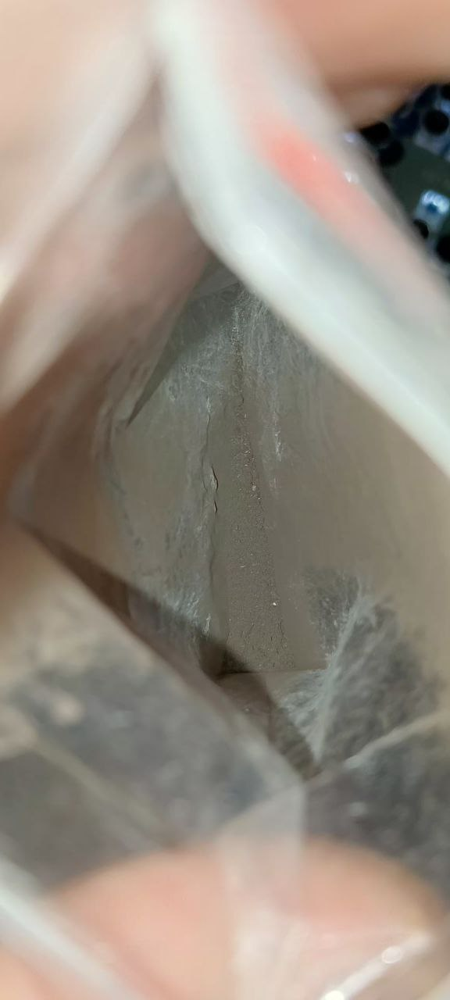

Wearing safety goggles, I poured caustic soda into a measuring beaker, covering the bottom. I added cold water. An exothermic (heat-releasing) dissolution of sodium hydroxide began. Stirring, I dissolved the remainder; at first the solution was pale, then it became clear. I poured the freshly prepared solution into silver chloride that had already been ground in a porcelain mortar.

The solution instantly turned black. I poured off the remainder through toilet paper trying to catch the oxide that had mixed with the water, but for some reason it passed through the 2-layer paper filter. The porcelain mortar also chipped slightly.

Most likely, a nucleophilic attack occurred: AgCl + OH⁻ → **HO–Ag–Cl** (a hypothetical intermediate, which may exist for a very short time, because we have a SOLID SUBSTANCE, not a solution reacting with a solution; if considered as a covalent rather than ionic compound, the notation HO–Ag–Cl is reasonable) → AgOH + Cl⁻ → 2AgOH → Ag₂O + H₂O (alternatively, hydrogen may detach from AgOH forming HCl, which would immediately react with NaOH, but more likely hydrogen detaches and immediately reacts with a neighboring –OH group. But how would that happen in a solid silver hydroxide? This also explains why silver hydroxide is sometimes prepared in alcoholic solution. So at temperatures above −50 °C and in water, oxide formation proceeds more easily. If you look at Wikipedia, you can see that this precipitate (hydroxide) decomposes specifically in aqueous solutions. And conversely, NaCl does not convert it back to silver chloride simply because in oxide form it is not soluble in water.) (If you look at the structure of dry silver acetate, such an assumption seems plausible.)

By electronegativity for Ag and Cl: Cl = 3.16, Ag = 1.93; 3.16 − 1.93 ≈ 1.23, which is less than 1.7, so the bond has COVALENT character. And the formation of HO–Ag–Cl as an intermediate during nucleophilic attack, by analogy with SN2 in organic chemistry, is real and possible. (But all of this is hypothetical.)

2AgCl + 2NaOH = Ag₂O + 2NaCl + H₂O

Check: 2 silver on the left, 2 on the right; 2 chlorine on the left, 2 on the right; 2 sodium on the left, 2 on the right; 2 hydrogen on the left, 2 on the right; 3 oxygen on the left, 3 on the right.

Freshly prepared silver oxide in caustic soda:

I poured off the sodium hydroxide solution, added water, and decanted it (removed the water with a syringe and needle), using more water than the original solution volume.

Left to evaporate on a radiator.

Ground in a mortar and put what could be collected into a bag.

I dissolved the remainder in 70% acetic acid diluted with water and left it to evaporate on the radiator.

**Silver compounds can be toxic and carcinogenic, and inhaling dust or contact with some salts can irritate the skin. Contact of aqueous alkali solution with eyes can irreversibly damage them, up to complete loss of vision.**

The obtained silver oxide can be mixed with borax and melted to obtain nearly pure silver, or acids can be added to obtain silver salts. For example, this way you can obtain pure silver nitrate without copper impurities (which would be present with 925 sterling silver). (Nitric acid causes burns and its vapors are toxic, as are decomposition oxides, but they will not be produced much in this reaction. Even when evaporating small amounts of nitric acid I practically did not observe them, but when heated and exposed to light it decomposes. Therefore a fume hood is needed.)