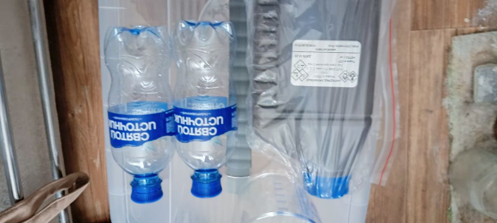
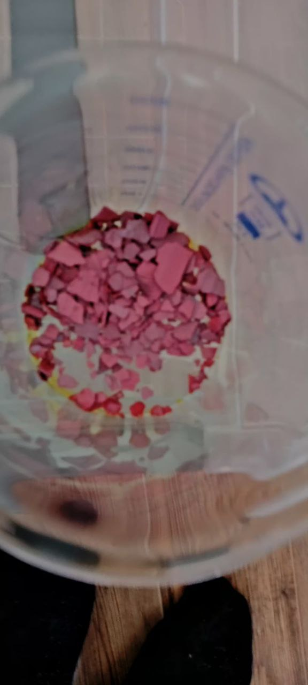
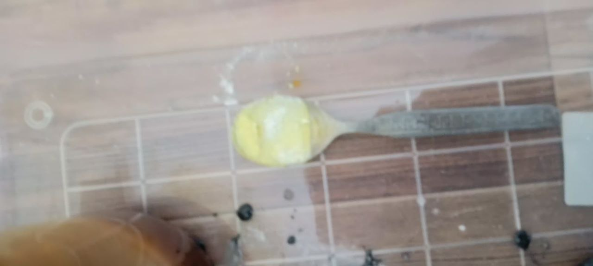
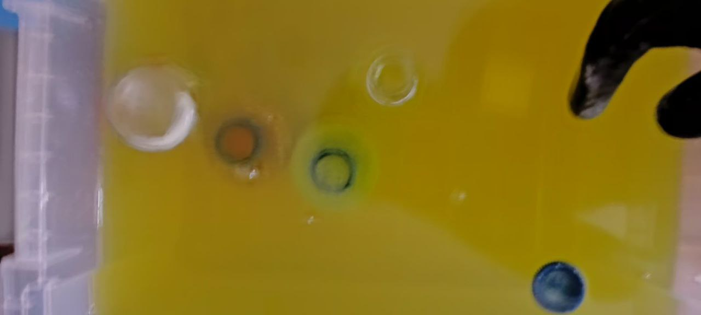
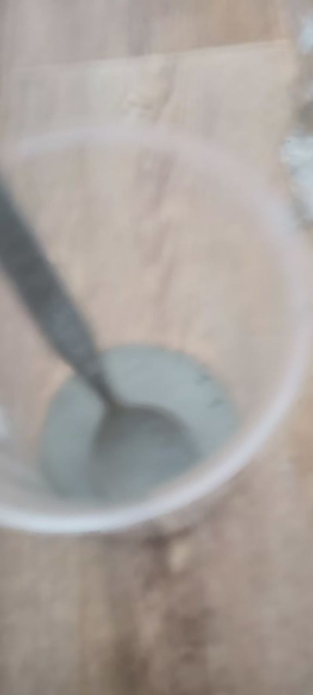
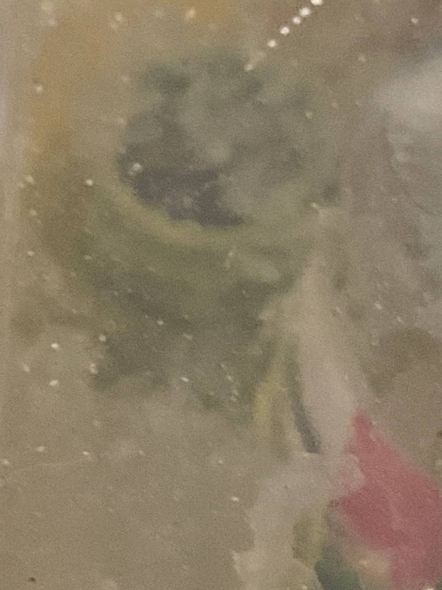
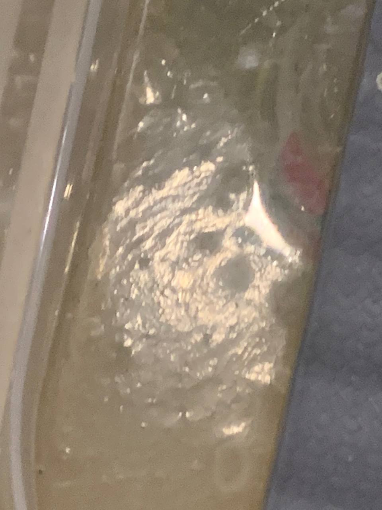
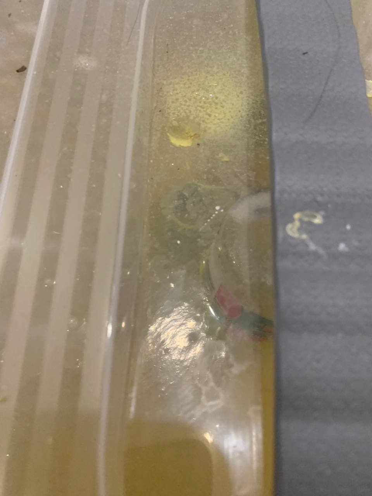
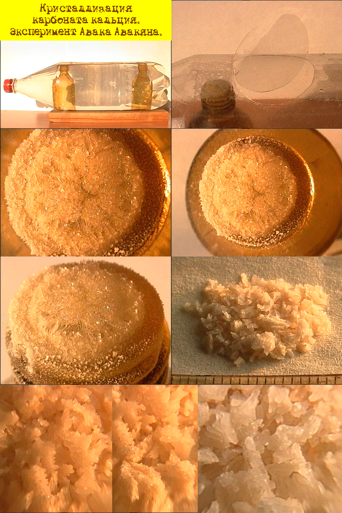

Most of the time I felt like I had dropped out of my blog, but the people I live with worry a lot and are scared of my activities around the house, so I decided to do organic chemistry out at the dacha instead.<br/>
Meanwhile, at this time I happened to have some chromium(VI) oxide, the anhydride, which turns into H2CrO4 in water. A very toxic thing — milligrams are enough to kick the bucket, so you need to be careful with it. Though actually, it seems it isn't dangerous as long as you don't stick it in your mouth.<br/>
I've been busy with other activities, including chemistry-related ones, but they're beyond the scope of this blog. I also studied the more theoretical part. I got as far as conformations and kinetic rate, racemization and the like. Soon I'll finish the book completely and start reading the next ones, consolidating the knowledge I've gained along the way. I do the exercises from the textbook and run them through AI; it corrects and explains, and sometimes I have to explain to it that it's the one making a mistake. It's mutual learning, basically. I'm doing the work people should actually be paid for<br/>
Usually all my notes in the notebook turn out well, but sometimes there are not entirely correct judgments or mistakes. And now for the chromate...
A message from Avak Avakyan on this subject: I asked his advice on what can be done with chromate, besides oxidizing substances in organic chemistry, and I was planning to try making malonic acid with it.
<style>
@keyframes VeryCoolText {
    0% {text-shadow: 0px 0px aliceblue;}
    50% {text-shadow: 8px 8px aliceblue;}
    100% {text-shadow: 0px 0px aliceblue;}
}
img {
    max-width: 60vw;
}
code {
  word-break: break-all;
  overflow: scroll;
  max-height: 100px;
  animation-name: VeryCoolText;
  animation-duration: 13s;
  white-space: pre-wrap;
}
</style>
"""
```
CrO3 is the best of them. It is the most active of the chromium oxides, and the one from which other chromium compounds are easiest to obtain. As an oxidizer it's fantastic. It dissolves in water, and its aqueous solution is chromic acid. From this solution you can get an endless variety of chromates, many of which are valuable minerals, beautiful crystals (most of them colored). The ones that are insoluble or sparingly soluble in water — you can grow their crystals just like all such precious stones: take two open bottles with aqueous solutions that react to form the chromate you need (for example, Na2CrO4 in one bottle and ZnSO4 in the other); set these bottles on the bottom of a small aquarium (or a similar container) and SLOWLY, WITHOUT stirring things up (DO NOT mix!), pour water into the aquarium to slightly above the bottles. Close the aquarium with a lid so the water doesn't evaporate. Over weeks and months, the slow diffusion of the solutions will lead to the appearance and growth of gorgeous crystals! THAT'S how you grow crystals of water-insoluble minerals from water. One reagent in one bottle, the other reagent in the other. The IDEA is that if you mix the solutions that react to form an insoluble precipitate FAST, the precipitate comes out AMORPHOUS, because it doesn't have time to crystallize. But if you mix these same solutions SLOWLY (over weeks, months), the precipitate that forms comes out as growing CRYSTALS. I crystallized calcite that way, for example. Most often one of the solutions diffuses faster, and crystals start growing in the neck of one of the bottles.

...

 2). The bottles (for crystallization) should be placed upright (opening upward). No solid particles; the two bottles contain SOLUTIONS, the bottles are OPEN (no lids). I've attached a picture (in the attachment), take a look. For example, one bottle contains an aqueous solution of calcium nitrate; the other, an aqueous solution of soda ash; the aquarium has water. In this example, calcite crystals will grow. The soda solution diffuses faster, so the crystals will grow at the top of the neck of the bottle with the nitrate solution. The reality is that most solutions diffuse very slowly, and if you fill the bottles to the brim and then SLOWLY AND GENTLY, WITHOUT STIRRING THINGS UP, pour clean water into the aquarium, the diffusion of the solutions will proceed slowly, over weeks. The narrowness of the necks and the distance between the bottles can make the process downright glacial; in some cases you can even put open glasses quite close to each other.
```
"""
<p>(c) Avak Avakyan Avakovich</p>

<div class='pair'>
    <p>The most important thing (still missing baking soda):</p>
    
</div>
<br/>
<div class='pair'>
    <p>The anhydride itself:</p>
    
</div>
<br/>
<div class='pair'>
    <p>Chromate:</p>
    
</div>
<br/>
<div class='pair'>
    <p>Finished solution:</p>
    
</div>
<br/>
<div class='pair'>
    <p>Zinc:</p>
    
</div>
<br/>
<p>Preparing sodium chromate:</p>
<video width="640" height="360" controls>
  <source src="{{ '/experimets/KristalChromate/ChromicAcidToNaChromate.mp4' | relative_url }}" type="video/mp4">
  Your browser does not support video.
</video>
<br/>
<p>Preparing zinc sulfate (by the way, a really suffocating gas is given off — not necessarily just hydrogen. Maybe the SO4 group is being reduced)</p>
<p>But there's no smell of hydrogen sulfide or sulfur dioxide (I know their smells):</p>
<video width="640" height="360" controls>
  <source src="{{ '/experimets/KristalChromate/zincandsulfaricacid.mp4' | relative_url }}" type="video/mp4">
  Your browser does not support video.
</video>
<br/>
<p>Concentrated zinc sulfate (a lot of zinc didn't react, after dilution)</p>
<p>(the reaction went on, apparently there wasn't enough water for H3O+:</p>
<video width="640" height="360" controls>
  <source src="{{ '/experimets/KristalChromate/Zn(SO4)_Conc.mp4' | relative_url }}" type="video/mp4">
  Your browser does not support video.
</video>

```
Hello!
YOU DON'T need to open the aquarium; crystallization is NOT caused by evaporation! The solution does NOT need to evaporate. Let it sit closed; crystals will grow over time. The crystals are the result of slow mixing of solutions (slow diffusion). If you mix them quickly — an amorphous yellow powder of zinc chromate will precipitate; but if you do it like this, slowly, then instead of an amorphous powder the precipitate "comes out" as growing yellow crystals. If all the solution in the aquarium is yellowish (from the chromate), the crystals will grow somewhere in the neck of the bottle with zinc sulfate. By the way, I watched your video about zinc sulfate. Yours is just too dirty; it should be colorless crystals, and what you have looks earthy. I would dissolve it in water, filter it and evaporate it (to purify it). I made it from zinc and battery electrolyte; I've attached a picture (in the attachment, take a look); it should be colorless crystals like these (in my photo it's a little wet from the leftover electrolyte). As for the caustic burning gas when zinc dissolves in the electrolyte — first, there may be an aerosol of sulfuric acid ("smoke" made of microdroplets of electrolyte; tiny splashes from bursting bubbles); second, technical electrolyte always contains an impurity of hydrochloric acid, and its "caustic fumes" (hydrogen chloride) are a real thing.
In dreams and in the Astral a DOG is the goddess of death; IN THE BATHTUB is her favorite place in our apartments, after all she is an elemental of WATER. That's why in the BATHTUB is where you'll most often meet her.
Fixing HDDs is a needed and useful thing!
By the way, there's such a nuisance: when CD/DVD drives go bad, it happens that they spoil the discs: the information really ISN'T erased, but the disc is marked as RAW, and after that any CD/DVD device reads it as a blank disc with RAW format. Have you ever run into this problem? I've been told that such a supposedly "RAW" disc CAN be read; the information on it isn't wiped at all; you just have to "fix" the "header", supposedly. Are there programs that can do this?

> Today bubbles appeared, and the liquid looks as if it has a sort of glassy layer. I cracked the lid open a little, letting the excess water evaporate. I'll open it once a day. The reason it's yellow is that one bottle spilled and it's a very dilute sodium chromate. Bubbles are coming from the bottle and right on the surface of the solution. I should have done this on the balcony, but as it is it'll take a long time to evaporate, so then let crystallization go slowly — that way it crystallizes much better
P.S.
You cite an important fact: "When I touched objects (a stone), the picture became brighter and less blurry. I clung to objects/houses as if with claws. ... The less I touched anything, the more often everything got foggy and I had to leave the body again." YES, that's right, and it can be used as a "technique": — RUB YOUR PALMS AGAINST OBJECTS in the Astral so you don't "drop out" of the place we are in. THIS is what a certain witch advises on www.livemaster.ru ; alas, right now I can't find that publication. Another thing: in the Astral you need to BLOW on your own eyes, using your hands for this, cupped like a "boat" so as to direct your exhaled air onto your eyes. This too increases the brightness of perception in the Astral and prolongs our stay in the place where we are.

> The astral projection happened today. I slept, and began to feel as if something was pulling me out of my body. I talked with someone, asked for help getting out. They pulled and pulled me out, and in the end I could move my foot and I started rocking it, and at one point
> I noticed that it was as if I could move instantly through space by the power of thought, and I moved over to the TV, and then beyond the room entirely. I saw cars, buses, houses. When I touched objects (a stone), the picture became brighter and less blurry. I clung to objects/houses as if with claws. In the end I flew right into one completely random house and saw strangers' kitchens, ended up in some house. An apartment; there were people there who didn't notice me by the bed
> and next to them, lying on a dresser or something of the sort, was some child, and he said, wow, I've found myself a friend. That is, he noticed me. I went into the next room and talked with someone there. In answer to my question of who they were, they said they were ghosts. They also advised me to try caligula, recommended that drink, and said something about the patriots of Ukraine. The less I touched anything, the more often everything got foggy and I had to leave the body again. I flew there again, but instead of that house there was some empty sort of thing, and I thought, what would happen if I flew into space and talked to aliens. I flew upward and even saw the atmosphere, and it all ended with everything becoming very bright (apparently from the sun); in the end I couldn't get any farther than the planet. I was jerked sharply back into my body, and with my eyes closed I saw my room the way I see it physically, except the curtains were a little different and everything seemed doubled. Then I woke up and fell asleep again. Again I tried to take off/fall in a dream — in an actual dream this time, not after sleep paralysis. I even jumped off a balcony in a dream and fell, didn't smash to pieces, but ended up somewhere, and then got thrown back into dreams. (falling/taking off helped for a while)
> In dreams there was a dog; it drank water and licked up blood, and we were in the bathroom together. Then there was some hospital, then I wandered around incomprehensible swamps and was told that a rocket could be made with magnets. For it to fly 400 meters, find them in the forest; and there was something about a monitor/PC too.
```
<p>Avak Avakyan</p>

<p>A few days later</p>

images/chromate/
<div class='pair'>
    <p>Finished solution:</p>
    
</div>
<br/>
<div class='pair'>
    <p>Finished solution:</p>
    
</div>
<br/>
<div class='pair'>
    <p>Finished solution:</p>
    
</div>
<br/>

```
I took a look — horror!!!! 😊

In the attachment — see how it's done (you may publish this picture wherever you like). I decided to "get fancy" and used a two-liter plastic bottle lying on its side as the "aquarium". With two strips of narrow tape I tied it to a board that became the stand (see: those strips of tape are barely visible under the left and right bottles). The neck of this bottle is screwed on tight. On top (that is, in the side of this bottle) I cut a "hatch" with manicure scissors, like a submarine's (see the upper-right frame). Through this "hatch" I inserted into the bottle little jars filled to the brim with solutions: the left jar has an aqueous solution of Kalceks; the right jar has an aqueous solution of washing soda. Carefully I put these jars in the right places. And then CAREFULLY (WITHOUT STIRRING THINGS UP!!!) I poured water through the "hatch" into the common bottle so that the jars ended up UNDER water (not deeply). After that I closed the "hatch" and "walled it up" (sealed it) with a strip of wide tape. Taking Kalceks (as the calcium salt) was a mistake: the urotropine in it gave flakes of its own decomposition products. The distance between the jars turned out to be too great: the reaction was downright slow. Over time (more than a month) the neck of the left jar (the one with Kalceks) became completely overgrown with CALCITE crystals (the reaction product). The crystals came out small (see the millimeter scale of the ruler in the second frame from the bottom on the right), and their growth stopped because the overgrown neck cut off contact between the solutions.

Yours — horror!!!! 😊 WHY such HUGE dimensions: a giant aquarium… It's simply a shame to waste that many reagents! In the aquarium there's a jar upside down (why?) and a blue cup whose top is ABOVE the water in the aquarium (it should be UNDER the water — otherwise WHY is it there at all?). There is an abundant ragged crust on the surface, which says that you did NOT try to "not stir things up" when you were pouring it all in (to put it mildly). 😊 In my experiment (see above), no crusts or precipitates formed in the common container, BECAUSE I filled that container with water extremely smoothly, WITHOUT STIRRING IT UP, after which the whole contraption lay in perfect stillness.
-
I just filled it when I realized it was in the way and needed to be moved. The upside-down vinegar bottle was leftover sodium chromate, and when I was pouring [water in] it tipped over because it decided to rise above the water, and the blue cap stayed there because I forgot to take it out. There isn't much reagent in there, but lots of water 
And the cap is getting a yellowish coating, which means something is forming. Probably if the volume were smaller it would be faster and better, and take up less space too. But the information about an aquarium was taken to mean a large container, so I decided not to skimp 
A failed path is useful too. It's like the story with mercury fulminate: they went another way and discovered isomerism. Or take homebrewing — you can discover stereochemistry that way too. And it's useful so that others don't repeat the mistakes. So it's fine, though pouring it down the drain now wouldn't be very good, and it's hard to do as well. So let it stand as long as it isn't in the way. As for bottles, I don't know where to get ones like these, but I'll think of something too. Thanks for the photo.
```
<p>from our correspondence</p>

<div class='pair'>
    <p>Avak Avakyan's crystallizer (brilliant):</p>
    
</div>
<br/>

<hr/>

<p> UDP 06 07 2026. Crystals have appeared. (crystallization started around March 20)</p>
<video width="640" height="360" controls>
  <source src="{{ '/videos/Chromate060726.mp4' | relative_url }}" type="video/mp4">
  Your browser does not support video.
</video>


```
Hello. Something was forming anyway. If you add alkali, the chromium will precipitate as hydroxide, right? So that the water can be poured off calmly, without fear of poisoning yourself or polluting the environment
...
Comfrey, by the way, gives a dry-mouth effect. .... It helped me do visualization and still reminds me a bit of ... 2 leaves like these, crushed
...
They write that you need sulfur or some other reducing agent. And alkali doesn't act on hexavalent chromium as such. Maybe time is needed. Oxidation states are virtual values, aren't they? It's about valence and the actual chemistry. As I understand it, without heating the reaction goes poorly, and without alkali too
...
overall the concentration there is low, heavily diluted. If you leave it to evaporate on its own, it will evaporate after a while 
```

Answer:
```
And good health to you too!

I saw the video about the chromate. Possibly on the neck of the open bottle standing there (on the left) — it looks as if crystals have grown there, but the quality of the video doesn't allow a definite conclusion.

As for alkali — alkali will precipitate chromium from salts where chromium is 2+ or 3+, that is, where chromium is NOT part of an ACID RADICAL (for example, if we're talking about CrSO4 or Cr2(SO4)3). But when it comes to chromates — there chromium is in the form of the CrO4 (2−) anion. Alkalis with this anion give water-soluble chromates (you'll get a yellow solution), for example K2CrO4. Alkali can precipitate, for example, magnesium hydroxide from an aqueous solution of magnesium chromate:
2KOH + MgCrO4 = Mg(OH)2↓ + K2CrO4.
Once again: the chromium in chromates is in the acid radical, which is similar to the sulfate radical; after all, you can't precipitate sulfur from sulfates "as a hydroxide", because the hydroxide of hexavalent sulfur is sulfuric acid. Chromic acid is similar to it.

PRECIPITATING hexavalent chromium is easy in the form of insoluble and sparingly soluble chromates of low-activity metals; copper, for example. The solubility of CuCrO4 in water is 0.034 g/100 ml.

REDUCING hexavalent chromium — you can try aluminum foil in an ACIDIC medium (without a strong acid, the foil may become passivated due to the formation of aluminum chromate); hydrochloric acid is best (or electrolyte + NaCl), because with sulfuric acid the foil reacts rather "reluctantly". Iron filings or nails in sulfuric or hydrochloric acid can also reduce the chromate ion (it's an analogous reaction), as can zinc. In strong acids such as sulfuric and hydrochloric, the end result may be a solution of chromium salts, with chromium going all the way down to 2+ — that is, in sulfuric acid the result will be a solution of CrSO4. Salts of divalent chromium are very "useful around the house": they are the strongest reducing agents (in aqueous solution they decompose water very slowly, releasing hydrogen!). This will be a SOLUTION, not a precipitate. To obtain a precipitate, you'll need to make the final solution alkaline enough for Cr(OH)2 hydroxide to precipitate (which will tend to oxidize to hydroxides of trivalent chromium, also insoluble in water).

About COMFREY — now THIS is VERY interesting!!!! It's FANTASTIC that you've taken up experiments. The FIRST trials should always be done with MICROdoses; with iris you should start with a 5×5 mm square; with aconite, even less. If a dose doesn't work, doing another test with a bigger dose the next day is no problem; but if the first dose was a lethal one — then there won't be a next day. 😊
```


# UDP

https://wipedlifepotato.github.io/images/chromate/osashdenije/files.html
Here you can see how, when copper is added in the form of copper sulfate crystal hydrate, the crystals turn green, and then a little smoke and these precipitates appear
I also poured in a mixture of copper oxides and carbonate (the bulk of it) and copper citrate — that gave a decent green as well
For a test I also added iron sulfate; it did nothing
In the end, crystals formed on the bottle that could be gathered up in clumps; without water they're pretty and they glow, but I got them dirty with water and they were ruined.
With the water from the bottle, you can see what is presumably chromium hydroxide — so it really did change its oxidation state without any redox reaction as such. Which means this happens over time, or else
some of the impurities took part in a redox reaction. But it seems to me that compounds like this should decompose on their own, like permanganic acid, for example. And redox reactions and oxidation states are "stretched over the globe". Ni(CO)4 = oxidation state zero

```
Hello!

Thanks for the warm words!

The video from
www.youtube.com/watch?v=AgnCqZNBDYA
I watched. 😄 You dump dry copper sulfate (blue vitriol) into a solution of water-soluble chromates; but if the point was to find out whether there would be any reaction at all, you should have poured in an aqueous SOLUTION of copper sulfate, not sprinkled dry powder. 🙂 What may have happened here is "passivation": when solid particles (of copper sulfate) form an insoluble compound with the solution (copper chromate), that insoluble compound coats the particles of copper sulfate with a film, and then the reaction doesn't go any further: a water-insoluble film forms on the surface of the sulfate particles, and that's the end of it. The green precipitates you have are copper chromate, not chromium oxides or hydroxides.

I looked at all 9 PHOTOS of the bottle from the chromate solution. I see nothing crystalline; it looks either like an amorphous product, or so microcrystalline that even an X-ray diffractometer would hardly recognize such a product (practically speaking, it is AMORPHOUS). Once again: when we FAST mix two solutions whose reaction yields an insoluble precipitate, that precipitate comes out IMMEDIATELY and turns out either AMORPHOUS or super MICROcrystalline. That's just what happened in your case. To grow crystals, the solutions need to mix over WEEKS (or even months); then the precipitate comes out SLOWLY, and it has enough time to CRYSTALLIZE: instead of an amorphous precipitate, CRYSTALS grow. Slow diffusion of solutions (two glasses on the bottom of an aquarium) is a fine way to grow crystals.

Propolis is a motley mixture of organic substances, mostly resin-like. Why do you need it? 🤔

➡️ But I have some interesting information: your experiment with COMMON COMFREY interested me a LOT, and — I crawled all over a number of local hills, didn't find it, asked the director of the local "Institute of Forestry" on "VKontakte"; she pointed out where it grew; I drove there, found it and brought it back. Long story short. This is a VERY interesting plant!! First, the effect sets in SEVEN HOURS after rubbing it in (as an ointment, when it's ground up with vegetable oil). Second, after the first two successful experiments, when I brought the dose up to 4 cm² of dried leaves, the body's compensatory reaction kicked in: the "sleepy–poisoned" state gave way to a super "energized" one; this happens when the body responds to an attempt to put it to sleep with a RELEASE OF ADRENALINE. But when this happens, it's no disaster: our supply of adrenaline isn't infinite, and if you take a dose of poison greater than the body can compensate for with adrenaline — the poison wins. It's like getting used to vodka: a small shot can be compensated for with an antidote, but the body doesn't have enough antidote for a whole bottle: alcoholics booze it up every day all their lives, and yet full tolerance is never achieved: a large dose still gives them the "white fever". 😀 6 cm² of dried leaves turned out to be a dose just a bit beyond what the body can handle. I'll still find the ideal dose. The EFFECT, I'd say, is very much like intoxication from STREP THROAT. The mouth isn't exactly "dry", it's more like when you have a fever. I'll say this: STREP THROAT has always been, for me, the most powerful means of entering the Astral!! If COMFREY turns out to be a toxin similar in action to the toxins of strep throat, that will be a super fantastic find!!! Under comfrey I had times when it was hard to wake up from a dream; there was also something like Castaneda's "stopping of the world". I'm continuing the experiments and — I ADVISE YOU TO GO AND GATHER IT AND DRY IT for yourself; it looks promising. I'll repeat: the effect sets in 7 hours after rubbing the ointment into the wrists; your metabolism is a bit faster, so perhaps the effect will kick in at 6:30 or 6 hours. As for the DOSE — I grind it perfectly (so that there are no visually noticeable solid particles at all); if you grind it carelessly, you'll need a much larger dose (because a lot of the product will just be useless big chunks of leaf on your hand). If you grind it completely, most likely the dose will be around 7 cm² of dried leaves.

➡️ While it isn't winter yet: I recommend finding "MEDICINAL BLACKROOT". It's the closest relative of comfrey, with almost exactly the same chemical composition. In 2023 I photographed it on one of the local mountains; back then all I had was a lousy mobile phone and the photo quality was crummy, but you can make it out (see): it's a fairly tall herbaceous bush, very much like henbane in type, with small flowers of a dark permanganate-purple color.
-
The reaction still went on despite the passivation; first and foremost the crystals reacted with water, since water is the solvent and it did transfer part of it into solution. It would have been hard for the copper solution to get into this bottle, but in theory it could have. Maybe, but by then there was already a pool of green and orange hues. In other words, it got badly stained and there's almost no chromate left. Here, I even pulled the bottle out of the solution to show it. They even gave off glints for me, and when I spilled water onto a piece of paper, everything turned to mush; I thought about trying to dry it in the microwave, but in the end I threw it out. Hmm, how do you check whether it's a crystal
Just mixing it with water turned it into something that may be a colloid, I'm not sure, but there really was a glint of light, though not on every piece. That is, some were just separate clumps like these / mixtures of powder. And then I dropped water on it and everything fell apart
...
answer:
As for the crystals and the water — besides the precipitate, you also had a solution with a hell of a lot of WATER-SOLUBLE chromates dissolved in it. When you pulled the bottle out of that solution, shiny little crystals of those SOLUBLE chromates could have formed on it as it dried (the moisture evaporated, and what had been dissolved crystallized). If you then washed this with water — those SOLUBLE chromates dissolved again and were washed away. And your insoluble precipitate looks absolutely AMORPHOUS (under magnification it's all the more obvious).

As for the pigweed — yes, this really does seem to be "redroot pigweed" ("spiked amaranth").

And real HOPS (a vine with characteristic "cones") I most definitely do NOT recommend — I tried drinking a decoction of its cones, and it's the strongest "Viagra" of all the plants I've ever come across (as you know, I'm NOT a fan of that subject; so — I do NOT recommend it). Hops are advertised as a sedative, a sleep aid, and people even warn that they "suppress" and ruin your ability to reproduce; but in reality it's the other way round.

P.S. If you taste and smoke everything in sight, you can run into a powerful poison and end up in the morgue. For example, black locust ("false acacia") contains protein toxins (toxalbumins) like the ricin of the castor bean, here, click:
http://www.cnshb.ru/AKDiL/0045/base/k0260060.shtm
You can end up in the morgue from this just as easily. And if not in the morgue, you can do a splendid job of damaging your body. A whole bunch of plants thin the blood, and there are also plants that bring on myriads of hemorrhages throughout the body. Like numerous strokes in every organ. My point is: first identify VERY RELIABLY what plant you've picked and read about its effects on the body; and only then experiment.
... (more about plants later; there will be a separate post, possibly.)
```

# UDP
That said, this method — pouring a real multi-liter pool and sticking the bottles into it — does work, in a way, but it isn't very effective: you get dirty amorphous crystals, especially if things get stirred up. The bottle method is cleaner and more effective, and causes fewer problems when it comes to getting rid of the leftovers afterwards.
