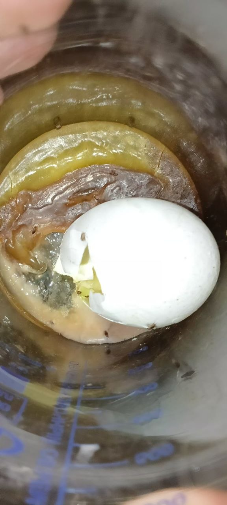
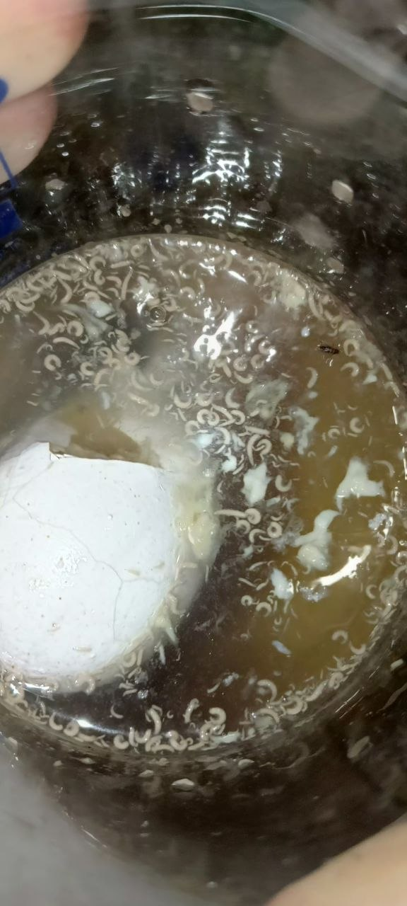

# Point

I bought eggs. I wanted to extract the protein from them and at the same time check the myth about hydrogen sulfide. I think I had already extracted protein before, but I wanted to make a buffer solution and precipitate it again.

I left a broken egg in a glass. 5 days passed and a VERY unpleasant smell appeared. At first I thought it was coming from somewhere on me, but then I realized it was in the room. I remembered the egg.

Experiment notes:
```
[26.08.2026 16:14] A: [ Photo ]
[26.08.2026 16:14] A: It doesn't smell like hydrogen sulfide. It smells like damn amino acids.
[26.08.2026 16:15] A: [ Photo ]
[26.08.2026 16:15] A: After adding an electrolyte (sulfuric acid) it stopped smelling so strongly. This is protein.
[26.08.2026 16:16] A: Myth busted. And also they sold me an egg with worms.
[26.08.2026 16:17] A: The smell is almost gone. It smells like something unfamiliar, but it's not hydrogen sulfide. Maybe some other products. I'll leave it for a few more hours.
[26.08.2026 16:17] A: By the way, these worms don't care about the acid.
[26.08.2026 16:17] A: They're swimming in it. So let's leave it for about 3 hours.
[26.08.2026 16:18] A: is it normal that they sell eggs with worms right away?
[26.08.2026 16:19] A: yeah
[26.08.2026 16:19] A: no hydrogen sulfide
[26.08.2026 16:19] B in reply to A:
> Myth busted
about hydrogen sulfide?
[26.08.2026 16:19] B in reply to A:
> ‎⁨is it normal that they sell eggs with worms right away?⁩
no, that's fucked up
[26.08.2026 16:19] A: I'll send a separate request to the manufacturer about the eggs
[26.08.2026 16:19] A: I just didn't see the worms
[26.08.2026 16:19] B: you should have taken a photo and sent it to the manufacturer
[26.08.2026 16:19] A: I've even eaten a lot of these eggs
[26.08.2026 16:19] A: I hope they died in my stomach
[26.08.2026 16:20] B: not all of them may be infected
[26.08.2026 16:20] B: eggs in one tray can come from different hens
[26.08.2026 16:20] A: but they're supposed to treat them with peroxide
[26.08.2026 16:20] A: and check hens for worms
[26.08.2026 16:21] A: well, they probably won't live long in my body, but in a hen apparently yes
[26.08.2026 16:21] A: what amuses me more is that they don't care about 40%+ sulfuric acid
[26.08.2026 16:21] A: I don't remember how much it was exactly
[26.08.2026 16:21] A: need to check the density
[26.08.2026 16:22] A: but I took the strongest one you can find on the market
```
# PS:
The larvae could have appeared over 5 days, via insects, but who knows.
# end ps

Photos/Videos:
<div class='pair'>
    
</div>
<br/>
<div class='pair'>
    
</div>
<br/>

====
```
I read about the egg. 🙂 Of course sulfuric acid will remove the basic part of the smell, BECAUSE the smell of a rotten egg is NOT hydrogen sulfide but AMINES — the same ones that arise when meat spoils (you CORRECTLY identified the smell). Amines vary: when herring spoils, different amines arise than from, say, pork. Sulfuric acid forms sulfates with such amines and thus "binds" them "permanently." Alkalis intensify the smell because they do not react with amines but displace amines from salts (some amines end up bound as salts of various acids in the rot, and alkalis decompose these salts, forming the corresponding alkali metal salt and a free amine, which "stinks").

Advise grandmother to take ASPARKAM. And also: is she taking beta-blockers? If so, WHICH ones? My mother also has problems with both heart and kidneys. And the best beta-blocker turns out to be LOCREN. There is a domestic analogue called "betaxolol", but this "betaxolol" does NOT work (tested by experience; perhaps it is just a bogus product like gypsum or chalk).
```