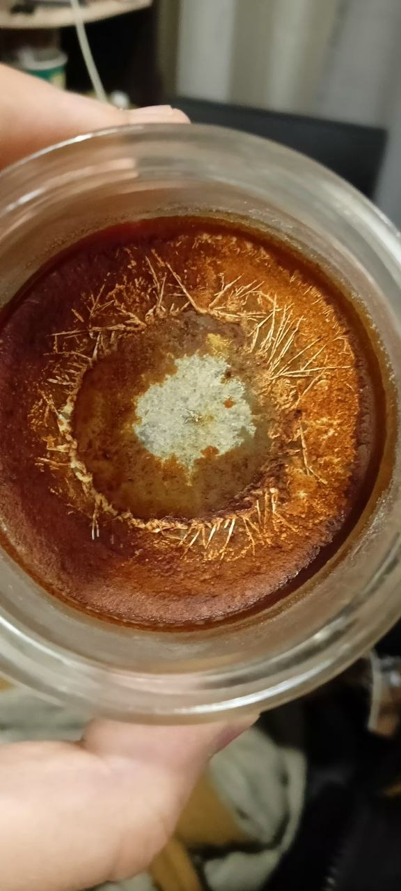
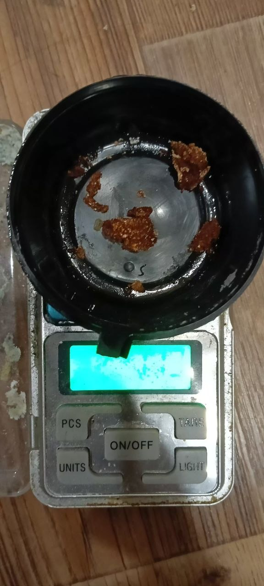
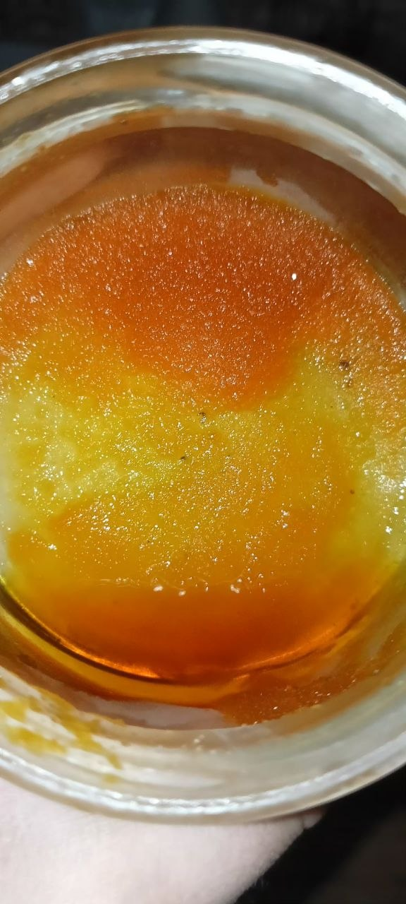

```
WARNING / DISCLAIMER:
This publication is for informational, educational, and theoretical purposes only.
```

## Extraction

To extract capsaicinoids I did the following:
* Took 30 grams of red pepper and poured hydrochloric acid over it.
* Filtered it — it passes very poorly even through a Büchner funnel, but it does pass. A red liquid remained.
* Added sodium carbonate to the red liquid until the pH was about 10 (greenish).
* Added ethyl acetate, heated it and stirred gently by hand. Did not heat to boiling.
* Separated the layer and put it in the freezer.
* In the freezer there was a solvate; after leaving it for 2 days I obtained a layer that could be scraped off.

In the end there were white crystals and red ones. On a fingernail it was sometimes very sweet, sometimes burning. The red part burned 100% for sure, more than the white crystals. The burning came on quickly and went away quickly.

<div class='pair'>
    <p>White layer in the center, very pungent:</p>
    
</div>
<br/>
<div class='pair'>
    <p>Resulting mixed substance:</p>
    
</div>
<br/>
<div class='pair'>
    <p>Solvate:</p>
    
</div>
<br/>

## p.s.
(
Chemical properties — Organic chemistry
XuMuK.ru
https://xumuk.ru › organika
With strong acids, amides do give salts, for example [CH3CONH3]Cl, which are easily decomposed by water. On the other hand, the hydrogen of the NH2 group in amides is more easily removed than in...
)
The rest is similar to caffeine. If you look at its pKa, then unlike phenol it is a weak acid.