<div class='pair'>
    <p>Start of the reaction with Fehling's solution (Seignette salt + copper sulfate + added alkali) (honey at the bottom)</p>
    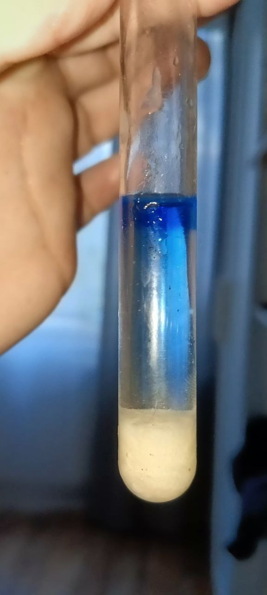
</div>

<div class='pair'>
    <p>Intermediate stage</p>
    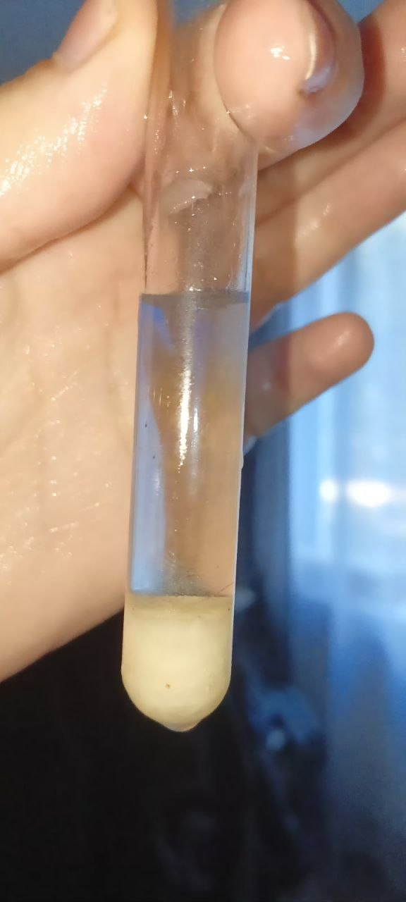
</div>

<div class='pair'>
    <p>Almost final result; in the end there will be a clear solution with a brick-red precipitate (Cu₂O)</p>
    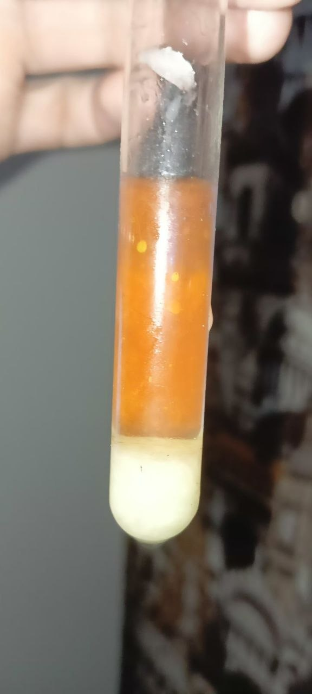
</div>

## Additional

---

## Processes with copper(II) hydroxide, Cu(OH)₂

<div class='pair'>
    <p>Fresh Cu(OH)₂</p>
    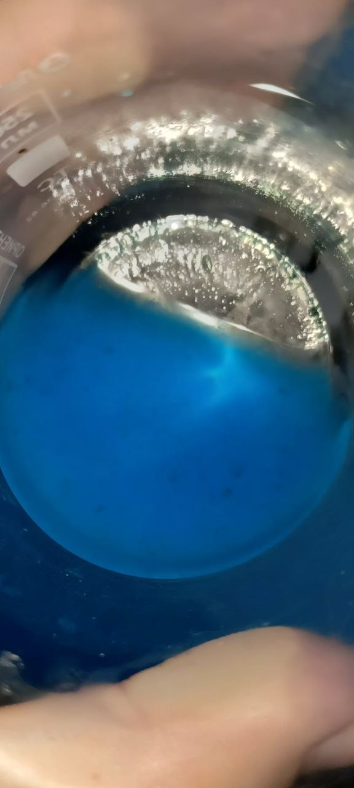
</div>

<div class='pair'>
    <p>After several hours (changes in structure/precipitate)</p>
    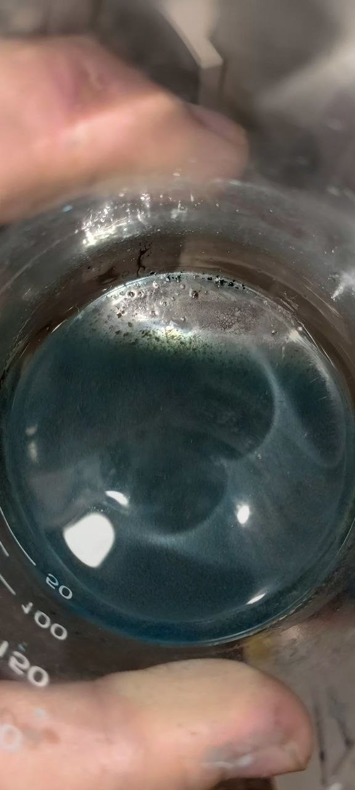
</div>

<div class='pair'>
    <p>In a syringe after several hours</p>
    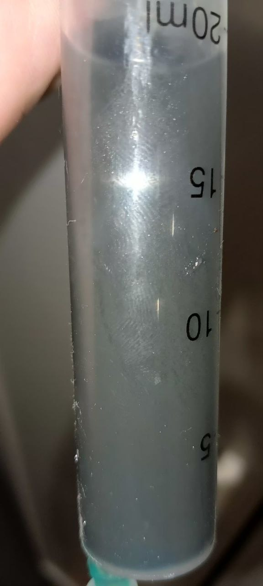
</div>

<div class='pair'>
    <p>Auto-evaporation — process started, the solution turns blue</p>
    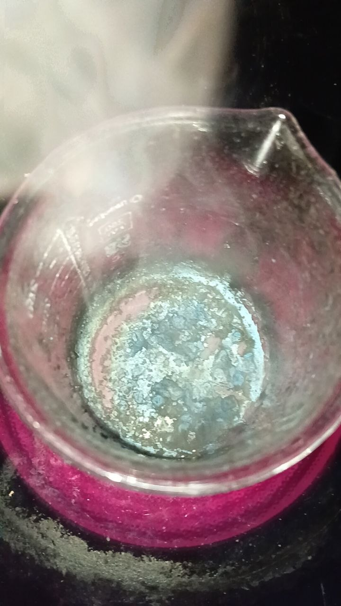
</div>

<div class='pair'>
    <p>Auto-evaporated — starting to heat up</p>
    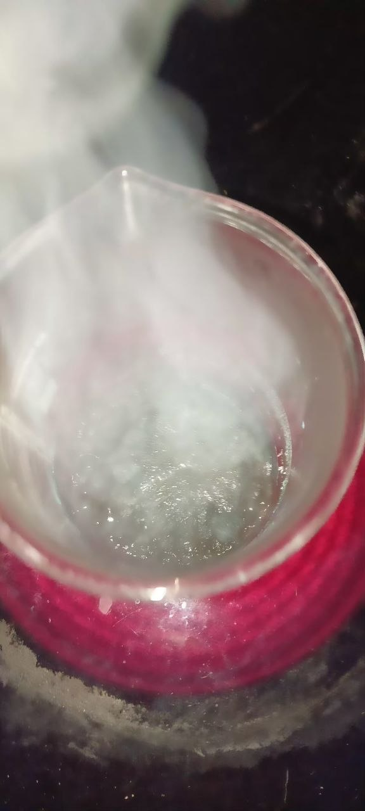
</div>

<div class='pair'>
    <p>Auto-evaporated — starting to heat up: a precipitate fell out instead of the blue color</p>
    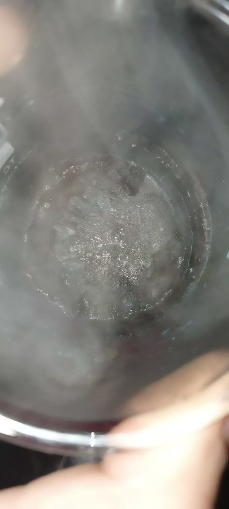
</div>

<div class='pair'>
    <p>Intermediate result of the experiments</p>
    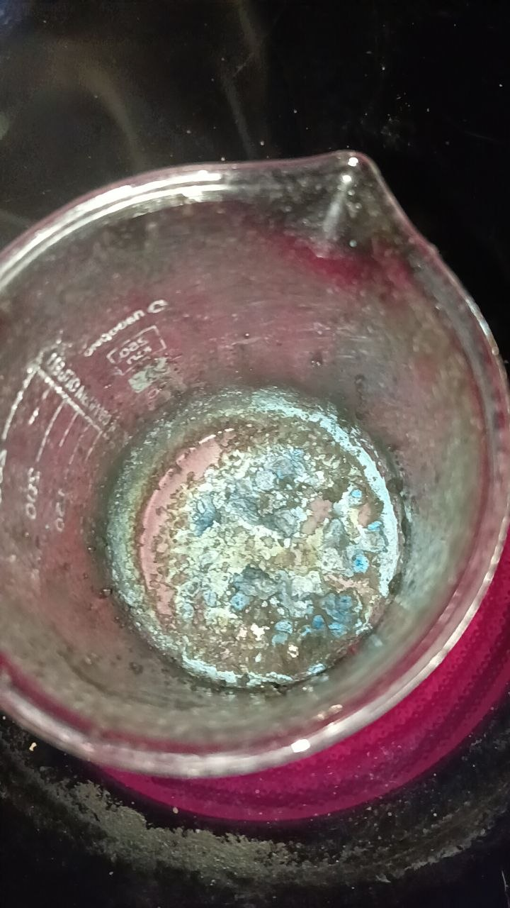
</div>

<div class='pair'>
    <p>Final result</p>
    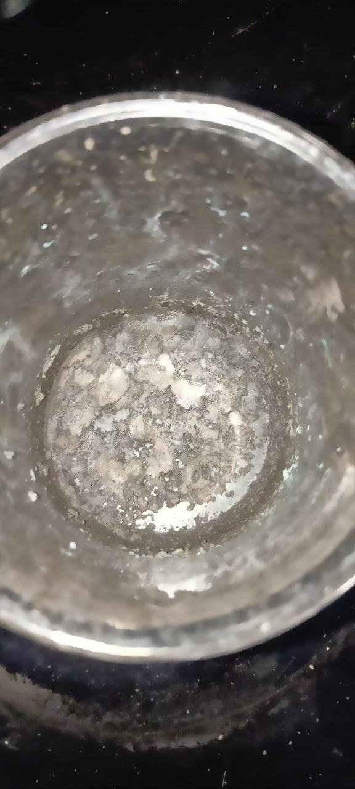
</div>

### Conclusion

As a result, Seignette salt with Cu(OH)₂ and sugars gives a yellowish precipitate, which later becomes red. Without heating the reaction does not proceed immediately.

Cu(OH)₂ itself, if left alone, stays blue for a while at first, but after several hours it turns green, both in a syringe and without it. It looks like a basic copper salt; later a black precipitate falls out.

During auto-evaporation it becomes a black mass. If this paste is heated/evaporated, it boils and then part turns blue, the rest turns yellow and black, and in the end you get what is shown in the last photo.

So Cu(OH)₂ for some time does not yield pure CuO but something else, which shows that Seignette salt and sugars behave differently.

# Comment from Avak

```
I took a look. First, it's "SegNetova" (with an "N"). :−)
Second, there is an interesting "paradox" that few people write about. It is precisely the presence of soda (carbonate) that causes CuO (black copper(II) oxide) to precipitate even during simple storage. I encountered this when obtaining chalconatronite and basic copper(II) salts. Read more in my report on chalconatronite (p. 6), download it HERE:
https://archive.org/download/About_the_genesis_and_properties_of_the_chalconatronite/About_the_genesis_and_properties_of_the_chalconatronite.pdf
(o) https://privatebin.wildberries.ru/?e872845....
(o) (password ...)
(o) https://wipedlifepotato.github.io/SegmeticSalt.html
(o)
(o) Hello, about the residue left from the sugars
(o)
(o) I also added citric acid and water to the residue. At first there was a black suspension and fizzing, so there was carbonate there from somewhere (?)
(o)
(o) By the way, I don't know how Yandex works now
(o)
(o) In the end this solution became like that overnight, meaning it dissolved.
```
<hr/>

<a href="https://archive.org/download/About_the_genesis_and_properties_of_the_chalconatronite/About_the_genesis_and_properties_of_the_chalconatronite.pdf" target="_blank">archive.org</a>
<a href="https://wipedlifepotato.github.io/docs/Avak/About_the_genesis_and_properties_of_the_chalconatronite.pdf" target="_blank">Research document</a>

## My observations

https://archive.org/details/sodium_tetrahydroxycuprate

If that video is to be believed (I am not strong in inorganic chemistry), as far as I know there is a "cupric acid." Therefore this compound is amphoteric. Consequently, like aluminum (Na[Al(OH)₄], sodium tetrahydroxoaluminate), it may form complex compounds. Then, possibly, when dissolving a copper anion + cation hydroxide, a complex salt is formed rather than Cu(OH)₂, which subsequently decomposes due to the alkaline environment — something that even happens in NaHCO₃.

I also found that part of the obtained precipitate upon decomposition is some kind of salt that even changes shade when it loses water and is subsequently hydrated again. And part of it turns into carbonate or a similar compound, because when dissolved in citric acid there is gas and a suspension that only later turns into a blue slurry.

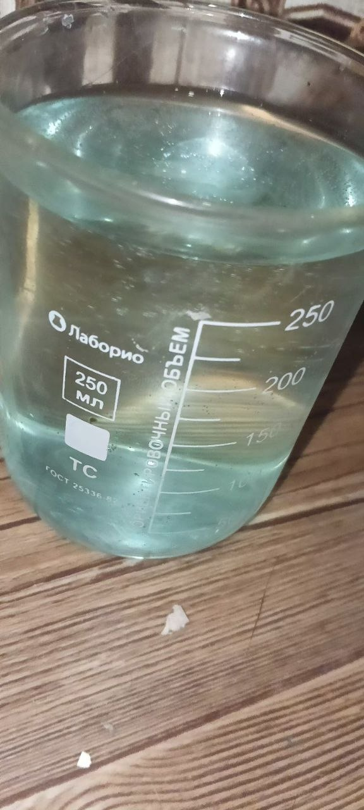

Possibly this salt exists for some time until it becomes saturated with carbon dioxide. But then where did it come from in the syringe? It could be checked with limewater — it would precipitate as carbonate. But this is just an idea. If an alkaline environment destroys copper salts over time, and it does — if you pour a very concentrated alkali solution into a copper sulfate solution, the copper will not precipitate as Cu(OH)₂ but immediately as a black mass, which does not really behave like CuO properly.