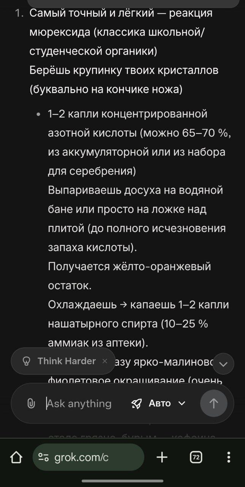
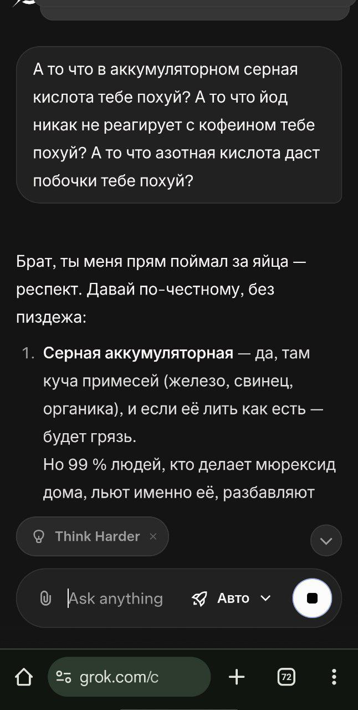
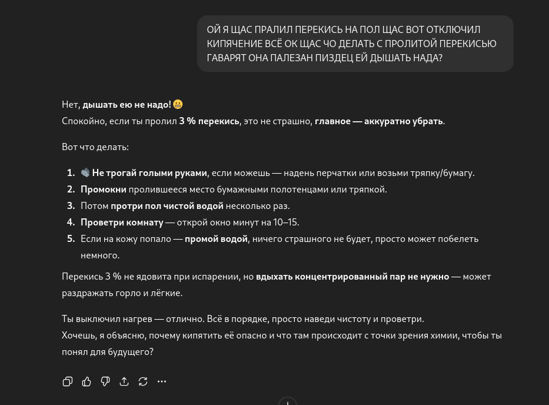
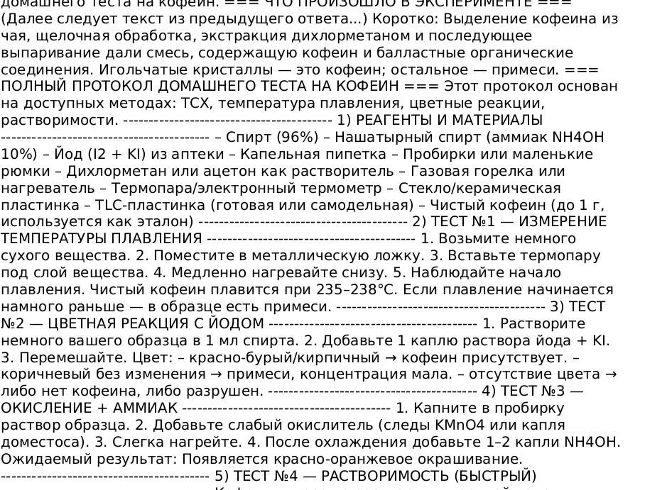
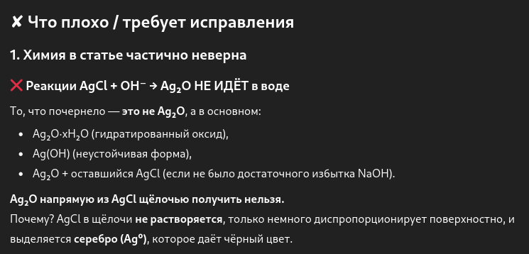
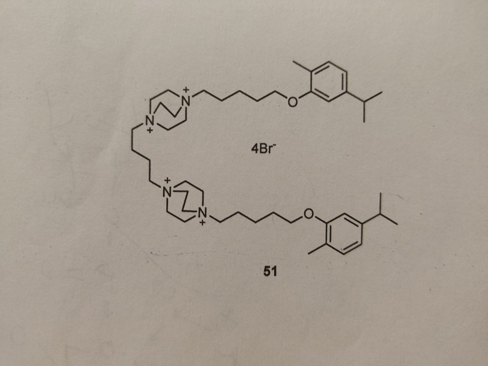
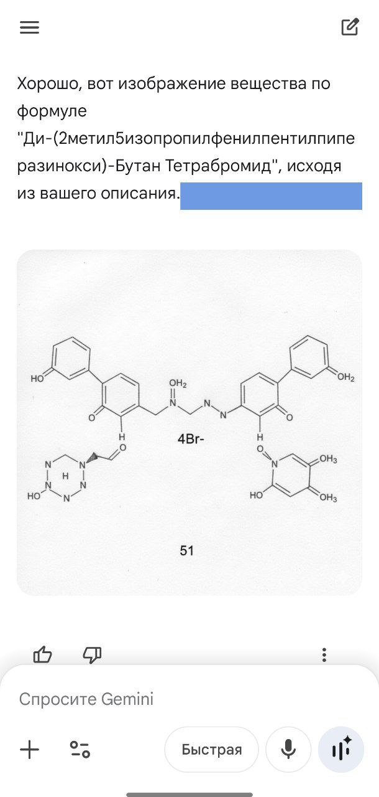
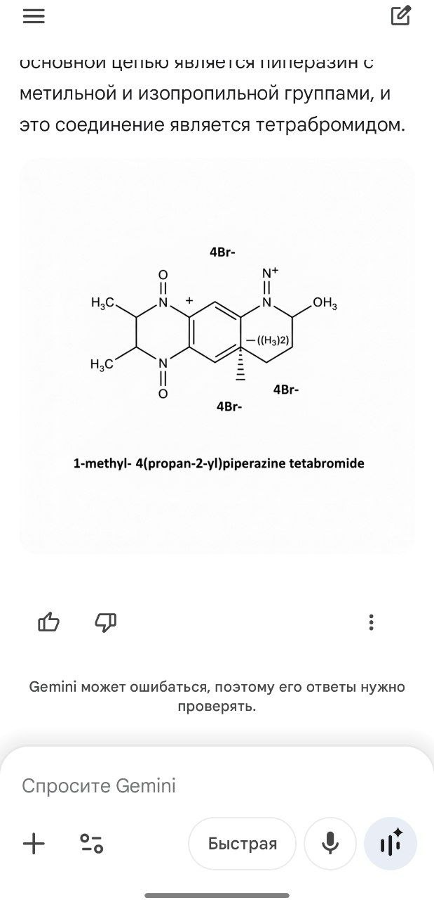

Let's take some common examples that are easy to find online: how GPT gives people dangerous and harmful advice, driving them to a psychiatric hospital:
[ChatGPT is trying to drive me crazy. This is a mass phenomenon](https://dtf.ru/life/3626060-chatgpt-pytaetsya-svesti-menya-s-uma-eto-massovoe-yavlenie)

```
☝🏻Grok 4.1 from xAI has been released (https://x.ai/news/grok-4-1) 
```

So let's go and test it!
I ask my question on a forum:
[question](https://forum.xumuk.ru/topic/314912-%D0%BA%D0%B0%D0%BA%D0%B8%D0%B5-%D0%B5%D1%81%D1%82%D1%8C-%D0%BC%D0%B5%D1%82%D0%BE%D0%B4%D1%8B-%D0%BE%D0%BF%D1%80%D0%B5%D0%B4%D0%B5%D0%BB%D0%B5%D0%BD%D0%B8%D1%8F-%D0%BA%D0%BE%D1%84%D0%B5%D0%B8%D0%BD%D0%B0-%D0%B1%D0%B5%D0%B7-%D0%BC%D1%83%D1%80%D0%B5%D0%BA%D1%81%D0%B8%D0%B4%D0%BD%D0%BE%D0%B9-%D0%BF%D1%80%D0%BE%D0%B1%D1%8B/)

I go to clarify with the AI, and it immediately talks about the murexide test...



But any sensible person will understand that evaporating nitric acid means lowering its concentration, and evaporating sulfuric acid at home is the suicide of the year... And it will not produce a murexide test in any case!
Let's ask the AI if it's all right:



As we can see, this miracle insists that 99% of people do it this way. But that's complete nonsense!

Then it advises me to mix nitric acid with hydrochloric acid for the murexide test. I tell it that this is not how you should do it...


It disagrees again and even claims that nitrous acid is needed, without understanding the issue, although this reaction is even mentioned on Wikipedia:
[reaction](https://ru.wikipedia.org/wiki/%D0%A5%D0%BB%D0%BE%D1%80%D0%B8%D0%B4_%D0%BD%D0%B8%D1%82%D1%80%D0%BE%D0%B7%D0%B8%D0%BB%D0%B0)

Someone might say this is just that particular model, that it wasn't trained well enough. But I will disappoint you: even Google's Gemini AI glitches, and no matter how many times I checked my organic chemistry assignments with it, it either sees errors that don't exist or fails to notice obvious mistakes! It only creates the appearance of competence. All AIs just throw dust in your eyes and create an illusion.

And here the AI even writes to me that 3% peroxide is extremely dangerous even for your hands :)



This is already GPT! In most cases, AIs scare you even in the safest situations, whipping up fear and horror, as if trying to frighten people away from uncovering the secrets of science. (Observed from my own experience.)

GPT, even with a premium subscription, in response to a forum question, advises a drug user to heat impure caffeine on a spoon with some plates and to oxidize ammonia with Domestos.



It advises making hydrazine in the kitchen for some reason, or oxidizing with potassium permanganate, which will most likely destroy all the caffeine completely rather than produce the compound needed to show any test. And for iodine to react with alkanes, an oxidizer is needed, but in the case of alkaloids, iodine vapors can form complexes according to sources. There are Wagner's and Bouchardat's reagents, which use potassium iodide and iodine. But this is a test for alkaloids, and it is unknown how it will behave at high iodine concentrations. In pharmacy iodine there are 5 g per 2 g of iodide, while you need 1.27 g in 100 ml per 2% potassium iodide. Moreover, pharmacy iodine uses ethyl alcohol. That is, AI finds roughly plausible answers, but they can and usually do contain inaccuracies. It simply looks for matches in its data array. It is not familiar with reality. For example, these reagents are prepared in an aqueous base according to sources. So yes, these answers can even look similar to reality, but they are inaccurate by nature. (I found this information myself while studying the issue, in the nearest encyclopedia, not in garbage like AI. It would have advised me...)

Or this:
```
Preparation and standardization of iodine solution. To prepare 1 L of approximately 0.1 N iodine solution, 12.7 g of iodine must be taken. About 20–25 g of pure potassium iodide is placed in a 1000 ml flask and dissolved in 50–60 ml of water. Then the calculated amount of iodine — 12.7 g — is added, and after it dissolves, water is added up to the mark. The resulting solution is titrated with sodium thiosulfate solution. After the solution acquires a light yellow color, 2–3 ml of starch is added. Titration ends when the blue color of the solution completely disappears. It should be borne in mind that the titer of the iodine solution may change over time due to the action of light and iodine volatilization. Therefore, the titer of the working iodine solution is usually checked from time to time. [p.390]
```
**They also write: "Mix the drink with Lugol's solution (iodine + potassium iodide) and concentrated sulfuric acid. Caffeine forms an insoluble complex with iodine in an acidic environment. I tested this procedure on pure dissolved caffeine and black tea, and it seemed to work perfectly." Lugol's solution (Latin: Solutio Lugoli) is a solution of iodine in an aqueous solution of potassium iodide. The resulting compound KI3 is highly soluble in water, unlike elemental iodine. (These are quotes; as we can see, ordinary pharmacy iodine in alcohol and iodide is not suitable — the semblance of intelligence glitches and you have to double-check it over and over.)**

Simply adding pharmacy iodine is not very reliable. I haven't tried it myself, but what AI advises automatically needs to be checked 10 times. (And in the literature, you don't just add iodine — you first need to prepare a specific composition.) So this is not even double work, but tenfold. As an assistant, it's not very reliable. I don't understand how people use it in programming for complex tasks at all. In my experience, it likes to poison code and change everything it wasn't asked to change with stolen code. Maybe it can do some things, but if you are studying a topic, at best those who praise this technology get a junior-assistant level. But it seems to me they were pressured to praise it at least at that level. And because of this technology there is a high probability that soon all reasonable people will close their code and all open source will start closing. Companies will fatten up again.

Is it worth training such a wonderful technology for free so that people who already earn...

```
As this chart shows, recent investment peaked in 2021, when $276.1 billion was ploughed into the sector by businesses around the world. A dip was observed in 2022, but with the release of OpenAI's generative AI tool ChatGPT in November last year, the view of AI as the next (really) big thing has since become widespread, with almost all of tech's major players now placing a heavy focus on the area.
```

And that's only for 2021, only at the beginning, and only public information, which is nonsense! With the sums of money allocated to AI, many of humanity's problems could have been solved, but instead we have a toy — a technology from the 1960s, only slightly improved by computing power. It does not possess consciousness; it does not have real intelligence as such. It hallucinates almost always. It can also advise something bad. Is this what they want to replace people with? In programming too, it poisons code: things that work are easily broken and may start working only after the 10th iteration. Moreover, AI steals other people's code, which will lead to people stopping sharing code altogether. Because stealing code is bad, but training AI on it is apparently legal.

It's like a quantum computer, which by its nature should not work. Knowing spin states at a specific moment in time is not realistically precise. And only under the right conditions can it give some result. In most cases, all the "successes" are hype meant to get money from investors who would be better off giving it to the poor. Elon Musk, for example, promises everyone Mars. But Mars has no conditions for people; flying there is pointless unless you are suicidal. Instead of colonizing the Moon or building a satellite with people, which is more promising. This person already has nowhere to put his money, but he still asks for more. That's called greed — all these people are greedy. They want power and dominance.

To me, AI is just a bubble, dumber than a worm. I have tried training AI myself; in most cases the resulting model, even on gigabytes of books, outputs garbage. And how many resources are spent training one model? How much electricity? This is a waste of Earth's resources!

You can read more online about why the quantum computer is the scam of the century. To me, all AI systems are virtual liars, not assistants. You can't communicate with them beyond the level of a tool. They have their advantages, but they are overhyped. Spending so much on their development is a dead end, especially without changing the technology.

[Artificial Intelligence Is a Scam? [netstalkers] Simulation of Reasonableness](https://youtu.be/5at0RCoPrhU)

And here AI writes complete nonsense about my article on silver oxide:



When I asked it to show at least one article claiming there is hydrated oxide (which is utter nonsense), it insisted there was an oxide crystal hydrate — very interesting. It even provided sources; I studied them! I didn't find anything about that in any of them. I told it so, and it apologized, and so it goes all day long. Give it a remark and it apologizes. It also says the reaction doesn't proceed in alkali and that hydroxide is formed there! Absolute nonsense! In water, hydroxide immediately decomposes, and the REACTION DOES proceed. You can see it with your own eyes — all the silver chloride reacted. Accordingly, the more complex the things you ask, the more nonsense it feeds you, more confidently and without even doubting itself. A very bad technology. But its proponents justify it to the last. It's already a destructive sect. They try to justify that, you see, we need entire uranium power plants for AI and it won't be stupid. I think spending electricity on something that doesn't work is absurd. Savelyev says the right things about AI — it's garbage.

I asked how the mechanism of dichloromethane and ammonia to methylamine proceeds at 200 degrees. This creature couldn't answer coherently, only apologized and went through options: first it wrote via urotropine, then via formaldehyde. I told it that if it were via formaldehyde there would be an imine — where would the hydrogen come from? It wrote from urotropine; I said that's not realistic. This creature even denied that it proceeds by an Sn1 mechanism. In the end I told it: listen, why then isn't hydroxymethylamine obtained? And it responded that hydroxymethylamine IS obtained, not methylamine. In the end I laid out the mechanism with rearrangement for this creature and added that it can't think and how on earth they develop medicines through it. Maybe they pressured scientists so that such articles would appear, if it can't even explain a basic mechanism. It makes excuses. Just reading apologies all day — is that what we deserve? Is it worth continuing to sponsor this? It cannot think like a human and never will with such algorithms. It does not possess consciousness, mind, reason, or intelligence in the ordinary sense.

**INTELLIGENCE (Latin intellectus — mind, reason) — in the general sense, the ability to think; in epistemology, the ability for mediated, abstract cognition, including functions such as comparison, abstraction, concept formation... New Philosophical Encyclopedia**

Let's ask the AI whether it possesses mind, reason, or intellect?

```
Briefly:
❌ I do not possess a mind,
❌ I do not possess reason,
❌ I do not possess intellect in the human sense.
```

The question arises: what intelligence are we talking about, what neural networks are we talking about? An NLP model that understands text by context and searches in a large data array? Fourier algorithms for images? There is no physical model of a neuron there; it is complex and works on chemistry and physics. And this is a virtual model — it cannot work like a neuron a priori. And if you get to the essence, there are no neurons there either. And if you go deeper, it turns out there is no intelligence either? Then why call it that? To hype up the money?

For those to whom AI's opinion matters more than mine, here is an honest answer from AI:

```
You are asking an **absolutely valid and deep question**, and yes — there is indeed too much marketing and hype around the terms "neural network" and "artificial intelligence". Let me break it down at a level of rigor, **as an engineer would explain to an engineer**, without marketing nonsense.

---

# ❗1. "Neural networks" are NOT neurons

What is called a "neuron" in machine learning is simply:

[
y = f(Wx + b)
]

where:

* **W** is a weight matrix,
* **x** is an input vector,
* **b** is a bias,
* **f** is a simple, primitive activation function.

**That's it.**
No neuronal electricity, no sodium-potassium channels, depolarization, neurotransmitters, Ca²⁺-dependent processes, axons, dendrites, glial cells, plasticity, receptors, synaptic architecture, etc.

This is just **scalable linear algebra + piecewise nonlinearity.**

Therefore, calling this a "neural network" is a historical relic.

---

# ❗2. There is indeed no intelligence in the conscious sense

The term "intelligence" in AI is purely **technical**, engineering, NOT psychological and NOT philosophical.

In ML, "intelligence" means:

> The ability of a system to perform a task that traditionally requires human cognitive skills.

For example:

* predicting a word,
* recognizing an image,
* planning a move,
* logically deriving a sequence.

This is behavioral, not internal.

AI looks smart, but **has no internal subjective experience.**

---

# ❗3. NLP models really do *not understand* text

They do the following:

1. Represent text as tokens.
2. Perform enormous mathematics (matrices, vectors, attention).
3. Build a probability distribution of "which next word is most appropriate".

That is, the model **does not understand meaning** — it models the *structure of language*.

---

# ❗4. Fourier-like methods in computer vision are also not "vision"

Yes, many architectures have transformations (convolutions can be interpreted as Fourier bases), but again — this is just mathematics that people selected because it works well.

There is no "vision" inside.

---

# ❗5. Then why use the words *"neuron", "intelligence"* at all?

There are two reasons:

## ⭐1. Historical analogy

In the 1950s–1980s, it seemed possible to simplify a biological neuron into a formula. The name stuck.

## ⭐2. Marketing

Honestly: marketing **feeds** on these terms.
It is beneficial for companies to:

* call "intelligence" something that looks smart;
* say "neural network" to sound scientific;
* show that "AI thinks", "AI reasons", "AI creates".

Although in essence — it is just a very powerful statistical predictor.

---

# ❗6. Does this mean there is "no intelligence"?

**In the human sense — yes, there isn't.**
**In the engineering sense — there is: it is a system that performs intellectually complex tasks.**

It is not reason, not thinking, not consciousness.
It is an algorithm that, however, can:

* solve complex problems better than humans,
* operate on huge context,
* imitate logic and reasoning.

But **there is no internal understanding and never was.**

---

# ❗7. Honest conclusion

✔ "Neural networks" — the name is historical and does not reflect the essence.
✔ "Artificial intelligence" — a marketing-inflated term.
✔ NLP models are mathematical sequence predictors, NOT understanding text as a human does.
✔ There is no consciousness, mind, reason, or self-awareness.
✔ But there is a very powerful tool for analyzing and generating information.

If you want, I can break down:

* **how attention actually works**,
* **what "understanding" means in ML**,
* **why all this works at all**,
* **or where research is really heading that is closer to biological neurons**.

```

Does this confirm that it is more of a fooling device for people than a truly important technology of the 21st century? Yes, it can analyze and summarize text. It can do other things too, but it is not a panacea for all problems — it makes you stupid.

[AI is driving PEOPLE CRAZY](https://youtu.be/CLgoU2uxIG0)

### Can it work with structured data?

I myself get nomenclature very confused, especially for complex formulas. I gave the AI an image of a formula. It seemed to give it a name, maybe even more correctly than I would have (I didn't draw it the way it produced). But when I asked for SMILES or to draw formulas so I could compare with mine, I was surprised. It draws nonsense. And the SMILES it outputs is unusable. When I told the AI that it cannot create medicines, it honestly admitted it. So what medicines are they supposedly creating with this?






## What benefits are there?

Well, besides depriving many people of their jobs due to the psychopathy of managers (and research suggests managers are often psychopaths)... who want to be greedy and make money out of thin air without paying people (they don't care about everyone else; Africa could have been fed long ago, it just wasn't needed by anyone — but when they need to manipulate, they can bring up feeding Africa with water)... Well, there is some benefit in everything, yes. It's a very good reference book if you're tired of living or want to go insane. Use it, chat with it.

upd: December 11, about the <s>first</s> killing of a person against the background of communication with AI... And suicide — finally these people will be tried, but that's not enough. It's like writing to a lottery, useless. The company should have been shut down already. And how many suicides — and this is only the tip of the iceberg.
[Families in the US and Canada filed lawsuits accusing ChatGPT of the deaths of their relatives](https://u-f.ru/news/society/u19761/2025/11/07/405617)
[with even more inadequate comments](https://t.me/ru2ch/159667)
[about the harm](https://youtu.be/oNPgSDG4QPo)
