```
Topic: Boric acid
Hello!

I discovered that boric acid is sometimes used to try to treat inflamed teeth. Apparently, this is folk medicine.

I immediately remembered that I once needed tetraborate and was almost shocked by how many things there are. Metaborates, borates — overall, all the properties reminded me of alcohols in organic chemistry.
I started reading more carefully and noticed that it is indeed written that it does not exhibit the usual properties of organic acids with proton donation. I checked with litmus paper — indeed, it does not. The paper remains yellowish. It's essentially a buffer solution.

Moreover, I was going to test it with baking soda, but as usual, it disappeared somewhere. Classic.
Well, that's not a big problem, since now I will test it with washing soda (sodium carbonate). Testing with caustic soda would be ambiguous.

Wikipedia says that it exhibits acidic properties at the acceptor-donor level (Lewis acid, where an acid is an electron pair acceptor and a base is a donor. That is, where there is no H+ donation, but rather the opposite, like a base. It can be confusing, but I remember it this way: ammonia is a base and there it accepts a proton, acting as an acceptor... But at the same time in NH3 it exists and also has 2 free electrons that it donates. So it can be confusing.)

In general, now I will test it with washing soda.

Hmm, cancel that. I tested it with ordinary baking soda. I sprinkled a pinch of it and at first no gas came out at all, and I thought Wikipedia and the AI had confidently misled me that there would be no reaction with soda. But no, the AI was wrong — the reaction does proceed. But litmus shows the medium as a buffer, and at the same time a precipitate immediately forms, but not sinking down — it floats up. Very little gas is released.

For some reason, I've felt for a long time that boric acid is similar to alcohols in organic chemistry. This can be checked later: you need to attach some fatty acid or something similar and see if you get something like a fat, but I'll do that later.

The litmus was thrown in the trash and now I took it out again to make sure it hadn't reacted. No, it did react after all... But only in places, and it seems where I touched it with my fingers. So if litmus reacts only to pH in general, then H+ is present there. Then Wikipedia is somewhat misleading.

https://ru.wikipedia.org/wiki/%D0%9E%D1%80%D0%B3%D0%B0%D0%BD%D0%B8%D1%87%D0%B5%D1%81%D0%BA%D0%B8%D0%B5_%D0%B1%D0%BE%D1%80%D0%B0%D1%82%D1%8B

and moreover, as in organic chemistry, it is made with sulfuric acid — esterification.

So as not to "breathe vapors" (it's unlikely that something with a clear crystal lattice in its ordinary form can produce vapors — azeotropic mixtures with water capable of covering all the lungs faster than outdoor air, but since they said so) I still closed it in a bottle. But as I wrote earlier, stoichiometry is not particularly used in organic chemistry. Either a deficiency or an excess is taken, depending on the desired reaction. I poured baking soda into a glass bottle from Essentuki and poured this solution there, mixed it very well, and didn't see that anymore. The soda hardly dissolves anymore. I'll leave it for longer.

https://studfile.net/preview/7264660/page:11/ toxicology says that baking soda binds it. That means the reaction does occur.
Poisoning even affects the brain. That is, in general it crosses the barrier that many organic compounds do not normally cross, and there is interaction with organic matter.

https://chemister.ru/Databases/Chemdatabase/properties.php?dbid=1&id=397

Volatile with steam. So it can indeed behave like a liquid in solution. Apparently, when heated.

The lethal dose is large, so I didn't need to put it in a bottle. But oh well.

They were afraid it would evaporate, although I immediately said it should rather crystallize. But they said what if animals eat it. I don't know. They only pee on the bed, but don't drink solutions.

By the way, where the copper citrate should be, a foam appeared that looks like bacterial life.

With organic acids it apparently reacts only through the anhydride. I found something like "triacetyl borate".

Chemistry and Chemists No. 2 2008. Purification of organic ...

image.png
Chemistry and Chemists journal
... the triacetyl borate is cooled and the resulting crystals are filtered off. After distillation, anhydrous acid is obtained. Acetic acid is also dehydrated by ...

(THE JOURNAL IS BANNED IN THE RF. TOO SCIENTIFIC FOR THIS COUNTRY.)
So, it turns out, such a compound exists.

I found it on archive.org https://archive.org/stream/djvu14519/djvu%3D14519_djvu.txt
As I understood, these compounds immediately turn back into acid and boric acid, which apparently dissolves very poorly in organic solvents and precipitates, since it would remain during distillation otherwise. At first I didn't quite understand why it should be kept in a reflux condenser with an oxidizer. To oxidize what wasn't oxidized — but how and where does permanganate have such solubility there? I think the main thing is distillation and, as it turns out, triacetyl borate.

Phosphoric acids also form esters, but that's already toxic and there it's usually not done by esterification (there was some German method; there is one where isopropyl alcohol is attached directly under strong heating, for example. But I've already forgotten — usually they attach to chloro derivatives, I think. I need to review the Arbuzov reaction and others.), but here it's by esterification.
```
<h2> Photos: </h2>

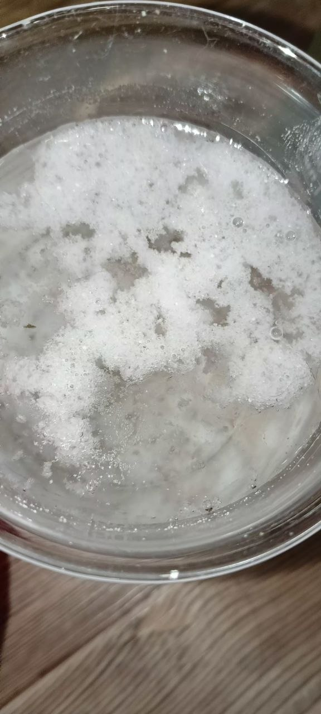 
<br/>
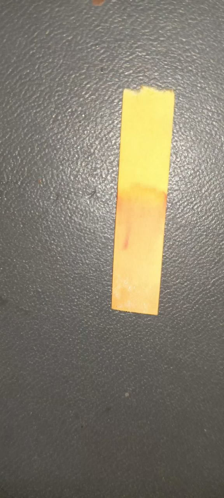
<br/>
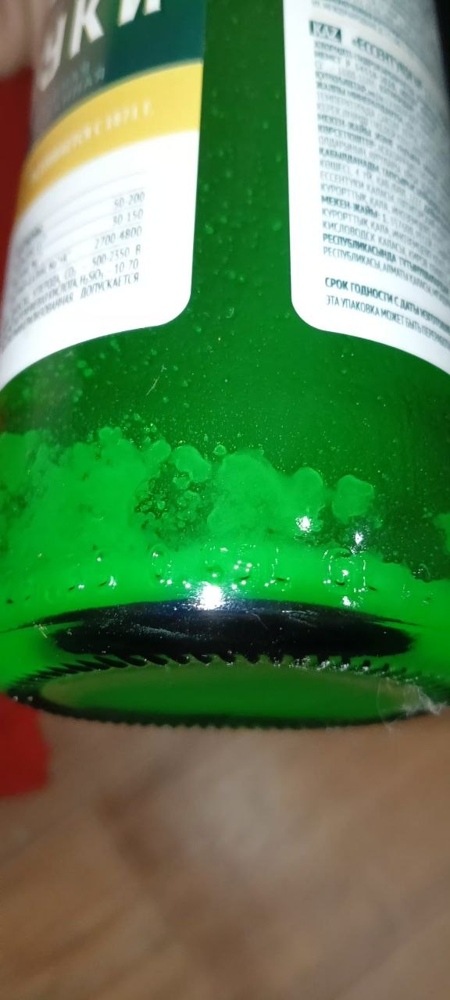
<br/>
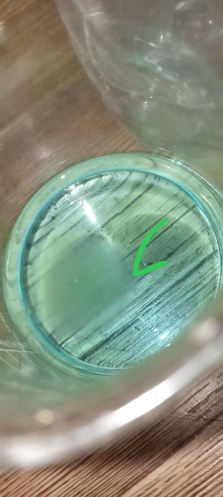
<br/>
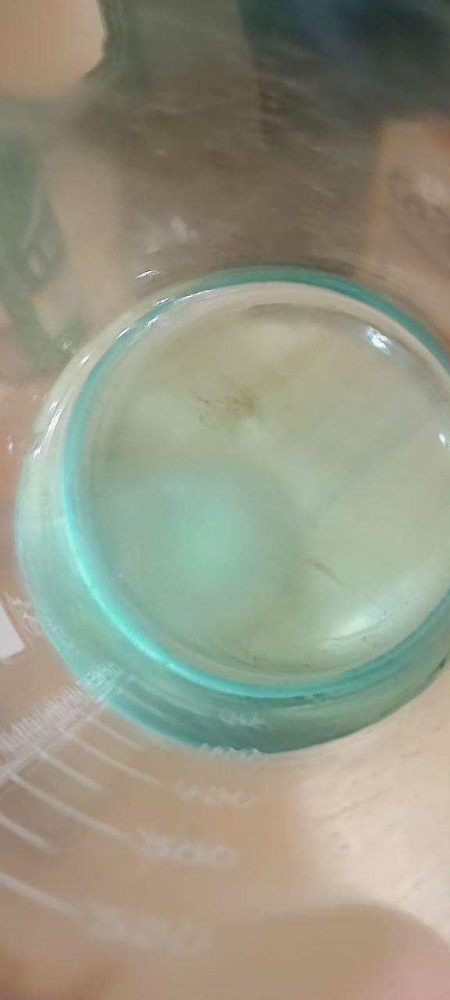
<hr/>

<h2> Reply: </h2>

```
Hello!

Boric acid can be a "real" acid; in aqueous solutions it forms oligomers, most often tetraboric acid. This is a polycondensation product, formula H2B4O7. I attached the structural formula of the sodium salt of this acid (sodium tetraborate). Soda (both Na2CO3 and NaHCO3) "fizzes" in boric acid, forming sodium tetraborate as a hydrate, because tetraboric acid is slightly stronger than carbonic acid. But only "slightly," which is why litmus is "not very impressed." Boric acids are ABSOLUTELY non-volatile; their aqueous solutions, like the acids themselves (they are all solid), can be kept openly in a bedroom; there will be NO "vapors" from them. They are toxic — YES; but this is not about "smell" (they are non-volatile and cannot smell), but about the fact that it is better that they do not enter the body. Esters of orthoboric acid can be obtained in the same way as esters of phosphoric, arsenic, sulfuric, or carboxylic acids. Their properties show a huge difference between boron and its homologue in the periodic table — aluminum. Aluminum alkoxides are typical metal alkoxides. But with boron, substances with the properties of esters are obtained. By the way, I OBTAINED a super exotic substance (possibly for the first time in the world): explosive esters of peroxyboric acids. I obtained them by dissolving boric acid in acetone, carefully dissolving 94% sulfuric acid in the resulting solution, and then adding dry hydroperite and stirring. Propylidene peroxyborate was obtained — a boron ester of "the acid". This is a white solid explosive product, inferior in pyrotechnic properties to "the acid". As for the similarity of boric acids to alcohols — yes, there is similarity, as with silicic acids. Because boron and silicon are similar in properties to carbon. Alkyl derivatives of boron and silicon can form analogues of ethers; for example, (CH3)2BOCH3. The similarity is that the acidity of (CH3)2BOH does not differ very much from the acidity of alcohols, for example, methanol CH3OH. For comparison, tin and lead (heavy homologues of carbon), unlike silicon, form similar compounds, but in terms of properties...
```

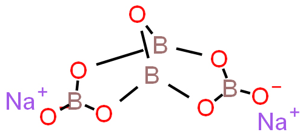

<hr/>

<h2>Attempt to obtain peroxyboric acid</h2>
```
Mixed 50 ml of peroxide, poured boric acid into it (I have a whole 1 kg somewhere right now). Poured 50 ml of 95% orthophosphoric acid into it. A precipitate appeared. I filtered this precipitate through a Büchner flask; filtration with a syringe works poorly (decantation works poorly), it would be better to separate it from the solution with a mesh. So, I took the partially dried material, directed it at a lighter, it boiled and I didn't notice any noticeable changes in the flame afterward. Only at the beginning, apparently from the peroxide, and the resulting material charred. Most likely soot from the lighter. Then I scattered it and tested the crystals — a very small part of the flame turned green. There were no other changes. I will try again, using alkali instead of acid. But the fact is that mixing acid and boric acid with peroxide by itself does not produce a combustible substance.

p.s.p.s When I was cleaning up the semi-liquid residue on metal flux, I got a burn similar to a peroxide burn, even after several hours in the light and open air. (It is better to wash and shower immediately after work and use protective equipment when working with powdered substances. Hair collects dust and then it can get into the eyes, for example, or food. But this requires working with large quantities and in production. At the same time, these burns caused by peroxide, if on the skin in trace amounts, are not very dangerous, as the burn passes quite quickly.)

"
ICSC 1046 - SODIUM PERBORATE

International Labour Organization
https://chemicalsafety.ilo.org › icsc › showcard.display
Non-combustible but promotes combustion of other substances. Releases irritating substances in a fire.
"
```

(p.s. sulfuric acid — because I assumed it was possible to protonate the OH group so that it would become a leaving group and consequently be replaced by an OOH group, but that's in theory; in practice, BPO5/BPO4 may have formed, and most likely it was boron phosphate rather than its peroxide)

<hr/>

Attempt to make it from borax. I took sodium tetraborate, its crystal hydrate, poured in trace amounts of orthophosphoric acid. Poured in 25 ml of peroxide and kept it warm. The water was cloudy like a colloid. Added a trace amount of acetone and the colloid separated. Then I poured off the excess water and poured the slurry onto paper and scraped it off.

The liquid mixture, when heated with a lighter, melts and the flame seems to jump, and traces of tetraborate also appeared as splashes occurred. Then from the liquid form it fused into this shape on the lighter. It burns a little, but it doesn't look like traces of acetone — maybe peroxide residues or sodium borate peroxide.

As a conclusion: neither one nor the other could produce a reaction similar to organic peroxides, so either we have an adduct or a new compound.

<hr/>
Photos:

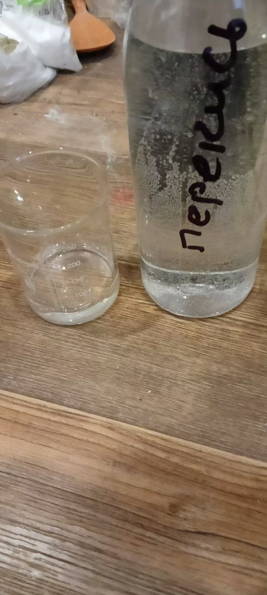
<br/>
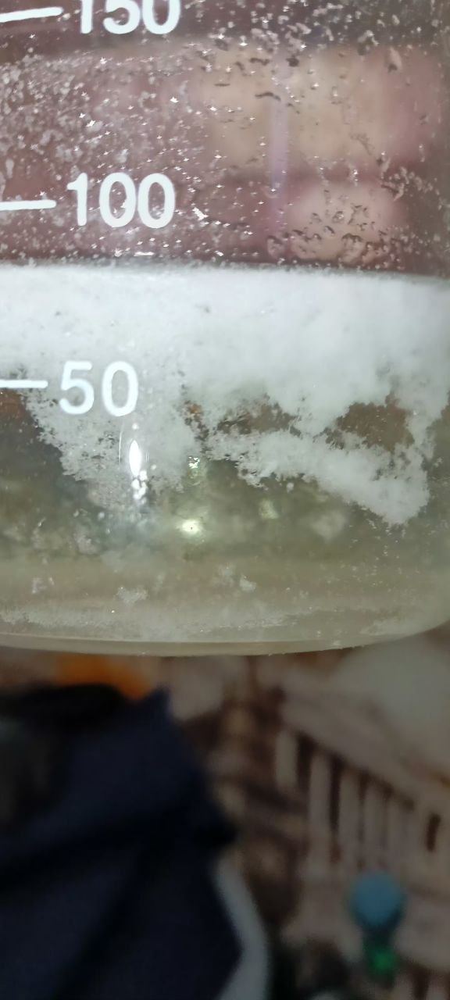
<br/>
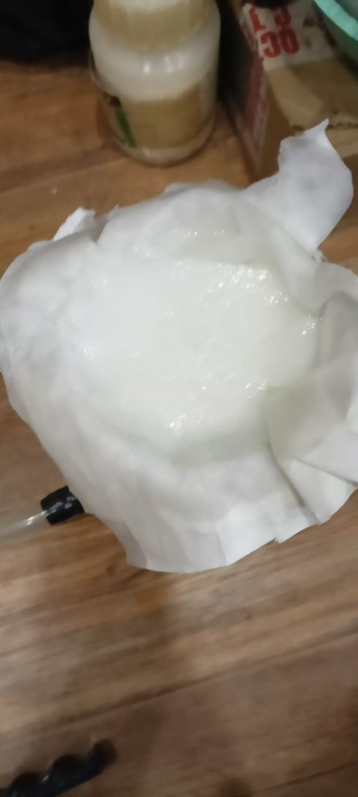
<br/>
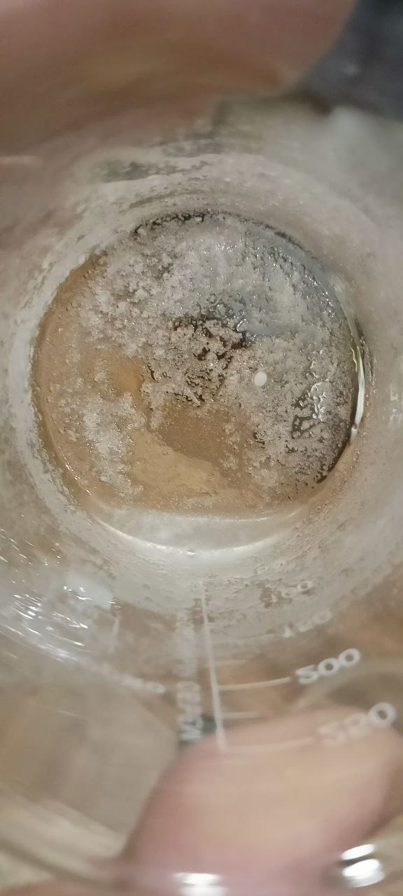
<br/>
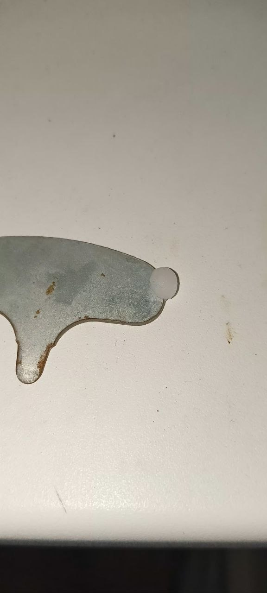
<br/>
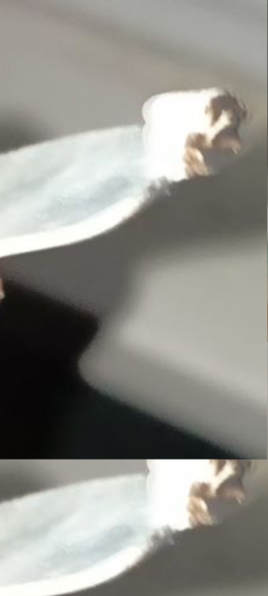
<br/>
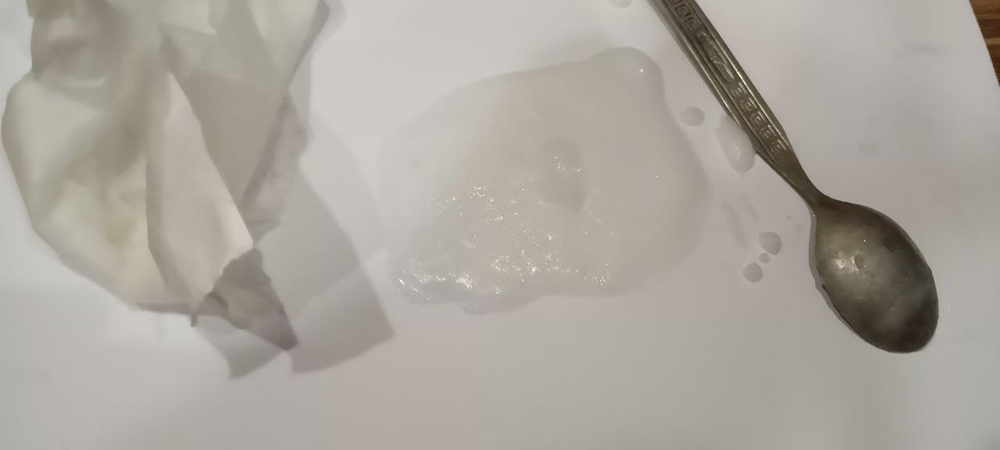
<br/>
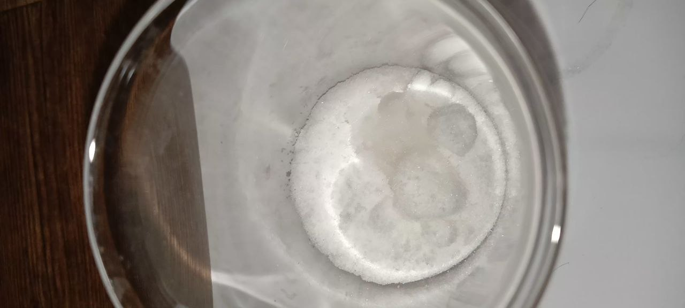
<br/>
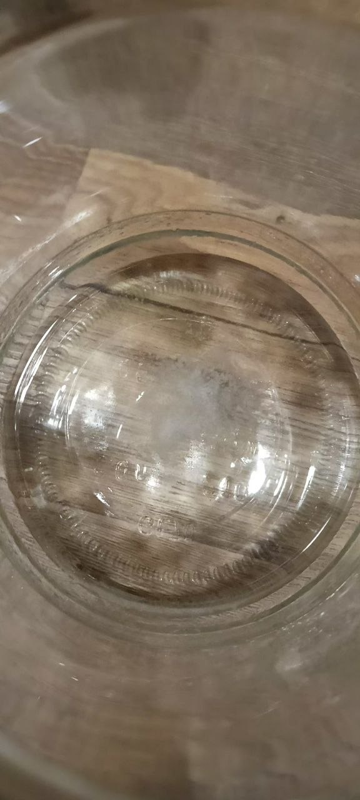
<br/>
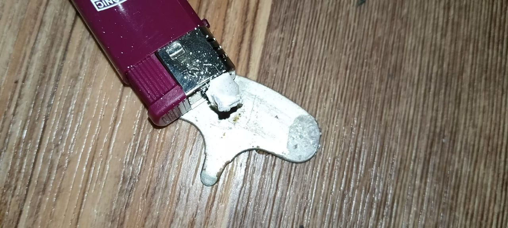
<br/>
<hr/>

<h4>Important notes</h4>

Orthophosphoric acid + boric acid = boron phosphate (is it really an acid, or a base?) [https://ru.wikipedia.org/wiki/%D0%A4%D0%BE%D1%81%D1%84%D0%B0%D1%82_%D0%B1%D0%BE%D1%80%D0%B0]

Inorganic compounds can and do exhibit organic properties; for example AgCl (silver chloride) has a polar covalent bond, not an ionic one, as school chemistry teaches us. This can be checked by electronegativity: at a certain electronegativity difference there will be a covalent bond.

```
delta X = |Xa - Xb|
delta X ~ 0-.4 -> nonpolar covalent
delta X ~ .4-1.7 -> polar covalent
delta X > 1.7 -> ionic
Xa (Ag) by Pauling -> 1.93
Xb (Cl) -> 3.16
|3.16 - 1.93| => 1.23 -> polar covalent bond, but school teaches that it will always be ionic. Something like that.
```
<hr/>
About boranes -> https://ru.wikipedia.org/wiki/%D0%93%D0%B8%D0%B4%D1%80%D0%B8%D0%B4%D1%8B_%D0%B1%D0%BE%D1%80%D0%B0
<br/>
About silanes -> https://ru.wikipedia.org/wiki/%D0%A1%D0%B8%D0%BB%D0%B0%D0%BD%D1%8B
<br/>
Diphosphine/hydrazine — an analogy. Nitrogen compounds decompose at a tremendous rate.
<br/>
Hydrogen sulfide can actually polymerize, for example polysulfides/sulfanes (polyhydrosulfides).

```
Based on all this, it seems to me that other, alternative forms of life may exist. Including those made of inorganic substances that would never occur to you as capable of supporting any life activity. Everything depends on the conditions of the planet. Therefore, the search for water and hydrocarbons is a naive branch for searching for alien life forms. It is not certain that they possess physical bodies in the usual sense at all, but if they do, then theoretically they could be liquid or even gaseous. But in that case, if they are gaseous, the existence of their consciousness is questionable. On the other hand, does algae have consciousness? But it is alive. We are used to thinking that whatever can feel anything at all has consciousness. For example, it is commonly believed that insects do not feel pain, but they even die from FOV similarly to humans...
```

<hr/>
Possible reaction:
```
Acetone + H+ => enol of acetone
enol of acetone + :B(OH)3 -> ...CH2:B(OH)3 and further polymerization, since acetone has a second free group. Then one would need to know the exact formula of the final substance.

Then the OH group in acetone in its keto-enol form can be detached and a geminal compound can be obtained (https://en.wikipedia.org/wiki/Geminal_diol) with an -OOH group in theory. And then an oligomer or even a polymer can attach under certain conditions.

Then a theoretical formula can be imagined. That is, purely theoretically, this is possible. And if it exists, then it is unlikely to be an adduct, especially if a single substance precipitates rather than a mixture.

p.s. for those who will check with AI: proceed from the negative charge on the CH2 group in the enol... Otherwise the AI disagrees until you explain it... When you explain it, it agrees but still disagrees. In general, the pi-nucleophilic bond in the enol can produce a negative charge due to mesomerism — it has an excess of electrons. Boric acid is a Lewis acid and accepts a free electron pair. Then you can figure it out... (but this is all theory; there is not much point in feeding it to AI, it goes beyond its training, although these are obvious things. In general, if it's not clear, it's better to open a textbook than use AI)
```
<h4>Summary: </h4>

- some inorganic substances can and do exhibit properties of organic substances, even without consisting of carbon
- not all compounds called acids exhibit acidity in the usual sense. In general, cold acetic acid without water exhibits only the properties of a solvent
- not all metal-base compounds are ionic
- possibly, other alternative forms of life exist. Including those consisting of boron.
- boric acid behaves more like a base in the usual sense, as a Lewis acid, and generally like alcohols in organic chemistry. Moreover, with acid anhydrides it can form esters, although they hydrolyze quickly. And with organic alcohols themselves it can undergo esterification and also produce boric acid esters. The key point here is esterification.
- new, little-studied compounds may exist, even in ordinary boric acid, which can be bought in almost any fertilizer store

(correct where needed above)
<hr/>

<h4>Reply: </h4>

```
And "peroxide" — do you mean an aqueous solution of H2O2, or hydroperite? If hydroperite — with phosphoric acid you will get urea phosphate (similar to urea nitrate). If without urea, then yes — it may indeed be boron phosphate, most likely so.

About life not based on carbon — carbon did not give rise to life by accident; the fact is that it forms the strongest bonds with itself, as a result of which polyethylene molecules can be infinite and at the same time strong; moreover, carbon forms ideally covalent, non-ionic bonds both with itself and with a number of other elements, which do NOT react even with the strongest acids and alkalis. Therefore, from hydrocarbons you can create any intricate structures, attach functional groups to these structures, and this backbone turns out to be unshakably strong — it is NOT destroyed even by the strongest acids and alkalis. Carbon has no equal in this. No other element even comes close to these properties, so such infinite diversity of the most complex and yet strongest molecules cannot be created from other elements. So creating non-carbon life is, to put it mildly, hardly possible.
```

End of article.
