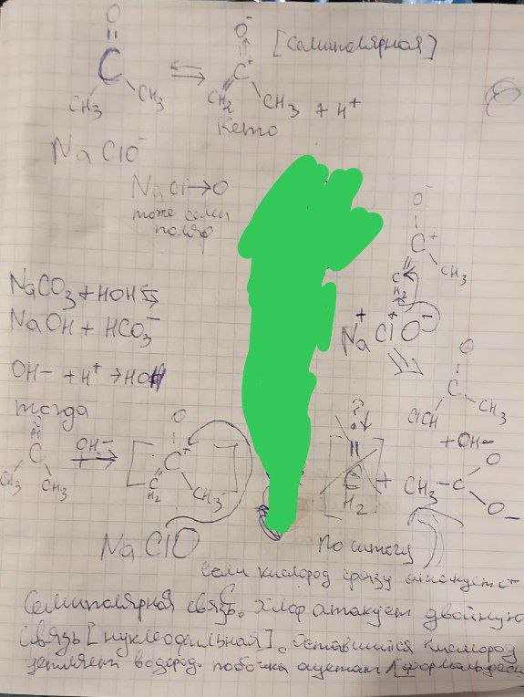
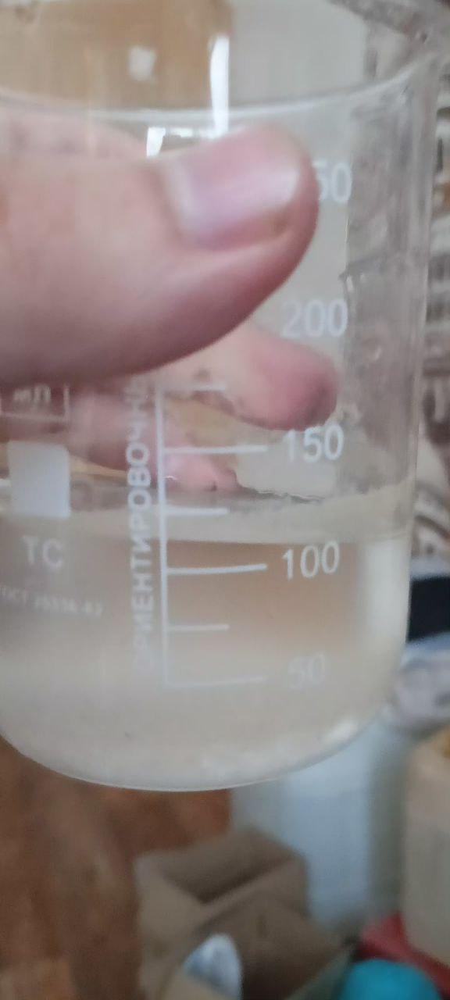
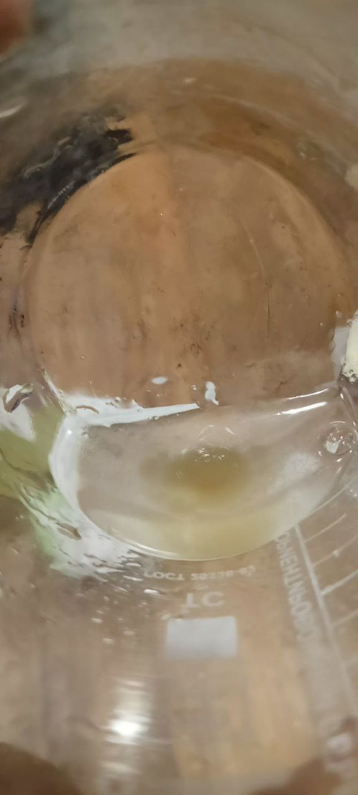
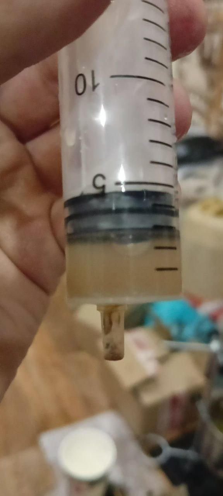
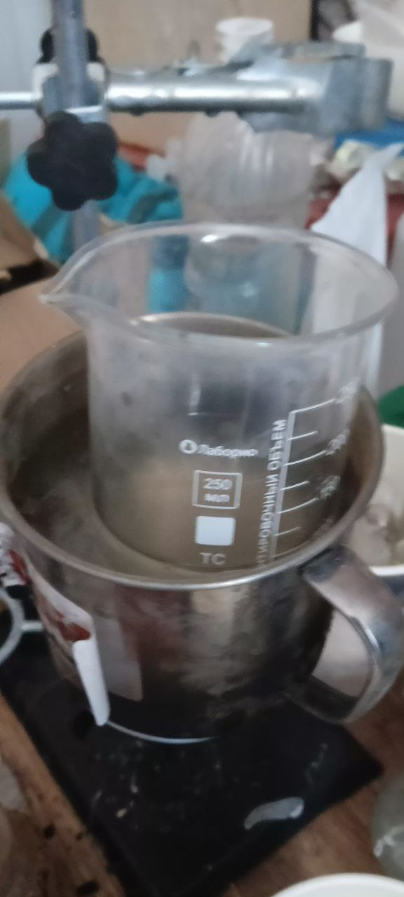
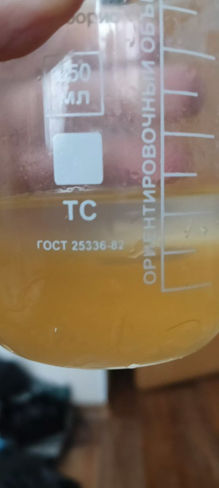
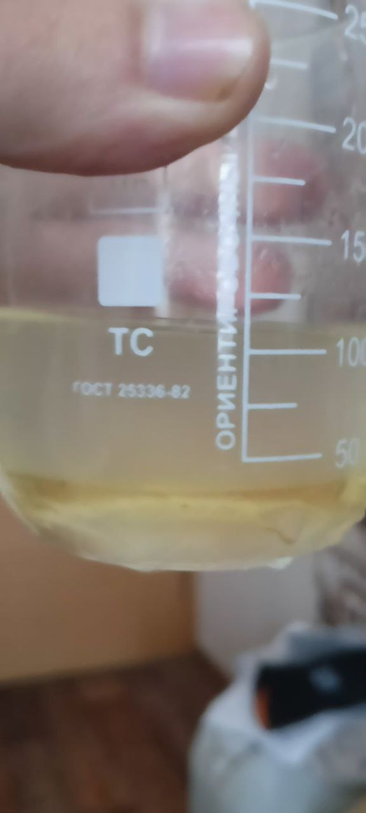
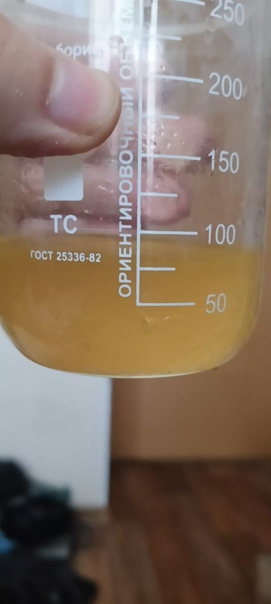
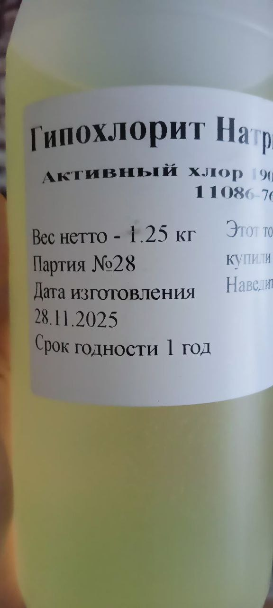

```
WARNING / DISCLAIMER:
This publication is for informational, educational, and theoretical purposes only. The author describes purely chemical observations in the context of studying the haloform reaction.

Law: The author strongly warns about the need to comply with legislation. This text is not a call to action or a guide to manufacturing anything.

Health: Chloroform and reaction byproducts (such as chloroacetone) are toxic and irritating. Inhalation of vapors or skin contact can lead to damage to the CNS, liver, and lungs.

Disclaimer: The author is not responsible for attempts to reproduce the described actions and their consequences. All chemical experiments must be carried out in certified laboratories by specialists in compliance with safety standards.
```

On obtaining iodoform: <a href="/en/iodophorm.html" target="_blank">iodoform</a>
<hr/>
Chloroform is obtained in roughly the same way. I take acetone, a quarter spoon of sodium carbonate and add 50 ml of water to 50 ml. I leave what didn't dissolve and pour it into another glass. I place it in an ice bath and add some hypochlorite. An upper layer appears. By mistake I initially separated the lower layer, but chloroform is on top. Apparently the density of formate and table salt outweighs it.

You need to draw it off immediately into water, then draw it off with a clean syringe. I think you can even add a bit of acidic medium to remove alkali residues. It must be drawn off with a clean syringe. Chloroform gets contaminated easily. Chloroform hydrolyzes very quickly to formate, so you need to work quickly. Rumor has it that chloroacetone can be produced as a byproduct, but in practice I did not notice it. I have encountered chloroacetone before and did not notice it here. Chloroform with alkaline alkoxides will give an orthoformic ester and, upon their hydrolysis, formic esters, while it itself hydrolyzes to formate. In short, you need to draw off the layer immediately and wash it, separating it from water. I think first into an acidic medium. You can also dry it later with some salt that forms a crystallohydrate and does not perform a nucleophilic attack. You can try anhydrous copper sulfate or calcium chloride. I personally did not dry it. If you have a lot and don't care about purity, part of it will simply hydrolyze. Another part will slowly decompose. If you need chloroform right here and now, I think this is not necessary.
<br/>
<p>upd 2026-01-11: couldn't sleep remembering aldol condensations and then recalled the haloform reaction and wrote it down</p>
<p><p>
<p>Simply put, in hypochlorite there is a semipolar bond. Chlorine is positive and oxygen is negative. In an alkaline medium acetone changes structure (keto/enol form. In acid the oxygen becomes protonated, as in acetone, and there will be a negative charge in the center; in alkali positive and a double bond. That's the one we need). Chlorine attacks the double bond and attaches. A hydrogen remains, which is immediately removed by the oxygen from hypochlorite, which instantly decomposes. This produces R-CCl₃. Then oxygen itself attacks the charged carbon center and it is oxidized to the acetate form. And R-CCl₃ picks up a hydrogen from nearby or from water or elsewhere — it clearly has a charge, you don't even need to look at electronegativity here. In my assumptions, in theory you could get formaldehyde as a byproduct through some trick. Or an alkaline OH group attacks the carbon and then oxidation follows and the chloroform and acetate groups detach. You can look at this mechanism in different ways. In theory, besides these products there could be di- and tetra-substituted derivatives and maybe even mono. In practice, apparently, chloroform is the main product. Hypochlorite can be obtained by electrolysis, therefore it can somehow be obtained by electrolysis. (Industrial chloroform has trace amounts of ethanol added to inhibit decomposition and is stored in dark bottles.)</p>

<div class='pair'>
    <p>Obtained chloroform</p>
    <video width="640" height="360" controls>
      <source src="{{ '/experimets/Alkylhallogenidfromspirit/chlorophorm/chlorophorm_web.mp4' | relative_url }}" type="video/mp4">
      Your browser does not support video.
    </video>
</div>
<br/>
<div class='pair'>
    <p>Acetone with water and carbonate:</p>
    
</div>
<br/>
<div class='pair'>
    <p>Contaminated chloroform, but it cleaned the syringe after working with tea:</p>
    
</div>
<br/>
<div class='pair'>
    <p>Contaminated chloroform, but it cleaned the syringe after working with tea:</p>
    
</div>
<br/>
<div class='pair'>
    <p>Ice bath:</p>
    
</div>
<br/>
<div class='pair'>
    <p>Layer:</p>
    
</div>
<br/>
<div class='pair'>
    <p>Layer:</p>
    
</div>
<br/>
<div class='pair'>
    <p>False bottom layer that was initially mistaken for chloroform:</p>
    
</div>
<br/>
<div class='pair'>
    <p>Hypochlorite:</p>
    
</div>
<br/>