I dissolved 2 tablespoons (eating spoons) of loose tea in 75 ml of water. Brewed it in a microwave.

Tea at first:

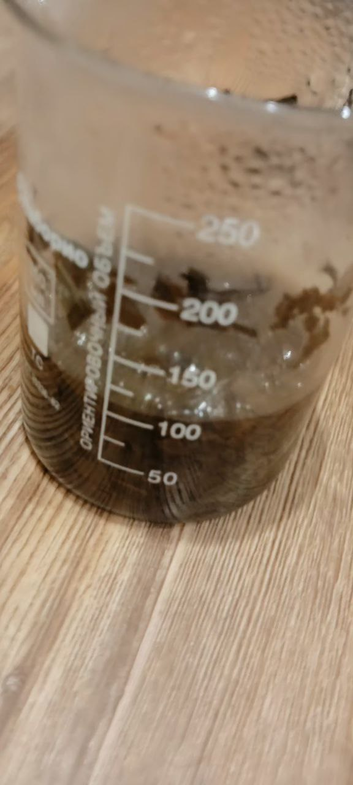

After filtering out the leaves:

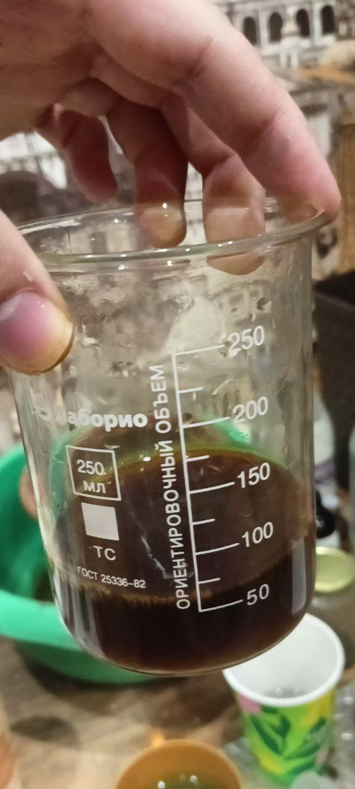

I threw in a piece of quicklime; it was hard to break (only with a hammer) [CaO].
It immediately slaked, but the color of the solution changed.

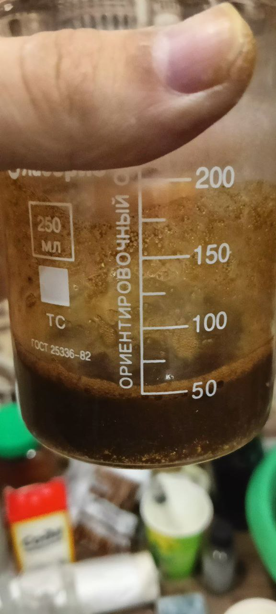

I crushed more lime, added it, and filtered the precipitate that formed (these are tannins).

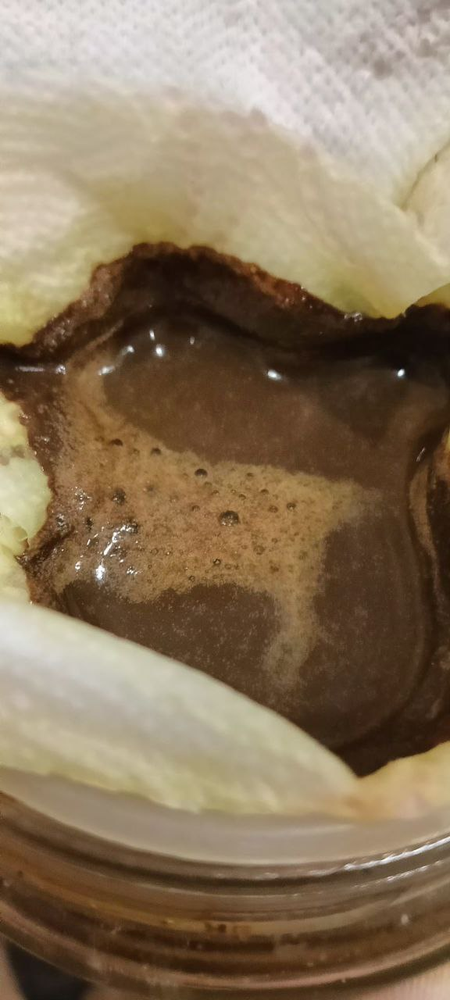

After that it didn't help much; I repeated the procedure, but each filtration lost some liquid. Therefore, to make sure the caffeine converted to the basic form, I added NaOH.

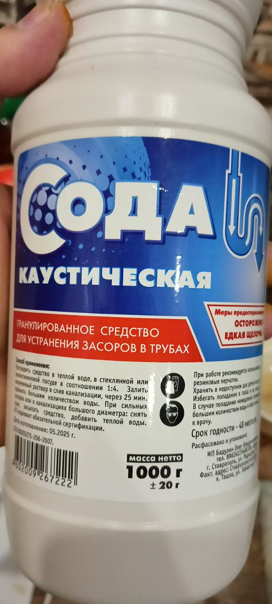

After caustic soda, the toilet-paper filters began to break down very quickly, and I couldn't remove almost all of the precipitate that was forming, so although the solution was partially transparent it retained some color. I added very little alkali, only trace amounts, but that was enough for the remaining part to precipitate.

I took dichloromethane:

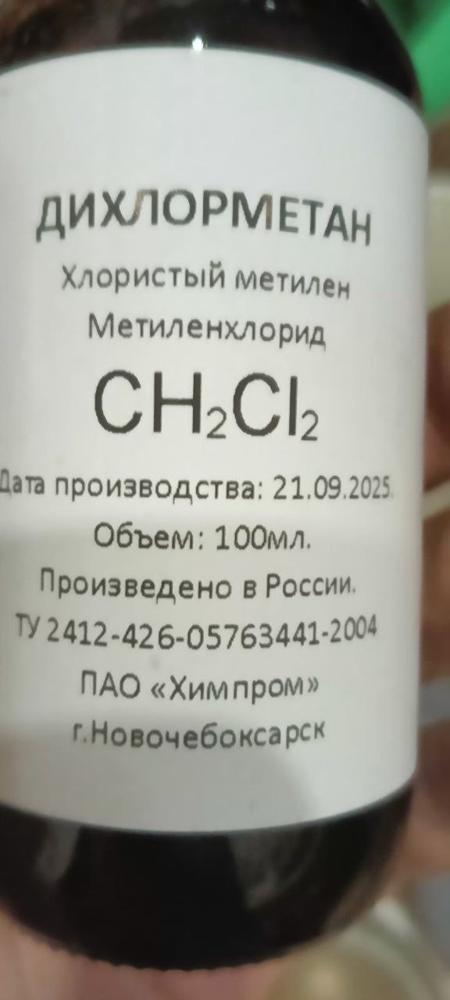

I added about 5± ml. The solution began to behave like gasoline in a puddle or even oil in alcohol — bubbling with strange spheres — and eventually became one sphere, which I drew off with a syringe. (It separated into liquid phases.)

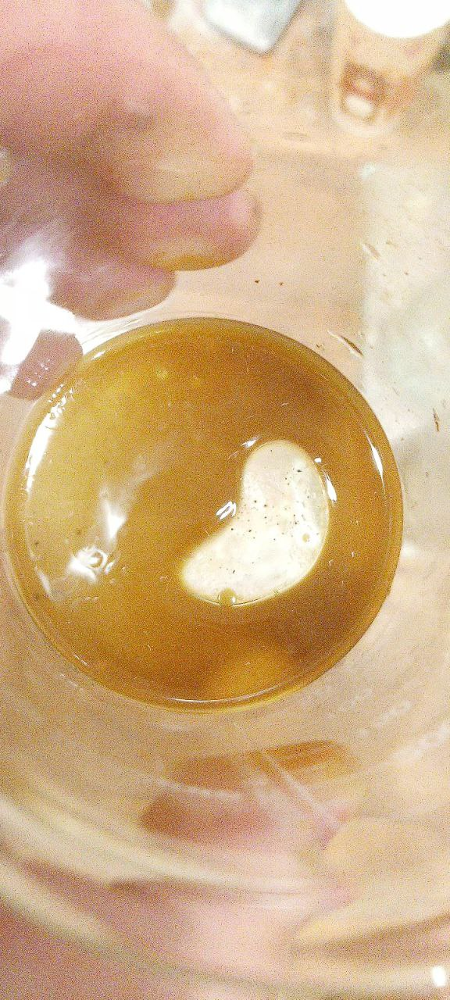
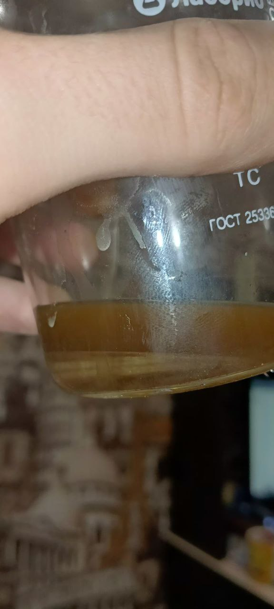

Before that I bubbled it more and shook it to extract better (almost like extracting iodine from an aqueous solution with a nonpolar solvent).

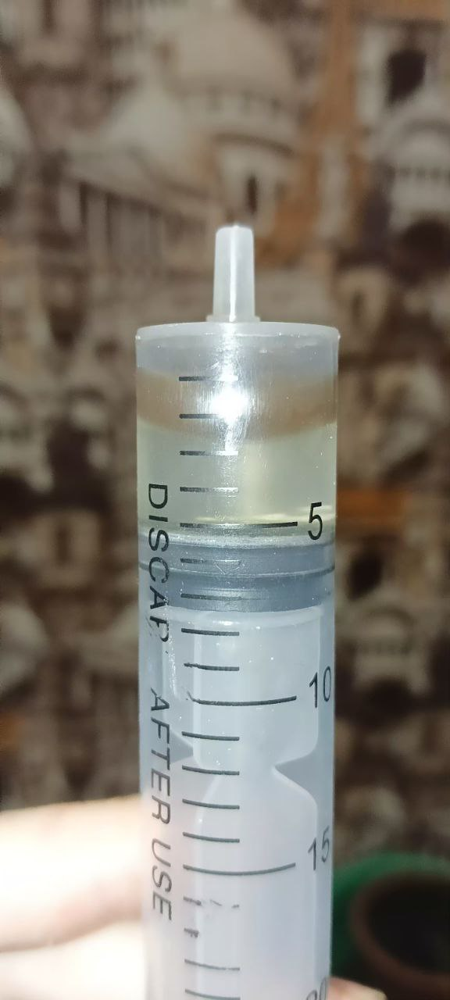
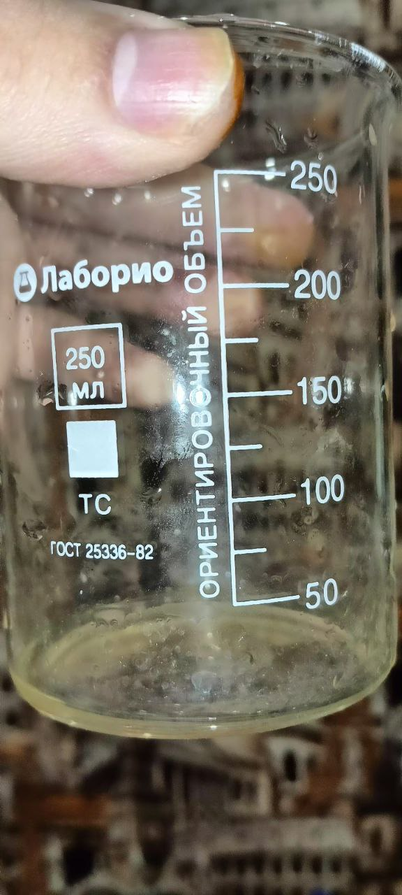

The resulting solution was left to evaporate by itself at an open window; even at a lower temperature this didn't take very long. Despite that, while examining the solution I still inhaled dichloromethane, even though the glass was above my head. The smell is very sweet and even pleasant, though very toxic. If there were perfumes with a similar smell, I would buy them.

I obtained crystals:

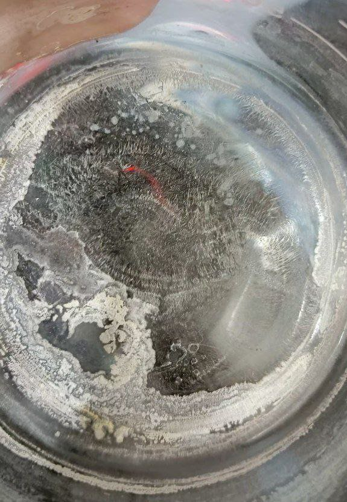

I added lime until the precipitate stopped remaining on the filter in such large quantities.

The next possible step, when I have peroxide, is to check with the murexide test. But even from the crystals you can see there are needles that look like pure caffeine. Most likely this is caffeine with impurities, or a peculiarity of caffeine crystallization. The murexide test will only answer whether there is caffeine there; it will be difficult to determine product purity that way. Only by checking the melting point.

**Not a very interesting point, <s>you can skip it</s>**: always use PPE and a fume hood. Dichloromethane vapors are carcinogenic and can damage the kidneys, liver, and so on. And alkali can make you lose your eyes. And you can accidentally suffocate from ammonia. (In rats, dichloromethane has been shown to cause lung, liver, and pancreatic cancer. Latex or nitrile gloves are not suitable for regular work with dichloromethane.)

## Attempt to perform the murexide test

I added nitric acid until all the precipitate dissolved. It dissolved well. I left it overnight; by morning most of it had evaporated and white crystals remained. But they should have been red, so I decided that the nitric acid had not decomposed enough to release oxygen and there was no real oxidation. I evaporated it under a fume hood and obtained a reddish residue. But when I added ammonia in a small amount I got a red slurry. And when I added more ammonia I just got a yellow color. As options: either there was too little caffeine and its derivatives, or it was very contaminated. For the next attempt I plan to do it with a larger quantity and ethyl acetate as the solvent. Simply because I have more of it. Also, in the second attempt I plan to give up on caustic soda and instead crush my pieces of quicklime into a good powder.

By the way, this is related to the topic of AI... Even small changes can cause a complete failure. And what is on paper does not always correspond to full reality, so all these AIs should not claim that they are better than teachers (as Grok insisted to me) [NoAI](/en/aiishipemachine.html)

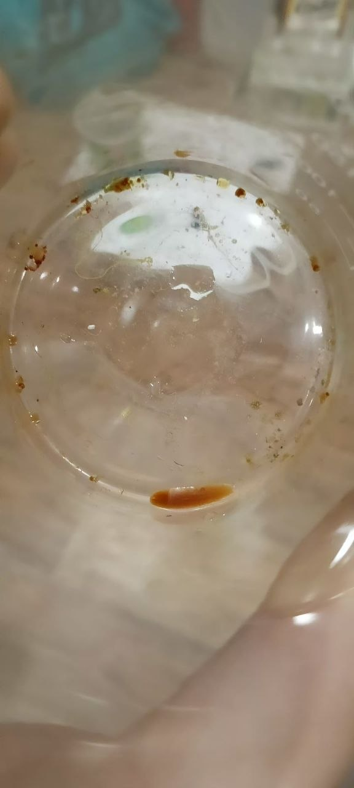
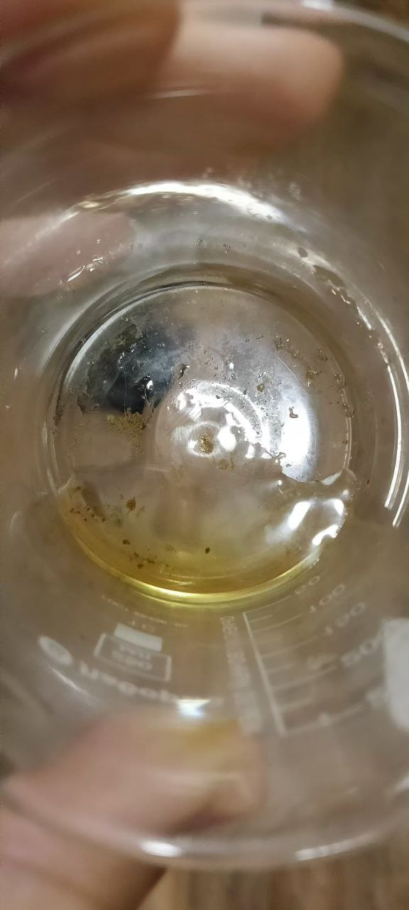


# Attempt with ethyl acetate, part 1.2

I took a 200 ml tea solution, 3 tablespoons. Boiling water. Without initial filtration, I carefully added pieces of CaO. At one point, realizing that over time with heating, instead of passivation, an active reaction 2CaO + 2H2O -> 2Ca(OH)2 was taking place, I just threw in a piece and part of it even spilled out.
Last time I even pressed a piece of lime with a spoon — it didn't break and didn't react like that. I don't know why. But the solution was clearly colder then. Maybe I just needed to wait, but oh well.
On the internet they write that it should react immediately with cold water. Very strange, because in practice it didn't react immediately for me. But with a hot solution it reacted immediately, although it boiled — which is normal if the container is very large. But adding it in portions is definitely correct (you can burn yourself and get nasty consequences from alkali, so I worked in protective goggles).

I filtered the resulting slurry. At first my filter tore and part of the precipitate got into the solution. The solution itself, unlike the case when I added only trace amounts of alkali, was less transparent and more yellow.

<video width="640" height="360" controls>
  <source src="{{ 'experimets/Coffeine/2/caohandrastvor.mp4' | relative_url }}" type="video/mp4">
  Your browser does not support the video tag.
</video>

I obtained a solution and a precipitate/residue:

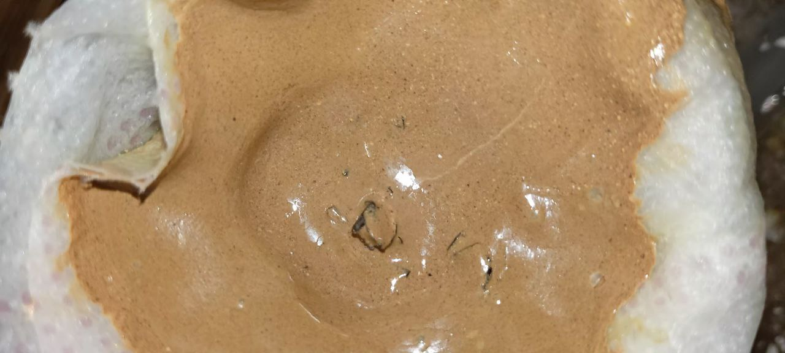
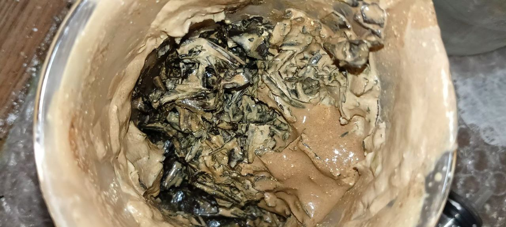
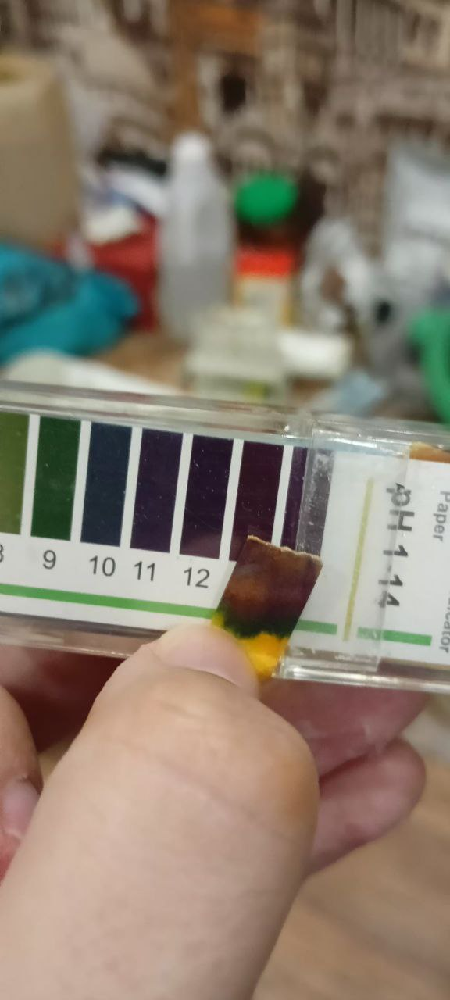
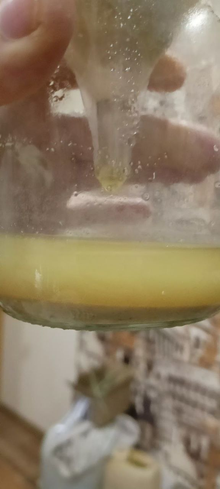

I added ethyl acetate, about 25 ml, to the resulting liquid.

<video width="640" height="360" controls>
  <source src="{{ 'experimets/Coffeine/2/fazy_web.mp4' | relative_url }}" type="video/mp4">
  Your browser does not support the video tag.
</video>

I poured it over and bubbled it. Unlike dichloromethane, the resulting layer is much harder to separate with a syringe; moreover, it smells more unpleasant and is not at all like pears or apples. The smell faintly resembles fruit, more of a vinegar note, only instead of an acidic smell it's something unclear. And the smell spreads quite quickly. Also, unlike dichloromethane, ethyl acetate practically does not evaporate at an open window, and it is also hard to evaporate on a radiator. At the same time, an azeotropic mixture is not excluded (hypothetically), since in porcelain I obtained less finished substance than during the initial crystallization.
In short, I liked dichloromethane more for these purposes.

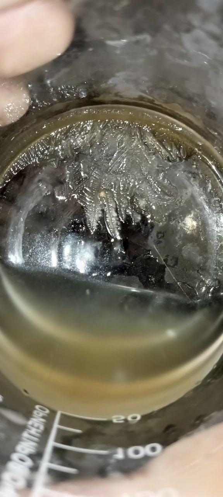

## Murexide and AI

Using AI as a source of reliability is very dangerous when one AI says one thing, another says something else, and it contradicts itself. Here are some proofs:

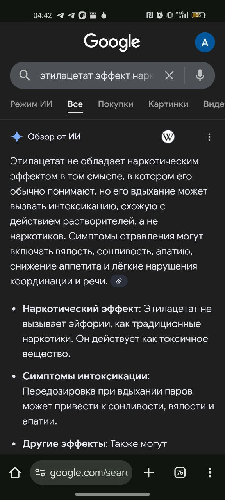
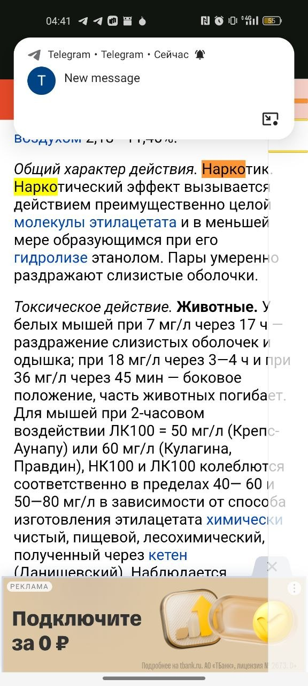
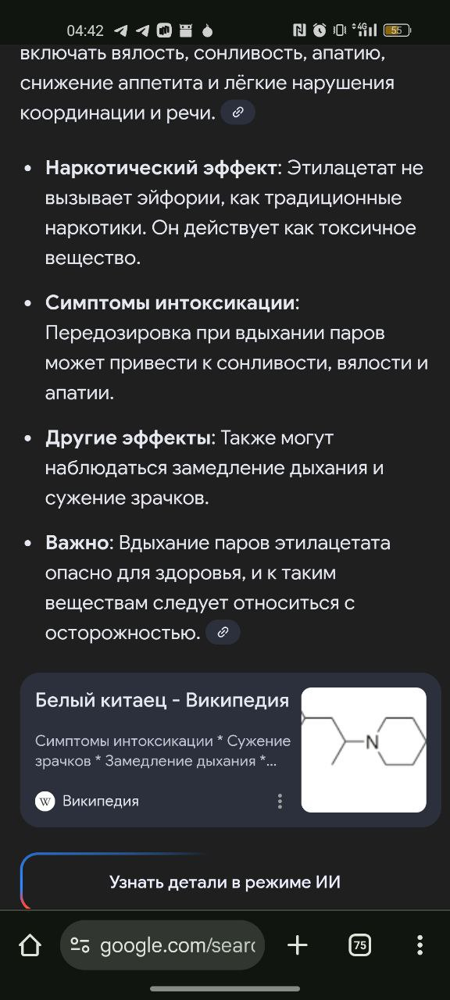
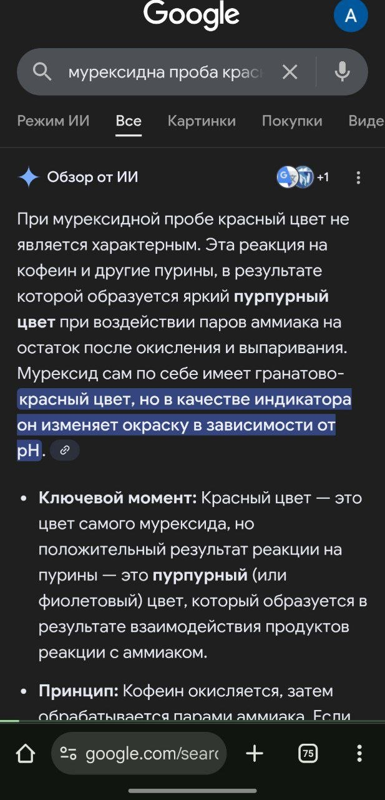

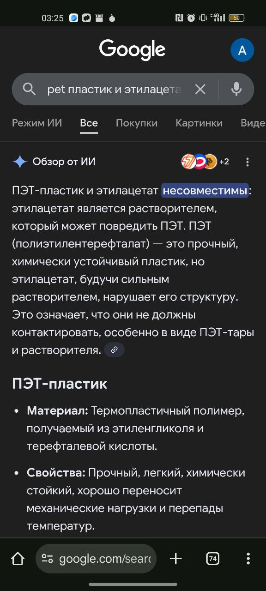
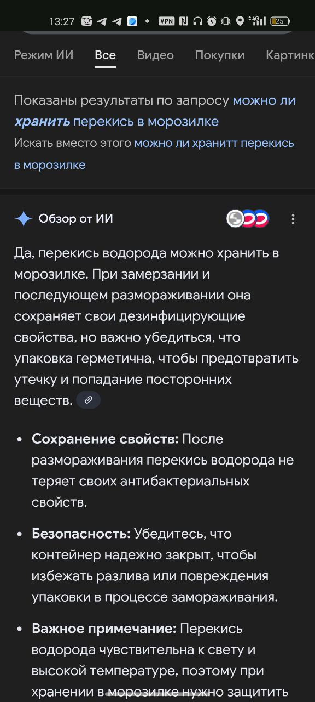
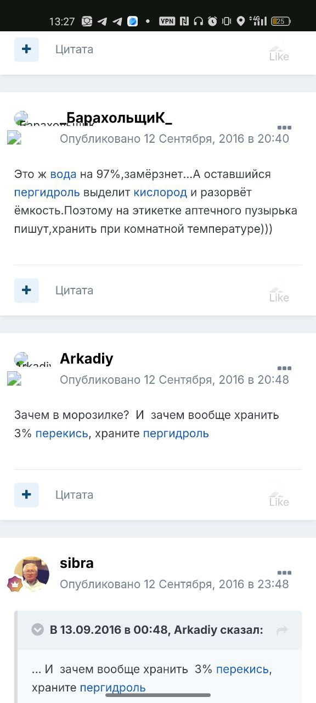


For those who missed it: AI writes that ethyl acetate has no narcotic effect, although it is logical to assume that in the body it hydrolyzes to ethyl alcohol, which would produce a narcotic effect. And on this question it even suggests studying fentanyl (apparently the developers themselves are on something serious there).

Then it writes that the murexide test does not give a red color (although if you read manuals, it does give red, not only purple).
Then it says that PET is used for storing ethyl acetate, and in another case says it cannot be stored in PET (double work, having to go and check after this AI).
And in another case, it says you can freeze peroxide, while other (human) sources write that medical peroxide cannot be stored below 0°C at all.
So all of this is quite unreliable.

[AI = hype machine](/en/aiishipemachine.html)

## Murexide test

It didn't work for me: I got a yellow solution, as with nitric acid. When ammonia was added, as with nitric acid, it gave a red color. And an attempt to evaporate the ammonia from this solution (which, in principle, is what needs to be done, by the way) gave a completely different shade and some pinkish precipitate. At the same time, if you study manuals, different literary sources report orange or red...

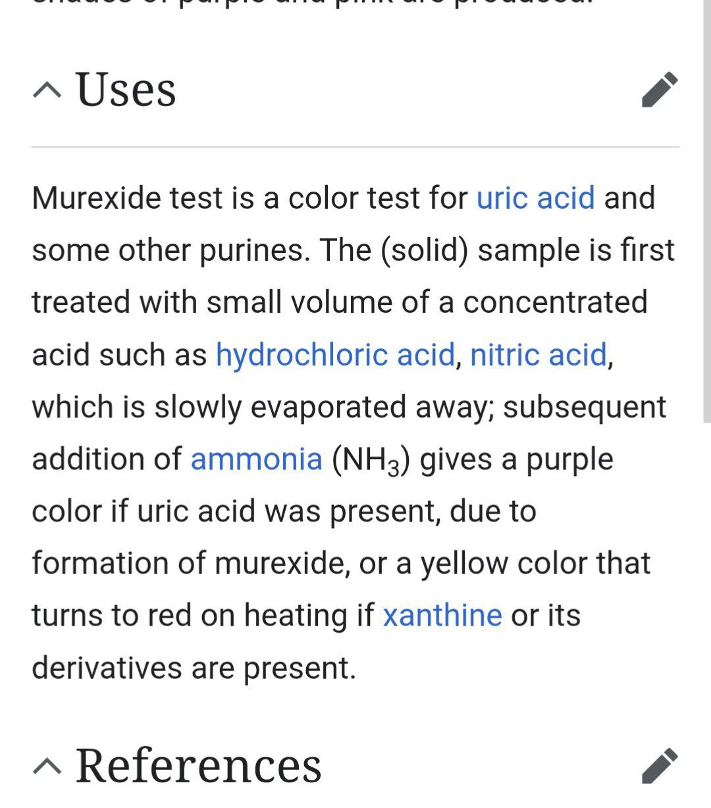

According to Wikipedia, it should be a yellow solution, which upon heating gives red (mine turned slightly red).

```
Tetramethylpurpuric acid gives a specific purple coloration in the presence of ammonia or ammonium salts. The appearance of the characteristic purple coloration for tetramethylpurpuric acid is explained by keto-enol tautomerism, which is due to a single π-conjugated system of the heterocycle [9, p. 508]. A comparative analysis of literary sources [4], [8], [10] leads to a certain contradiction in the description of the color of the final product: an orange or brick-red precipitate is given as the characteristic color of murexide.
```

```
Heating in the presence of hydrogen peroxide leads to cleavage of the imidazole ring of caffeine to urea and subsequent oxidation of the pyrimidine ring to dimethylalloxan and dimethyldialuric acid. Hydrochloric acid acts as an acid catalyst at the condensation stage: protonation of the oxygen of dimethylalloxan leads to delocalization of the positive charge, stabilized by two resonance structures, which facilitates nucleophilic attack by the hydroxyl group of dimethyldialuric acid and leads to the formation of tetramethylalloxantin (amalinic acid), whose solution has a characteristic rich lemon-yellow color (see Figure 2).
```

This is what I got:

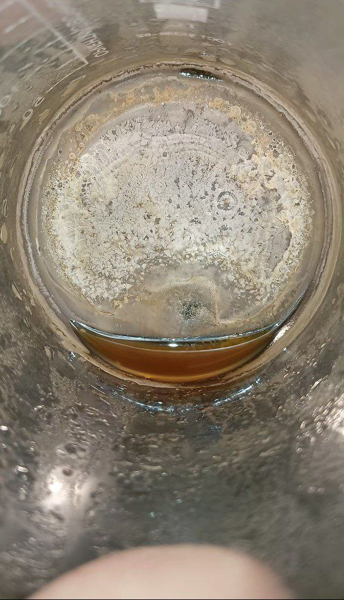
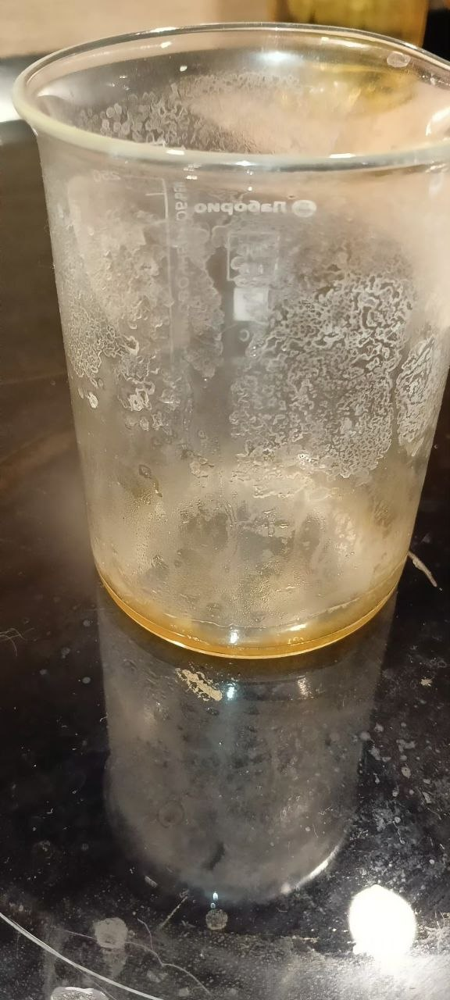
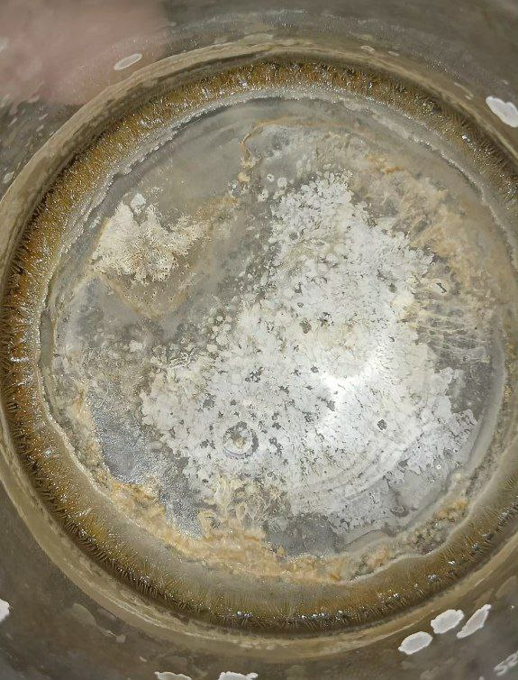
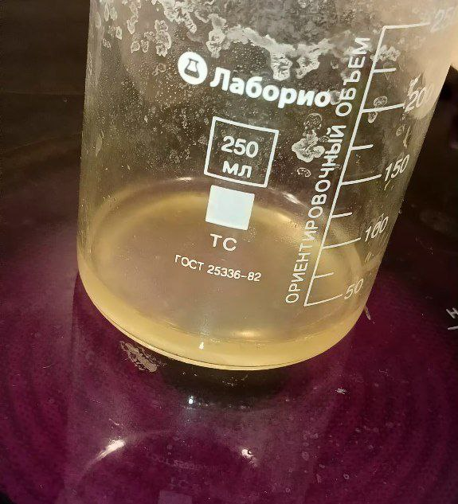
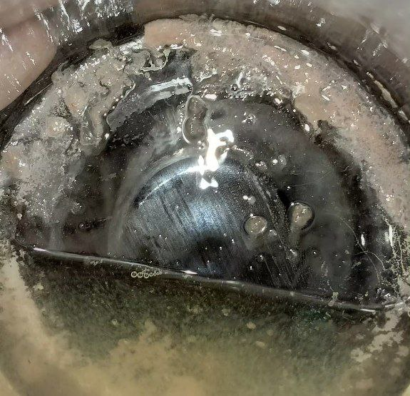
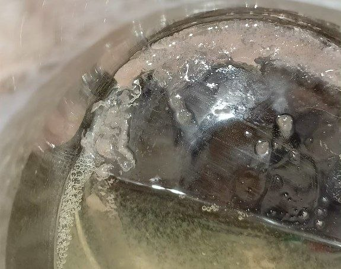


The solution, by the way, is yellow, and therefore, because of impurities, a completely different shade may result — and that may be normal — but then you could extract much more caffeine. Maybe a whole pack of the cheapest tea, the kind used to make chifir in not-so-remote places. But then all this would need to be done in some kind of pot, and a proper separatory funnel would be needed.
To increase caffeine solubility, you can add citric acid. But I still think the issue is not quantity, but purity.


Initially, as in the very first photo, only a slightly brighter coloration appeared when ammonia was added to the yellow solution (not the dry residue). Perhaps the ammonia needs to be boiled so that it attaches to the molecule.

Hydrogen peroxide 37% and hand:
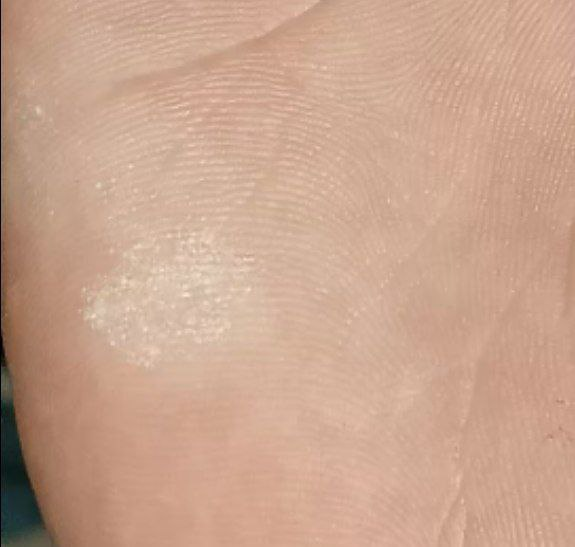

I took a glass pipette, washed it well with water (so that less dirt that could decompose the peroxide would get in) and dripped it into a glass. Apparently a little ended up on the walls of the vessel and I touched it. An unpleasant burning sensation comes only later, not immediately. White spots appear. They went away on their own in less than 30 minutes for me. But I understand that at non-trace concentrations and if held longer, the hand would turn properly white. Even alkali does not react so quickly when it gets on the skin. I think the consequences for the eyes will be even worse than from alkali. Use protective goggles with peroxide — this is important — and gloves are very desirable here.


Avak writes:

```
I looked at your page about CAFFEINE. The nasty thing is that there is quite little caffeine in tea, coffee, etc., and at the same time there are myriad other compounds. I have not tried to isolate (precipitate) caffeine myself. THEY WRITE:
https://www.chem21.info/pic1/130026168223234123181188232190039042147048224216.png
that caffeine forms a brown precipitate of periodide "with an iodine solution in an acidic medium"; and also that caffeine forms a white precipitate with tannin solution, soluble in excess tannin. BUT what concentration of caffeine can be determined by these methods? It is one thing if you have ready-made crystalline caffeine whose authenticity needs to be confirmed by qualitative reactions, and quite another when you need to precipitate caffeine from plant products in which there is little of it. About EVAPORATION (you) — evaporation of aqueous solutions of most organic products gives RESINIFICATION. So "darkening" during evaporation is primarily the result of decomposition (resinification). Evaporation is used in the MUREXIDE TEST, BUT only in a water bath (because a water bath does NOT allow heating above 100°C)! About the formation of murexide — if the action of nitric acid and then ammonia gives a red color — that is it. "To carry out the reaction, the preparation is heated in a water bath until completely evaporated with an oxidizer (H2O2, Br2, HNO3) in an acidic medium. Then ammonia solution is added; a purple-red coloration appears." https://studfile.net/preview/3977582/
In this quote I would exclude bromine, because with bromine there will be a lot of side effects. The solubility of murexide in water is poor, BUT for it to precipitate there must be quite a lot of it, and after all there is very little caffeine in tea and coffee. So there will be "red coloration", but a precipitate — hardly.

About potassium ferricyanide as an oxidizer. POSSIBLY! You need to try (acetone and isopropanol).
...
For a caffeine test, you need to boil in a WATER BATH with DILUTED nitric acid. Diluted HNO3 does not nitrate, but simply OXIDIZES, which turns out to be the necessary process (after which ammonia forms murexide).
```

So, apparently, I need to try diluted acid and not heat directly from the stove. I will first try on a preparation that definitely contains caffeine.

Mail correspondence
1, 2 (from me).
```
I took an Askofen tablet, crushed it. Put it in a glass. Added almost 10–25 ml, maybe even more water, and a few drops of nitric acid. Ml may be ±
Put it in a water bath until the smell of acid was completely gone. The solution turned yellow. I poured ammonia into it. From the ammonia a precipitate fell, reddish/brownish. I added more and the shade became brown. The same as with the substance from tea.
If you look closely, the brown is either a mixture of green or a mixture of something pale reddish. But that's not certain. That is, if you don't evaporate to the end, you get a different shade altogether, or I didn't boil long enough in the water bath. But 30 minutes for sure.

I found a lab procedure on a forum and on a site where they take magnesium oxide and tea. And then sublime caffeine crystals onto a cold surface. Then add concentrated nitric acid solution (a few drops) to them and evaporate to dryness. And then 10 drops of ammonia and get a red/purple salt - https://studfile.net/preview/9820379/page:11/ (it is unknown whether they actually tried this themselves or not, but it looks realistic)
I also found this:
"
Sublimation of caffeine from dry tea. A small amount of crushed tea is placed on a watch glass and covered with a second watch glass. Heating carefully, observe the sublimation of caffeine. It settles on the upper glass in the form of long, slightly colored needles. [p.203]
"
That is, you can sublimate it instead of extracting it. And the oxide is needed to bind polyphenols and the rest. It seems to me that at high temperature the acid-caffeine adduct can separate by itself. So, in general, I don't get this purple coloration. And even with Askofen I get a brown/reddish-green coloration. Maybe I just don't understand colors, but this method of detecting caffeine in contaminated systems is very difficult. You need to observe exact proportions. And if the caffeine is not pure, the proportions already change. You get not purple, but a completely different color. I will keep trying/thinking.
---
I searched for these reactions on YouTube. One just burned everything to charcoal with urotropine. Another just mixed iodine. One just shows some iodine solution for no reason. Only one showed a green solution. But that was not an alcoholic solution, but a ready-made reagent and hydrochloric acid. It gave a green color. These are not very good reactions. Maybe you need to find a caffeine salt that simply doesn't dissolve. Caffeine picrate is insoluble, so there must be similar compounds with fewer issues. Like, why would I need picric acids. But I think this is the most optimal way to confirm that alkaloids have been isolated. They will precipitate. This should be a very reliable reaction.
Or you need to look for a physical method. And if a physical method, then you need to isolate a lot of substance. To check, for example, solubility in water and solution density.
Caffeine decomposes in alkali.

https://studfile.net/preview/3977706/page:2/
And here too they write water bath.

A characteristic feature of purine alkaloids is their instability when heated in an alkaline medium (at pH>9). In this case, caffeine decomposes to caffeidine-carboxylic acid and further to caffeidine (a physiologically inactive substance). [p.363]

That is, you also need not to overheat the solution or not make the medium too alkaline. Many pitfalls.
In general, I will try to auto-evaporate a solution of peroxide, hydrochloric acid, and Askofen in a porcelain dish on a radiator. I hope it works. And nitric acid gives a coloration that confuses everything. I think it will work. The water in the radiator is hot.
```

To me (Avak Avakyan):
```
About caffeine sublimation — that's absolutely BRILLIANT!!! Of course, this is the IDEAL way.

With Askofen, it seems, everything turns out correctly. Probably murexide should look like that.

"Caffeine, morphine, aconitine, theobromine are NOT precipitated by picric acid":
https://edu.vspu.ru/members/rfnzufkz/docs/231119/download
At this link there is a Word file where it is described in detail how to sublime caffeine. By the way, you can try to sublime caffeine from Askofen. It also says there (in this file) that nitric acid with caffeine can give amalinic acid, which is orange. Amalinic acid is tetramethylalloxantin. Formula of alloxantin:
https://www.optimum-lab.ru/wa-data/public/shop/products/38/48/24838/images/73367/73367.0x500.png
This is that product with 4 methyl groups on nitrogen atoms (instead of hydrogen). It gives murexide with ammonia.

Caffeine is practically not basic. Compare it with uric acid:
https://upload.wikimedia.org/wikipedia/commons/9/9b/Harns%C3%A4ure_Ketoform.svg
So calling it an "alkaloid" is a bit of a stretch: the word "alkaloid" comes from "alkaline"; that is, "alkaloids" are organic compounds that have alkaline properties. "Classically" these are nitrogen compounds in which nitrogen behaves like ammonium. But not all organic nitrogen compounds are alkaline (uric and cyanuric acids are examples). I say this because precipitating some caffeine salt means you need to look for some "specific" salt like urea nitrate (urea is also practically not basic, but with nitric acid it does form a poorly soluble and stable salt in solid form).

HERE:
https://www.reddit.com/r/chemistry/comments/x3odfu/extracting_coffee_aromatics_and_caffeine_without/?tl=ru
they discuss extraction and precipitation of caffeine. They recommend extracting with ethyl acetate (as a result they promise caffeine crystals). They also write: "Mix the drink with Lugol's solution (iodine + potassium iodide) and concentrated sulfuric acid. Caffeine forms an insoluble complex with iodine in an acidic environment. I tested this procedure on pure dissolved caffeine and black tea, and it seemed to work perfectly."
```

I have now made a solution of water, hydrochloric acid, 37% peroxide, and 1 crushed Askofen tablet. So far there was a smell, maybe of a chlorine derivative (hypochlorous/chlorous acid may form) — chlorine — but when I opened the window the smell disappeared. Most likely chlorine. HCl + O* => HO-Cl / HO* + Cl* / H2O + ClO* + Cl2 + also chlorinated organic matter and maybe something else I didn't account for [a radical-type mechanism. Where the asterisk is a homolytic charge, not plus and not minus, but between these charges — a radical, simply speaking]. It, in turn, can decompose into chlorine and water with oxygen, or further to chloric acid, up to — in practice I think not beyond chloric (perchloric?) acid. And thus also chlorinate organic matter. I obtained chlorine in a jar a long time ago and have already forgotten the smell, and sensing a strange smell I immediately opened the window and the smell stopped being noticeable.
I may be confusing something, since I don't take this information much from sources and it's my own guesses/hypotheses.

I accidentally found an article that you can even catch chemiluminescence there (in alkali).
I didn't find any information about chlorine derivatives of salicylic acid.

```
When barbituric acid is treated with fuming nitric acid, 5-nitrobarbituric acid is formed (Baeyer, 1861), which upon reduction gives 5-aminobarbituric acid, or uramil (Baeyer). Uramil was obtained by Prout (1818) by decomposition of murexide with acids. Prout called it purpuric acid. By treating cyanate of potassium with aminobarbituric acid, pseudouric acid is obtained (Schlieper and Baeyer, 1863; Baeyer, 1869), which can be converted to uric acid (see below) [p.360]
```


```
A characteristic feature of caffeine and other xanthine derivatives, as well as uric acid, is the murexide test, based on the formation of alloxantin (or its methylation products) upon oxidation with chlorine, hydrogen peroxide, etc. These compounds give red-colored salts with ammonia, and red-violet with alkalis [p.514]
```

I did not find the color of alloxantin, nor the color of derivatives (5-aminobarbituric acid and alloxan) in the Russian-language segment. In English:
[alloxan](https://en.wikipedia.org/wiki/Alloxan) -> **Appearance: pale yellow solid**
I also did not find colors for salicylic/chlorophenol derivatives and so on:
[chlorosalicylic](https://en.wikipedia.org/wiki/Chlorosalicylic_acid)

In general, alloxan should be yellow and should turn red with ammonia. In acid it decomposes (high concentration) and gives a greenish-brown tint. And with alkali it gives me the same tint over time. And in general, murexide itself is unstable.

--
I checked the solution with ammonia again before it was completely dried and at first got exactly the purple color, which immediately decomposed into brown, as in the tests with tea.

<video width="640" height="360" controls>
  <source src="{{ 'experimets/Coffeine/2/murexidetest1_web.mp4' | relative_url }}" type="video/mp4">
  Your browser does not support the video tag.
</video>

Here is the mortar itself:

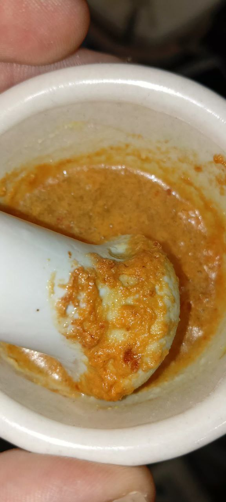

Discussion with Avak:
my message:
```
If in aqueous solution, without waiting for a completely dry residue, something reddish-pink really is visible. But not for long.
I'll try to dry it completely. Murexide, they write, decomposes in the same acidic medium.
It evaporates very slowly on the radiator. And I took peroxide + hydrochloric acid in a ratio such that there is more hydrochloric acid, less peroxide, and a little water. That is, a very acidic medium, and hypochlorous acid and chlorine should form there. It's worth trying with iodine.
I'm continuing to evaporate to a completely dry residue now and will repeat adding ammonia, but it already looks more like pink shades.
```
To me:
```
I watched your video; everything is perfect, as it should be! Everything is correct. Wikipedia says that murexide is "dark red, BROWNISH or purple small crystals with a greenish luster":
https://ru.wikipedia.org/wiki/%D0%9C%D1%83%D1%80%D0%B5%D0%BA%D1%81%D0%B8%D0%B4
So "you don't need to look closely at the shades." 😆😂🤣
You also need to remember that "an aqueous solution of murexide is stable for one day":
https://xumuk.ru/encyklopedia/2719.html
And that's at ROOM temperature. And when boiling, especially in non-neutral media, it can "die" extremely quickly. By the way, when adding ammonia, if there is LITTLE of it, the coloration soon disappears because the acidic medium decomposes murexide. Therefore, you need to add an EXCESS of ammonia at once. Otherwise: a drop of ammonia falls into the acid solution; NEAR IT murexide immediately forms, IT immediately turns red IN THAT PLACE. And in the next moment the acid from the surrounding space decomposes the murexide — and we see that the coloration immediately "fades". And the decomposition products will not give murexide with a new portion of ammonia. THEREFORE you need to ➡️ QUICKLY pour in an EXCESS of ammonia AT ONCE.
It is best not to evaporate such water-unstable compounds. It is simply desirable to obtain enough caffeine, and then make murexide from it in a MINIMUM of water, so that the murexide precipitates. And the precipitate should be IMMEDIATELY filtered WITHOUT heating and quickly pressed hard between layers of paper to dry quickly WITHOUT heating. And best of all, obtain murexide from uric acid, of which there is a lot in bird droppings, in particular pigeon droppings.
```

<video width="640" height="360" controls>
  <source src="{{ 'experimets/Coffeine/2/murexidetest2_web.mp4' | relative_url }}" type="video/mp4">
  Your browser does not support the video tag.
</video>

(the gas is remaining hydrochloric acid reacting with ammonia; it was taken in excess relative to the peroxide)

With alkali:

<video width="640" height="360" controls>
  <source src="{{ 'experimets/Coffeine/2/murexidetest_naoh1_web.mp4' | relative_url }}" type="video/mp4">
  Your browser does not support the video tag.
</video>


Askofen definitely contains and contained 40 mg of caffeine. It's worth trying with Lugol's solution in an acidic medium. Maybe it's even easier to do chromatography, but if you look at chromatograph prices — overpriced — it's not easier. It's unclear why the prices are so high, as if it were an extremely complex device. Just not needed by many and there won't be many purchases; the cost can't really be that high.
Well, on eBay, a gas chromatograph that costs under 900k here can be bought for $1125. And 990,950 RUB > 87,700.05 RUB. About 11 times more at minimum.
[overpriceproof](https://www.ebay.com/itm/257111084466)
well, and you can find gas chromatographs for a million rubles yourself.

That is, if we exclude salicylic acid and paracetamol, then we have caffeine in Askofen, and it should have given such behavior. As you can see, if you do the murexide test in other compositions, under other conditions, you get completely different behavior. And murexide itself is a rather unstable compound. It's worth trying Lugol's solution and an acidic medium.
In my personal experience, the murexide test is very specific and sensitive to conditions. And spotting the shade in a contaminated solution is quite a pleasure. Salicylic acid derivatives can also give a red tint if you change the formula a bit...

End of part 1.

It is not entirely clear what reacted with the residues after working with tea/murexide. Copper sulfate was reduced and a reddish-colored solution formed:
It just got onto an unwashed funnel and glass. I added it to color the solution to see if there were layers and set it aside.

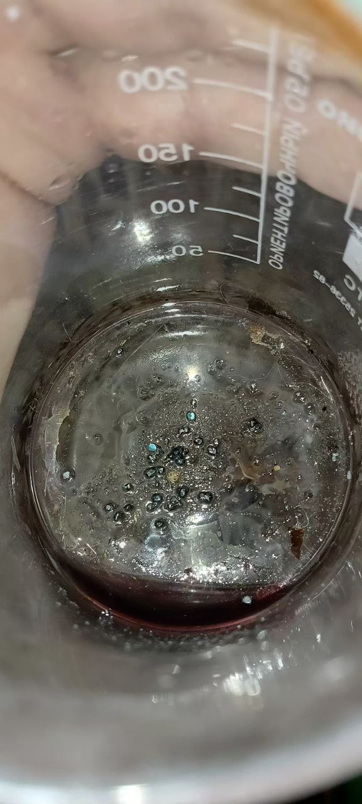
