Part 1: <a href="/en/coffeine.html" target="_blank">Attempt to extract caffeine from tea, part 1</a><br/>
There is a first part that covers other pitfalls and a way to obtain it without solvents at all. I have seen a similar method using watch glasses in other sources as well. I think it is realistic, because when evaporating a solution with DCM, more than half of it evaporates.

<div class='pair'>
    <p>Tea + citric acid (extracts better):</p>
    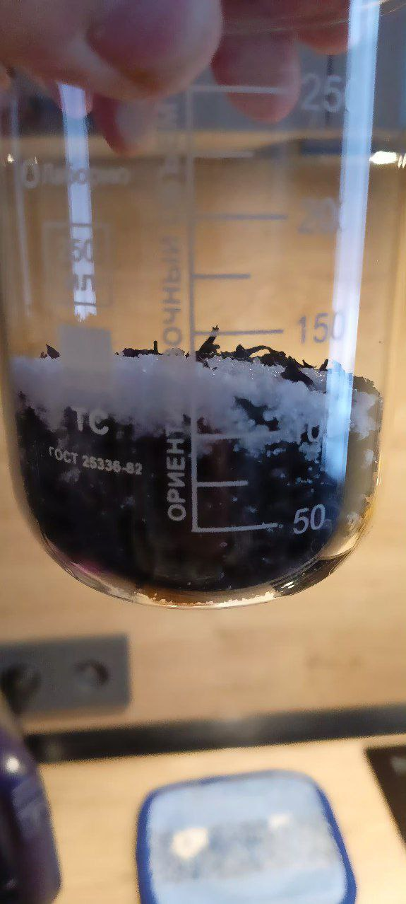
</div>
<br/>
<div class='pair'>
    <p>Lime + tea, filtration:</p>
    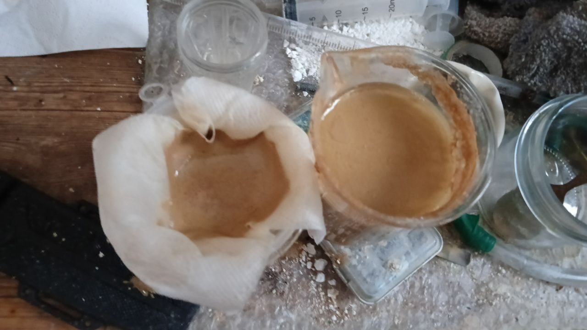
</div>
<br/>
<div class='pair'>
    <p>Lime + tea, filtration:</p>
    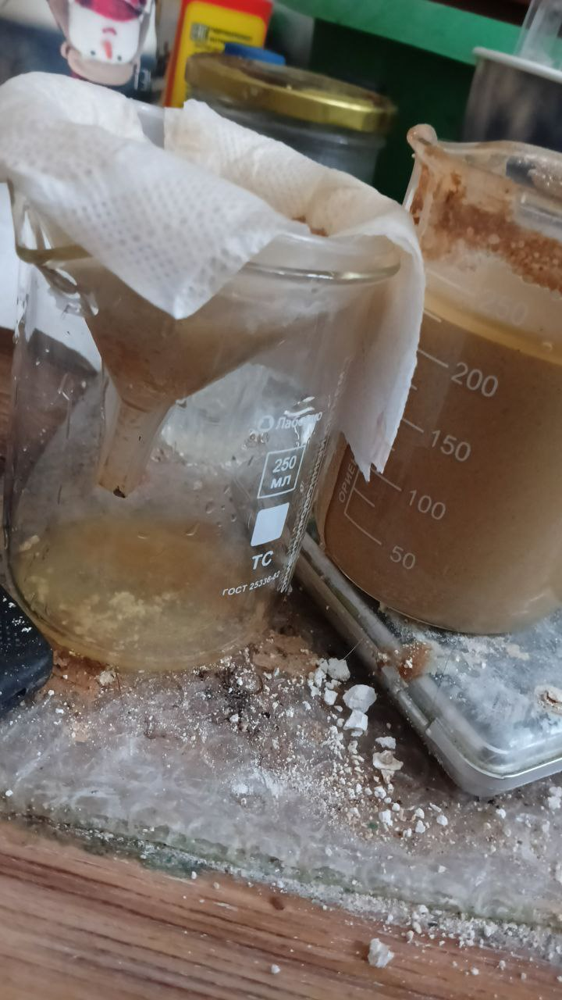
</div>
<br/>
<div class='pair'>
    <p>Crystals from DCM when freezing the solution:</p>
    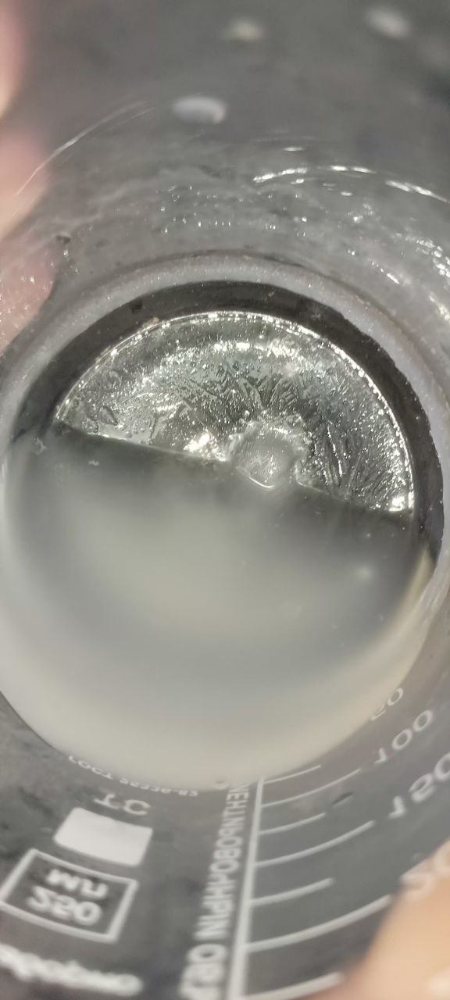
</div>
<br/>
<div class='pair'>
    <p>Crystals from DCM when freezing the solution:</p>
    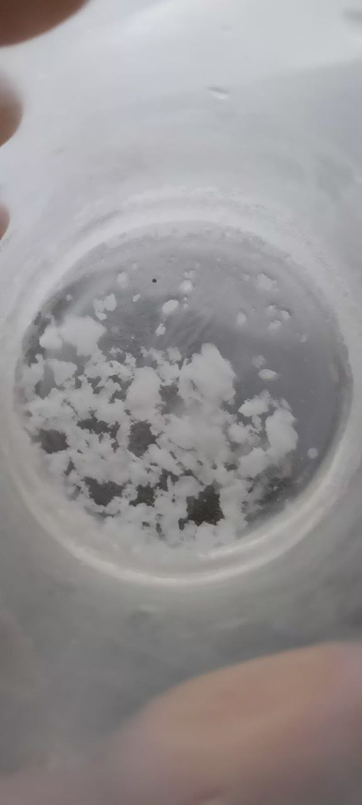
</div>
<br/>
<div class='pair'>
    <p>Crystals from DCM when freezing the solution:</p>
    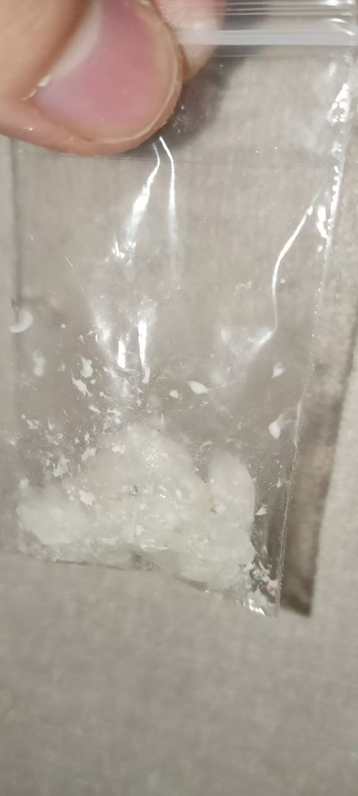
</div>
<br/>
<div class='pair'>
    <p>Crystals from DCM when freezing the solution:</p>
    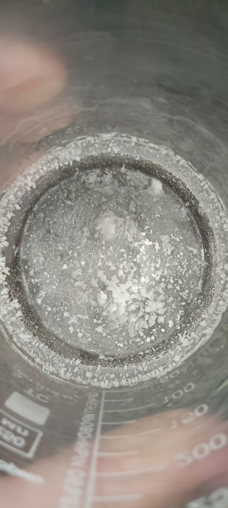
</div>
<br/>
<div class='pair'>
    <p>After the temperature rises, a supersaturated solution (it needs to be dried further in a warm place on a flat surface without heating, otherwise it will evaporate):</p>
    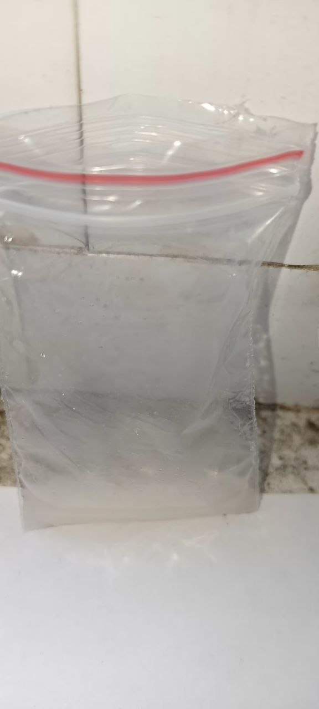
</div>
<br/>
<div class='pair'>
    <p>Weight of crystals with DCM residues:</p>
    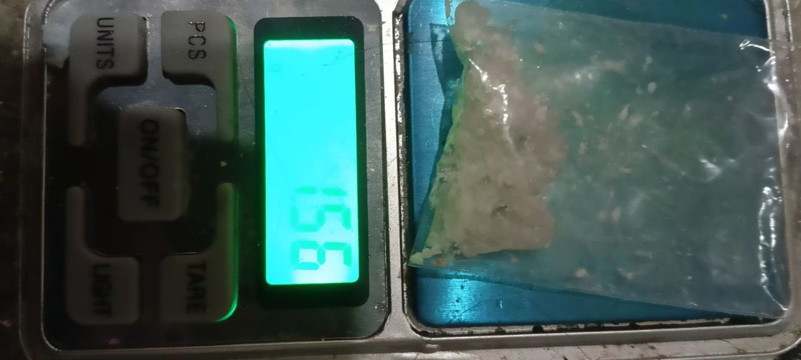
</div>
<br/>
<div class='pair'>
    <p>DCM:</p>
    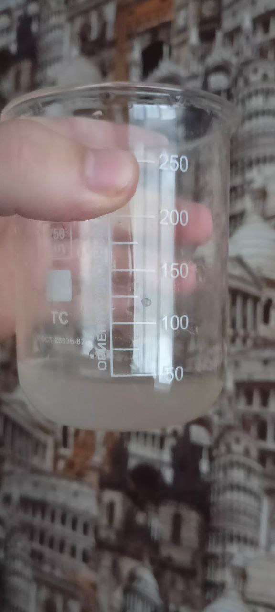
</div>
<br/>
<div class='pair'>
    <p>DCM in a separate phase:</p>
    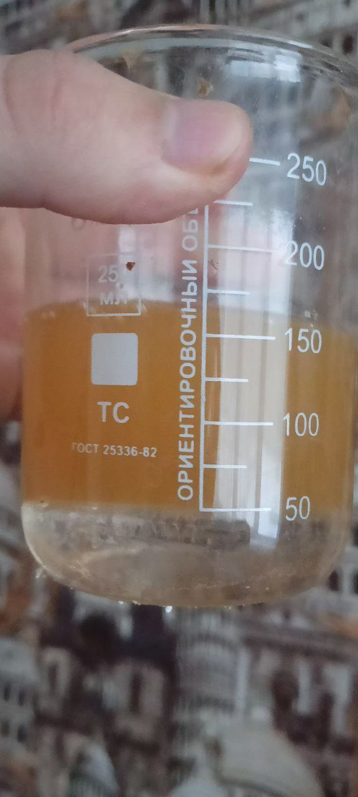
</div>
<br/>
<div class='pair'>
    <p>Burn from peroxide; can be wiped off with a washing sponge:</p>
    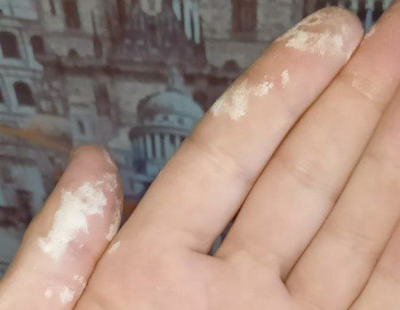
</div>
<br/>
<div class='pair'>
    <p>Murexide test attempt:</p>
    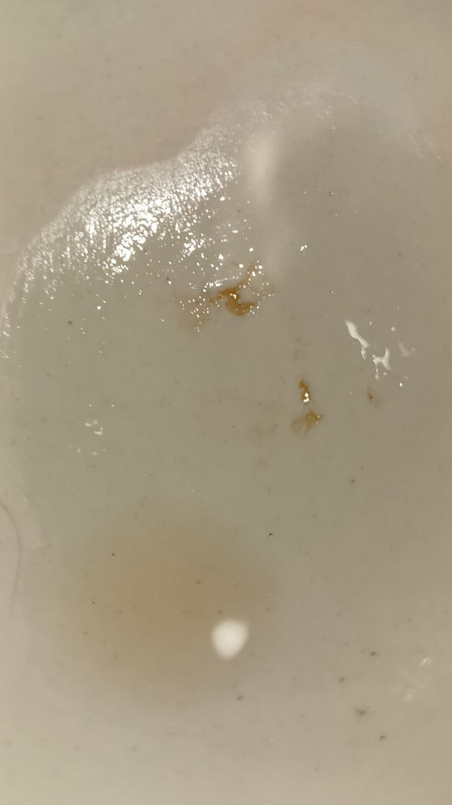
</div>
<br/>
<div class='pair'>
    <p>Murexide test attempt:</p>
    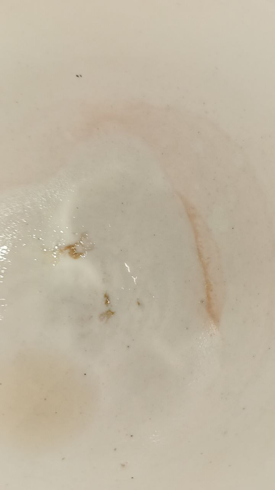
</div>
<br/>
<div class='pair'>
    <p>Murexide test attempt:</p>
    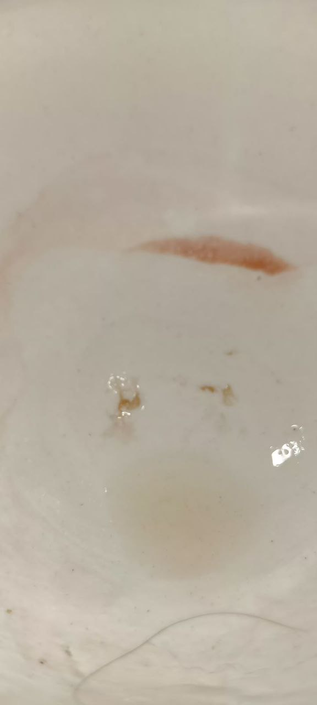
</div>
<br/>
<div class='pair'>
    <p>Murexide test attempt:</p>
    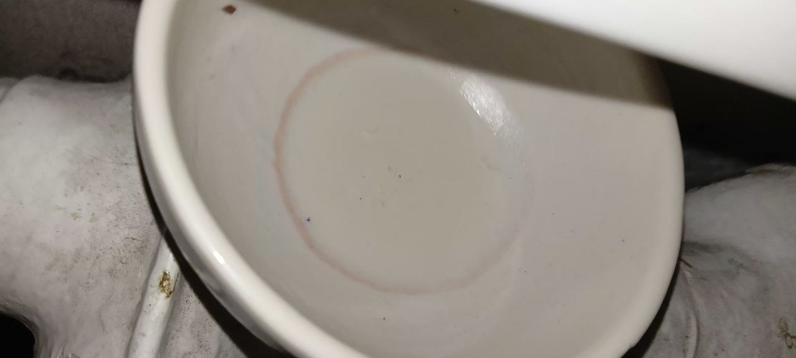
</div>
<br/>
<div class='pair'>
    <p>Failed murexide test:</p>
    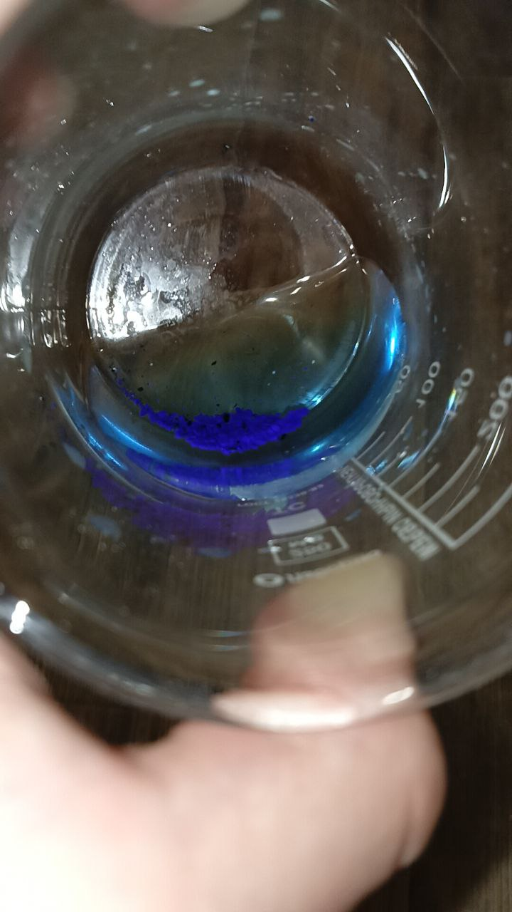
</div>
<br/>
<div class='pair'>
    <p>Failed murexide test:</p>
    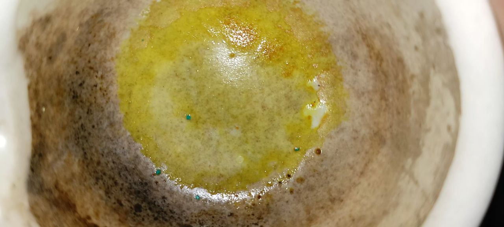
</div>
<br/>
<div class='pair'>
    <p>Failed murexide test:</p>
    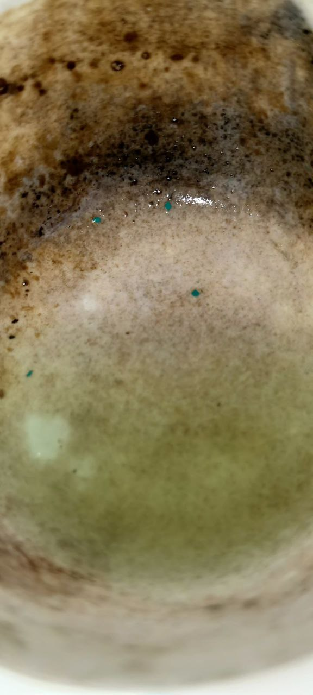
</div>
<br/>
<div class='pair'>
    <p>Lime splashes:</p>
    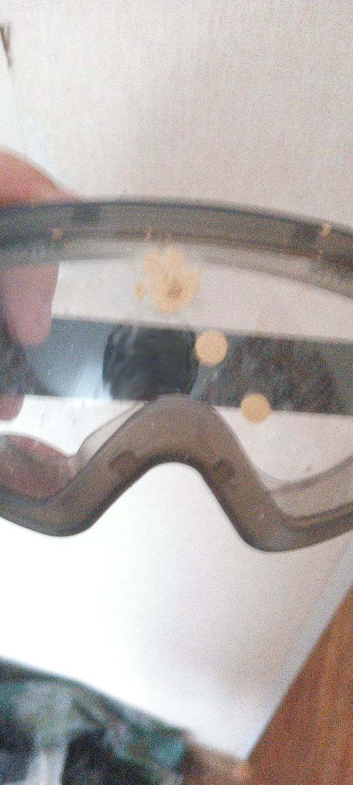
</div>
<br/>
<video width="640" height="360" controls>
  <source src="{{ 'experimets/Coffeine/3/1_web.mp4' | relative_url }}" type="video/mp4">
  Your browser does not support the video tag.
</video>

<video width="640" height="360" controls>
  <source src="{{ 'experimets/Coffeine/3/2_web.mp4' | relative_url }}" type="video/mp4">
  Your browser does not support the video tag.
</video>

```
Dissolve tea in water, in boiling water. You can add a little citric acid, but not too much.
Then use lime to precipitate tannins and filter.
Add a solvent that is immiscible with water and extracts caffeine to the resulting solution.
Stir with a spoon or something else. Draw off the solvent layer with a syringe. Place it in a cold, well-ventilated place. Crystals will precipitate. Separate them. Remove excess solvent. Leave the crystals in a warm, dry place and let the remaining solvent evaporate. Alternatively, you can evaporate it, but some will be lost to the atmosphere. Part 1 also mentions that you can heat a dish and place another dish with water on top of it; crystals will form on the dish with water.

You can perform the murexide test according to a standard procedure, but I used an excess of hydrochloric acid, a small amount of 37% peroxide, and placed it on a radiator.
https://www.scribd.com/document/824812454/murex1952
Under acidic conditions, murexide changes color depending on pH: it is yellow in strong acid, reddish-purple in weak acid, and blue-purple in alkaline solutions, making it useful as a pH indicator and metal indicator in titrations. Strong acids protonate murexide, shifting its color from the usual reddish-purple (weak acid/neutral) toward yellow.

As a result, during evaporation you will get a pinkish layer. The residue will be a yellow-red precipitate. When ammonia is added, it turns redder or slightly more pink. For the test I used the residues of caffeine that were not scraped off.

The murexide test can give red (on a pinkish residue at the edge), pink (a trace where acidity decreases or ammonia is added), brown (if not evaporated enough), green (if overheated), or yellow (before acids/ammonia) shades, not a pure pink as often described (my observations). With copper it can give a specific shade, and apparently with other metal ions as well. It can resemble the pink shade of an ammoniacal solution that turns red over time, although this may be a false observation.

It makes sense to attach an organic or inorganic acid to the caffeine base and recrystallize it. The retail price of caffeine is about 300 RUB for 25 g, so this is more for understanding the process.
```
