# Copper sulfate crystallohydrate

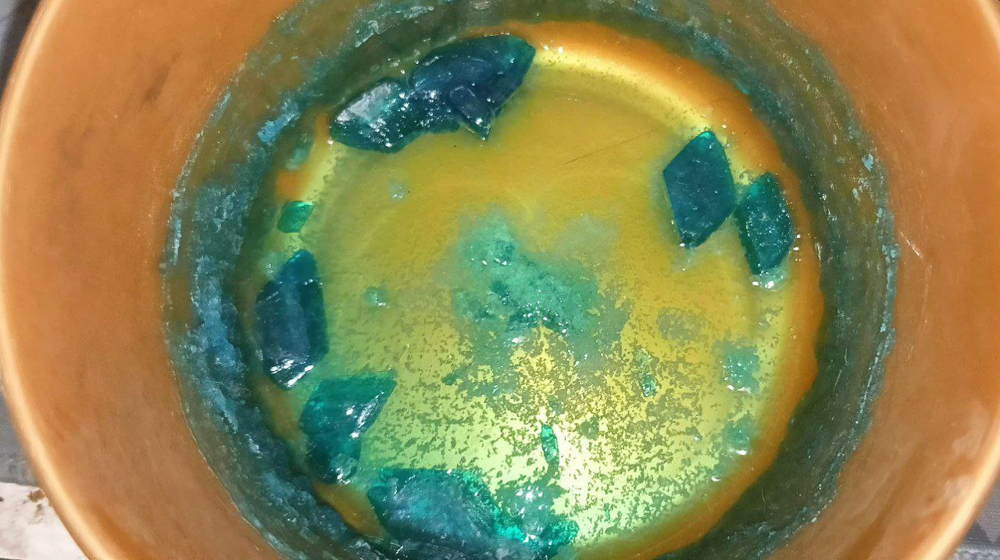
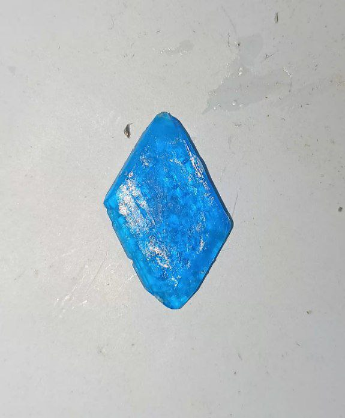

## Partially dehydrated

## Rehydrated under normal room conditions after many days (14 days passed)

# Copper nitrate crystallohydrate

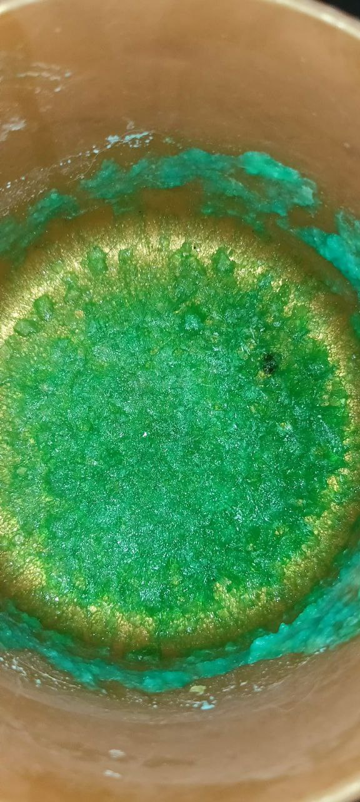

## After microwave (dissolved again, filtered, and put in the microwave for crystallization, 1:30 minutes)

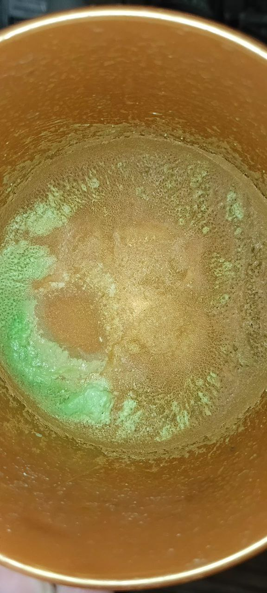
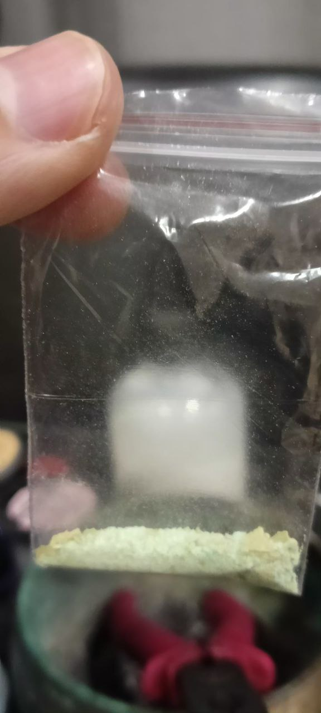

You can see that part turned whitish and part turned yellowish. After adding water the liquid itself became not green, but blue! Although initially the solution was green before the microwave. Also after the microwave there is an acidic smell. Possibly a basic salt formed partially, because a residue appeared that does not dissolve:

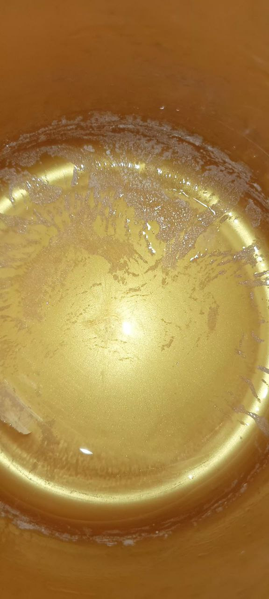

After adding water:

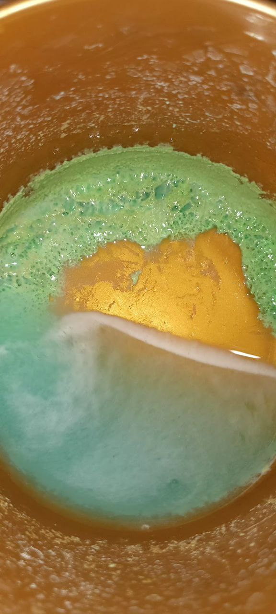
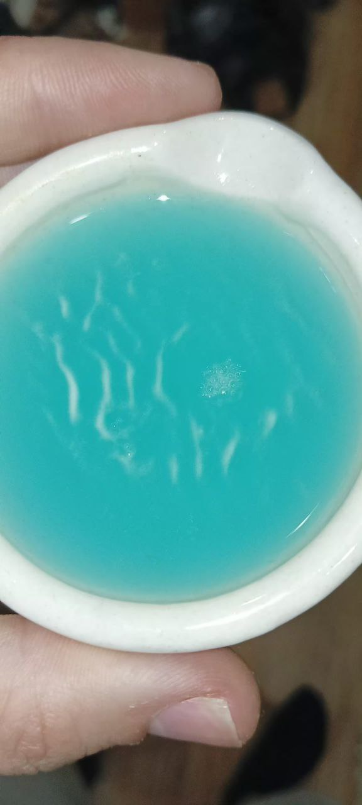

Possibilities: freshly prepared copper nitrate from nitric acid. Concentrated, the solution is green. After destruction of the crystallohydrate, it seems another crystallohydrate form that gives a green color is harder to obtain. The undissolved residue — possibly products of interaction with plastic, or impurities, or maybe I just didn't notice before, but that's unlikely. The acidic smell is most likely nitrogen oxides. But it somewhat resembled the burning sensation of hydrochloric acid, though there could not be hydrochloric acid there. So those are nitrogen oxides. But then where did the copper oxide go? And the yellow color may be some impurities that were in the silver, since the copper nitrate was obtained from 925 sterling silver. But before I dried it in the microwave everything was green. And now the crystals crystallize green. Also, I poured the clear blue solution into the evaporated part on the auto-evaporator (radiator) and it became thicker — less blue-transparent and a more dark, saturated color. Just improved lighting. And when strongly diluted it is almost like a copper sulfate solution, blue, only light blue. The more concentrated, the more the color changes. I will keep observing. The crystals themselves crystallize green.

On the radiator it also turns yellow in places, part remains green. If you crush it in a mortar it becomes liquid again. I had to evaporate it in the microwave for 15 seconds at a time. In the end the same pale green powder was obtained (for large crystals it needs to crystallize at room temperature and for a long time).

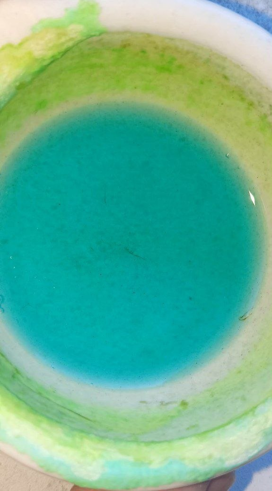
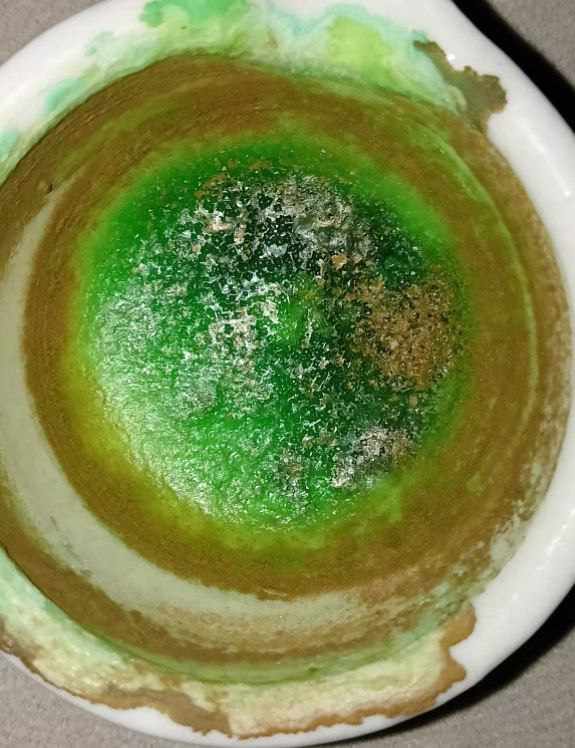

# Silver acetate (on the edges)

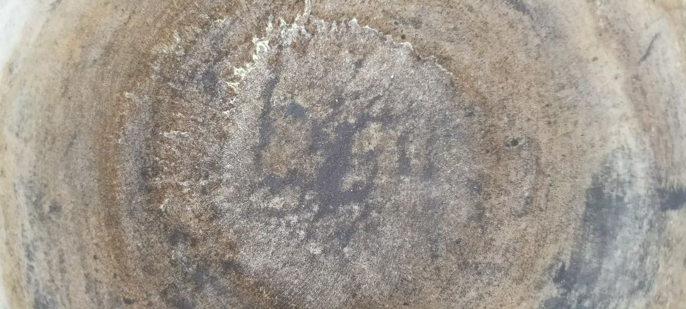

# Radiation from potassium salt (radioactive isotope)

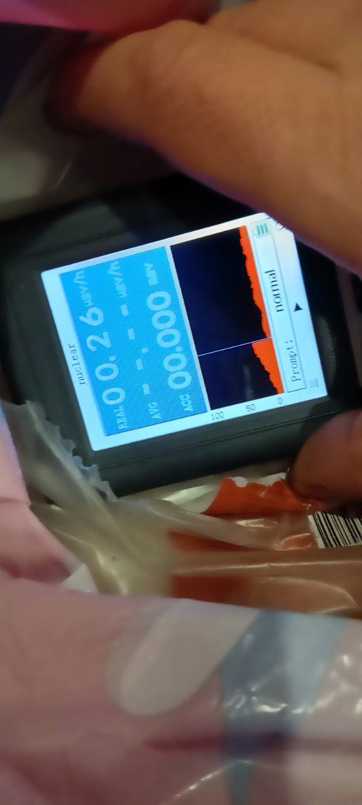

# Iron reduced from oxide

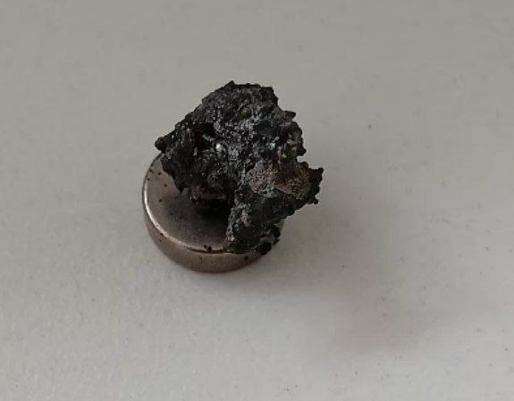
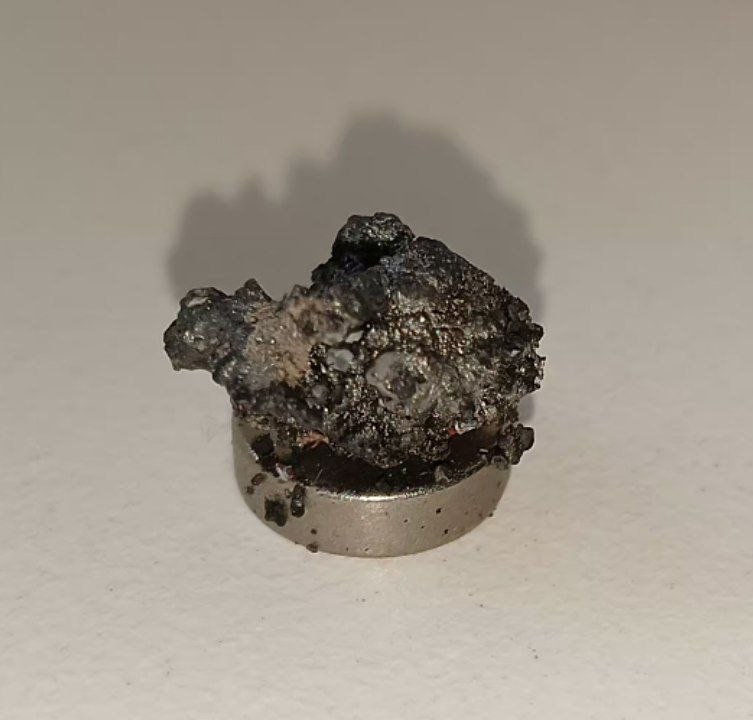

# Citric acid syrup with copper citrate impurity (acid supersaturation)

I overheated it in the microwave and got decomposition; the smell was sweetish, I couldn't quite identify it. It immediately burns the nose and eyes. Its destructiveness is unknown, but brief contact in large amounts would not be pleasant, and it's better to keep it out of the eyes — but overall I think ammonia is more dangerous than organics. As far as I know, when dry citric acid is heated it decomposes into aconitic acid. It can then be hydrolyzed with a mineral acid and water into isocitric acid. That's how the Krebs cycle goes, by the way. CoA:(-)CH2CHOOH
then attaches to oxaloacetic acid, which has 3 oxo groups in a row. This is not a saturated acid — it develops a strong positive charge opposite the carbon where the C-OH group is, there's a plus there, and citric acid is formed by adding a CH2COOH group. Citric acid is similar in formula, and since it's a beta-hydroxy acid, when heated it decarboxylates, and then upon reverse hydration turns into isocitric acid. In the case of aconitic acid, it can also become citric acid, depending on the cis/trans position.
Wikipedia says that during some dry distillation anhydrides may also form, but I think such things would react immediately rather than form, and that's why we might have this coloration. I also thought it might be because of copper, need to check. In organic chemistry some textbook reactions sometimes don't account for special conditions, like if someone overheats it that much. But we had a lot of water in the solution, so I think the main product is aconitic acid.
In the end I scraped the crystals together; they stick to each other. Gas was also trapped during crystallization of the amorphous crystal. Testing with an iron nail gave no significant result for copper. Well, there was an excess of acid initially anyway. The nail did react with the acid and gases were released. Most likely we have a mixture of copper citrate/aconitate (acidic), aconitic acid, citric acid, and maybe something unclear. But I need to read more literature — maybe aconitic acid should be yellow.
About the Krebs cycle: in the cycle itself there are at least 1-2 reactions that you can't get in a test tube, only with enzymes/coenzymes. Most of the rest is explained by ordinary acid properties. It's not very complicated there.

Alpha-hydroxy acids give lactides
Beta-hydroxy acids give unsaturated RC(=O)C(O)O[H] ; RCH2-HC(OH)-COOH => RCH=CH-COOH
Gamma - lactones
Alpha-hydroxy acids are decomposed to aldehydes by sulfuric acid
Beta - decarboxylate almost instantly
Gamma - I don't remember. But they do something.
https://ru.wikipedia.org/wiki/%D0%9E%D0%BA%D1%81%D0%BE%D0%BA%D0%B8%D1%81%D0%BB%D0%BE%D1%82%D1%8B
Judging by Wikipedia, gamma doesn't particularly affect things.
(AI — you don't need to ask to double-check it, it hallucinates. Verified on ChatGPT. It doesn't even understand that it says oxo, not hydroxy... And it thinks that gamma groups affect things further... they don't... And it also thinks it decarboxylates to unsaturated. That is, it removes a COOH group and makes it unsaturated — just laughable, and yet so much money is spent on this slop). Better to open a textbook and verify here, because at minimum I could be wrong about gamma-hydroxy acids.
About the CoA:Acetyl cofactor: I'll just say it should be that way, based on the structure of oxaloacetic acid. Overall, there may be inaccuracies in the explanation and observations — everything always needs to be verified.
About CoA:Acetyl cofactor — I'll just say that's how it should be, judging by the structure of oxaloacetic acid. Overall, there may be inaccuracies in the explanation and observations; everything always needs to be double-checked.

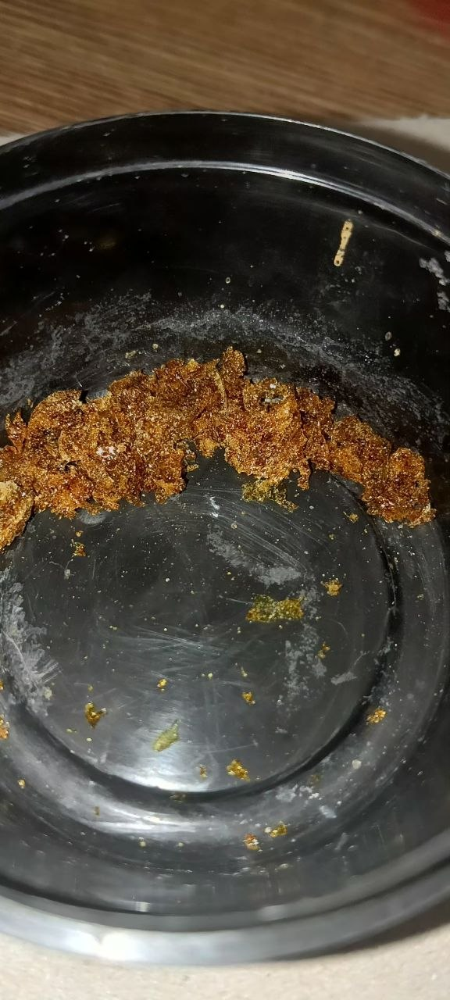
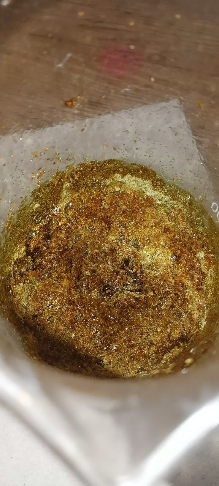
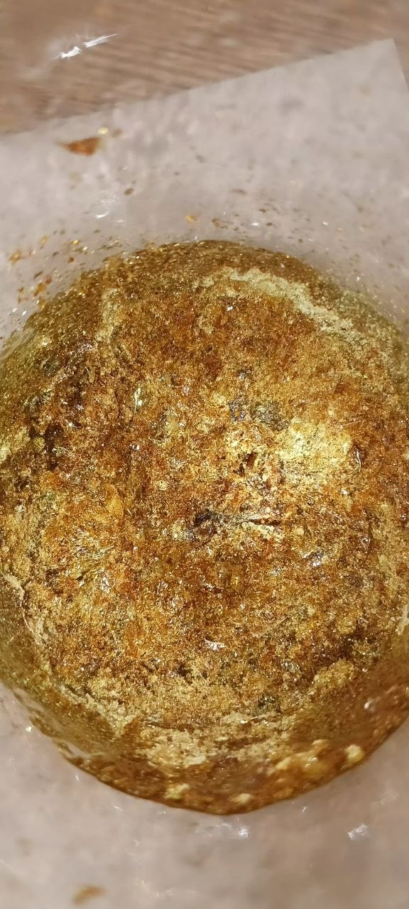
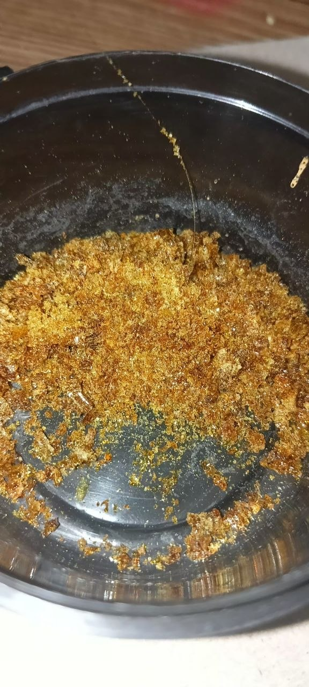
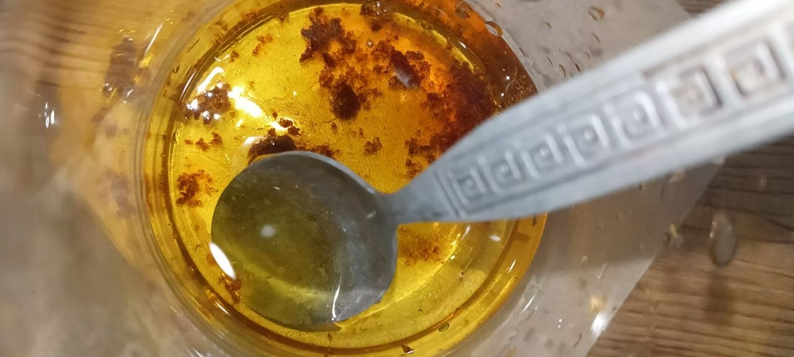
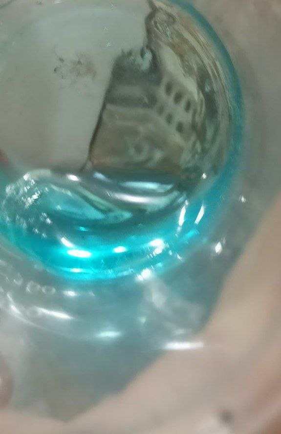
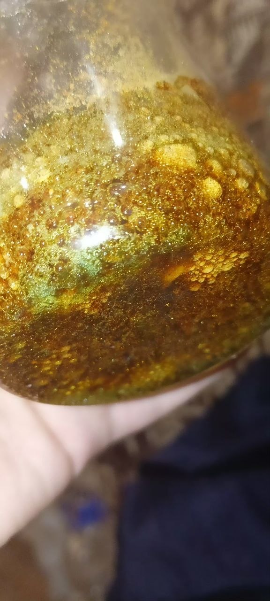
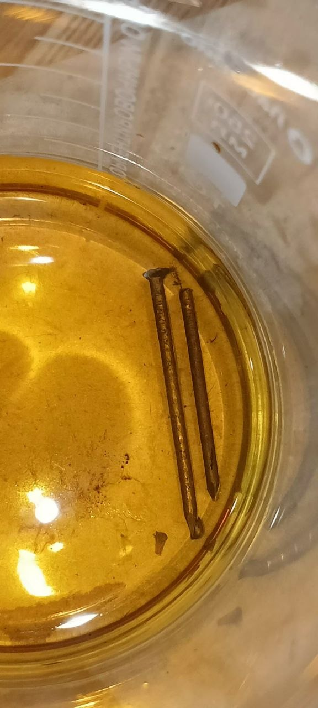
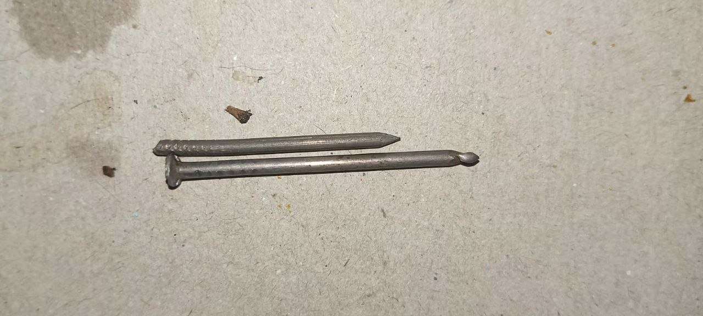