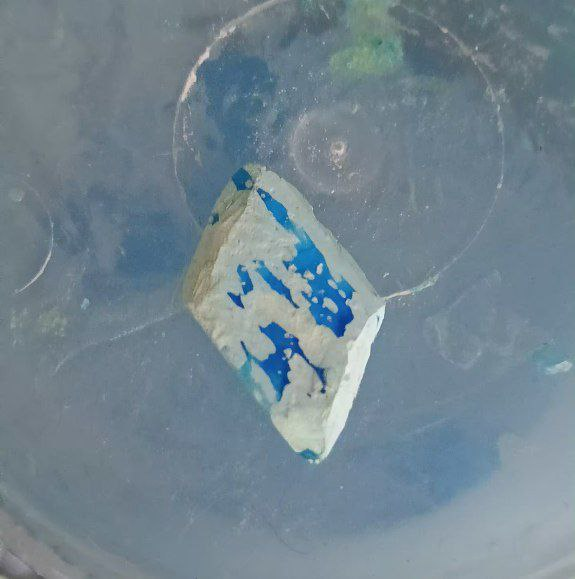
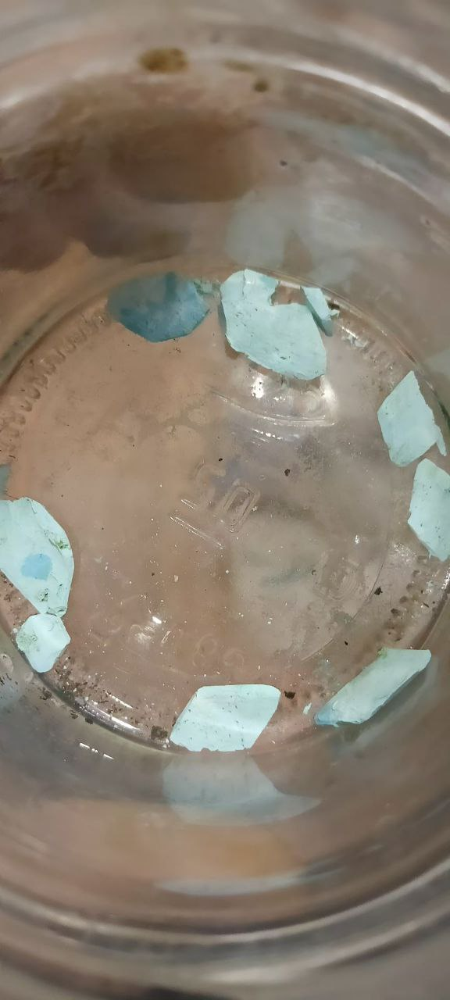
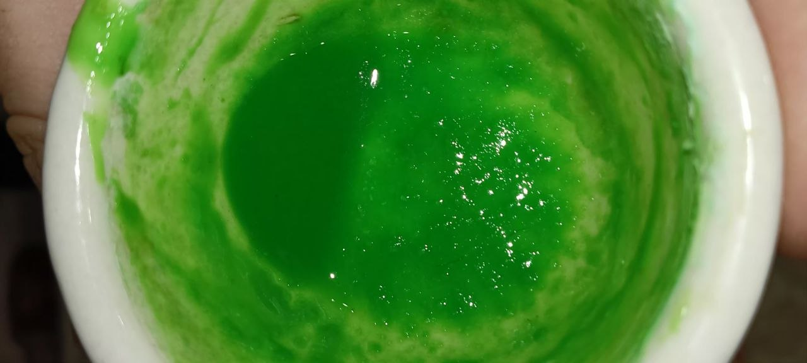

# Copper sulfate crystallohydrate

## Partially dehydrated

## Rehydrated under normal room conditions after many days (14 days passed)

# Copper nitrate crystallohydrate

## After microwave (dissolved again, filtered, and put in the microwave for crystallization, 1:30 minutes)

You can see that part turned whitish and part turned yellowish. After adding water the liquid itself became not green, but blue! Although initially the solution was green before the microwave. Also after the microwave there is an acidic smell. Possibly a basic salt formed partially, because a residue appeared that does not dissolve:

After adding water:

Possibilities: freshly prepared copper nitrate from nitric acid. Concentrated, the solution is green. After destruction of the crystallohydrate, it seems another crystallohydrate form that gives a green color is harder to obtain. The undissolved residue — possibly products of interaction with plastic, or impurities, or maybe I just didn't notice before, but that's unlikely. The acidic smell is most likely nitrogen oxides. But it somewhat resembled the burning sensation of hydrochloric acid, though there could not be hydrochloric acid there. So those are nitrogen oxides. But then where did the copper oxide go? And the yellow color may be some impurities that were in the silver, since the copper nitrate was obtained from 925 sterling silver. But before I dried it in the microwave everything was green. And now the crystals crystallize green. Also, I poured the clear blue solution into the evaporated part on the auto-evaporator (radiator) and it became thicker — less blue-transparent and a more dark, saturated color. Just improved lighting. And when strongly diluted it is almost like a copper sulfate solution, blue, only light blue. The more concentrated, the more the color changes. I will keep observing. The crystals themselves crystallize green.

On the radiator it also turns yellow in places, part remains green. If you crush it in a mortar it becomes liquid again. I had to evaporate it in the microwave for 15 seconds at a time. In the end the same pale green powder was obtained (for large crystals it needs to crystallize at room temperature and for a long time).

# Silver acetate (on the edges)

# Radiation from potassium salt (radioactive isotope)

