> ⚠️ **Important:** It is not recommended to obtain magnesium citrate for internal use —  
> such substances may contain impurities.

## 🧭 Table of contents
- [Attempt to obtain it via carbonate](#attempt-to-obtain-it-via-carbonate)
- [Avak's reaction that he sent me (Na2CO3 + MgSO4)](#avaks-reaction-that-he-sent-me-na2co3--mgso4)
- [My observations](#my-observations)
- [Attempt to obtain it via bicarbonate](#attempt-to-obtain-it-via-bicarbonate)
- [Drying](#drying)
- [Obtaining the citrate itself](#obtaining-the-citrate-itself)
- [Crystallization](#crystallization)
- [Bonus (artificial stones)](#bonus-artificial-stones)
- [Crystallization options tried](#crystallization-options-tried)
- [Message from Avak](#message-from-avak)
- [What you get in the end](#what-you-get-in-the-end)

# Attempt to obtain it via carbonate
I didn't have time, but from the table I saw that the CO3(2-) ion of magnesium is insoluble. I still decided to try; in the previous part there was an attempt via sodium carbonate.
I could assume that the soda had caked over time and turned into sodium bicarbonate, that is, it simply absorbed water. But in principle, it was closed.
Therefore, I checked its weak solution by taste and with a solution of black tea. The black tea solution changed color and a precipitate fell out. Without litmus it was difficult to understand exactly.
When I stopped understanding anything at all, I wrote to Avak Avakyan and received a reply:
"
And about magnesium and calcium — I clicked on your page; you are doing some kind of horror... 😳🥶😱 First of all, it seems to me that your street stone is not limestone, but concrete. There is all sorts of stuff in it. Calcium carbonate is certainly present there. And the solution was colored by IRON, which is generally "omnipresent" in nature.

The idea of obtaining magnesium citrate this way is generally unclear. First, calcium citrate is almost insoluble in water and significantly less soluble than magnesium citrate. Calcium sulfate (gypsum) is more soluble than calcium citrate. So even if you managed to obtain calcium citrate, its reaction with magnesium sulfate would not proceed (the equilibrium is shifted toward the starting reagents, because calcium citrate is the least soluble in this equation). Dissolving chalk in citric acid — the reaction proceeds, but rather slowly and with slowing down, because the product — calcium citrate — is almost insoluble and also passivates the chalk by covering it with a film.

If you don't want to buy ready-made magnesium citrate, I would do this:
1) by reacting magnesium sulfate with SODA (any kind) I would obtain a precipitate of magnesium carbonate (I would take strong solutions so that the reaction proceeds better).
2) I would filter the resulting magnesium carbonate precipitate (and also pour water through it on the filter to remove the aqueous solution of sodium sulfate) and then put this magnesium carbonate into an aqueous solution of citric acid. The reaction will proceed fairly quickly, and you will get magnesium citrate.
"

I added that I had tried, but it didn't work, and I would try again.
Before I had time to try, I received a reply:
"
➾ I tried: it turns out, yes, indeed, sodium BIcarbonate (baking soda) does NOT give a precipitate with magnesium sulfate, regardless of the ratio of reagents. This is not mentioned in reference books, but it is a fact. Apparently, bicarbonate gives too acidic an environment, and in it soluble double salts like MgSO4×2NaHCO3 turn out to be stable.

But washing soda Na2CO3, which can be obtained by heating baking soda on a spirit lamp (or you can buy it, it is sold), instantly gives a precipitate of magnesium carbonate with magnesium sulfate.

Since the matter is alkalinity, I did this: I mixed roughly equal volumes of magnesium sulfate and baking soda, completely dissolved them in water, and then dripped ammonia solution (aqueous ammonia; as an alkalizer) into it. And — hooray: magnesium carbonate precipitated instantly and completely.

That is, into a solution of magnesium sulfate and baking soda taken in roughly equal volumes, drip aqueous ammonia. And everything will work out (all the magnesium will precipitate as magnesium carbonate).

Moral: even the most "elementary" reactions in reality may not go AS IN TEXTBOOKS. And so "out of nowhere", starting to try "elementary" "basics" in practice, we make discoveries. And, at a minimum, create new technologies.
"
Regarding soda, to add — [reddit](https://www.reddit.com/r/chemistry/comments/1e46xwg/mgso4_nahco3_na2so4_mgco3_co2/) they write this on the internet. Supposedly it should decompose, but I left the solution overnight and nothing precipitated. Maybe if heated, there will be a reaction, but this needs to be checked, and magnesium sulfate is running out... So later sometime.

## Avak's reaction that he sent me (Na2CO3 + MgSO4)

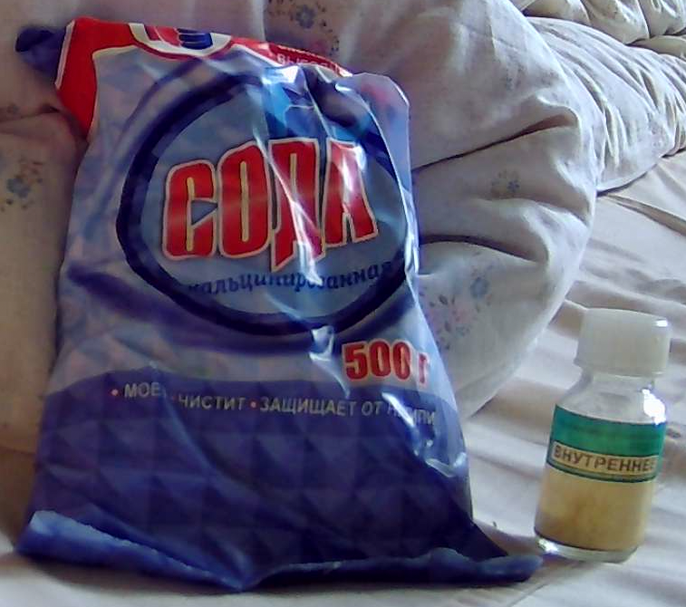


<video width="640" height="360" controls>
  <source src="{{ '/experimets/AceMg/2/Avak/Na2CO3_and_MgSO4_web.mp4' | relative_url }}" type="video/mp4">
  Your browser does not support the video tag.
</video>

## My observations

I still decided to obtain sodium carbonate for sure, and not trust the letters on paper.
I bought soda and calcined it in a pan; to avoid breathing too much dust and carbon dioxide, I turned on the hood.

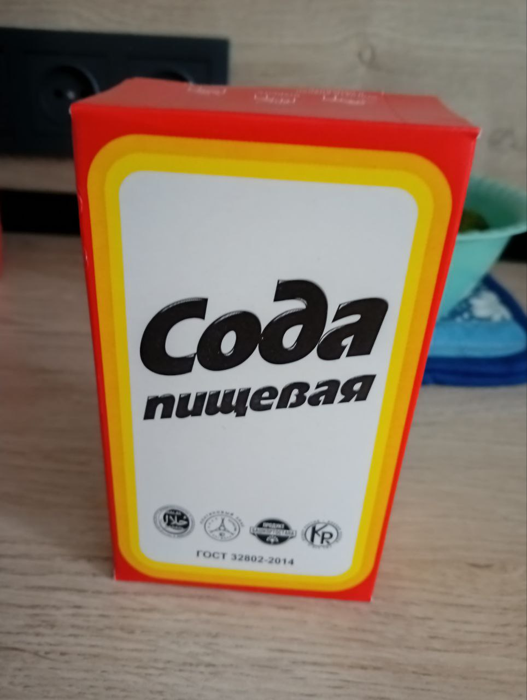
<video width="640" height="360" controls>
  <source src="{{ '/experimets/AceMg/2/NaHCO3toNaCO3H2OCO2_web.mp4' | relative_url }}" type="video/mp4">
  Your browser does not support the video tag.
</video>

The reaction itself:

<video width="640" height="360" controls>
  <source src="{{ '/experimets/AceMg/2/Na2CO3andMgSO4_web.mp4' | relative_url }}" type="video/mp4">
  Your browser does not support the video tag.
</video>

Then filtration and drying:

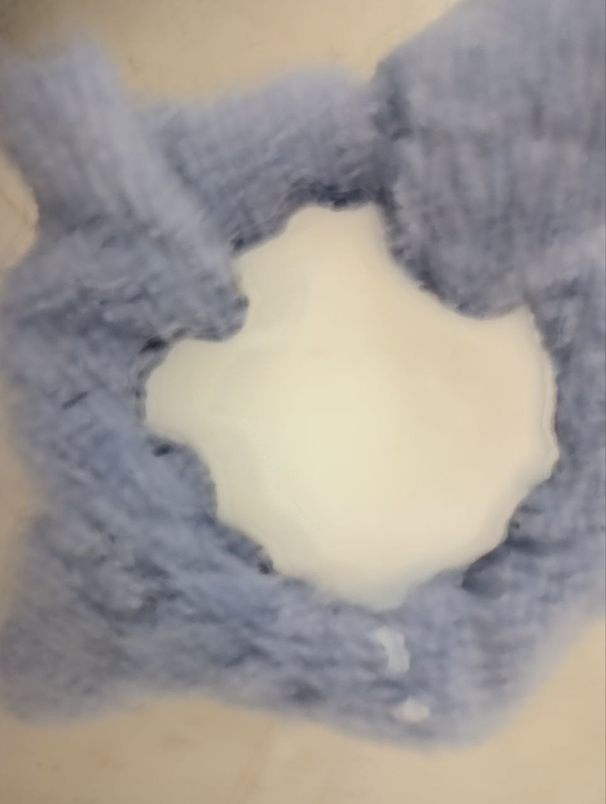
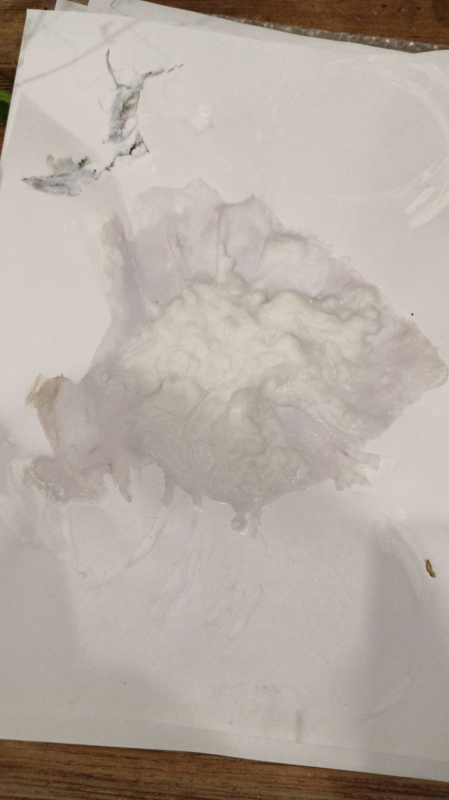

## Attempt to obtain it via bicarbonate

I filled the bottom of a jar with soda and a 25 g packet of magnesium sulfate. I dissolved them separately in water and then mixed them. Left it until morning. The reaction did not proceed.

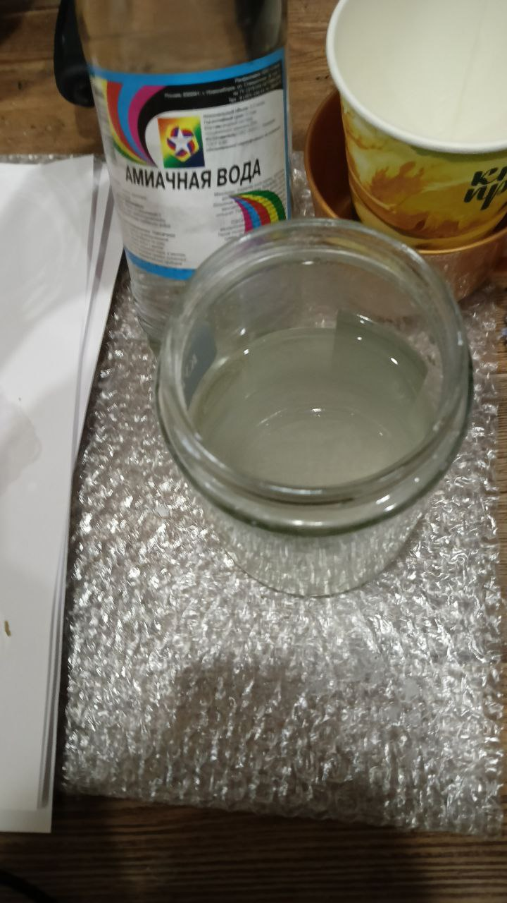

A 25% ammonia solution came into play:

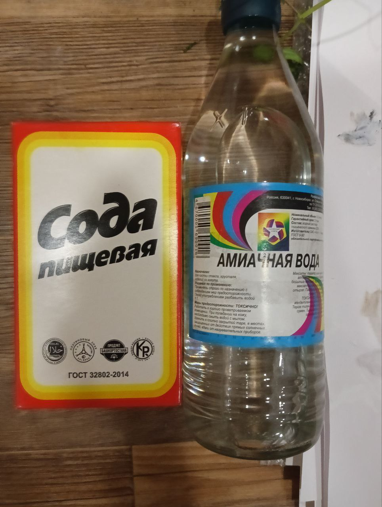

<video width="640" height="360" controls>
  <source src="{{ '/experimets/AceMg/2/MgSO4NaHCO3NH4OH_web.mp4' | relative_url }}" type="video/mp4">
  Your browser does not support the video tag.
</video>

And lo and behold, the precipitate was even better than with carbonate. With quick separation it will be easier to separate, because the solution does not become colloidal, but pieces remain directly on top.
Then they become like a paste, and if filtered in a special way, it can be even easier.
Here is what it looks like at the beginning:

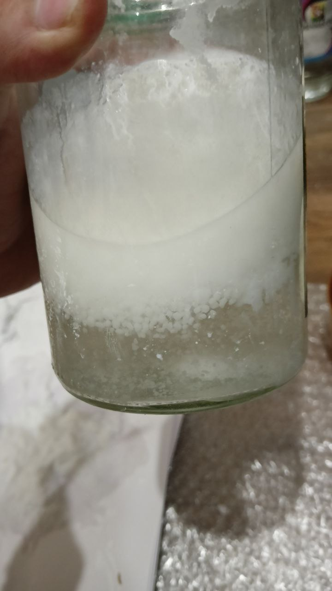

## Drying

I scraped pieces off the cloth and put them first in a paper cup, then poured them onto paper. From the reaction with ammonia I simply scraped it off with a knife, but I understand a different method of separating from water would be more effective. Perhaps some coagulants can reduce colloidality. You can check with ammonium chloride.

I took citric acid and added it to the dried material; it did not dissolve in water, but the water became slightly white. That is, it seems it can form a colloid, but weakly.

## Obtaining the citrate itself

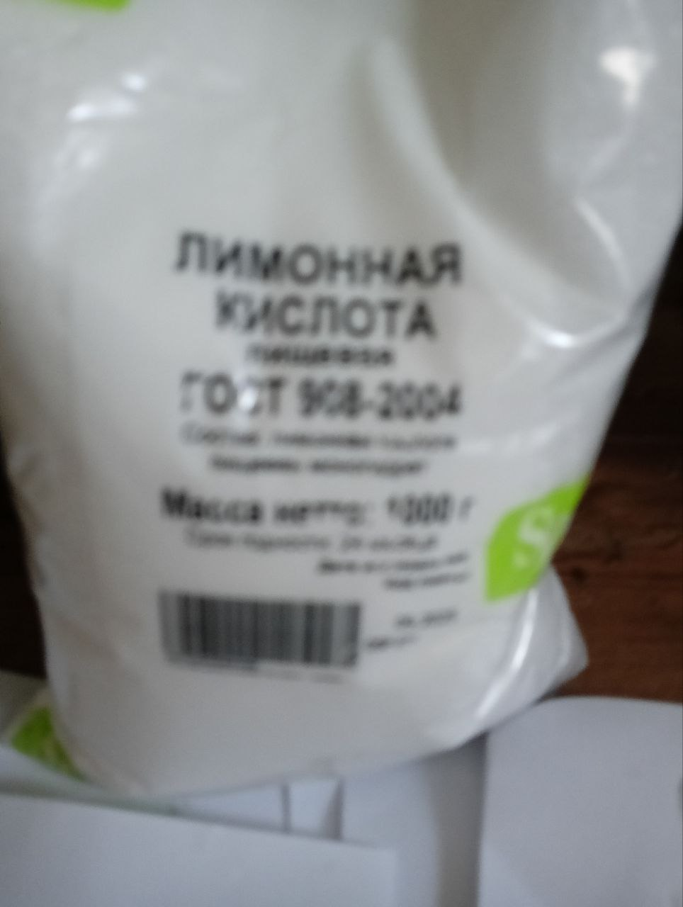

<video width="640" height="360" controls>
  <source src="{{ '/experimets/AceMg/2/AcidAndMgCO3_web.mp4' | relative_url }}" type="video/mp4">
  Your browser does not support the video tag.
</video>


I put it in a water bath until a glassy layer began to appear on the upper part and something amorphous began to precipitate.

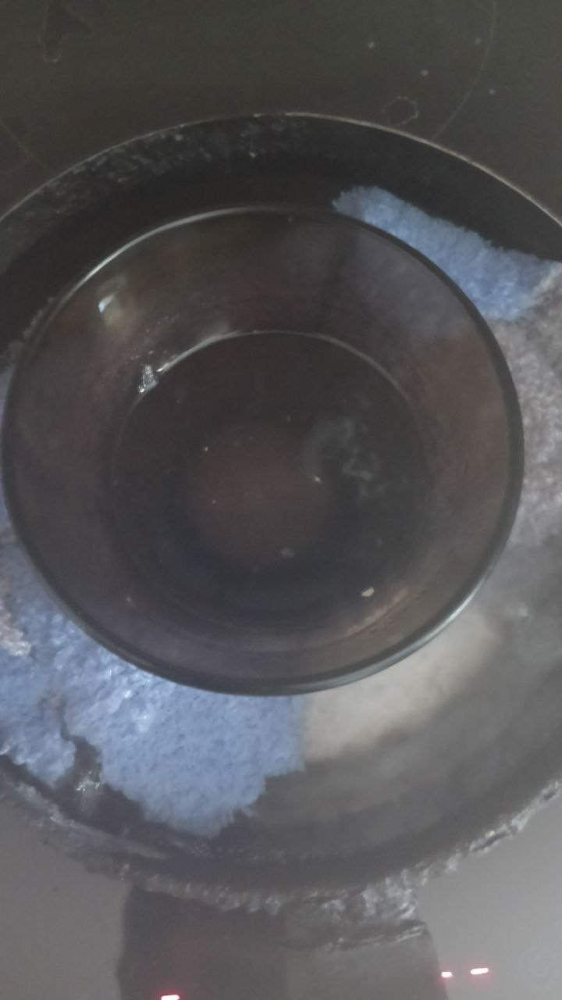

I had to reduce the volume by ~1/3 before any crystallization began.

## Crystallization

Crystallization was a problem, both for me and for Avak. Leaving it for 2 days after evaporation gave no results beyond a viscous slurry.


I asked on the forum [xumuk](https://forum.xumuk.ru/topic/314673-%D0%BA%D0%B0%D0%BA-%D0%BA%D1%80%D0%B8%D1%81%D1%82%D0%B0%D0%BB%D0%BB%D0%B8%D0%B7%D0%BE%D0%B2%D0%B0%D1%82%D1%8C-%D1%80%D0%B0%D1%81%D1%82%D0%B2%D0%BE%D1%80-%D1%86%D0%B8%D1%82%D1%80%D0%B0%D1%82%D0%B0-%D0%BC%D0%B0%D0%B3%D0%BD%D0%B8%D1%8F/)


They advised drying in a vacuum; I made a kind of vacuum — also without results, the viscous liquid only became a liquid.

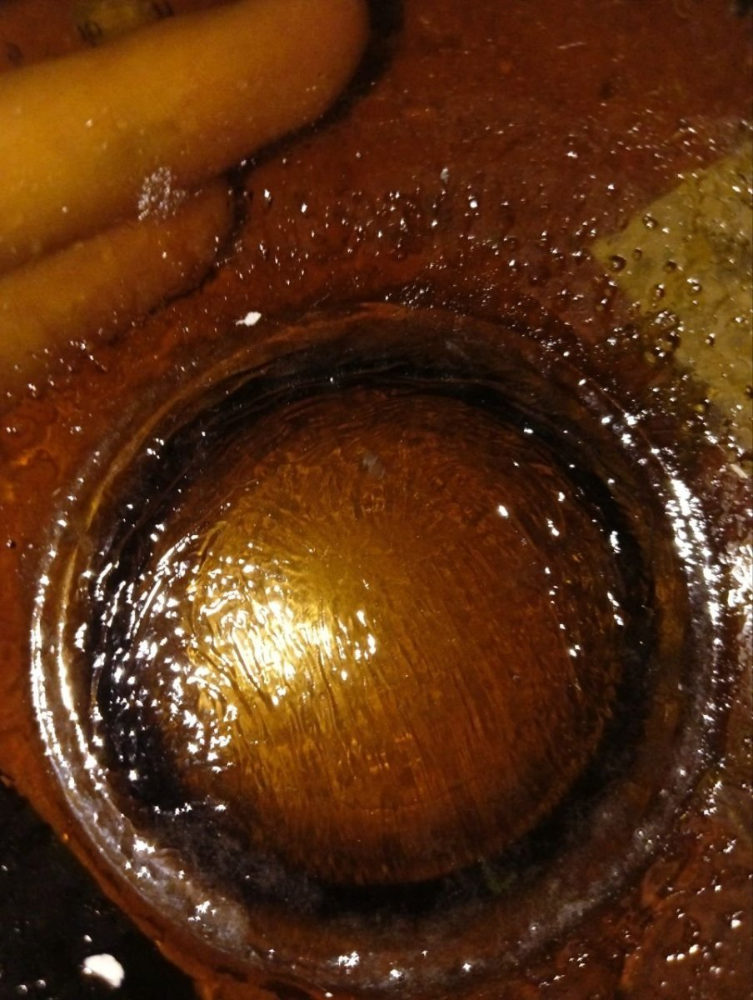

Messages from Avak on this topic:

```
Hello again. 😊
I looked at the forum: the advice with vacuum won't help. 😊 I discovered that this syrup is very hygroscopic: in a matter of hours it increases in volume and becomes thinner and thinner, absorbing moisture from the air. Even if you put it in a desiccator over 94% sulfuric acid, yes, it will dehydrate, but it will remain AMORPHOUS (it will NOT crystallize), and as soon as we take it out of the desiccator, it will immediately turn back into syrup again, absorbing moisture from the air. This problem is NOT unique. Calcium nitrate demonstrates the same thing. It is more thermally stable and can be safely evaporated and calcined (it will NOT decompose); this produces a dry white AMORPHOUS porous mass, but as soon as we turn off the heating, it absorbs moisture from the air, turning into a non-crystallizing hygroscopic syrup. How to crystallize it? — It is enough to concentrate it to the RIGHT concentration, BEFORE it turns into syrup, and — it crystallizes as a tetrahydrate. This tetrahydrate is NOT hygroscopic, stable in air (does NOT deliquesce); these are beautiful crystals.

I am sure that magnesium citrate can also be crystallized. There are a lot of techniques. I'm just "slowing down" now because 1) I'm fixing my computers, 2) I developed a new test for STYRENE, and 3) today I made a DISCOVERY: in the solution obtained after filtering magnesium carbonate synthesized using ammonia, ARTINITE crystallized for me!!! In English "Artinite", formula MgCO3•Mg(OH)2•3H2O. This is the trihydrate of magnesium hydroxycarbonate, a natural mineral, it is INSOLUBLE in water. It looks like spherulites (spiky balls of needle-like crystals), very similar to spherulites of baking soda. Here it is in nature:
https://www.mindat.org/gm/377
Artificial cultivation of water-INSOLUBLE minerals from aqueous solutions is a cool thing. I will study the details of the conditions of its crystallization, and — this will be my next report in the Perm scientific geological collection. 👍
...
And greetings to you!
You can quote private messages as much as you like — it's even good.
I looked at your page, glad that it worked out with ammonia. By the way, you have a powerful hot plate: it's great how baking soda was dehydrated into washing soda in your video (I watched and downloaded all your videos, great). It's wonderful that the result with washing soda also worked out.

But with citric acid — something is wrong with you. I filtered that magnesium carbonate whose synthesis I sent you in the video. Then I prepared an aqueous solution of citric acid and — this magnesium carbonate instantly (WITHOUT any heating!) "fizzed", releasing carbon dioxide, and dissolved in citric acid, forming a perfectly transparent solution. It behaved as if I had thrown baking soda into citric acid. It dissolved even faster and more readily than soda.

By the way, I came up with a "life hack": the fact is that on ordinary filters, which are a funnel made of toilet paper or cloth, — a lot of both solution (remaining absorbed in the filter) and precipitate (stuck to the filter) is LOST. I started doing it differently: stuffing a piece of cotton wool (or toilet paper, but paper is worse) INTO THE SPOUT of a funnel or a syringe with the plunger removed. Losses on this tiny piece of cotton wool are insignificant. I am sending you a VIDEO where I filter the solution obtained in my previous video (you can put this video on your blog). In the spout of the syringe (with the plunger removed) a tiny piece of cotton wool is inserted (it only needs to not fall out easily). Note that this negligible amount of precipitate would be completely "eaten" by filters made of blotting paper or cloth, but here — there are no losses at all, and the precipitate is NOT contaminated by paper.

And further, I decided to obtain magnesium citrate in the form of crystals, and — here there was a "problem". I tried to evaporate it, but along the edges of the evaporating solution a darkening crust is obtained — such organic matter decomposes when heated. The part that did not darken became an extremely viscous non-crystallizing syrup (like viscous colorless resin). It dissolves perfectly in water (even in a drop of water), turning into a non-viscous transparent solution. An attempt to precipitate magnesium citrate from this solution by adding isopropyl alcohol did NOT lead to success: a small amount of alcohol changes nothing; if there is more alcohol, the solution becomes cloudy when stirred, but under a microscope you can see that these are NOT magnesium citrate crystals, but microdroplets of aqueous solution surrounded by alcohol (that is, an emulsion). That is: you can't heat it; evaporation gives no result (a resinous non-crystallizing colorless syrup is obtained); it does not precipitate with alcohol. We will have to try other ways: first of all, try to FREEZE (put the aqueous solution of magnesium citrate in the freezer). In a number of similar cases, when water becomes ice, the substance dissolved in it becomes crystals. There are other ways. "Salting out" can be done not only with alcohol; you can select a salt that will NOT react with magnesium citrate but will be more water-soluble. Adding such compounds forces our product to precipitate from the solution. We'll try. 🤔
```

Video from Avakyan with filtration:

<video width="640" height="360" controls>
  <source src="{{ 'experimets/AceMg/2/Avak/Фильтрование_web.mp4' | relative_url }}" type="video/mp4">
  Your browser does not support the video tag.
</video>


## Bonus (artificial stones from calcium citrate/carbonate)
I made the stones like this:
I took ~2 spoons of citric acid, made a solution. Added calcium carbonate to the solution until the reaction subsided, stirring occasionally.
At one point everything precipitated, when the reaction was hardly proceeding anymore.
Then I molded shapes, put them in the oven for 3 hours at 50 degrees, on paper. Then put them at 100 degrees for an hour and a half. After that I left them to cool in the oven.
Then I made a mixture of acrylic varnish with a phosphor and painted them.
The stone I obtained can be squeezed and does not break when dropped on the floor.


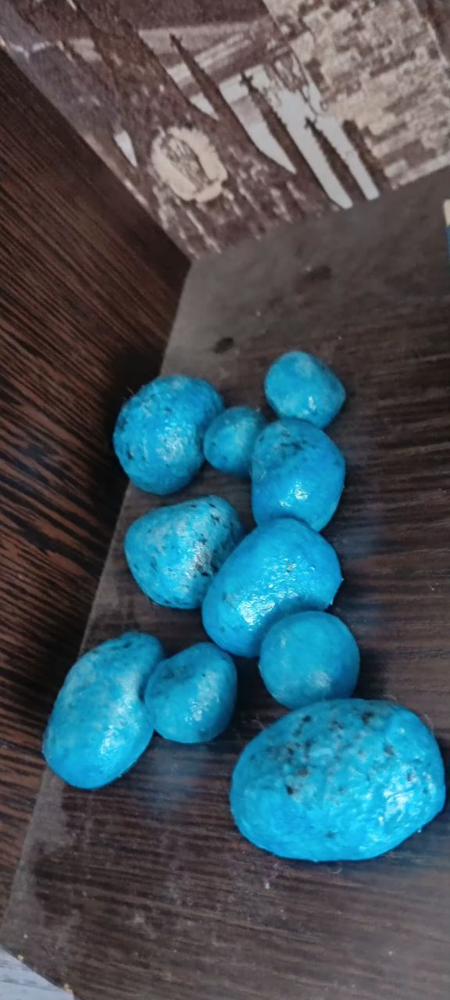


## Crystallization options tried
- Adding alcohol to the solution
- Partial vacuum
- Adding something to the solution (organic matter, citric acid)
- Freezing
## Message from Avak

```

Hello!

I RECEIVED all your letters. I FIXED the computer and video equipment. Research on magnesium citrate continues. I couldn't freeze it out: the solution turns perfectly into ice in the freezer, but does not separate into citrate crystals and ice crystals. I also haven't managed to salt it out yet. But I found useful information about SIMILAR compounds: iron(II) citrate and lead(II) citrate:

https://ru.crystalls.info/%D0%A6%D0%B8%D1%82%D1%80%D0%B0%D1%82_%D0%B6%D0%B5%D0%BB%D0%B5%D0%B7%D0%B0%28II%29

https://ru.crystalls.info/%D0%A6%D0%B8%D1%82%D1%80%D0%B0%D1%82_%D1%81%D0%B2%D0%B8%D0%BD%D1%86%D0%B0%28II%29

About iron citrate it says: "Excess citric acid slows down the evaporation of the solution, up to a complete stop." About lead citrate it says: "Excess citric acid leads to thickening of the solution, up to a complete stop of evaporation." Thus, chemists have already encountered this problem: and it turns out that obtaining a non-evaporating viscous hygroscopic syrup occurs from an EXCESS OF CITRIC ACID.

By the way, citric acid itself crystallizes from water perfectly; and also, it is VERY soluble. With intensive stirring, several volumes (equal to a drop) of solid citric acid can be dissolved in a drop of water. Another thing. I discovered that from baking soda and ammonia a more passive form of magnesium carbonate is obtained than from washing soda. It reacts with citric acid more slowly, but with stirring the reaction still ends quickly.

I made a saturated aqueous solution of citric acid and put an excess of magnesium carbonate (from washing soda) into it; I left the solution for a day. A day later I filtered it from the unreacted excess magnesium carbonate. A transparent non-viscous solution was obtained. I poured it into a bowl and put this bowl on a heating radiator. And — it dried! A transparent wrinkled something was obtained. It has been more than an hour since I removed the bowl from the radiator, but this product has not yet absorbed moisture from the air (that is, I hope there is no hygroscopicity). ➡️ That is, I have already obtained solid magnesium citrate. But I will experiment further. I will try to obtain it from citric acid and an excess of magnesium HYDROXIDE (not carbonate). 👉🏼 Perhaps with carbonate the reaction does not go to completion, and some excess of extra citric acid remains. So perhaps with an excess of magnesium HYDROXIDE the result will be not a transparent wrinkled crust, but magnesium citrate crystals.

```

## What you get in the end

I repeated the experiment. Yes, you get an amorphous precipitate; I washed it with isopropyl alcohol.

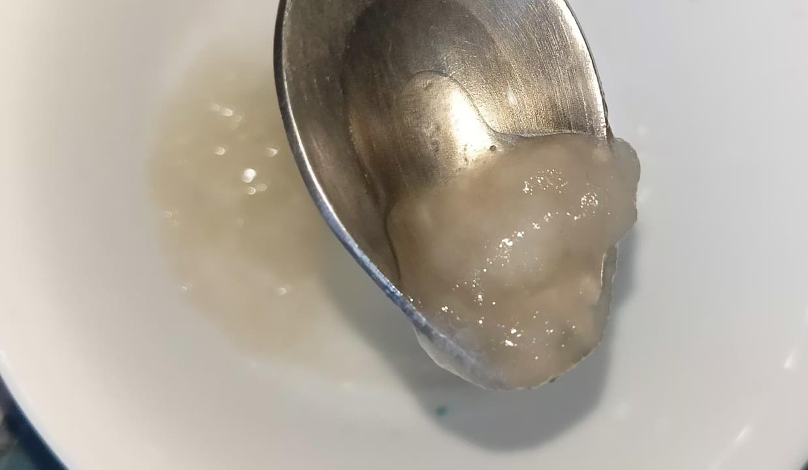

Using a microwave:

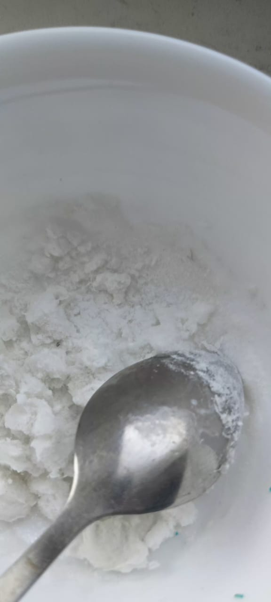

Stoichiometric calculations I used:

```
192.124 — citric acid.
M(MgCO₃) ≈ 84.3 g/mol.
CitrateMg M = 214.41 g/mol.
In total we have 8 g of MgCO₃ — this is 50% of the expected reaction of magnesium sulfate and sodium carbonate.

This is 8 / 84.3 = 0.094 mol.

2
H₂C-COOH
HC-COOH
H₂C-COOH + 3MgCO₃ =

H₂C-COO Mg OOC-CH₂
HC-COO Mg OOC-CH
H₂C-COO Mg OOC-CH₂

192.124 * 2 = 384.248 — total grams molecule to molecule.
0.094 / 3 = 0.03133333333333333 (because 3 molecules are needed, so we calculate 3 masses from here).
0.03133333333333333 * 384.248 ~ 12 (so we need 12 grams of citric acid).

Or simpler:
0.094 * 2 / 3 = 0.06266666666666666.
192.124 * 0.06266666666666666 ~ 12.

And magnesium needed for 12:
(12 / 192.124) = 0.06245966146863484.
0.06245966146863484 * 3 / 2 = 7.898024192708875 (since 3 molecules of magnesium are needed for 2 molecules of citric acid).

So, to have an excess, you need to take about 8 grams of citric acid, or even better — 6.

Or, more clearly and reasonably, count by ratio:
192.124 * 2 = 384.248 — this is how many g/mol of citric acid we have.
84.3 * 3 = 252 g/mol of magnesium carbonate.

384.248 / 252
or
3.84242 : 2.52

3.84242 moles of citric acid per 2.52 moles of carbonate.
In 8 grams we have:
8 / 2.52 = 3.1746031746031744.

And then:
3.1746031746031744 * 3.84242 = 12.19815873015873.

```

For 8 grams I used 5 grams of acid and got: 161.70 - 155.87 ~ 5 grams (possibly hydrated) of magnesium citrate.


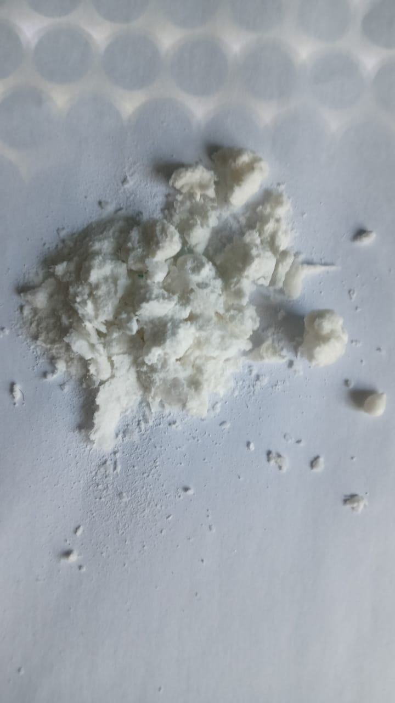


# Post Script

```
So, I also got a wrinkled wonder and put it in the microwave for 30 seconds. Then took it out. Stirred. Again for 30 seconds. Repeated. Then I saw crystals starting to appear, put it in for a minute and my wrinkled mass swelled up. Most likely water and alcohol were evaporating. Yes, it was still in an isopropyl alcohol solution at that point, a very small amount.
Then such crystals formed. In principle, in a microwave only water is heated.

I apologize for this being the 8th message and all of them fragmentary. This can be distracting from more important matters. I think the chemistry of formation in an excess of citric acid is acidic magnesium citrate; it has completely different properties than the neutral one. When we obtained it in an excess of magnesium carbonate, all the citric acid reacted and therefore no free acid remained. This substance then crystallizes. And that acidic form most likely reacts with itself reversibly and very quickly. I think it is worth trying to dry it in the microwave as well. In a microwave oven, microwave waves selectively act on water, but the trouble is that the substance itself will heat up. Still, I think the microwave can already be used in chemical processes as a tool and even dedicate a whole direction to this...
```

# Additional photos from Avak

```
The solution with magnesium citrate (a solution of sodium citrate with magnesium sulfate) became a viscous syrup for me; but on its surface (after more than 2 days) crystals began to appear. I am sending 5 photos in a microscope at 800x of these crystals. Note that these are the same rounded forms as the magnesium citrate crystals whose photos I sent earlier (from magnesium carbonate). Note that it is precisely in a strong microscope that you can recognize the compound: you can see that these are the same crystals, that is, it is precisely magnesium citrate (that's what a microscope is for). This is similar to the above information about the "surface crust" of iron(II) citrate. In this solution of mine there is mainly only one other salt — sodium sulfate ("Glauber's salt"), but it is significantly more soluble in water and has not yet begun to precipitate from this viscous syrup. The fact that a mixture of magnesium citrate with citric acid gives a syrup, AND THE SAME syrup is given by a mixture of magnesium citrate with sodium citrate — means that the syrup is a double salt of magnesium citrate with citrates of MONOvalent elements (citric acid = "hydrogen citrate", and hydrogen is also monovalent, like sodium). That is, syrups are associates of magnesium citrate with citric acid or with sodium citrate. What will happen next with this syrup — I'll see (I have it in an open transparent quartz bowl; by the way, the dark spheres in the photo are air bubbles inside the quartz glass).
```

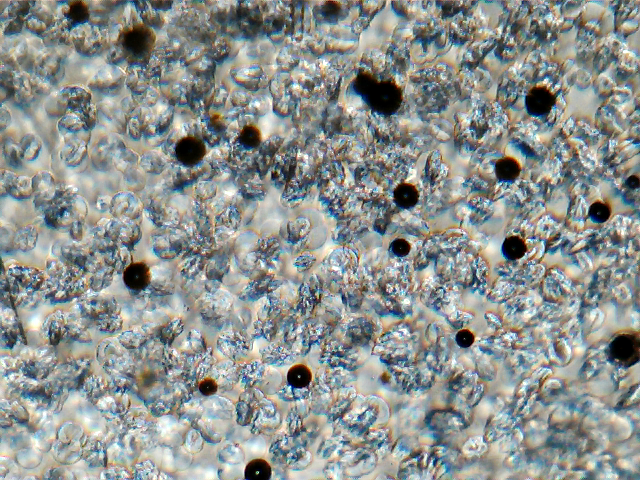
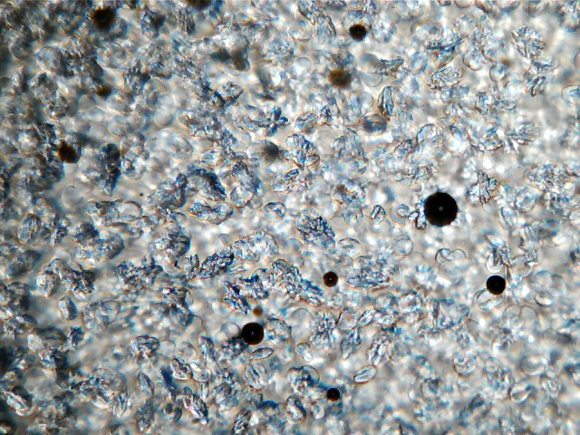
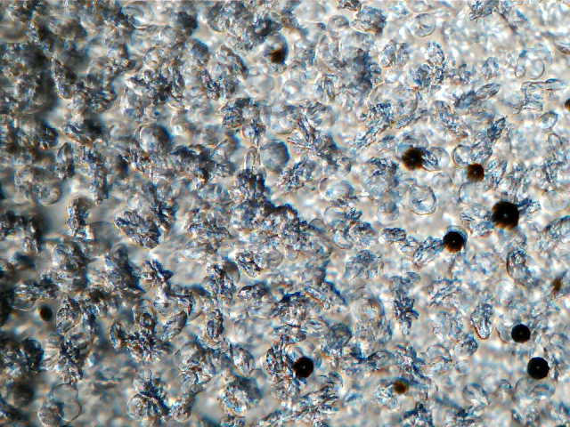
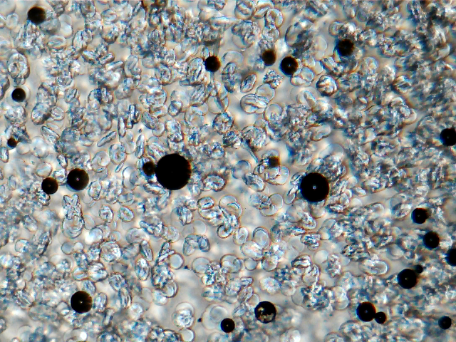
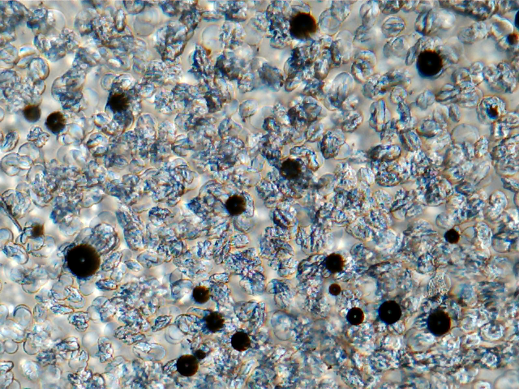


# Acidic magnesium citrate

The magnesium I left in the jar under "vacuum" — in fact the needle stopped letting air through — turned into a white slurry.

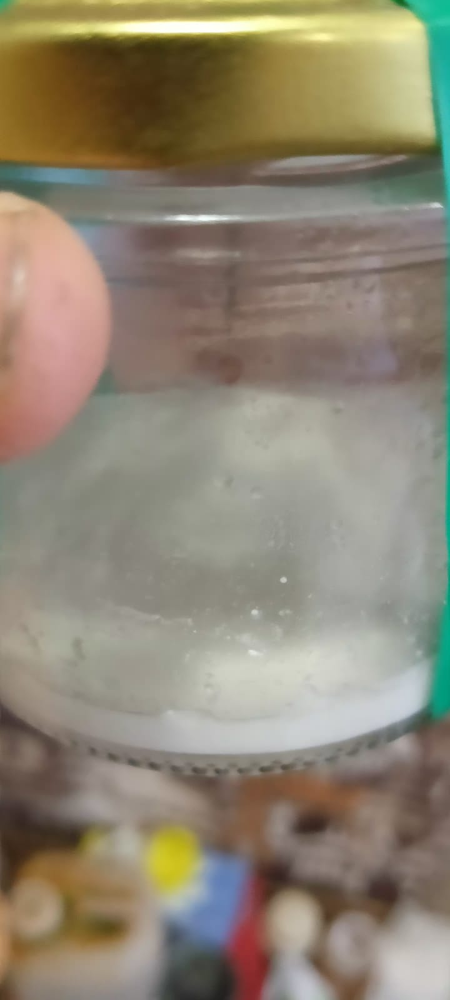
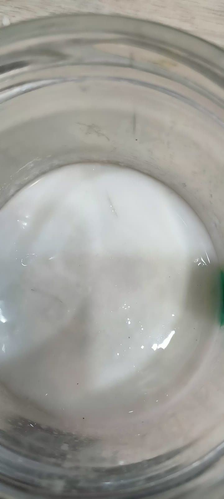

After putting it in the microwave, as in the first time, I got crystals.

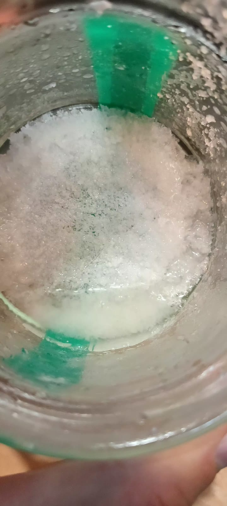
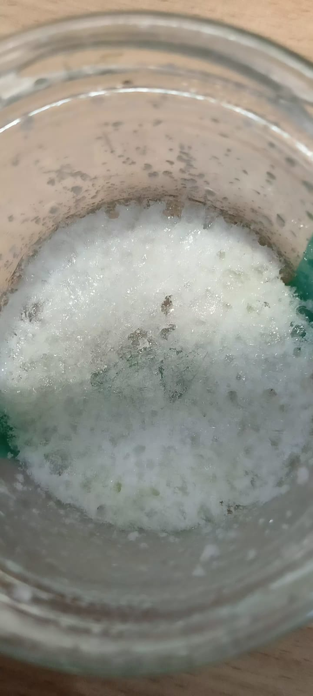

As a conclusion, I now have (presumably) acidic and neutral magnesium citrate.
