# Super disclaimer
**Warning: copper salts are heavy metals, corrosive, etc. Follow all safety precautions and do not repeat the experiment if anything is unclear. The author publishes this as a personal experiment and refuses to bear risks for your actions.**

# Experiment on obtaining basic salts

Browsing around YouTube, I found some videos.

The author of the video thought that his green precipitate was sodium sulfate, but I wrote to him that copper sulfate should not give a color.
According to Remy, ions of the d-block give color, and accordingly I assumed that he had copper nitrate or malachite there (needs to be checked).
The videos themselves inspired the idea to try to obtain basic salts of copper.

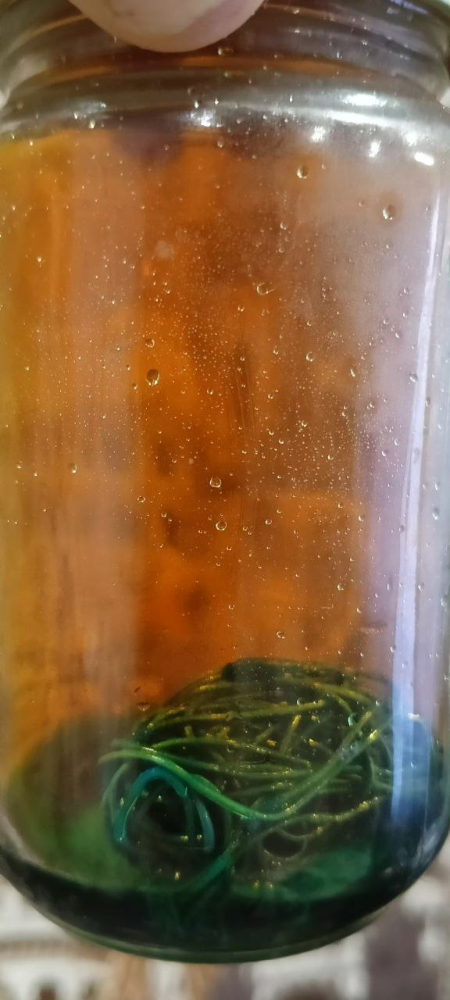
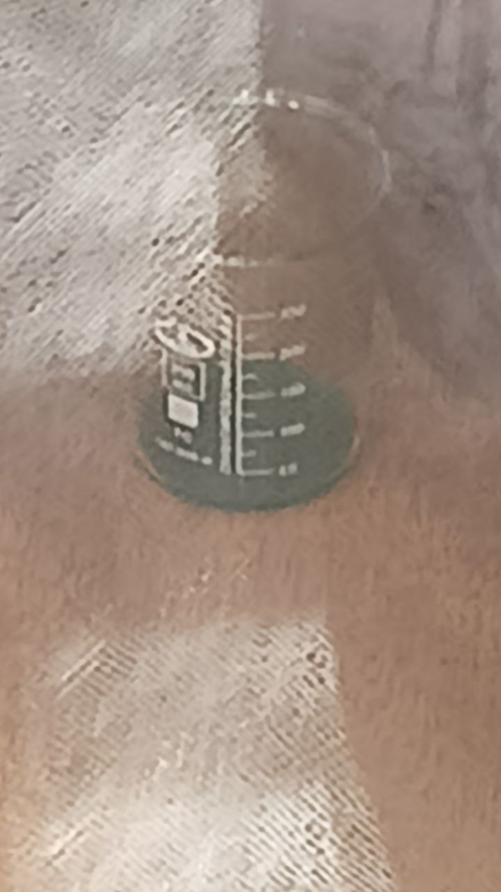

I took potassium hydroxide.

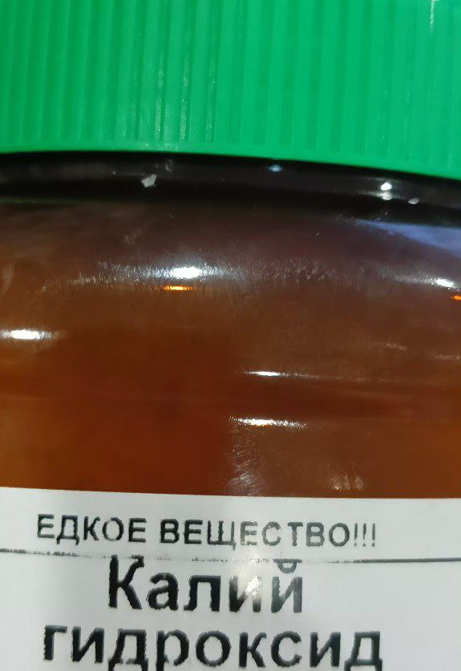

The crystals look like some broken squares.
At first I got a blue precipitate; the solution itself became blue instead of green. I thought I was too stingy with the acid and needed more yield (the solution was heating up). I added more — a black precipitate fell out. (As I later verified, this is copper oxide.)

I added citric acid to pH 7; the precipitate settled and there was a green solution. I stirred — this precipitate/colloid appeared again. I filtered it.

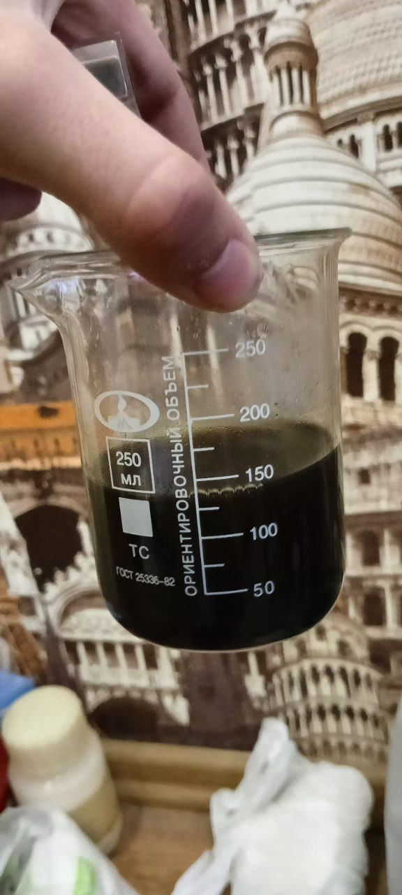
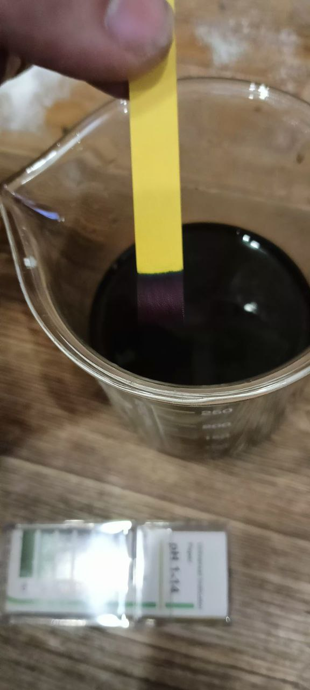

The solution itself was green.

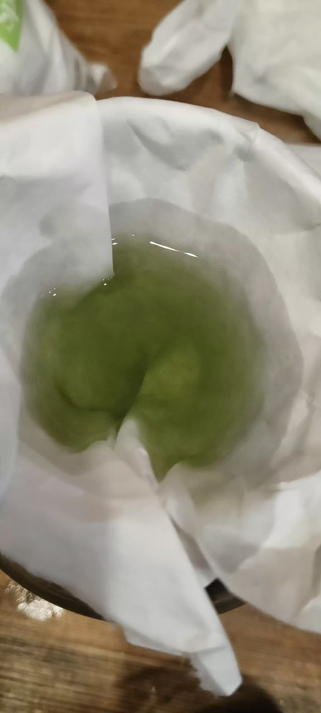
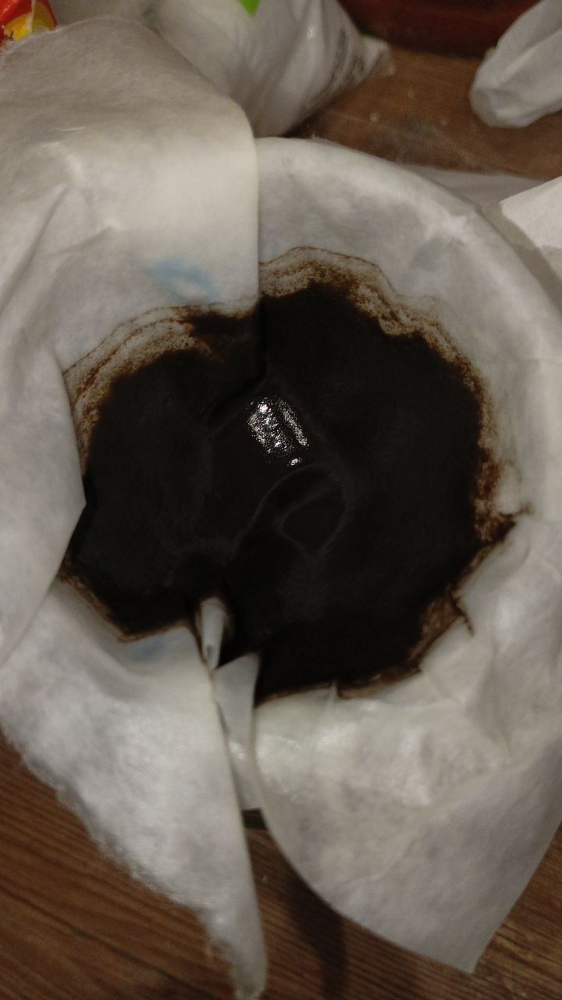

I checked the precipitate with electrolyte; I got a bluish-blue color (copper sulfate, slightly anhydrous; sulfuric acid is almost 40% and in excess):

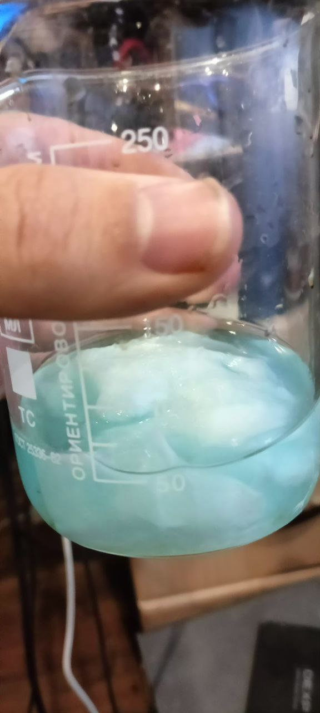

I poured my solution, already obtained the first time, into a test tube.

## Obtaining Cu(OH)2 itself

<video width="640" height="360" controls>
  <source src="{{ '/experimets/BasicSalts/Ca(OH)2.mp4' | relative_url }}" type="video/mp4">
  Your browser does not support the video tag.
</video>

I filtered the precipitate, put the filtrate in a flask, and poured in 6% vinegar in trace amounts.

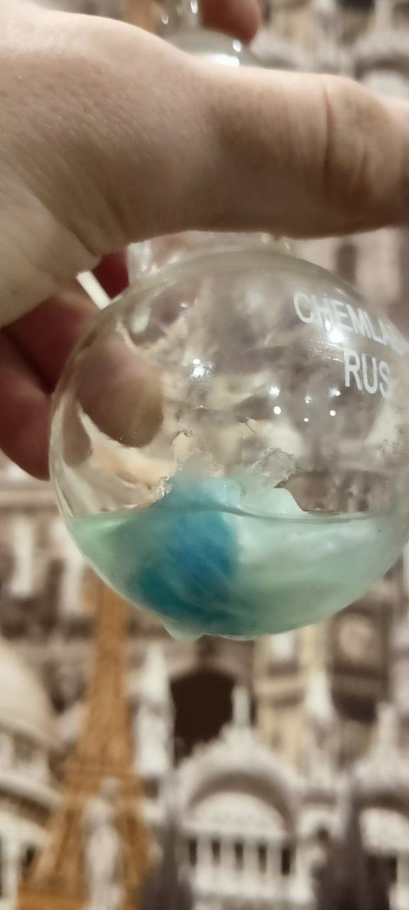

## Result

Semi-transparent greenish-blue crystals and a semi-transparent bluish solution in the test tube (possibly a basic copper salt, hydroxyacetate).

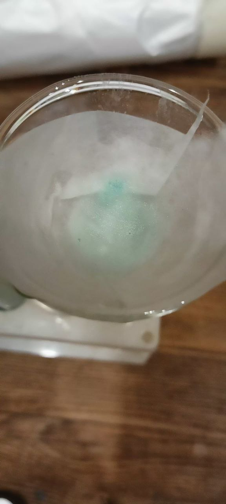
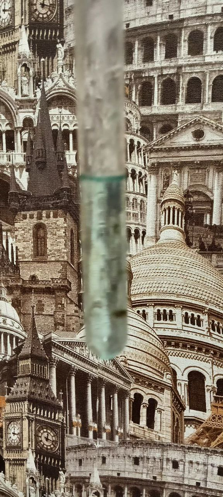

## Those videos

1 - https://www.youtube.com/watch?v=70mLVytWdNk
2 - https://www.youtube.com/watch?v=MZwYG6dG8CY

# Attempt to obtain malachite

I clarified with Avak Avakovich about basic copper salts and received a message:

```
About basic copper salts — this is an extremely "nasty" topic: copper PRIMARILY reacts to ALKALIZATION of the medium by HYDROLYSIS, giving a hydroxy-INITIAL copper salt. Ion exchange with other salts may not occur at all. For example, adding alkalis, or trisodium phosphate, or baking soda, or other reagents that ALKALIZE the medium to an aqueous solution of copper sulfate produces the SAME bluish precipitate of copper hydroxy-SULFATE. From copper dichloride under these conditions, copper hydroxy-CHLORIDE precipitates. Even obtaining copper hydroxide turns out to be not an easy task: hydroxy-INITIAL copper salts precipitate. At school they mix copper sulfate with soda and say that "malachite precipitated"; from sulfate and trisodium phosphate they expect copper phosphate, but in reality ion exchange practically does not occur, and the SAME bluish precipitate of copper hydroxy-SULFATE precipitates.
```

And indeed, during the hydrolysis of copper sulfate, sulfuric acid is formed, which returns back to sulfate. Roughly like this:

```
Aqua complex:
CuSO4 + 6H2O <=> [Cu(H2O)6]+2 + SO4^-2 <=> [Cu(H2O)5(OH)]+ + H+
Hydrolysis roughly like this <=>
Cu^2+ + H2O <=> Cu(OH)+ + H+ 
SO4^-2 + H+ <=> HSO4^-
HSO4^-1 + H+ <=> H2SO4
The medium will be acidic because sulfuric acid is a strong acid.
When sodium bicarbonate is added:
NaHCO3 => Na+ + HCO3- (stable compound)
HCO3- + H2SO4 = HSO4- + H2CO3 => HSO4- + H2O + CO2^
HSO4- + HCO3- + H+ => SO4^-2 + H2CO3 => SO4^-2 + H2O + CO2^
Or in ionic form:
HCO3- + H+ => H2CO3 => H2O + CO2^
HSO4- + H+ <=> H2SO4
Then CO2 and Cu(OH)+ remain in solution, HCO3- attaches to this compound:
2Cu(OH)HCO3 and immediately decomposes => Cu2(OH)2CO3 + H2O + CO2
The latter precipitates.
Thus we obtain a basic salt (malachite).
Na+ + SO4^-2 remain in solution.
```

Dried precipitate from the previous experiment:

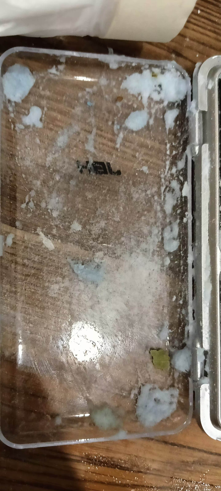

Reaction for obtaining malachite:

<video width="640" height="360" controls>
  <source src="{{ 'experimets/BasicSalts/Malahit/Реакция получения малахита.mp4' | relative_url }}" type="video/mp4">
  Your browser does not support the video tag.
</video>

Strange blue precipitate, possibly azurite:

<video width="640" height="360" controls>
  <source src="{{ 'experimets/BasicSalts/Malahit/Странный осадок синий.mp4' | relative_url }}" type="video/mp4">
  Your browser does not support the video tag.
</video>

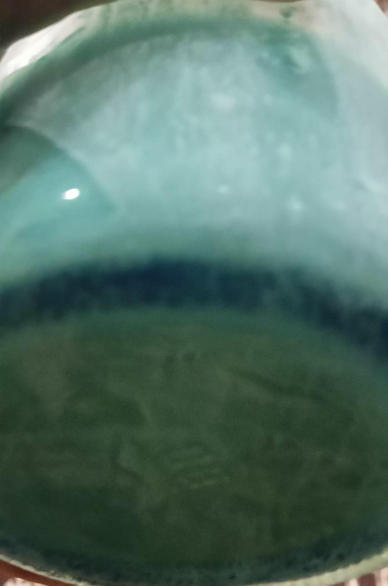

Wet malachite precipitate:

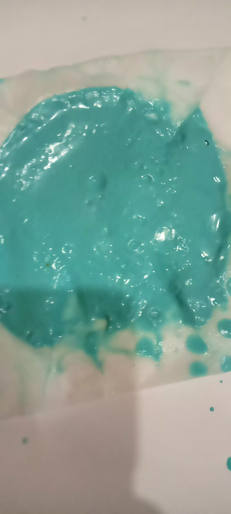

Sodium sulfate solution (pure; therefore, in the video the author mistakenly considered sodium sulfate to be the green-colored salt):

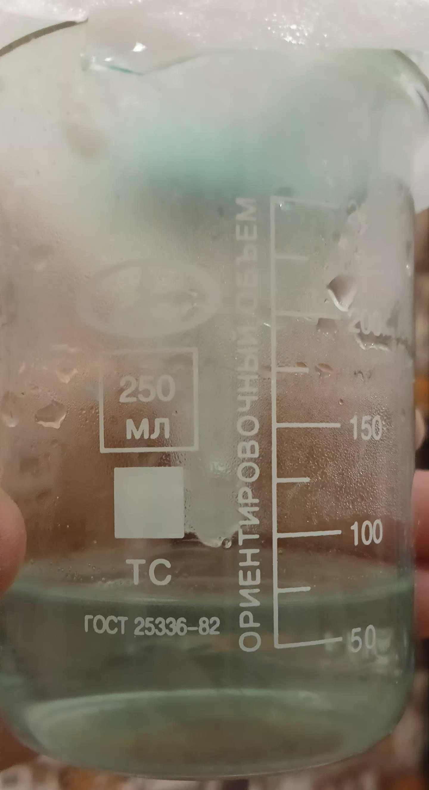

Finished malachite, after washing, filtration on filter paper, and drying in an oven at 100°C:

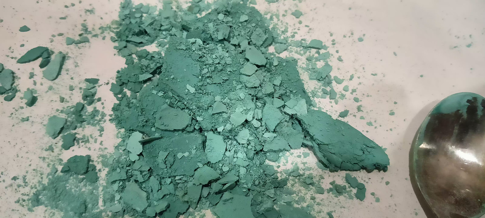

Malachite itself behaves like a colloidal solution and coagulates slowly, so I had to remove water by decantation. When the solution is heated, it settles faster. For industrial production, a good filter is needed that filters finely dispersed colloidal solutions so as not to waste time on purification.

Since CuSO4 is sold as a crystal hydrate CuSO4 * xH2O, the weight obtained from 50 grams, taking losses into account, was ~15 grams. (On the first purification, more than expected by 40%.)

At room temperature, something more like azurite is obtained:

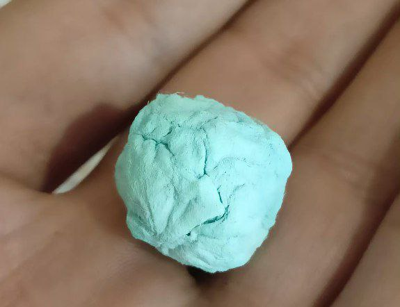

## Work by Avak Avakyan

```
Hello! I downloaded and carefully reviewed it.

It seems to me that all your interaction occurred at the first moment, when you (accidentally, by tipping over the jar) mixed the components. The reagents mixed and reacted instantly, forming these floating crusts. And that's it: there was nothing left to happen further. 🙂

And I "got around to it" and recorded a video and posted on the Internet a CHEMICAL REACTION I DISCOVERED of copper hydroxide with aqueous solutions of neutral carbonates (for example, washing soda). Several years ago, an English-language study came out saying that so far it has "not been possible to determine" what that very dark blue compound is that arises in the reaction of copper salts with strong aqueous solutions of washing soda. And it is assumed (with references to a number of other studies) that this is "most likely a double carbonate" of copper and sodium. However, there are two "double carbonates of copper and sodium": these are the known minerals juangodoyite Na₂[Cu(CO₃)₂] and chalconatronite Na₂[Cu(CO₃)₂]×3H₂O; and both of them are INSOLUBLE in water, therefore they CANNOT create the color of the solution (especially such a bright one). And I found out what compound gives this very dark blue "ink" color, similar to the color of ammines of divalent copper: — it is sodium tetrahydroxycuprate Na₂[Cu(OH)₄]. I have already published this in the Perm scientific collection. Here is my essay about it:
https://avakyanus.wordpress.com/2026/04/27/sodium_tetrahydroxycuprate/
And here is a link to download the VIDEO with this chemical reaction:
https://archive.org/download/sodium_tetrahydroxycuprate/Na2Cu%28OH%294.avi
```
<a href="https://archive.org/download/sodium_tetrahydroxycuprate/Na2Cu%28OH%294.avi" target="_blank">Video by Avak Avakyan about tetrahydroxycuprate</a><br/>
<a href="https://avakyanus.wordpress.com/2026/04/27/sodium_tetrahydroxycuprate/" target="_blank">Article about tetrahydroxycuprate</a><br/>

## Next stage

Do the same, but take ready-made iron(III) chloride for experiments.
