Photos/Videos:
<div class='pair'>
    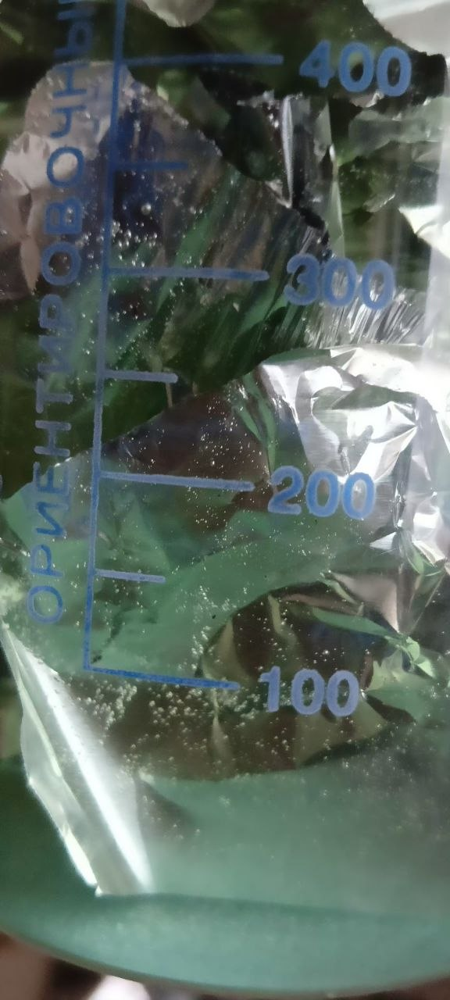
</div>
<br/>
<div class='pair'>
    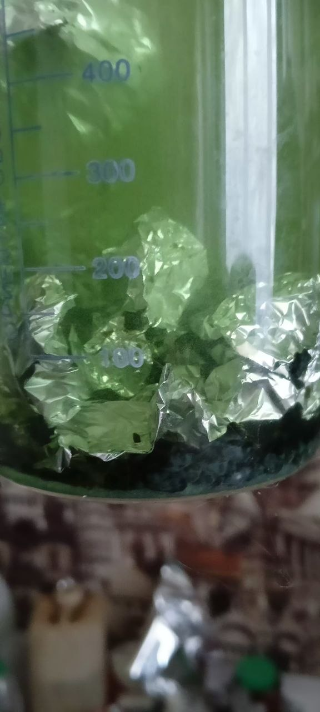
</div>
<br/>
<div class='pair'>
    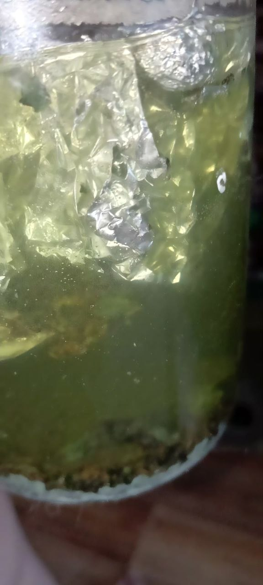
</div>
<br/>
<div class='pair'>
    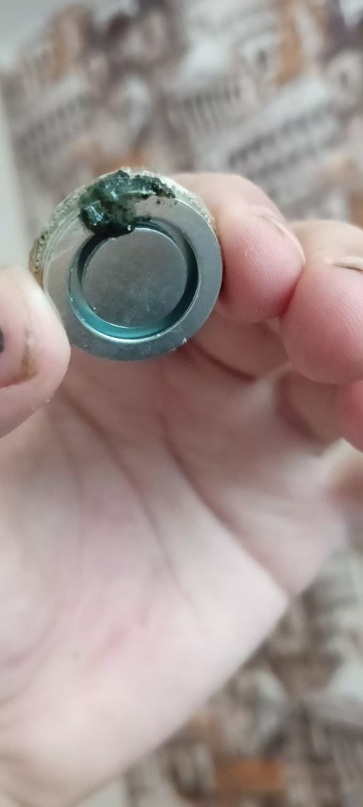
</div>
<br/>
<div class='pair'>
    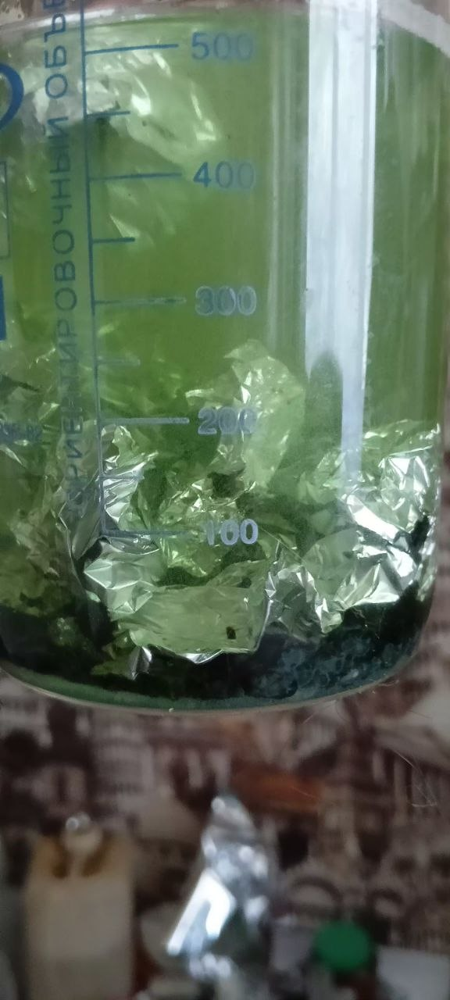
</div>
<br/>
<div class='pair'>
    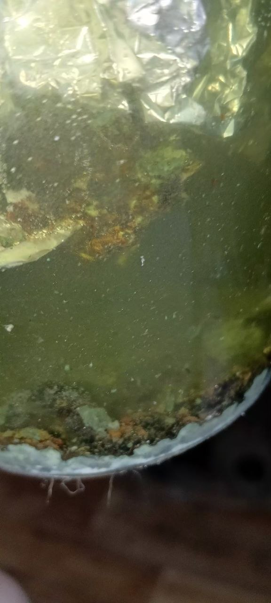
</div>
<br/>
<div class='pair'>
    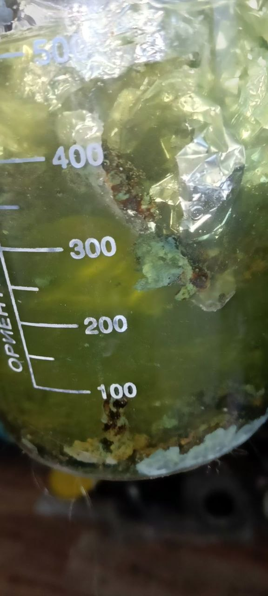
</div>
<br/>
<div class='pair'>
    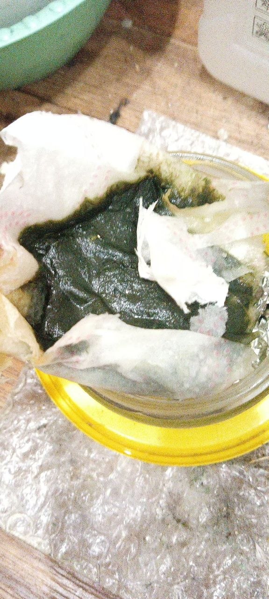
</div>
<br/>
<div class='pair'>
    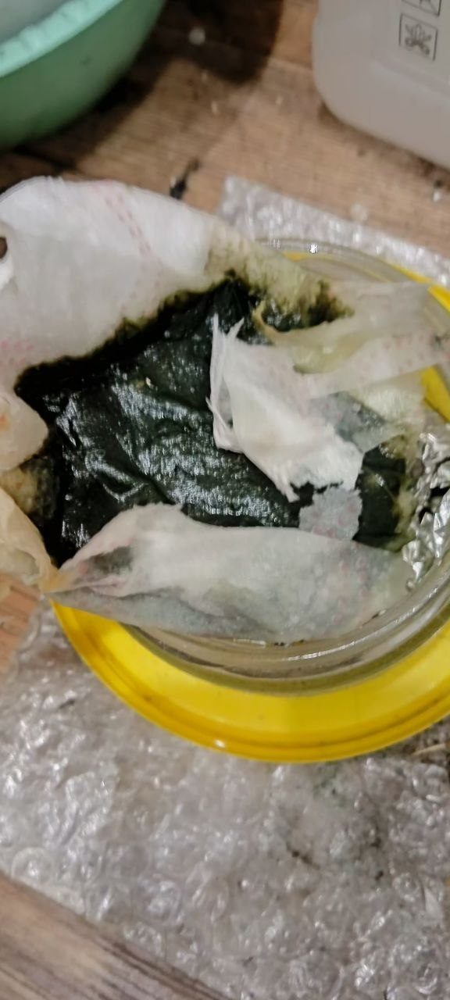
</div>
<br/>
<div class='pair'>
    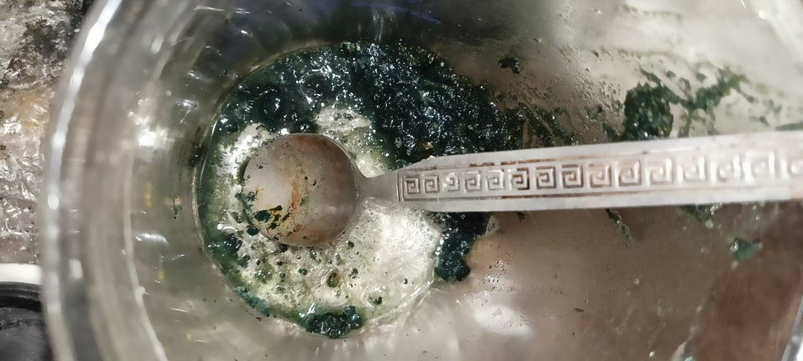
</div>
<br/>
<div class='pair'>
    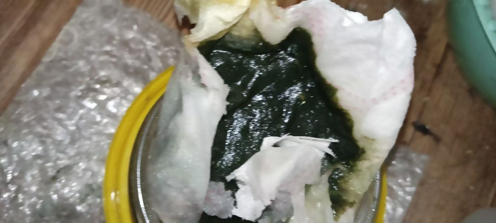
</div>
<br/>
<div class='pair'>
    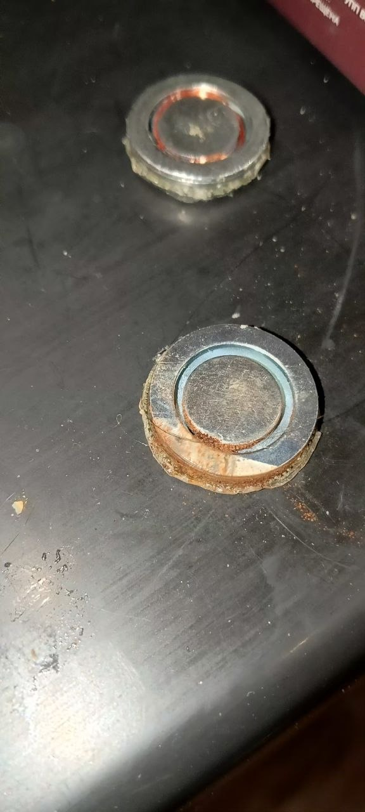
</div>
<br/>
<div class='pair'>
    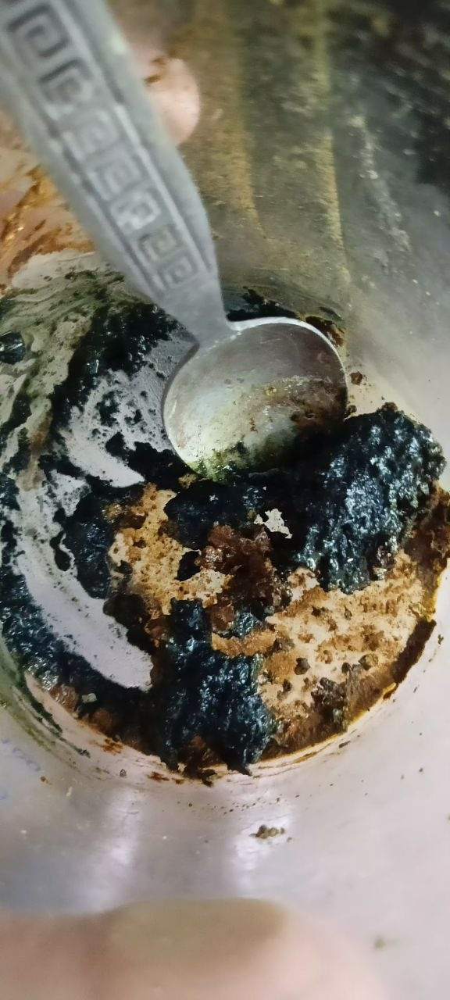
</div>
<br/>
<div class='pair'>
    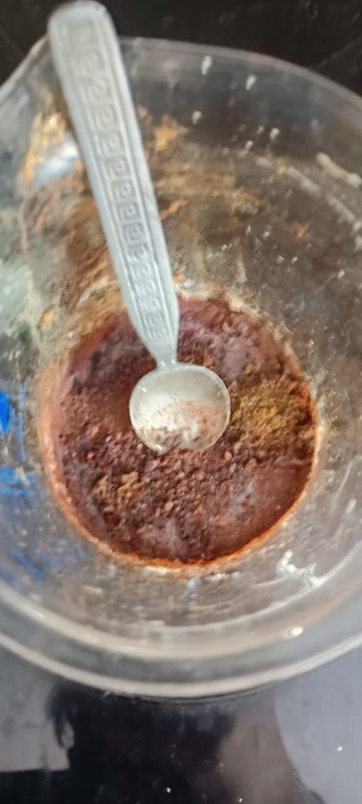
</div>
<br/>
<div class='pair'>
    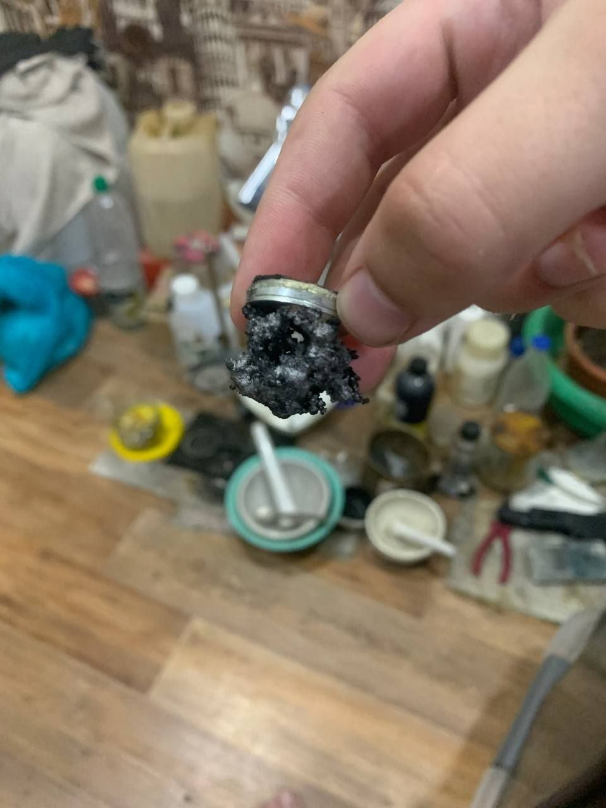
</div>
<br/>
<div class='pair'>
    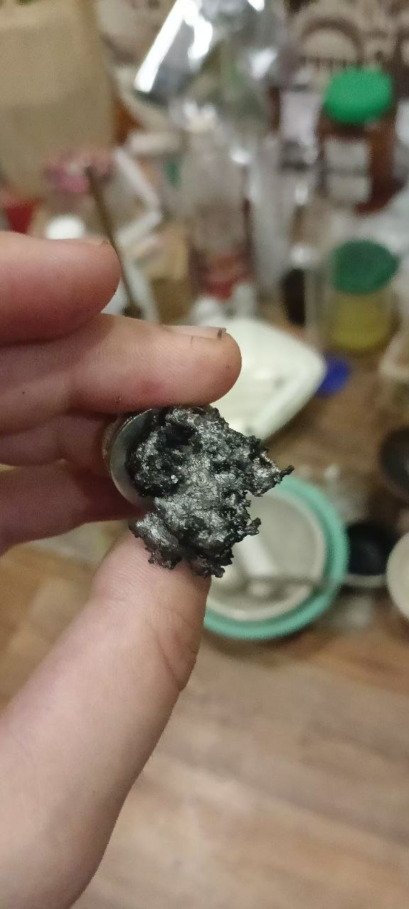
</div>
<br/>
<div class='pair'>
    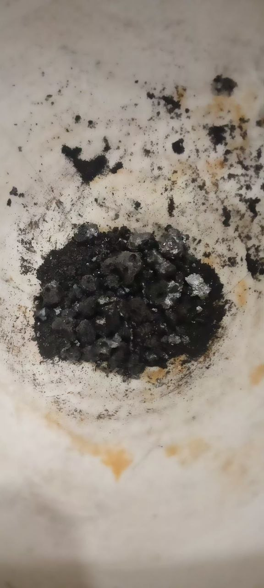
</div>
<br/>
<video width="640" height="360" controls>
  <source src="{{ 'images/feso4/magnetic_1.mp4' | relative_url }}" type="video/mp4">
  Your browser does not support the video tag.
</video>
<br/>
<video width="640" height="360" controls>
  <source src="{{ 'images/feso4/magnetic_2.mp4' | relative_url }}" type="video/mp4">
  Your browser does not support the video tag.
</video>
<hr/>

## Preface

A long time ago there was a discussion about the reaction of aluminum foil, table salt, and copper(II) sulfate. I was told that it produces not copper(I) oxides/oxide (Cu2O), but pure copper. But the result is not a yellowish-metallic precipitate, it is red. During electrolysis I obtained pure copper, and it did not have a red tint. To prove this, I carried out an experiment.
You can read my correspondence and arguments with AI here — https://g.co/gemini/share/47533d6d9818
An example of how glitchy it/I can be. Iron(II) sulfate, 100 ml in 600 ml of water, dissolved very poorly; when foil was added, only weak bubbling occurred (hydrogen, due to hydrolysis and sulfuric acid, and there is very, very little of it there). I tried adding a trace amount of sulfuric acid as activation energy — it gave no results. Adding iron(III) chloride also did not significantly speed up the reaction. Adding table salt did so insignificantly; perhaps sodium aluminate forms, but I think it simply shifts the pH. When a trace amount of alkali was added, a precipitate of hydroxides immediately formed and bubbling started after some time; the reaction became vigorous and you can observe the formation of FeO(OH)/FeO/Fe2O3. Copper compounds in alkali, Cu(OH)2 / Cu(OH), are not stable, like those of silver, and decompose immediately — I already have experience with a silver salt and obtaining silver oxide via alkali. It is roughly the same. That trace amount of hydrogen is not able to reduce the entire amount of oxides, <s>and also, according to Beketov's series</s> (it does not work with oxides), there is an oxide film on the foil — it is not an amalgam. Therefore the reaction proceeds slowly in terms of reduction by hydrogen, ... and that is why with copper sulfate it mostly produces <s>Cu2O</s> (Cu), which can also be obtained <s>from CuO</s> if you heat it for a long time with a strong flame (the powder turns red, maybe pure copper)... <s>At the same time Cu2O is more active than CuO (needs to be rechecked). When reducing iron I obtained a black lump with a slight metallic sheen, mostly black lumps almost like caked powder. All the materials above (crossed out for company)</s>

## Correspondence (by style)


```
About the piece of iron later, the message I wrote was deleted. Seems I found it. I tested the mixture by magnesiothermy. One person wrote that sodium chloride + foil + copper sulfate gives not oxides but pure copper. I tested it with iron(II) sulfate. Iron(III) chloride did not significantly speed up the reaction, table salt also did not, but alkali immediately caused bubbles, although at first I think a hydroxide precipitate formed. Mostly a black/greenish precipitate, with some brown. When heated it gave FeO(OH), and under the layer possibly FeO*Fe2O3, but the fact is that it is not pure iron — pure iron would not give a tint and would not be brown directly in water and as a layer on the foil. I will post the research later

....
```

Reply:

```
This is absolutely EXACTLY catnip. Crush a leaf — it will have a minty smell. Dragonheads (and skullcaps similar to them) do not have such a smell; dragonheads have a weak and uncharacteristic smell, skullcaps have practically no smell at all. Such a super lush, branched, huge powerful bush is formed by catnip, but NOT by dragonheads. However, this is not bad, but very wonderful: I recommend trying this catnip (consume flowering tops before bed); for the first time take a small dose (the first try should always be small — you never know, there may be an individual negative reaction)! In Krasnoyarsk catnip is also found, but I haven't gotten around to it yet. Moldavian dragonhead is currently blooming in Krasnoyarsk; it may soon become inconspicuous (when there are no flowers). At the moment (today) I picked skullcap scordiifolia (it is just beginning to bloom) and ate it, today is the first try. This is a similar plant from the same family, but with narrower leaves and slightly different flowers.

About COPPER — I also came across this, and apparently YES: what forms there is spongy copper (a precipitate of metallic copper, not Cu2O). Table salt is added to (and dissolves in) a solution of copper sulfate; then aluminum foil is placed in it. The foil dissolves, releasing hydrogen, and a reddish-brown precipitate falls out, and this, apparently, is precisely metallic copper.
```
 
My messages:

```
https://wipedlifepotato.github.io/experimentfeso4al2o3.html

I think there will be a mixture of hydroxides/oxides/... And I will check with table salt only later
...
I have an old video where I recovered copper powder by electrolysis from copper sulfate. Where copper was at the + anode and went to the - cathode, powder formed on the nail, and if you put the nail into a copper sulfate solution, you get a different tint than when using foil
...
Maybe it is pure copper, but why such a tint and in ......... Maybe I will recheck again, and pour acid on the finished precipitate. If it dissolves, then it is oxides/oxide.
```

Summary:

```
The internet says that the [CuCl4]2- ion appears with acid in NaCl
Then we have the acid H2[CuCl4] which reacts with the foil and then immediately reacts with water and hydrogen is released, and then everything is even more interesting if so. And comparing it with iron(II) sulfate may not have been necessary

https://g.co/gemini/share/f010ce76feca

I discussed it with AI. Under good conditions, Na2[CuCl4] is reduced by hydrogen, which may be the case. I don't know how hydrogen would knock chlorine out of the ion. It would first need to give an electron. Unless by radiation, but if the AI is not lying, that explains everything. And indeed, under different conditions the reaction can go differently. For example, at the dacha I used trace amounts of baking soda instead of table salt; when the fizzing stopped I got a blue precipitate instead of red malachite. The foil also gave bubbles

If you need catnip, I can pick some

And a long time ago you wrote that this gives oxide with foil — in general, under different conditions you get different results. Maybe it won't give any result at all...........

Not green malachite*

And Beketov's series says it does not work with oxides. So I think everything is different, I need to rethink it
```
(Na2[CuCl4] there)

Replies:

```
IRON is significantly more active than copper, so even if it appeared for a moment as metallic dust, it would immediately oxidize into oxides and hydroxides. I tried to deposit iron from aqueous solutions by electrolysis and obtained an iron coating on a graphite electrode, but within minutes after turning off the current it oxidized into rust. Copper, on the other hand, is much more inert — so much so that in the reactivity series it is to the right of hydrogen. Therefore it does not displace hydrogen from water or acids. That is why copper powder remains unoxidized under an aqueous solution. YES: earlier I read (on the internet) that under these conditions copper gives Cu2O (and I wrote this to you), but subsequent experiments with this reddish-brown precipitate indicate that it is still metallic copper. About the role of table salt — this is more exotic. The fact is that aluminum reacts with hydrochloric acid much more easily than with sulfuric acid. Salts in aqueous solutions exist as molecular associates; for example, CuCl2 in water exists as Cu(OH)2×2HCl. Thus, in aqueous solutions of chlorides there is actually hydrochloric acid, and in solutions of sulfates — sulfuric acid. Moreover, hydrolysis can lead to the fact that, for example, aqueous solutions of FeCl3 have a burning "smell" of HCl. That is, in aqueous solutions of chlorides of weak bases there is "free" hydrochloric acid.
..
About copper I meant to say "TO THE RIGHT" of hydrogen, that is "AFTER" hydrogen (I wrote "before", pardon).
..
In general, I note that the topic of Cu2O is quite "raw"; unambiguous information is yet to be obtained. To obtain "unambiguous" Cu2O, I used the "classical" method: I obtained Na2[Cu(OH)4] and heated its aqueous solution with glucose and NaOH. A precipitate was obtained. However, this precipitate "should" easily dissolve in aqueous ammonia forming a colorless solution of [Cu(NH3)2]OH, but it did not do so: only in air did a VERY small part of it dissolve VERY reluctantly (after VERY long intensive stirring), forming an ink-blue solution of [Cu(NH3)4](OH)2. Similarly but more actively behaved the precipitate obtained from aluminum foil and an aqueous solution of copper sulfate with added table salt. According to literature claims, Cu2O "should" easily dissolve in aqueous ammonia forming a colorless solution of [Cu(NH3)2]OH. And metallic copper only slowly oxidizes in aqueous ammonia in air (absorbing oxygen from the air), forming an ink-blue solution of [Cu(NH3)4](OH)2. That is, my experiments with both glucose and foil give a result that DIFFERS from official claims. Therefore, exact information — whether it is CuO, Cu2O, or Cu — is yet to be obtained. Moreover, about the "glucose experiment" textbooks give an obvious mistake: they claim that "the Cu(OH)2 precipitate does not fall out from copper sulfate and caustic soda in the presence of glucose because glucose has the properties of a polyhydric alcohol." As proof they show an ink-blue solution. HOWEVER, an ink-blue solution instead of a Cu(OH)2 precipitate is also obtained WITHOUT glucose simply because Na2[Cu(OH)4] is formed. We are told that glycerin and sorbitol "dissolve copper hydroxide", but in reality Cu(OH)2 in water does NOT react with them!!! The reaction occurs only when NaOH is added. But with NaOH an ink-blue solution of Na2[Cu(OH)4] is obtained even WITHOUT polyhydric alcohols and glucose! That is, the textbook authors themselves do not understand these processes. Moreover, if caustic soda is added to an aqueous solution of copper sulfate with glucose, the result... (correspondence continues)
```
