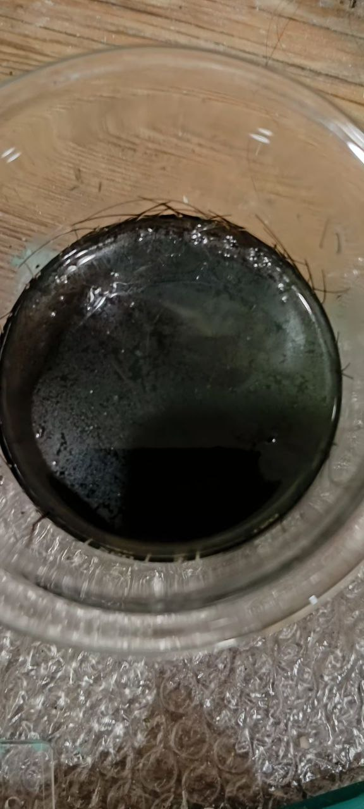
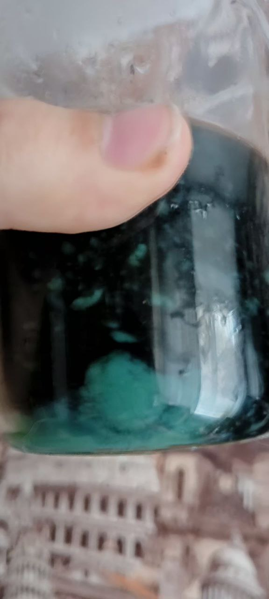
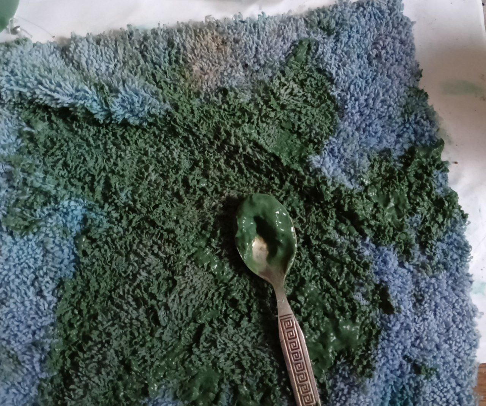
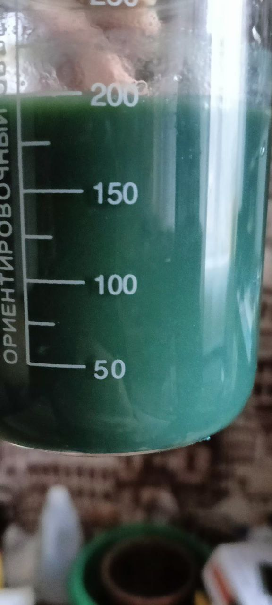
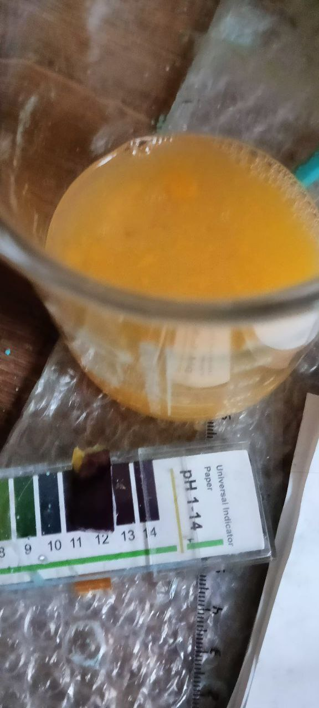
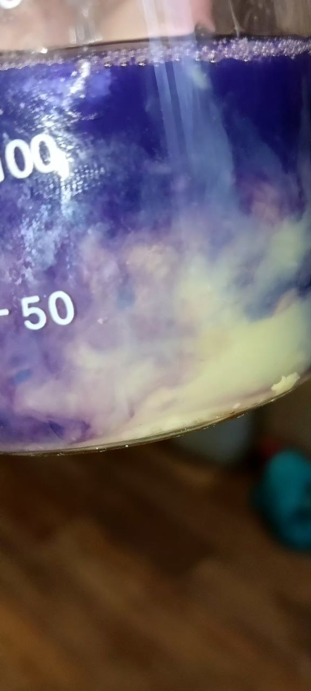
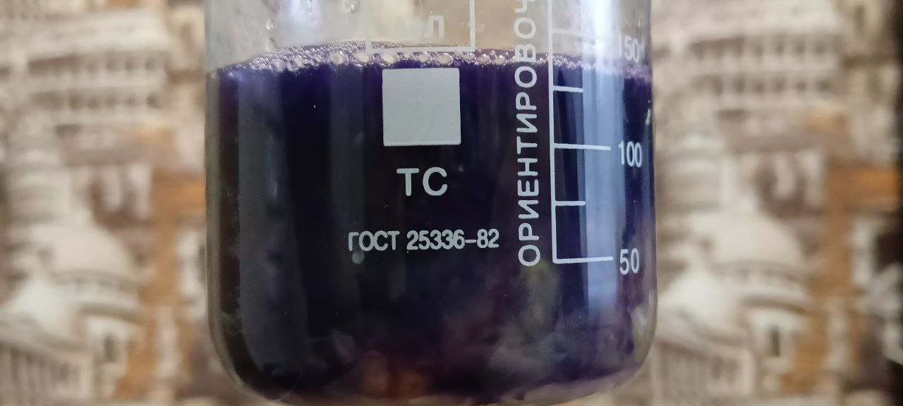
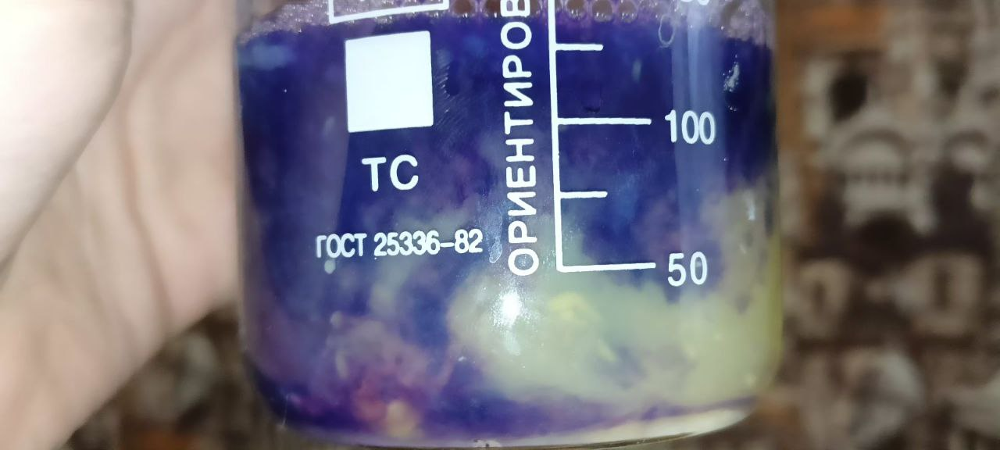
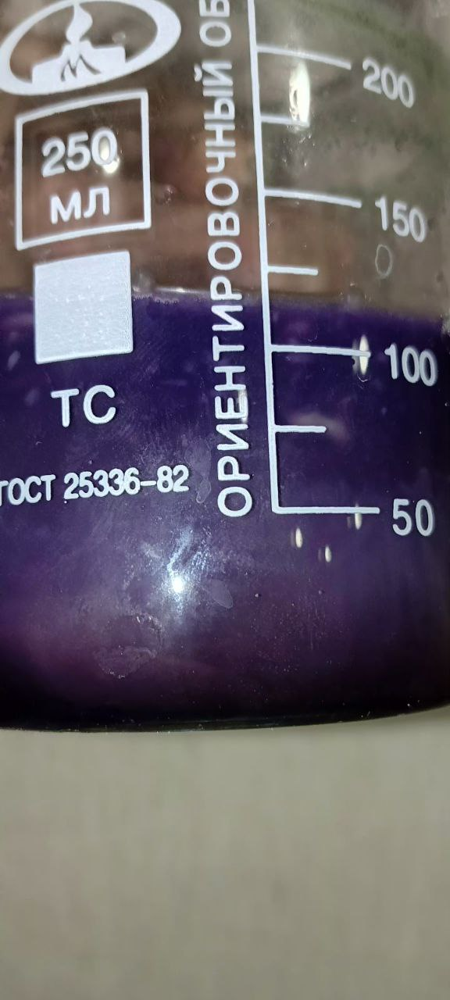
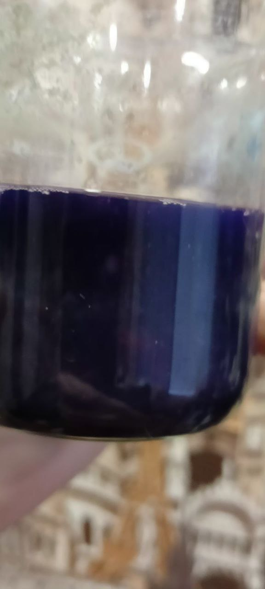

# Strong disclaimer
**WHEN WORKING WITH ALKALI YOU MUST USE PPE — IT CAN DESTROY EYES. THE AUTHOR PUBLISHES THIS AS A PERSONAL EXPERIMENT AND ACCEPTS NO RESPONSIBILITY FOR IMPROPER USE OF THIS INFORMATION, ESPECIALLY WITHOUT UNDERSTANDING WHAT IS HAPPENING.**

# Goal

To check whether it is possible to break protein bonds in hair with alkali without heating.

Reagents: KOH in an amount sufficient to provide pH 14, even slightly in excess.
Copper sulfate (CuSO₄·nH₂O) in trace amounts. With the hair I tried adding up to the maximum, expecting a violet tint, but only got a reaction similar to obtaining malachite.

# The hair

I placed hair from my head and some not from my head into the alkali solution (potassium hydroxide). I left it for about 3 days.

After 3 days I separated the hair as much as possible from the solution and added a little copper sulfate solution. As a result there was no biuret reaction at all, but a green precipitate (possibly malachite). The pH changed over several days, and the solution on the spoon was yellowish. The smell was unpleasant.

As you can see, there is no biuret reaction at all. Therefore, either protein hydrolysis does not proceed without aggressive conditions (heating, activation energy), or the bonds in hair are simply too strong. It should be noted that the hair not from the head seemed to dissolve or turn into a slurry.

# Biuret reaction with egg

The biuret reaction with proteins and peptides is a reaction in which proteins give a violet tint in an alkaline medium with copper salts. This reaction has only practical application in analytical chemistry.

As an example of the biuret reaction I took an egg and mixed it into a homogeneous mass (with the yolk). I added alkali to pH 14.

I added a little copper sulfate solution.

After some time:

A clear formation of a violet tint is visible — the biuret reaction — and in the end almost the entire solution became violet-blue. This can be seen in the photos.

# Conclusion

Hair is very resistant to alkalis at room temperature. At the beginning of the reaction the pH was 14; when I started adding copper sulfate, the pH was between 11 and 13.