# SUPER DISCLAIMER
**The author did everything at their own risk and is publishing this material as personal experience, disclaiming any responsibility for injuries that may result from repeating the experiments. The work was done in small volumes. More than half was lost during purification. This is not a how-to guide for dissolution. You're supposed to pour acid into water, not the other way around, because of hydration. Understanding the volumes and that the acid was already hydrated, this rule was broken in the material here, but you must not do that. The acid can boil over. If you breathe ammonia or nitric acid vapor, you can get pulmonary edema and burns. Breathing ammonium chloride aerosols can also cause burns. This article is an experiment; the author's goal was to understand the chemistry visually and then figure out how to work with silver; if you do plan to use this material as a guide, at least learn basic chemistry first. Study the risks and buy protective gear first. Do it under controlled conditions, under a fume hood. The author is simply used to the risks and has already worked with ammonia and inhaled it in large amounts. Someone who doesn't know better may be shocked and not know what to do. Acid can dye your lungs and skin — that's an indicator reaction in chemistry. In short, this disclaimer is for those who might later run off and sue me — THESE EXPERIMENTS ARE DANGEROUS WITHOUT UNDERSTANDING. THE ARTICLE VIOLATES PPE RULES AND THE GOAL WAS NOT TO GET 100% YIELD, JUST TO FIGURE THINGS OUT**

## one more disclaimer

What's above <s>you can skip reading</s>, well, you're not going to read it anyway; what's below you can jump straight to Part 2 from, if all you need is the result. 

# Dissolving a piece of 925 sterling silver jewelry

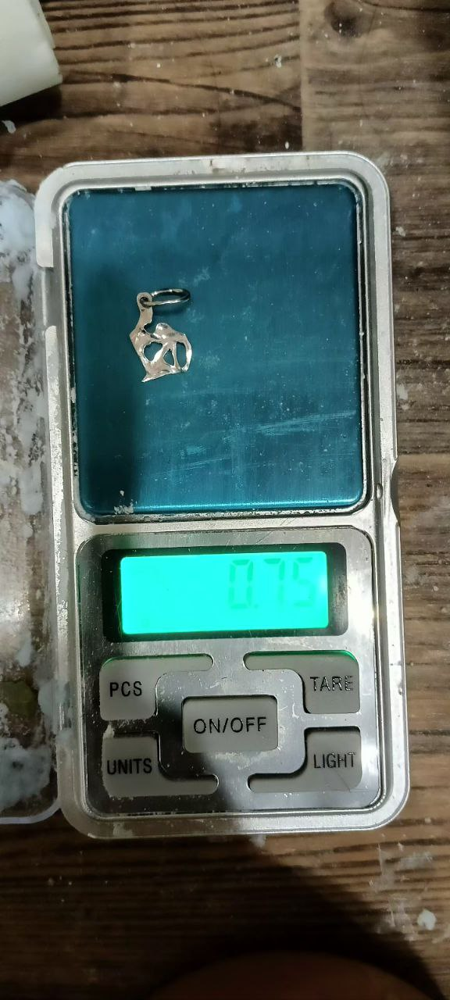

Took a few milliliters of 65% nitric acid and a silver piece of jewelry, tossed it into the solution and plugged the pipette with ordinary cotton wool

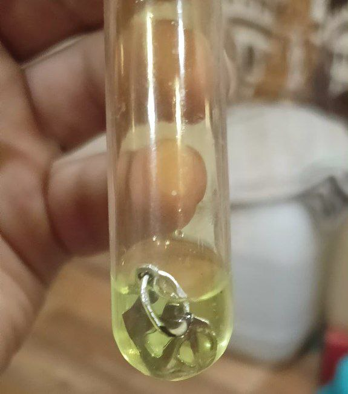

Without heating the reaction didn't proceed at all (passivation)

With gentle heating oxides start forming and the reaction does proceed after all, but still weakly

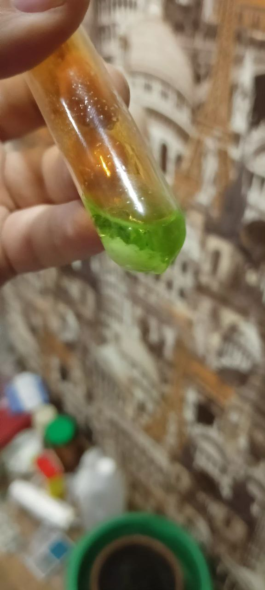


With strong heating nitrogen oxides are clearly visible

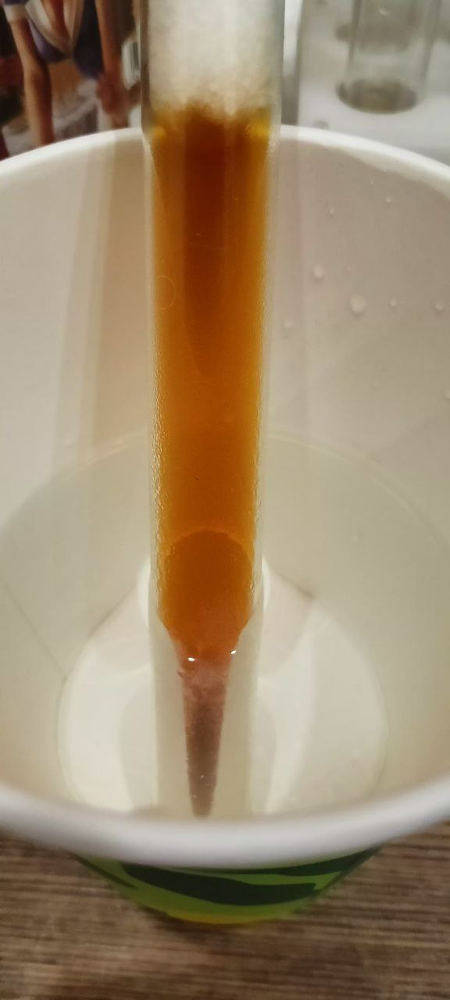

Diluted the solution and put it somewhere warm, the reaction went better

<video width="640" height="360" controls>
  <source src="{{ 'experimets/Ag/rastvorenijevrazbavlenom.mp4' | relative_url }}" type="video/mp4">
  Your browser does not support video.
</video>

# udp Avakyan's method for obtaining silver from mirrors

```
 1). Scrape the coating off the mirrors with a knife; you get a powder containing silver and impurities (paint, for example).

2). In a porcelain bowl dissolve plenty of ammonium nitrate in battery electrolyte (there is NO need to concentrate it) and pour the powder obtained from the mirrors into this solution. At room temperature the reaction doesn't start; heat it on an electric hotplate until the nitric acid boils; the reaction should continue until brown clouds of nitrous gas stop evolving completely. Quite a lot of a white precipitate of sparingly soluble silver sulfate will appear.

3). Add baking soda until carbon dioxide stops evolving COMPLETELY; this neutralizes the acids and converts the silver sulfate into a dark–yellow precipitate of silver carbonate. It's insoluble in water, so all the silver ends up in this dark–yellow precipitate.

4). Pour in (still in the same porcelain bowl) an excess of ammonia solution. It dissolves all the silver carbonate, forming a transparent dark–yellow (urine-colored) solution of diamminesilver carbonate. Filter this solution through a paper filter (made of two layers of toilet paper).

5). The resulting transparent dark–yellow solution, which looks like urine, can simply be evaporated (the silver in it usually turns out to be already pure enough). Pour nitric acid onto the evaporated product and we get silver nitrate (the starting reagent for most of the chemical syntheses we need). Or you can pour a saturated aqueous solution of ascorbic acid into this solution to make the silver precipitate as metal. But here's the «NUANCE»: if the silver solution is too dilute, the silver precipitation process can drag on for a week: the darkening when you pour in the ascorbic acid solution will be weak, the solution will only turn black after a day, and the silver will only settle to the bottom after several days.
```

<video width="640" height="360" controls>
  <source src="{{ 'experimets/Ag/diamminesilver_sulphate_and_ascorbic_acid_web.mp4' | relative_url }}" type="video/mp4">
  Your browser does not support video.
</video>


# Next

While the silver was dissolving, Avak wrote to me

```
If you've ended up with silver nitrATE (if you dissolved silver in nitric acid), — mix its strong aqueous solution with a saturated aqueous solution of sodium nitrITE: silver nitrITE will precipitate (this reaction looks like this):
https://www.youtube.com/watch?v=h07uf93Y0ng
```

But it turned out that I left the solution on the radiator too long and got this:

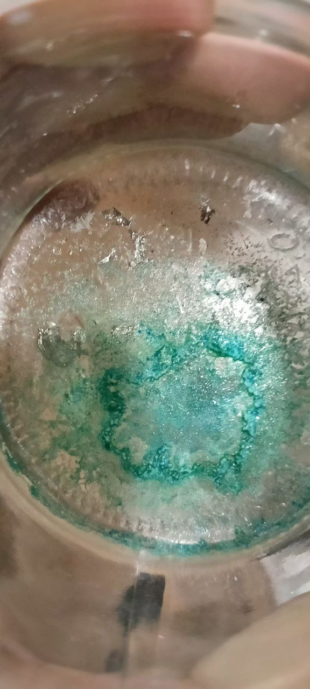

As you can see, quite a lot of copper, a LOT of copper.
Dissolved this precipitate in water. Then added hydrochloric acid and got a silver chloride precipitate (I should have filtered first, but I had a bit of a brainfart)

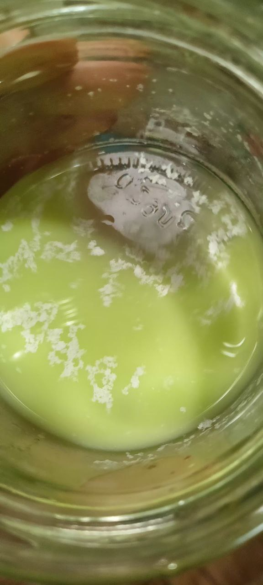
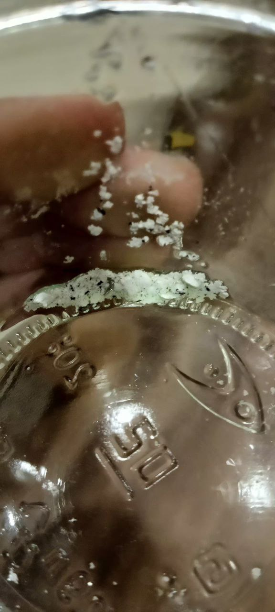
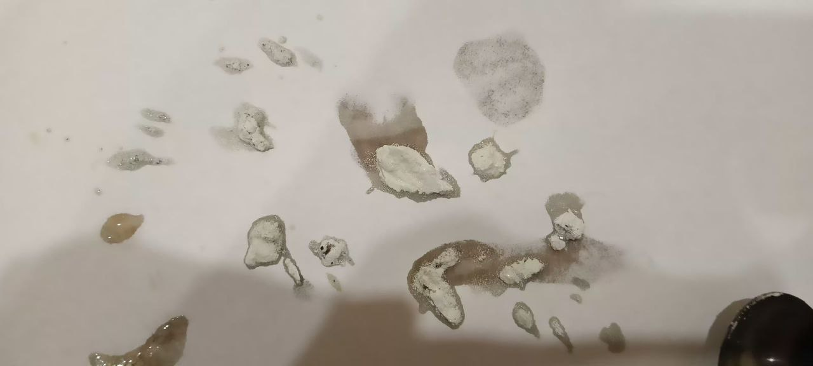
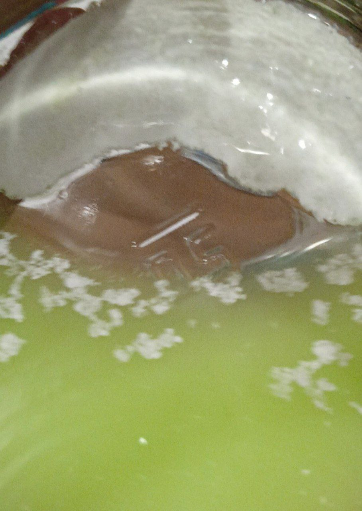

It comes out pretty bulky, most likely it's grabbing water(?)

# Dissolving in ammonia

Next, realizing that my chloride was rather dirty, I dissolved it in ammonia. Here's what was left after dissolving in ammonia (be careful working with ammonia, it can burn your eyes, lungs and all that. Even in a respirator and goggles. Best to do it under a fume hood or outdoors)

<video width="640" height="360" controls>
  <source src="{{ '/experimets/Ag/DymachijsaAmmiak.mp4' | relative_url }}" type="video/mp4">
  Your browser does not support video.
</video>

The residue (this is before filtration, right after the ammonia. I mean that white amorphous precipitate that does dissolve in ammonia, just not right away. Don't pour too much, it just needs time):

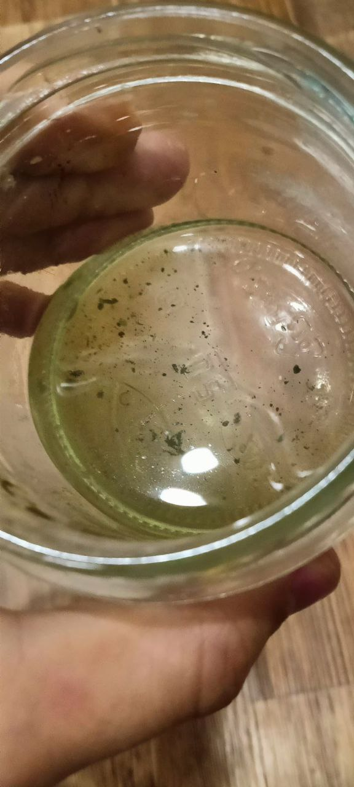

After that I filtered it through toilet paper and by the way probably lost half the solution that way. (most likely you shouldn't make 100 layers of paper; well, I definitely made about 10 layers) The solution itself turned blue, which you can see in the video. That's copper.

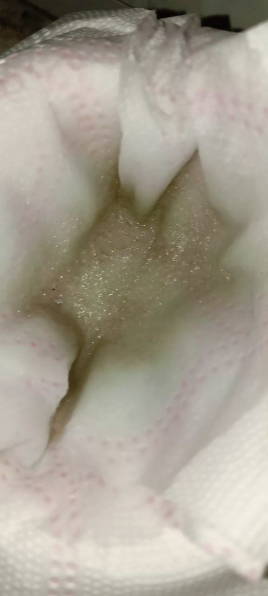


Okay, after that out on the balcony (since I got tired of waiting for all the ammonia to evaporate) I added some hydrochloric acid to the solution

<video width="640" height="360" controls>
  <source src="{{ 'experimets/Ag/OsahdenijeSKompleksaAmmiaka[Ag(NH3)2]Cl.mp4' | relative_url }}" type="video/mp4">
  Your browser does not support video.
</video>

<video width="640" height="360" controls>
  <source src="{{ 'experimets/Ag/OsahdenijeSKompleksaAmmiaka[Ag(NH3)2]Cl_2.mp4' | relative_url }}" type="video/mp4">
  Your browser does not support video.
</video>

A precipitate formed, and this time it came out more massive (most likely it's more ammonium chloride, while most of the silver stayed in solution altogether):


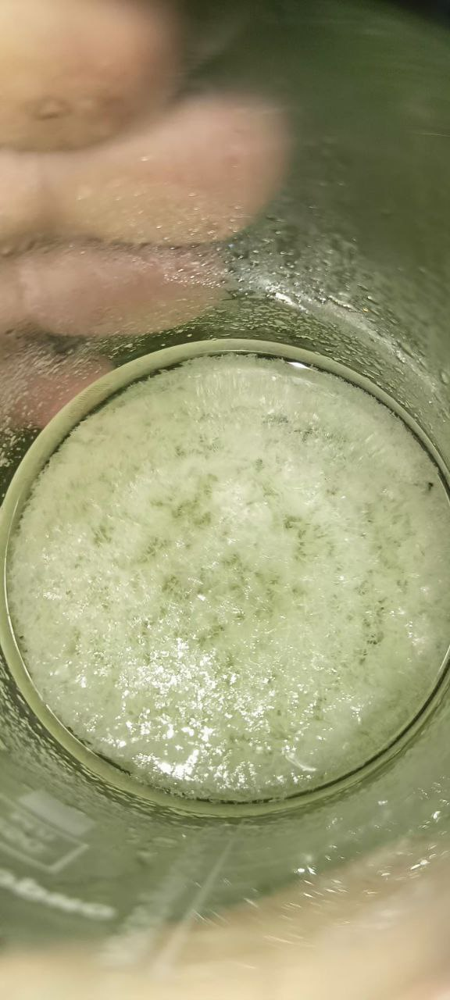

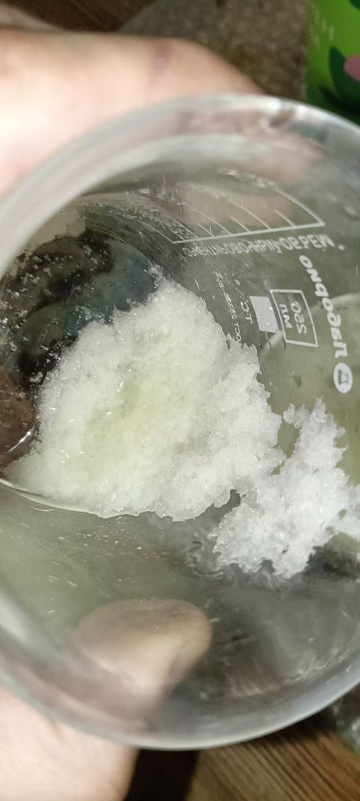


# Obtaining colloidal silver chloride

I immediately poured in 250 ml of water... and got a colloid

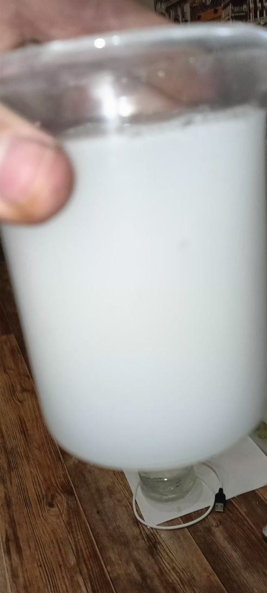


It doesn't want to sediment, what's more, filtering it through a syringe with microfiber is a pointless exercise...

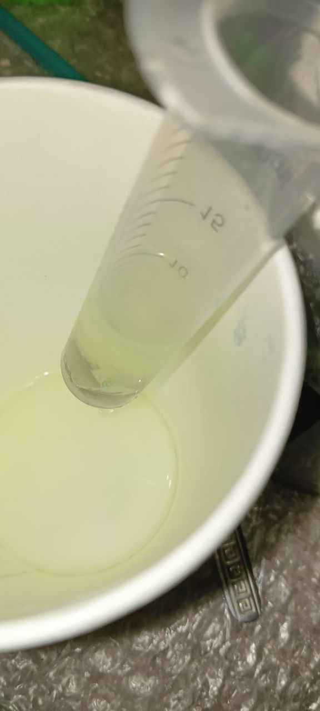
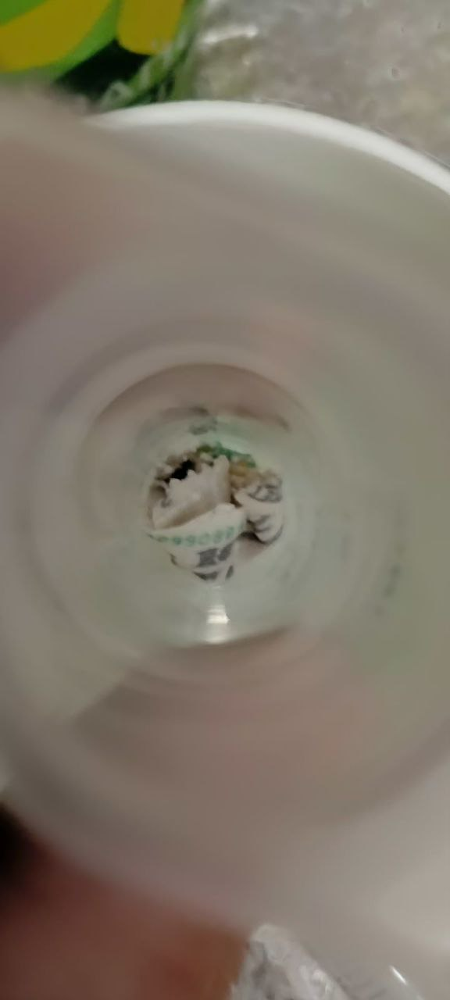

So I heated this solution in pulses in the microwave and it slowly coagulated (by the way, ammonium chloride itself is supposed to be a coagulant, but in this case it did the opposite)

After heating, slow sedimentation occurs

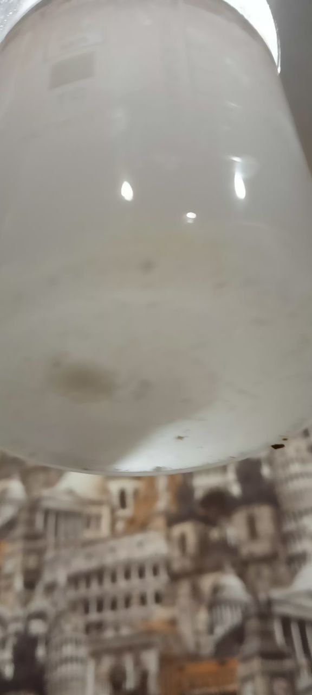
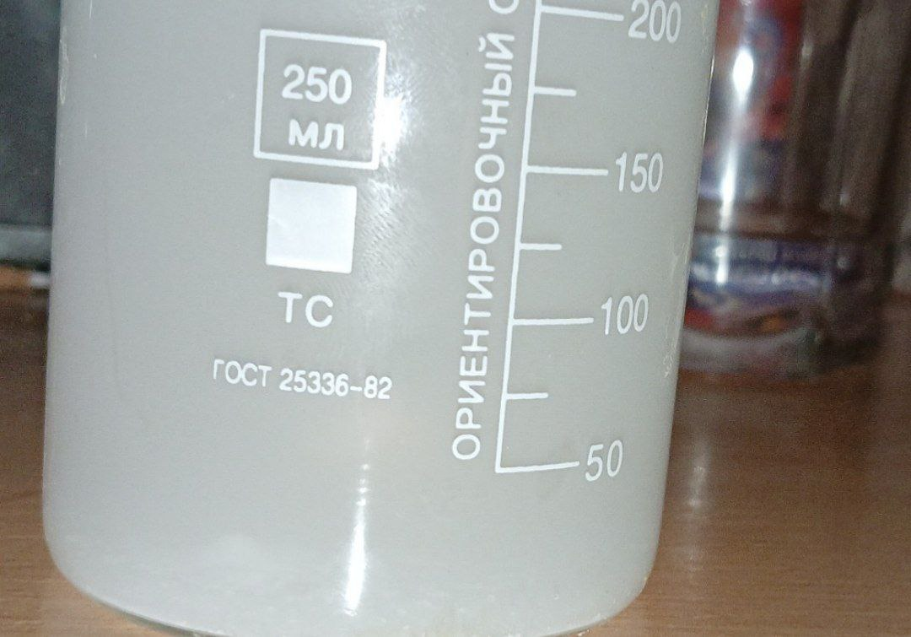

After repeated heating (up to boiling — in a microwave the liquid can even superheat) the solution became almost transparent and most of it precipitated. Probably boiling would be even faster, but the microwave is fine too (the microwave didn't burn out)
Then I decanted 250 ml, then washed with 20 ml about 3-4 times and for the last round added 20 ml and heated it in the microwave. Then, while still hot, I drew it off with a syringe. A syringe sucks out small volumes well

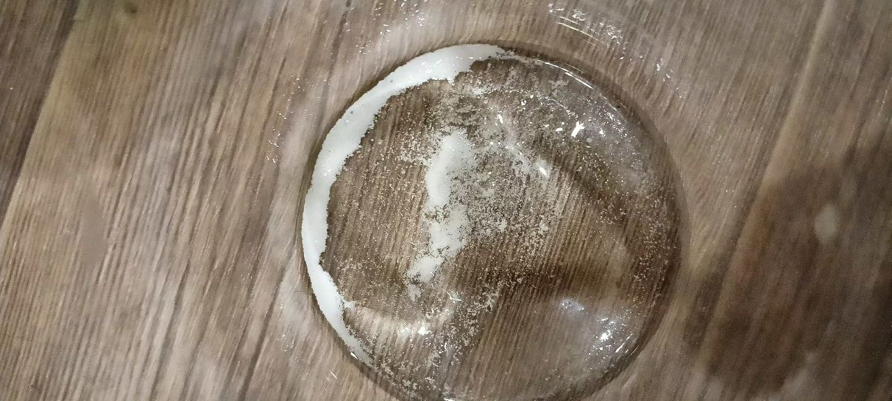

And that's how we got these little crystals

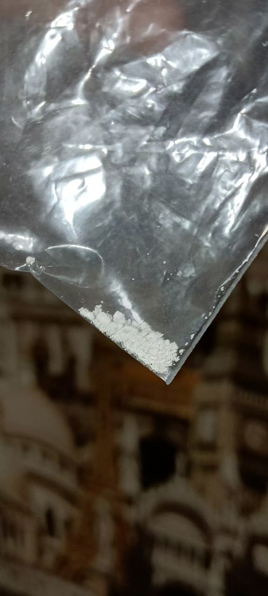
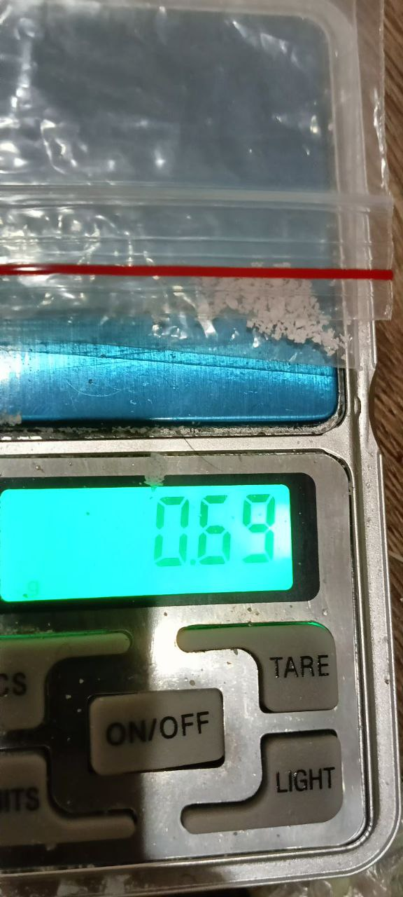

# How much did I get?

Got about 0.04 grams

And the leftovers:

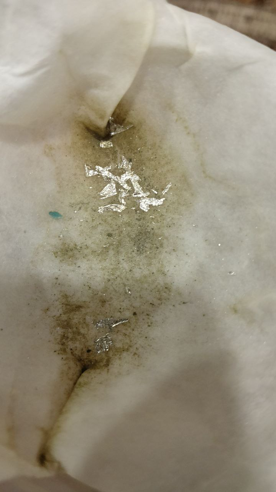


## Can it be done better?

Yes, absolutely! For example, if you don't f*ck up the solution and filter the resulting slurry right away, and only then add the same table salt solution. Heat it immediately to coagulate everything, then decant and add a little water for washing. Well, it still gets pulled out with the water as a colloid (I think so)
You could also try dissolving by electrolysis. I tried that to get lead citrate and then precipitate it with hydrochloric acid, but in practice it reduces right away and looks like this:

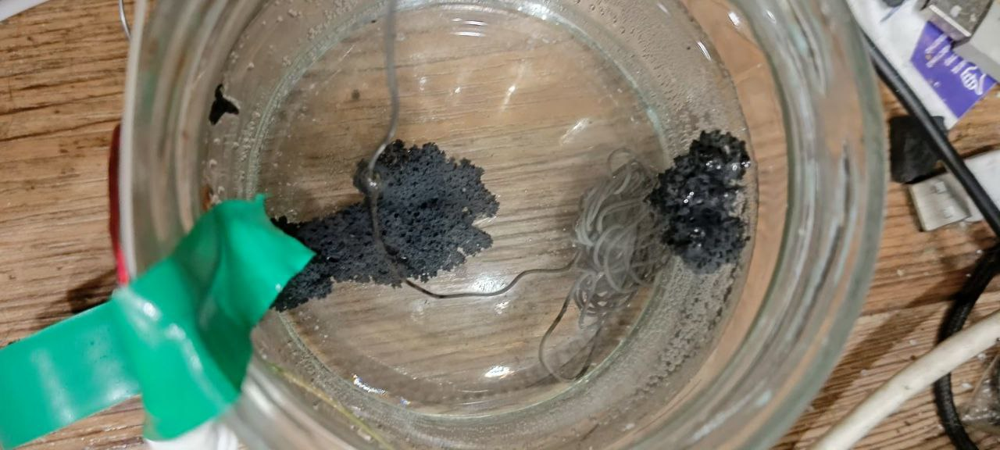

That is, this way you can dissolve it right away in dilute nitric acid or even in any other acid (the main thing is that there's no passivation and that this salt dissolves. In citric acid, electrolysis will probably take a lot of energy. Need to test) and get ready-made silver and copper powders as the output. And the solution will also contain copper and silver nitrate. The powders will be many times easier to dissolve. And this powder, purely theoretically, could later be dissolved in such a way that the copper dissolves but the silver stays as a precipitate. For example, hydrochloric acid with a catalyst (oxidizer). All these theories need testing, and besides, there isn't that much pure silver. Will 0.04 g of silver chloride be enough for analytics? I think it's enough for small experiments. But my yield turned out pretty low.


### Avakyan's comment

```
And good health to you!

I read your whole page https://wipedlifepotato.github.io/experimentsrastvorenieag.html

First of all, in this photo:
https://wipedlifepotato.github.io/experimets/Ag/Ostatki.jpg
— is that, by any chance, RHODIUM?! This shiny «foil» that looks like nickel? When I was dissolving a piece of silver jewelry, I had exactly this kind of «foil» left over from the RHODIUM COATING. I really hope you did NOT throw it away!! By the way, your piece of jewelry visually looks like it's coated with rhodium.

Secondly, silver chloride is slightly soluble in concentrated hydrochloric acid; and an EXCESS of table salt, as well as ammonium chloride, increase the solubility of silver chloride by forming complexes: HAgCl2, NaAgCl2, NH4AgCl2. And, needless to say, ammonia solution dissolves silver chloride perfectly.

Next. THIS right here: https://wipedlifepotato.github.io/experimets/Ag/AutoUparivanijeResult.jpg
— a very good product. It's extremely simple to clean it of COPPER: dissolve it in a SMALL amount of water and add A LITTLE aqueous table salt solution (NOT an excess!). ALL the silver will precipitate as a white solid, while the copper stays in solution. Second route: having dissolved this product (from your photo) in a SMALL amount of water, pour a saturated aqueous solution of ascorbic acid into it: the solution will turn black immediately, and soon all the metallic silver will precipitate (you saw this in my video). Ascorbic acid will separate the silver from the copper: the copper stays in solution.
...
About RHODIUM — yes, nitric acid can't get its teeth into it at all. 🙂 That's why when I dropped a silver piece of jewelry from a jewelry store into nitric acid, the reaction did NOT start. Only when I heated the test tube and the acid began to boil did it find CRACKS in the rhodium coating and get into them. And — little streams of bubbles started coming from those spots. Then the acid ate away all the silver and copper, leaving the rhodium coating in the form of EXACTLY THE SAME «foil» rags as yours. That is, rhodium doesn't «peel off»/«melt», it's just that the coating has microcracks.

On top of the CLEAR silver losses associated with ammonia solution and complexes, you make HUGE filters out of MANY layers of blotting paper. Such a filter holds back nearly half a glass of solution (soaked into the filter). That's exactly why I try to make the filters smaller too, and use fewer layers of paper, and sometimes resort to «tricks» like a syringe with a bit of cotton in the tip — so that a MINIMUM of solution is lost. Precipitates also know how to «stick» to the paper — that's losses again.

I would NOT advise consuming silver and gold compounds WITHOUT a clear medical reason, to put it mildly. They're toxic, they can accumulate, and they can do «long-playing» mischief in the body.
```

# Part 2, attempt 2

Poured in nitric acid, 65%. Slightly more than needed, in excess. About a quarter more than the volume of the chain itself, 1.7 grams. 
Put it in a 100C water bath. The reaction took off sharply; at first it was weak, but then NO/NO2 started evolving rapidly. The cotton wool got blown out and I pulled it out of the boiling water into the air

<video width="640" height="360" controls>
  <source src="{{ '/experimets/Ag/2/rastvorenije.mp4' | relative_url }}" type="video/mp4">
  Your browser does not support video.
</video>

One can assume that since there was strong heating, the nitric acid also decomposed
That is, besides the reaction HNO3 + Ag => AgNO3 + HOH + NO (without accounting for coefficients and stoichiometry), the reaction HNO3 + t -> HOH + NO2 + O2 also took place (without accounting for stoichiometry and coefficients)
And since there was copper, the reaction with copper also went: Cu + HNO3 => Cu(NO3)2 + HOH + NO2. But I think that with that kind of heating it simply produced O2 as well as NO and NO2. This is all approximate, in practice I think so.
So, I ended up with a heavy precipitate (a supersaturated solution)

(Yes, if you work without gloves and without a fume hood, you can dye your fingers and lungs. The skin got a bit dyed even from the gas itself. It got nitrated. Maybe the cotton wool got nitrated too, since alkanes are nitrated by radical attack. UDP. I checked — held a lighter flame to the cotton, it caught fire and burned well. The rest doesn't ignite when you bring a lighter to it. Too bad I didn't film it)

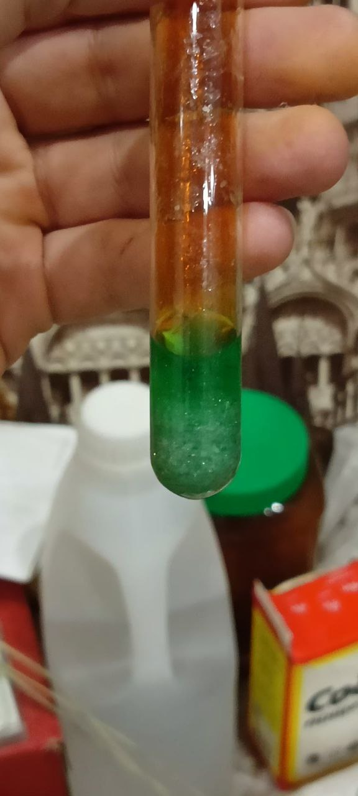

Filtered it and got a precipitate of undissolved material

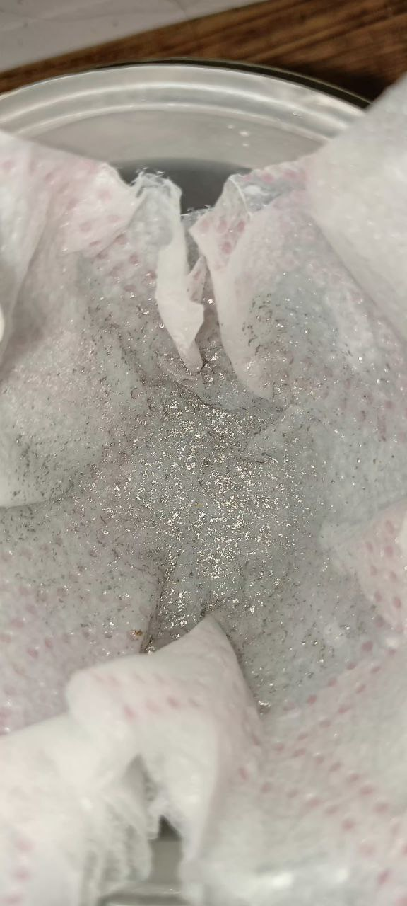

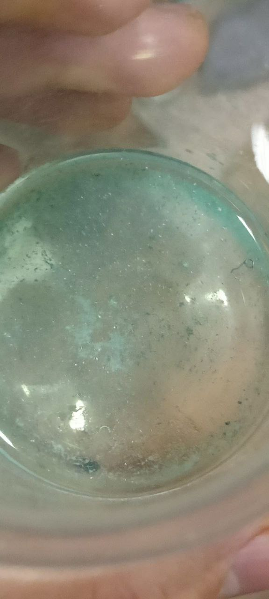


Added table salt solution little by little to the boiling water, in excess (about 2 spoonfuls), until the precipitate stopped coming out. Then I checked the remaining blue slurry — no precipitate forms if you add more.

<video width="640" height="360" controls>
  <source src="{{ '/experimets/Ag/2/chloridnatriaandnitrateag.mp4' | relative_url }}" type="video/mp4">
  Your browser does not support video.
</video>

Poured off the liquid and got silver chloride, dried it in the microwave, but because of a strange sound I went another route and stuck it in a ziplock, squeezed out the liquid, and then poured it off. In the end I left the open ziplock in a dark place to dry


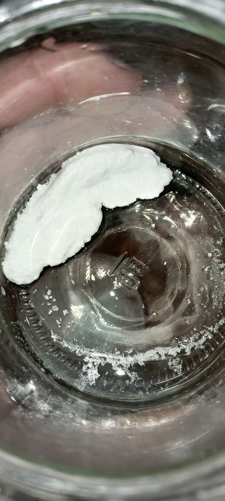
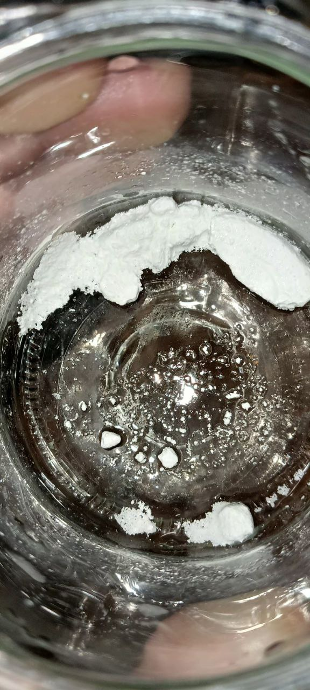
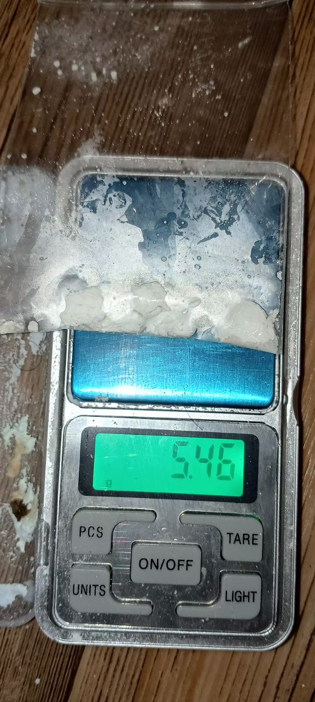
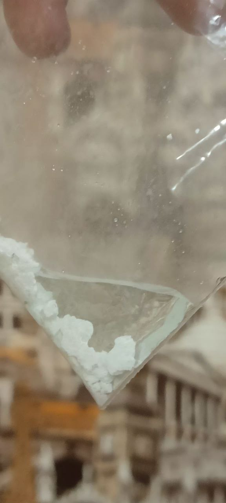

As a result, preliminary weight: (the weight seems too high here. Well, most of the weight is probably the bag itself. Should be around 2 grams)
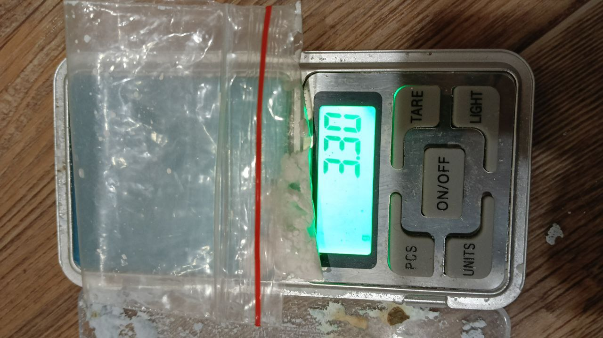

```
Ag+HONO2 => AgONO2 + NO + HOH
total oxygens 3 to 5; and nitrogens 1 to 2; and for 1 hydrogen there are 2 hydrogens

So at least 2 nitric acids are needed
substitute
Ag+2HONO2 => AgONO2 + NO + HOH
we get 5 oxygens to 6
Let's try multiplying by 2
Ag+4HONO2 => AgONO2 + NO + HOH
4*3 = 12
now our oxygen divides by 6 and we have 6 oxygens in total
Let's try substituting this 3 into AgONO2
3Ag+4HONO2 => 3AgONO2 + NO + HOH
12 oxygens to 9 and 1 left for NO, since 1 nitrogen, and now we have 4 hydrogens, so we need to multiply water by 2
and then it comes out
3Ag+4HONO2 => 3AgONO2 + NO + 2HOH
Well, I think it's all approximate and there's NO2 as well, and overall we don't need to count nitrogen oxides — we don't need them, and we don't need water either, and no need to count oxygen here. And in the end it's clearly going to be NO2
then 
M(Ag) ~ 107
M(AgNO3) ~ 169
Then
1.7/107 = 0.01588785046728972
0.01588785046728972 * 169 = 2.6850467289719626
Then we had approximately 2.686 g of silver nitrate

AgNO3 + NaCl => AgCl(precipitate) + NaNO3
M(AgNO3) ~ 169
M(NaCl) ~ 58
M(NaNO3) ~ 84
M(AgCl) ~ 143

2.686 / 169 = 0.015893491124260355 ( for calculations, we could have kept using 1.7/107, this is already a recalculation )
0.015893491124260355 * 58 = 0.9218224852071005 (the NaCl that was needed)
0.015893491124260355 * 143 = 2.2727692307692307
That is, overall it should have come out to 2 grams and change. The bag weighs about 0.64 grams. And the weight is 3.30 
3.30 - 0.64 ~ 2.6599999999999997
Well, that's about how it works out, and also taking into account that there were a few milligrams already there
But, since we had 0.925 sterling, 0.925 * 1.7 = 1.5725 
~ 2.1015654205607475 that's how many grams of silver chloride there should be. That is, maybe another 0.5 grams of water somewhere. Or better yet, just dump it out of the ziplock and weigh it properly on a plate instead of guessing altogether. Well, from all the calculations, we definitely have 2 grams.
As we can see, plugging coefficients into gram-mole calculations is a waste of time. It's faster and easier to calculate by ratio than to sit around working out formulas. After all, in practice, even in organic chemistry, these coefficients aren't used at all. Simply because a reaction can go many different ways. They take an excess of what's needed in order to get the desired result. For example, if you heat sulfuric acid with an excess of alcohol (ethanol), you get an ether, but if the acid is in excess, you get ethylene. To understand why that is, you need to study the chemistry of the reactions. That is, all these calculations, as we can see, look nice on paper, but in practice a lot isn't taken into account, and even in inorganic chemistry, where the reaction should proceed essentially one way — there are differences in percentage yield, and during purification you can lose everything altogether.
```

# What next?

Next I need silver oxide; like copper, it precipitates in an excess of alkali. Then you can precipitate almost any acids that give soluble salts, and then reduce them with the same ascorbic acid (aldehydes/sugars) or use them for other purposes, obtaining other silver salts. If you're trying to get pure silver this way for resale, be careful — there could be problems under the super-tough rules. They're terribly important — the ones because of which silver worth 56 rubles is sold for 350 rubles and is dirty on top of that. I specifically need silver oxide, for all sorts of further experiments. In organic chemistry too (in the future)

## Is it legal?

Yes, under federal law, dissolving silver that is your own property is absolutely legal for research/scientific purposes

### P.S
The whole operation took (in part two) about an hour. Instead of special filter paper, which they sell at a stingy price, I used toilet paper made of 2 square pieces. Good, soft toilet paper, not hard! The previous part was experimental, to understand all the mechanisms live, but this time, with an excess of nitric acid and a large mass, the reaction went VERY VIGOROUSLY. Be careful with large masses, don't get nitrated. 
Also, I washed with 15-20 ml of water (only once already, since the water didn't change color, which means most of the copper left with the pouring-off. And when I squeezed the water out in the ziplock, the water was clear, the copper had practically gone, so there's no real need to wash compulsively. It's enough to pour off most of the copper as nitrate the first time. It's soluble, after all! And the second and third times, I think, are enough already, and there will be fewer losses from the precipitate going off as a colloid. The only difficult reagent in this route is nitric acid, but it's freely sold these days. Worst case, you can get it using a jar and a source of "sparky" current. That is, by ionization of air. That is, you can make nitric acid straight from air, no need to distill anything. (just in case the big brains upstairs decide to ban everything, keep that in mind)
