# Important

⚠️ WARNING: The plants and methods described here are not medical advice. 
The information is for research/literary purposes only. 
Do not repeat the described actions without consulting a doctor. 
The author has not personally tried all the dosages and is not responsible for the consequences.
The site is for informational and educational purposes only. The plants described are not psychoactive or prohibited substances. Not intended for medical use.

# Background

For a while I studied all kinds of methods for inducing lucid dreams. For this I kept my own dream journals, sometimes dream maps. What worked best for me was getting a lucid dream through hand-searching in the dream and setting myself up before sleep to go into an LD. The only problem was that when the realization came that I had been dreaming, either the dream switched abruptly, or after a while I lost control or lost the ability to steer the dream. In other words, there is some kind of protection in dreams, so as not to disturb these processes. In my research, I was shown in a dream that a dream has a plot and a description of everything that is supposed to happen in advance. That dreams are a kind of sequential functions that call themselves. Also, when dream awareness appears, you can kill and resurrect "NPC" even with your hands, but I couldn't generate a phone with words. That is, words can influence a dream, for example to resurrect an "NPC", but you can't create a phone that I needed for the plot that way. I also noticed that in a mirror in dreams there is a completely different personality, and that light switches don't work in most cases. It's very interesting that by opening your eyes in a dream, when you realize it's a dream, you can wake up inside the dream of another dream. And think that you're not asleep.

## Examples of my dreams:
As of September 10, 2025, they are still gaining strength, and in the near future I plan to test and add data to this page.
At the same time, over the last few days I started keeping dream records again, and some thoughts came to me, in dreams: 
- that atropine when taken IV can cause glaucoma.
- that there must be x-/u- forms of arsenic where it sits as a complex compound, either in a tri-form, or with 4 O and Me in the middle. and it should cause severe destruction of the body up to disability, like derivatives of "trichrome" and "triphosphorus"
- Some poisonous nut of a tree, probably it was about strychnine
Among my lucid dreams, there was only this: I was running somewhere with someone up the stairs, ran into some hotel, then everyone disappeared and I needed a phone. I simply realized that I was in a dream and started trying to create a phone, but it didn't appear and I was pulled toward a white corridor; I decided to resist this and opened the nearest door. It was just an empty square room with a couch and a nightstand. There was a cat on the nightstand and for some reason, when I saw it, I lost the ability to make sounds in the dream. I decided to open my eyes out of mild fear and found myself in my own apartment, thinking I had woken up. I turn on the light and it doesn't turn on. In Woulff's bottle there was acid that was smoking and I got burned. At some point I started to realize that I hadn't woken up at all, and a dog runs into the room and scolds me. I opened my eyes again and again found myself in yet another dream and started asking what was wanted of me. The voice in the dream told me simply to wake up, and after that I woke up.
Another lucid dream I had was when I was walking through some catacombs and simply realized I was in a dream and started shooting from my hands. But the dream switched quickly
There are many other dreams where I recognized myself in a dream through hand-searching, and even a dream where I lived through the experience of parallel lives of myself and talked with who-knows-who the whole dream. And in all these dreams I understood that I was in dreams. I slept less than 4 hours then, but when I said in the dream that I'd had enough and woke up, it felt as if all 16 hours had passed.
I also have ordinary dreams where I simply developed the Big Math library not by a byte-based method, but in some geometric and not fully understood way, and even about a new track by some musician about yachts.

## Fly agarics for LDs
Fly agarics brought me no benefit for LDs; in micro and macro doses it improves thinking and causes increased aggressiveness and a sense of energy. In slightly larger ones it causes hallucinations. In one hallucination I felt like a mushroom and joined into hexes and felt the left and right hemispheres. In slightly larger doses I felt the death loop and saw past and future lives and how many lives I had lived in total. The states caused by this mushroom's hallucinations are such that you have to come to terms with death, and it's very scary. When misused, they are better suited to bringing about death (real death) than LDs.

## Psychedelics for LDs
Psychedelics such as 2C-, lysergic acid amides and psilo did not give me lucid dreams; under them it's almost impossible to fall asleep, and with your eyes closed there is simply a loss of contact with reality and all kinds of hallucinations. Consequently, when misused they are better suited to inducing psychosis and destroying the psyche than inducing LDs.

## Background
I shared my experiences with Avak Avakyan; sometimes we found a connection in my dreams with Mara and other mythologies. I tried to use many means that were supposed to induce lucid dreams. Here are some of them:


None of them gave any magical result. One day, Avak Avakyan, known to me as an outstanding chemist, religious studies scholar, explorer of the world, composer, programmer, botanist, composer... in short, an outstanding scientist, sent me a message that he had found a means for out-of-body travel. I'm not going to copy everything at once, I'll copy the essence (Avak sent me the seedlings by Russian mail very cleverly, since over the summer I couldn't find these plants on my own):

> APPLICATION:
> ➡️ BITTERSWEET NIGHTSHADE (Solanum dulcamara): For the FIRST trial you MUST take a square with a side of 7 mm from a fresh leaf (cut it with manicure scissors), grind it in a porcelain mortar with 8 drops of vegetable oil and rub it into your wrists (apply with a finger to the wrist of one hand and rub FORCEFULLY UNTIL IT WARMS UP, rubbing the wrist of one hand against the wrist of the other, as if you wanted to make fire by friction; the heat opens the pores of the skin and the ointment is absorbed better). The first trial must be a square with a side of 7 mm (NO MORE!), because FROM THE FIRST trial there will be a slight RACING HEART (from dulcamarin). Subsequent trials do NOT cause a racing heart, because tolerance develops. BASE DOSE: — TWO SQUARE CENTIMETERS of fresh leaf with 11 drops of vegetable oil. I take olive oil (that's authentic — that's how the witches of 16th-century Italy did it), but sunflower oil will do too. In the mortar you need to grind FOR A LONG TIME until the plant particles become visually imperceptible, that is, until the product looks like "green oil". Grind it poorly — and there will be NO results! The RESULT begins an hour and a half later and becomes strong two hours after rubbing — this is a SLEEP-INDUCING effect. Witches added bittersweet nightshade to their ointments as a SLEEP-INDUCING component. This nightshade gives precisely a healthy, high-quality effect and will replace myriads of psychotropics for you. If you DO NOT EXCEED the dose of 2 square cm, there will be no toxic effects at all.
> ➡️ BROAD-LEAVED WATER-PARSNIP (Sium latifolium):
DOSE — two of its "willow" leaves, each 10 cm long, with 40 drops of vegetable oil. Grind and rub in the same way as described above. The effect kicks in after an hour and a half (it becomes easy to fall asleep); the maximum effect (going out to the Astral) occurs 2 hours after rubbing. Two freshly sprouted panicles of buds with 15 drops of vegetable oil give a radically MORE powerful effect.

> ⚠️⚠️⚠️ ANTIDOTE (MANDATORY!!!). In the morning AFTER nightshade you MUST eat a tablet or capsule with a magnesium salt; I recommend THIS magnesium citrate on OZON:
https://www.ozon.ru/product/turamin-magniy-kapsuly-0-5g-90-943948875/
It's the cheapest and, most importantly, THE BEST (it's magnesium citrate under the commercial name "Turamin Magnesium").
In the morning AFTER water-parsnip you MUST eat an ASPARKAM tablet, here it is on OZON (this is the best one from UBF!!):
https://www.ozon.ru/product/asparkam-ubf-tabletki-175-mg-175-mg-50-sht-1618970282/
It's a total bargain, but it's NECESSARY after water-parsnip!
The thing is, nightshade removes MAGNESIUM from the bloodstream, and water-parsnip has a DIURETIC effect that carries away both magnesium and potassium. If you do NOT replenish them, as I indicated above, there will be side effects: over time the HEART will start to suffer from nightshade, and from water-parsnip blood pressure will start jumping and the pulse will periodically speed up, which over time can lead to a heart attack.

> ➡️ HOW TO PLANT:
BROAD-LEAVED WATER-PARSNIP: plant it in an aquarium or in a food container in soil; then pour in water so that there are one and a half centimeters of water above the soil. When it grows a bit more, keep 2 cm of standing water above the soil at all times. It needs this kind of "swamp" with constantly standing water. I sent plants at different stages: there are quite tiny ones and large ones.
> BITTERSWEET NIGHTSHADE simply plant it in soil. The container needs to be not small: it grows fast and produces very many roots. You do NOT need to make a swamp of standing water for it, but it must be watered VERY GENEROUSLY so that the soil is always like mud. It does NOT like excess sun (in the heat of full sun it will "drop its head" and wilt despite watering). It CLIMBS like bindweed. When it starts growing, stretch twine for it; it will branch and twine like beans (it's a perennial VINE). Both nightshade and water-parsnip CAN be kept in an apartment year-round.
> By Avakyan Avak Avakovich 

[Avak Avakyan Avak Avakovich on Rulit.me](https://www.rulit.me/authors/avakyan-avak-avakovich)

## Plants
- In the near future I have to start studying these plants and add data to this page

# BITTERSWEET NIGHTSHADE 
## Solanum somniferum, Solanum somnificum, Hypnoticum, Apollinaris minor
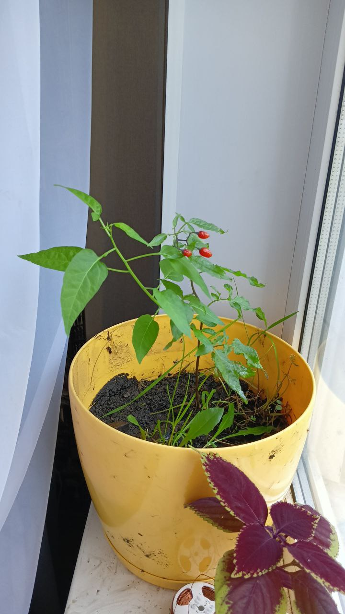
### September 10 — experiment with 2 small leaves, about 7 mm
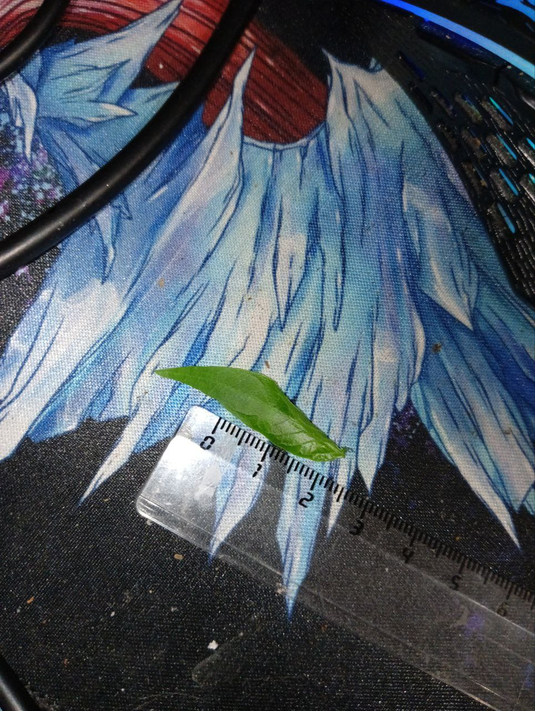
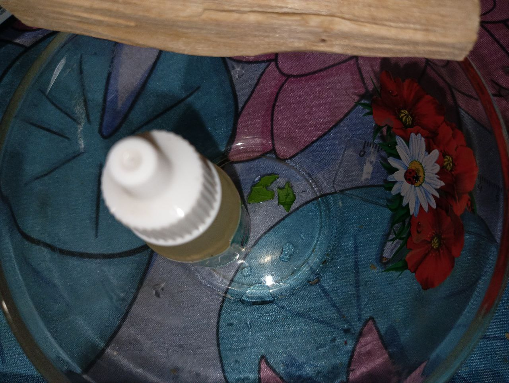
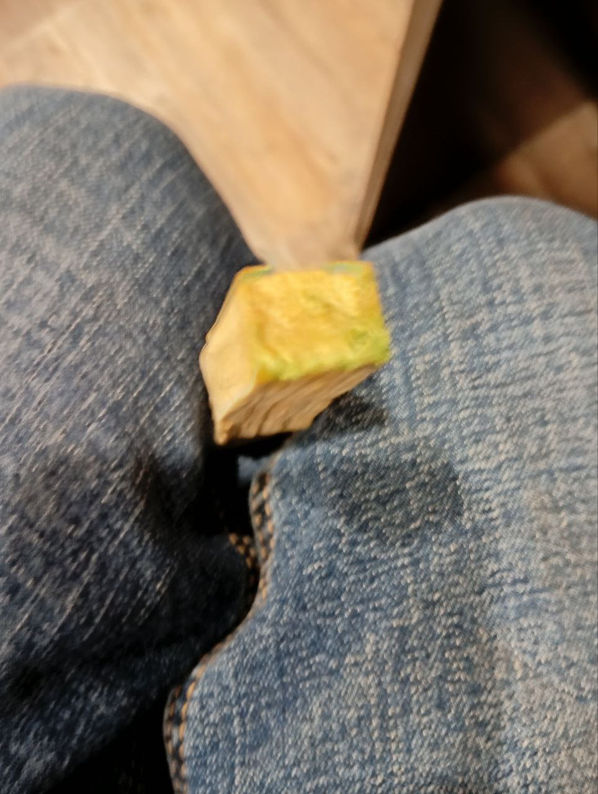
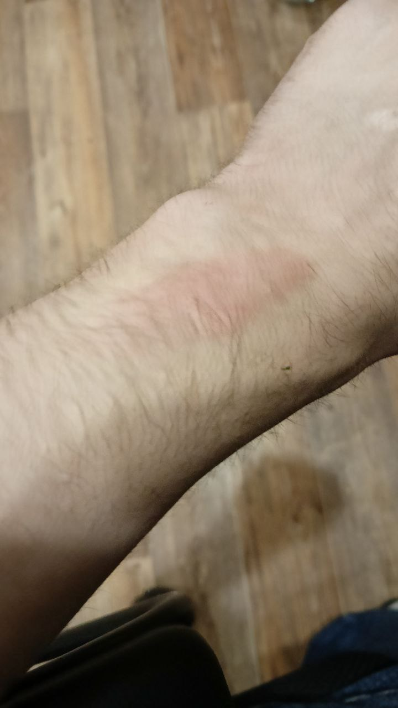
- Took a glass cup and a palo santo stick. Poured the oil into an empty eye-drop bottle. Dripped out 12 drops and ground 2 small leaves about 7 mm wide. Not a square. Most of the oil was absorbed by the palo santo stick. Rubbed the remaining oil onto my wrists and rubbed with the palo santo stick. After some time I developed dry mouth and had a feeling that my pupils were constricted and not increasing in size. There was a faint pressure in my heart, possibly a placebo effect. Thought images intensified. I couldn't fall asleep and slept less than 4 hours. I plan to do the next experiment with a berry or a full-sized leaf and, instead of the palo santo stick, use a stone and grind better. All effects may be placebo due to incorrectly prepared oil or a rather small leaf.
# BROAD-LEAVED WATER-PARSNIP
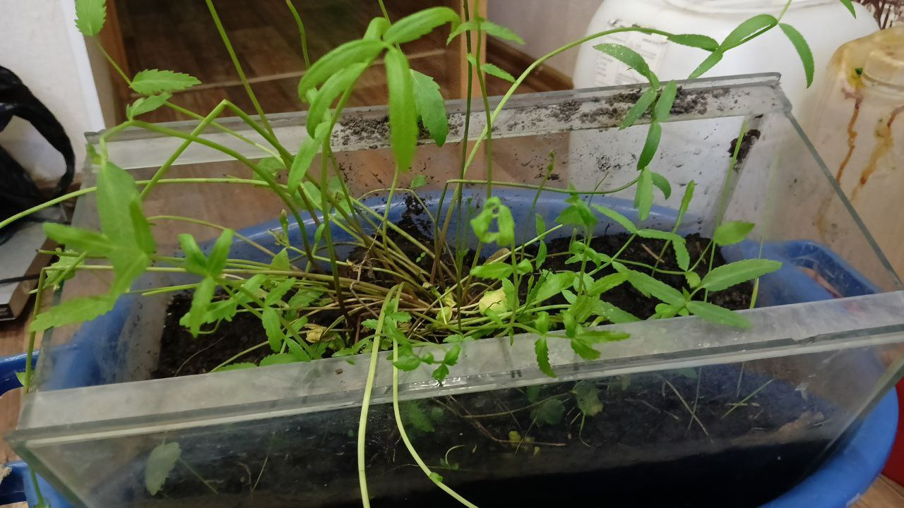
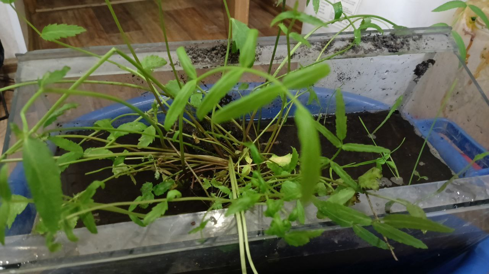

# Experience and dreams (September 14, 2025)
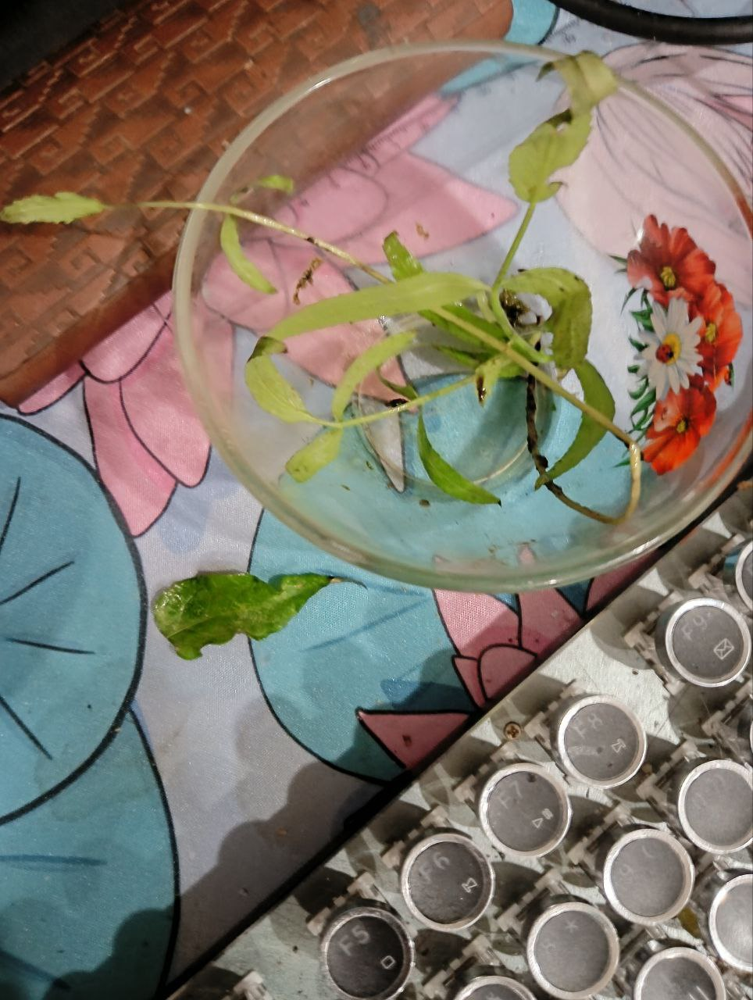
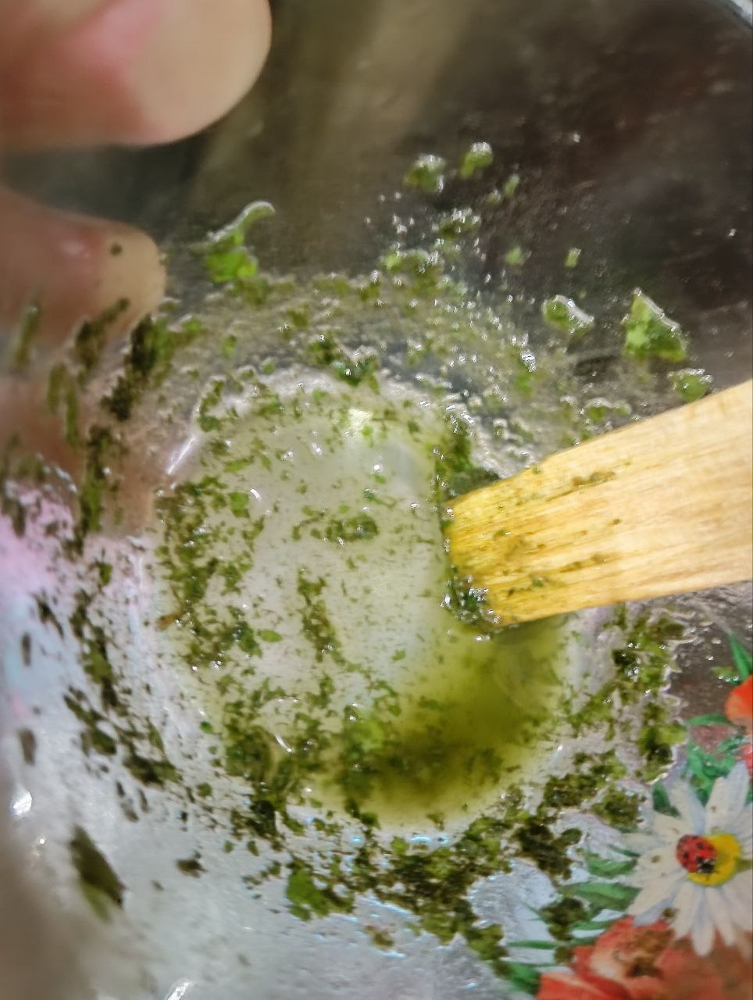

---
**22:41** — started rubbing my hands. Dizziness, fatigue, and pain in my arm appeared. My left arm felt warmth from the intense rubbing. Slight dizziness, possibly from overdoing it.
I made a solution: *2 capsules of asparkam + 250 mg of magnesium sulfate*. Time seemed to slow down, perception of brightness intensified (or seemed to).

**22:45** — dry mouth.
**22:46** — went to smoke a cigarette.
**22:50** — heaviness in the chest, a strong urge to go to the toilet. Went for a pee.
**22:57** — general fatigue.
**01:34** — dry mouth completely gone.

After that I slept **13 hours**.


## Dreams

### Flight and staffs

I dreamed that I was flying. I needed to go somewhere in a marshrutka, but I chose another mode of transport. At some point I needed to create a staff that would be passed on to relatives in case anything happened.
I made a **dark staff** and killed a snake coming out of a boot. Then I created a **stone staff**. There was a trip by boat (or ship) to the "island of the sleeping". I slept a little longer than usual. I killed everyone in a row in the dream.

### Hospital and diggers

Next I dreamed that my clothes were somewhere, and I ended up in a hospital. Then with children and diggers I crawled through buildings, we sang songs.


## Experiment on September 14

Took:

* **1 nightshade leaf**
* **several broad-leaved water-parsnip leaves**
  — all in sunflower oil.

Next stage: **testing with olive oil**.

P.s There were many more dream moments that I didn't write down or didn't remember. For example, at the end someone told me that I had woken up and fallen asleep (about my state). I really couldn't wake up. As soon as I did, I immediately fell back asleep. At the same time, there was no sedation as such. It's worth double-checking the state without rubbing and the state once more after rubbing. If it repeats — not a placebo. The last few days I slept much less and at most, with all my effort, 4-6 hours. P.S.p.s without these ointments the sleep is weaker or absent altogether. 

## Experiment on Oct 31
- [jupyter notebook](https://github.com/wipedlifepotato/wipedlifepotato.github.io/blob/main/notebooks/paslen31okt.ipynb)
---


# Irises

## Spuria iris

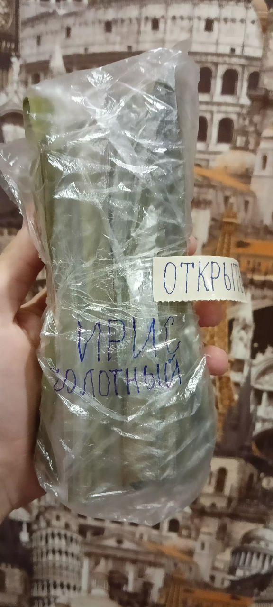
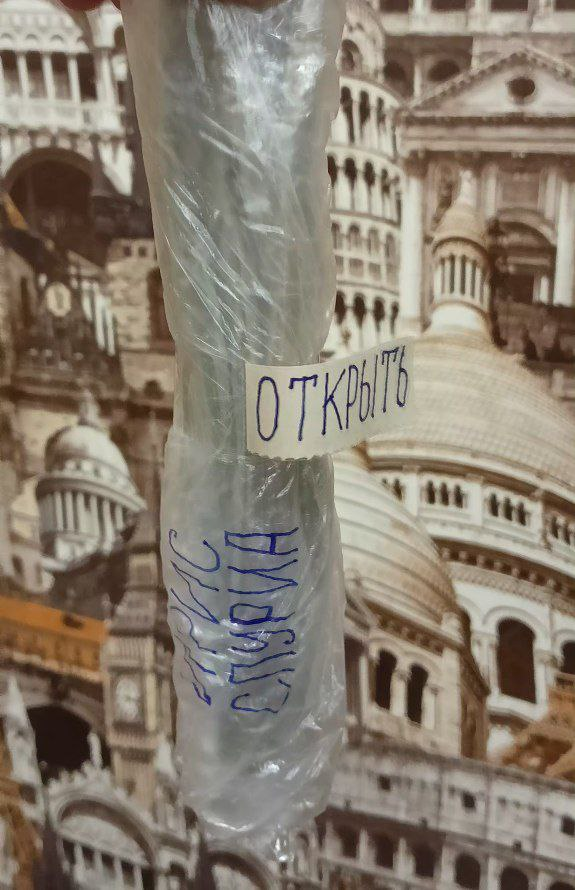

Sent by Avak, Avak's data:
```
 My latest results on these:
1). There is a "cumulation" factor (accumulation in the body); when I rubbed spuria iris in for the second evening in a row, — in the morning there was the best result; however, after rubbing it in on the third evening in a row, I COULD NOT fall asleep until 10 am: seemingly there was no "nominal" "perking up" either, and my pulse didn't speed up, but I had a sleepless night. We're talking about 5mm×5mm squares. That is ➡️ I do NOT recommend rubbing irises in for more than two evenings in a row. The sleep-inducing effect of irises kicks in an hour and a half after rubbing and becomes optimal early in the morning if rubbed in at night.
2). ASKOFEN is not harmless: when I drank one Askofen tablet every morning for three days in a row (to compensate for the blood-thickening effect of the iris), on the third day I got an upset stomach (bloating + diarrhea; this was precisely from the excess of Askofen). ASKOFEN is NECESSARY to compensate for the blood-thickening effect of irises; but constant use of Askofen will upset your stomach (you'll need to drink "Smecta").
3). Spuria iris helps stop the internal dialogue and achieve Castaneda's "stopping of the world" (this is when you get a stable, absolutely clear visualization; this is when the eyes stop moving from the internal dialogue). If rubbed in at night, — the ideal state comes early in the morning. Early in the morning, imagine that you are walking through some apartment on a very high floor, and intently LOOK AT EVERY DETAIL of the furnishings, trying to get a "clear, stable picture". The thing is, the internal dialogue is linked to eye movement, and intense, careful LOOKING stops the eyes, and as a result — the internal dialogue stops. In the morning (under spuria iris) relax and visualize that you are walking through an apartment on a very high floor, and intently LOOK AT EVERY DETAIL of the furnishings, trying to make each object you examine look bright and clear, stable, like something real. When the furnishings start to seem real, smoothly fly out of the window, vividly FEELING "fear of heights" as you look down, and FEELING the flight. FROM THIS the astral body will switch on perfectly. Again: Castaneda called "stopping of the world" the moment when a PERFECTLY clear, stable, lasting visualization kicks in. It kicks in when the internal dialogue is stopped; this is the moment of "inner silence" (also a Castaneda term). While the internal dialogue is going on, the eyes keep moving constantly, so a perfectly clear visualization can't be held for long. But when ➡️ the brain's speech-motor center switches off ⬅️, — the eyes stop ("the glassy stare of a junkie"… 😊). THIS moment makes itself known by the appearance of an absolutely clear, stable visualization that looks absolutely real. It can also be a "3D animation": for example, suddenly you see a splashing puddle close by, and it will be ABSOLUTELY REAL, you'll be able to examine every pebble at the bottom with perfect quality. This is the moment of "stopping of the world" and "the onset of inner silence" (the stopping of the eyes due to the switching off of the brain's speech-motor center). Spuria iris HELPS bring about this switching off (toward morning, if you rub a 5mm×5mm square with 8 drops of vegetable oil into your wrists at night). That is, again: toward morning, under spuria iris, relax and visualize that you are walking through some apartment on a very high floor, and intently LOOK AT EVERY DETAIL of the furnishings. LOOKING with an attempt to get a CLEAR, BRIGHT picture — this is very important. At the same time, you should try to remove the internal dialogue. Visualize that you approach the window and — smoothly fly out of the window, vividly FEELING "fear of heights" as you look down, and FEELING the flight. FROM THIS the astral body will switch on perfectly.

P.S.
In the morning (after a night "under the iris") drink an Askofen tablet.
P.P.S.
A TONOMETER is also desirable; irises can speed up the pulse and raise blood pressure. With irises, normal is when the pulse is above 90 beats per minute and blood pressure is ≈ 20 units higher than what is usual for you. There's no need to bring this down; you need to fly to the Astral. 😊 Askofen (drink it in the morning AFTER flights to the Astral) will prevent blood thickening from reaching dangerous parameters. HOWEVER it's not only about blood thickening; irises are not harmless: even "cardiac glycosides" are fixed in them; these are digoxin-like nasties like the poisons of lily-of-the-valley and strophanthus. In the two species of iris I sent, there isn't a lethal amount of them, but these are the kind of nasties Askofen is powerless against, and which can kill (the racing pulse is caused primarily by cardiac glycosides, it's like from strophanthus). So don't rub them in more often than two nights in a row. WITCHES called irises "ACORUM" ("ACORUM"); these are the "power plants" of 16th-century Italian witches; these are the plants of their ointment for out-of-body travel. 🧙‍♀️
```

Spuria, effect on me:
```
Smeared on 5x5mm with 8 drops. Before that I slept the whole day. Took it somewhere around 16:00. After an hour I wanted to sleep, closed my eyes and there was a very strong state for exactly 4 hours, when with my eyes closed it was a half-asleep, half-awake state. That is, with my eyes closed I could see dreams that I myself imagined with my thoughts. In the end I slept 8 hours. I only remember that at first the dream was about iron 
I forgot the other dreams, but I saw them completely without falling asleep, just by closing my eyes
```

As a result: spuria iris has a rather strong effect (4 hours of a dream-seeing state, with most of it without fully falling asleep, just with eyes closed. And the whole dream was controlled by what I myself was thinking)
