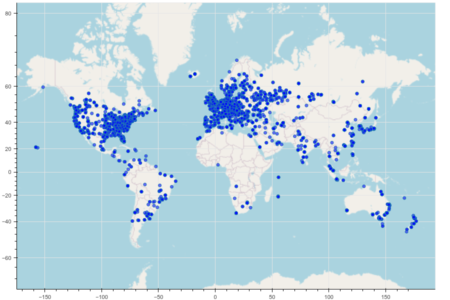
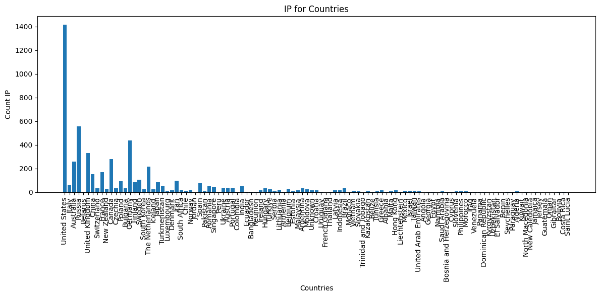
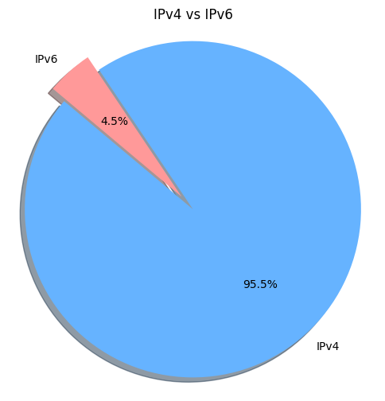
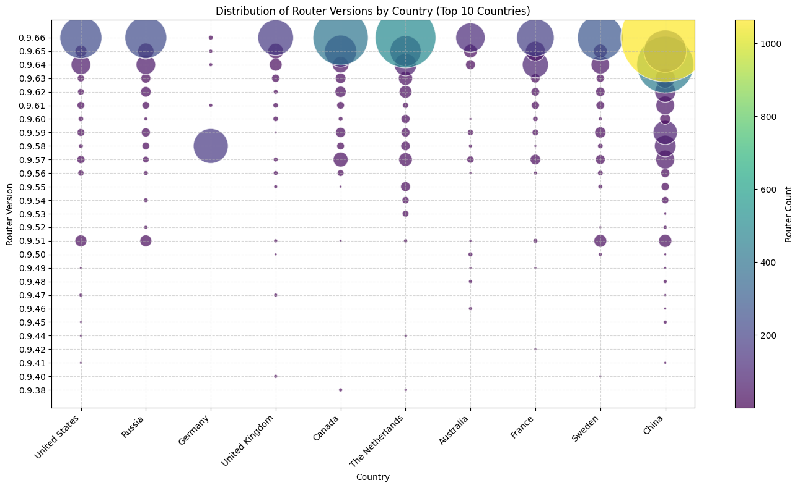
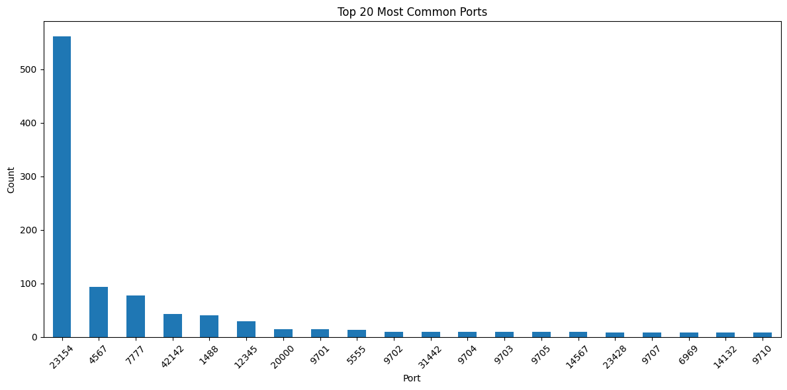
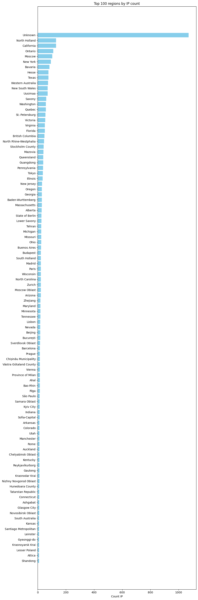
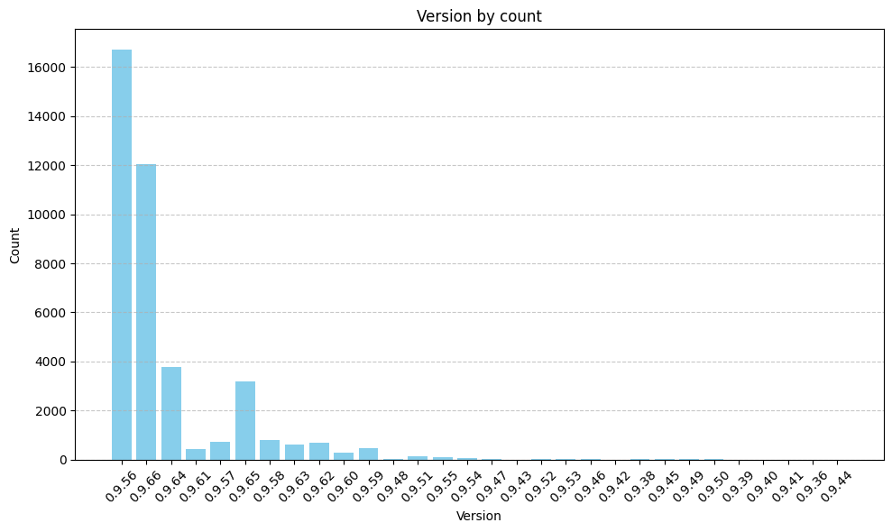
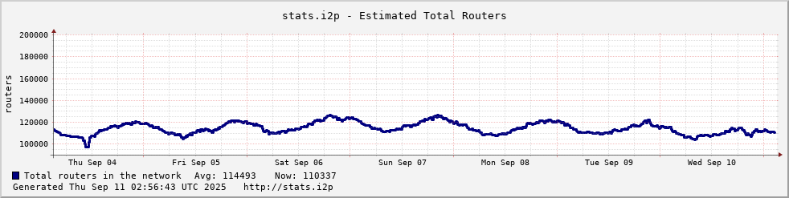
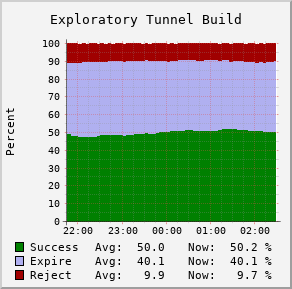
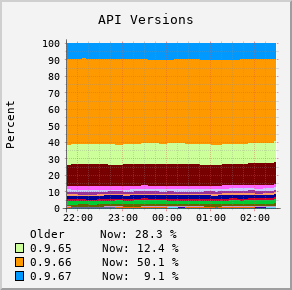

# I2P network research

## I2P network visualizations

As part of an analysis of the I2P network, the following visualizations were created:

### 1. bokeh_plot.png
  
An interactive visualization of the I2P network created with the Bokeh library. It allows you to explore the network structure, nodes, and their connections.

### 2. IPCountries.png
  
Geographic distribution of I2P network nodes by country, based on IP addresses and geolocation.

### 3. IPv.png
  
Distribution of I2P network nodes by IP protocol version (IPv4/IPv6), showing the prevalence of one version.  
**Data accuracy:** IPv6 is disabled on the router, so this data is not accurate.

### 4. RouterVersion.png
  
Distribution of nodes by router version, helping to assess how widely different software versions are used in the network.

### 5. Top20MostPorts.png
  
Top 20 most frequently used ports in the I2P network, highlighting popular ports and potential points of interest.
Most likely, these are botnets. Here are some of those addresses:
- 65.60.185.121
- 90.221.67.166
- 156.34.15.110
- 82.34.85.87
- 86.140.143.39
- 185.219.136.133
- 125.194.88.145
- 76.93.215.156
- 72.39.191.79
- 24.132.50.14

### 6. TopRegion_.png
  
Top 10 regions with the largest number of I2P network nodes, showing geographic concentration.

### 7. VersionByCount.png
  
Distribution of nodes by number of connections, showing router versions with the highest number of active connections.

---

## Technical details

- **Tools:** Python, Bokeh, Jupyter Notebook  
- **Data sources:** NetDB, stats.i2p  
- **Data collection method:** Analysis of public I2P network data (NetDB)  
- **Data reliability:** since there is only one data source and one I2P router, this data does not represent the entire network, only a part of it  

## Additional data from stats.i2p

### 1. routers2_1w.png
  
Dynamics of the number of I2P routers over the last week. Helps to see growth or decline in network activity.

### 2. 8-tunnel.exploSuccess.10m_1ddb.png
  
Tunnel exploitation success over the last 10 minutes. Can be used to assess connection stability and network load.

### 3. 5-versionsm_1ddb.png
  
Distribution of router versions over the recent period. Provides insight into how up to date the nodes in the network are.

---

**Note:** This data was collected from stats.i2p and complements the previous NetDB analysis. Router and tunnel dynamics make it possible to observe changes in the network in near real time and draw more accurate conclusions.
