```
WARNING / DISCLAIMER:
This publication is for informational, educational, and theoretical purposes only. The author describes purely chemical observations in the context of studying the haloform reaction.

Law: The author strongly emphasizes the need to comply with applicable laws. This text is not a call to action or a guide for making anything.

Health: Iodoform and by-products of the reaction (such as iodoacetone) are toxic and irritating. Inhalation of vapors or skin contact can lead to damage to the central nervous system, liver, and lungs.

Disclaimer: The author is not responsible for attempts to reproduce the described actions or for their consequences. All chemical experiments must be carried out in certified laboratories by qualified specialists in compliance with safety regulations.
```


There is a haloform reaction that proceeds with methyl ketones R-CO-CH3, with alcohols R-C(OH)-CH3, and also with ethanol. (This can be used as a test for ethanol.)
To begin with, for a test I used pharmacy iodine.
```
 2I* + HOH => HI + HIO (or I2 + HOH. But here I see I as a radical, hence the asterisk indicating a homolytic/radical character) [my personal view that this is a radical mechanism]
 IO- attacks the keto form and oxidizes the alcohol to a ketone. CH2-COH-CH3, and where CH2 is there is a pi-nucleophilic character: the IO- charge removes hydrogen and attaches I itself. This needs to be drawn on paper for clarity,
 but this mechanism is shown more clearly on Wikipedia.
 With ethanol, sodium formate remains.
 With isopropyl alcohol, CH3-CO and OH- also attach there because the carbonate has a positive charge, giving CH3-COOH, i.e. acetic acid.
```
p.s. iodoform will stink badly

<div class='pair'>
    <p>Result with pharmacy iodine (the yellow color is barely visible in the photo):</p>
    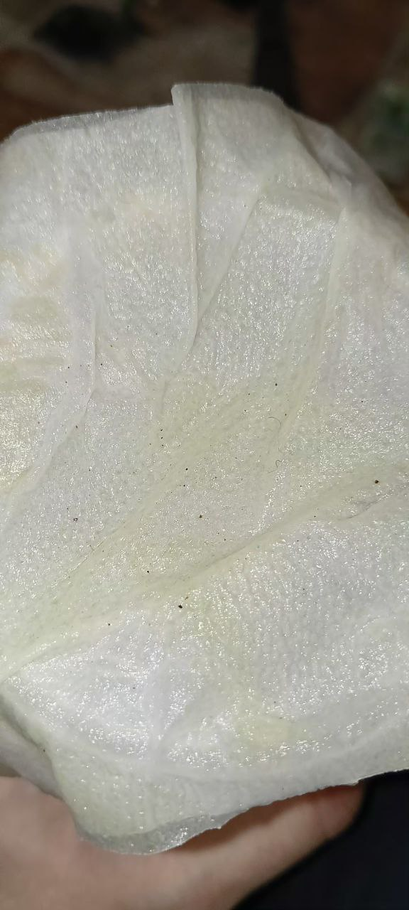
</div>
<br/>
<div class='pair'>
    <p>At first the solution looks like this:</p>
    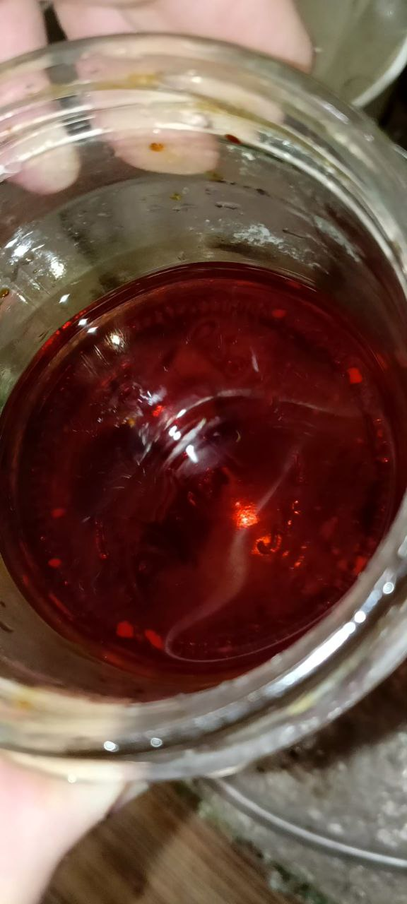
</div>
<br/>
<div class='pair'>
    <p>Then a layer like this appears:</p>
    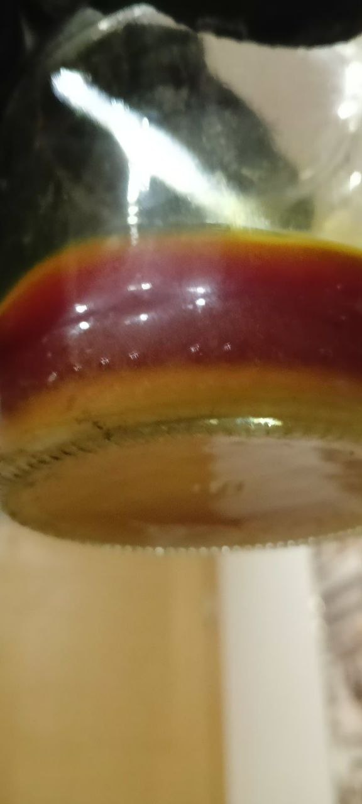
</div>
<br/>
<div class='pair'>
    <p>Then a layer like this appears:</p>
    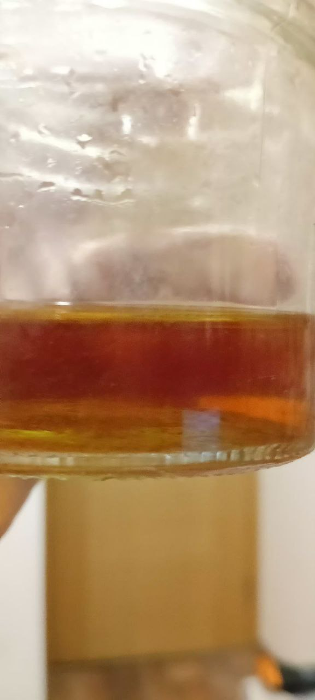
</div>
<br/>
<div class='pair'>
    <p>Then a layer like this appears:</p>
    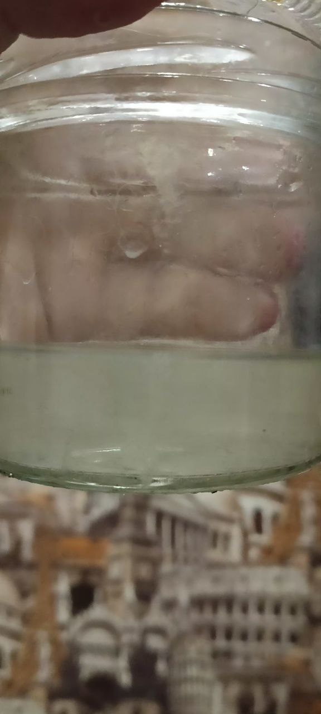
</div>
<br/>

That is, it goes from red to completely transparent. Formate remains in our case as sodium formate, because we initially worked with pharmacy iodine, which is in ethanol.
In the case of isopropyl alcohol or any other alcohol, one spoon of carbonate is enough for the whole solution. Otherwise the alcohol will separate into its own phase and the reaction will stop.

<div class='pair'>
    <p>Isopropyl alcohol separated into a phase:</p>
    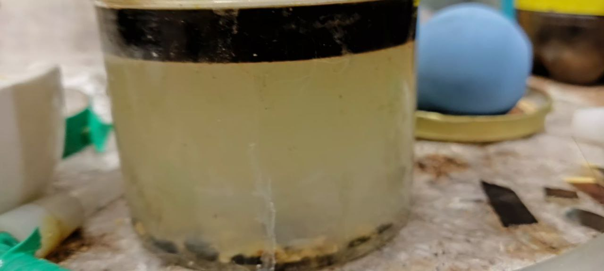
</div>
<br/>

<div class='pair'>
    <p>Iodoform in dichloromethane (soluble, but not very well unless heated; roughly like baking soda in water):</p>
    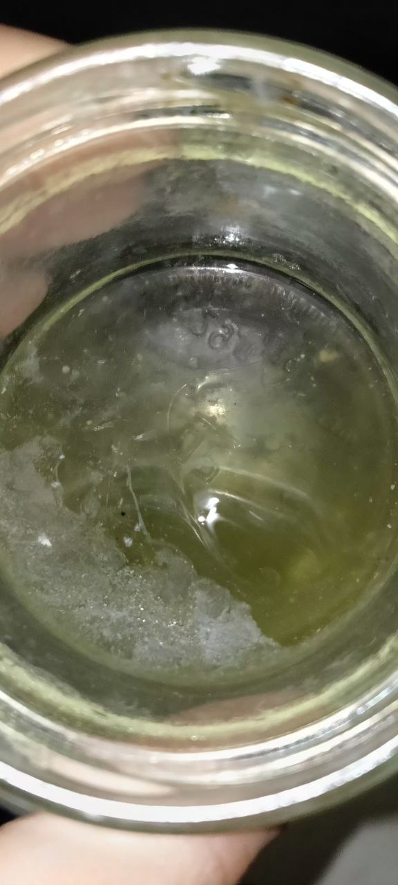
</div>
<br/>
<div class='pair'>
    <p>Crystals obtained from the DCM solution (they were even more beautiful before, but I did not take a photo and overheated it; there were very nice yellow needles):</p>
    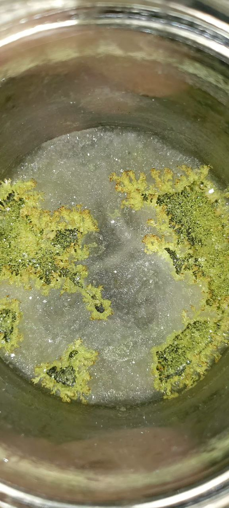
</div>
<br/>
<div class='pair'>
    <p>Overheated iodoform:</p>
    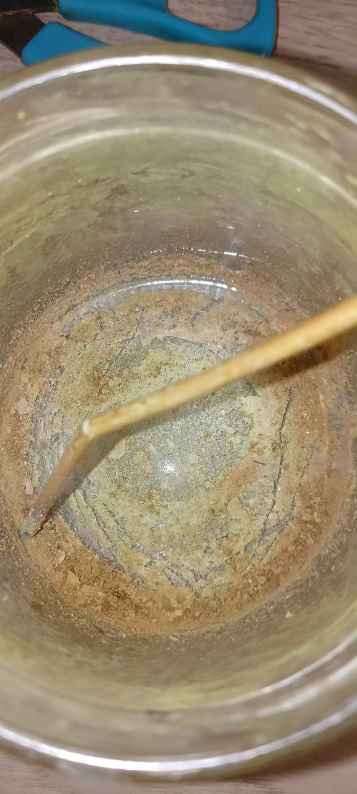
</div>
<br/>
<div class='pair'>
    <p>Overheated iodoform:</p>
    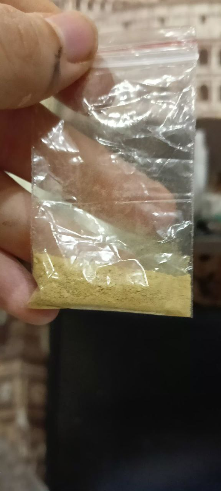
</div>
<br/>
<div class='pair'>
    <p>Iodine (from the experiment on obtaining ethyl iodide):</p>
    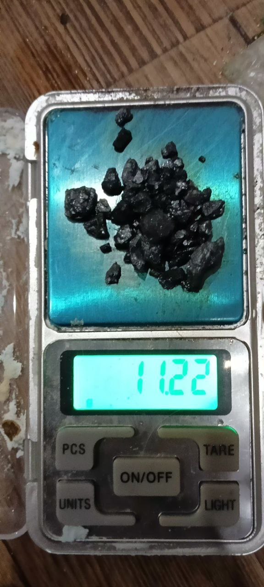
</div>
<br/>
<div class='pair'>
    <p>Paper and iodine:</p>
    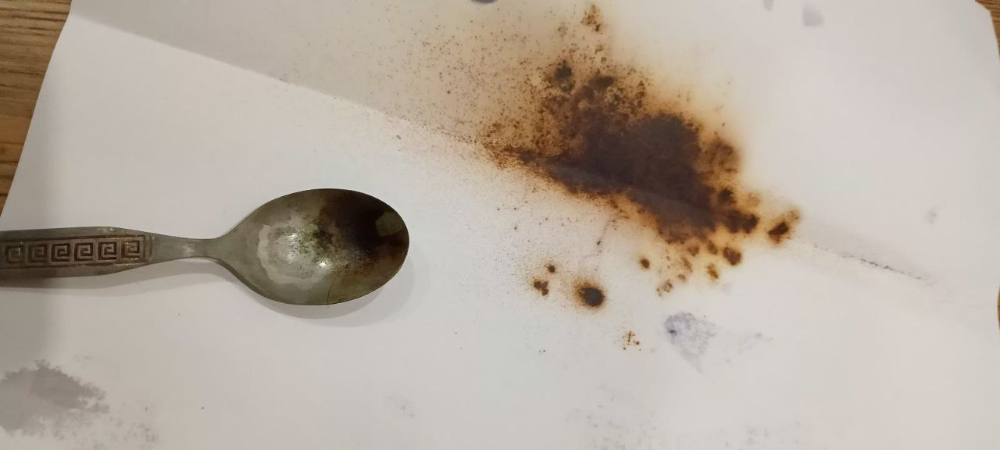
</div>
<br/>
<div class='pair'>
    <p>Brownian motion while filtering iodine from iodoform:</p>
    <video width="640" height="360" controls>
      <source src="{{ 'experimets/Alkylhallogenidfromspirit/brounmove_web.mp4' | relative_url }}" type="video/mp4">
      Your browser does not support the video tag.
    </video>
</div>
<br/>
<div class='pair'>
    <p>Dirty iodoform:</p>
    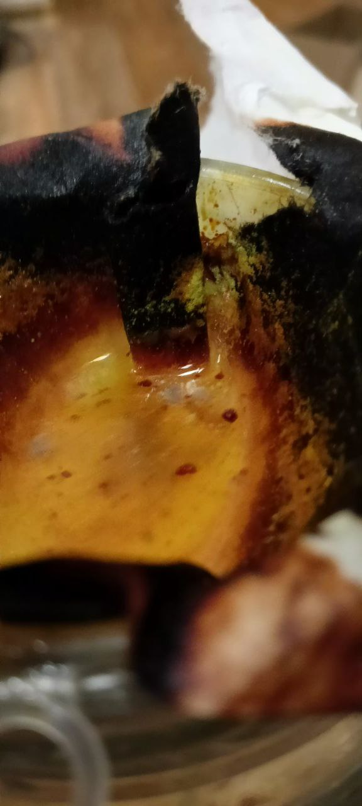
</div>
<br/>
<div class='pair'>
    <p>Fresh iodoform:</p>
    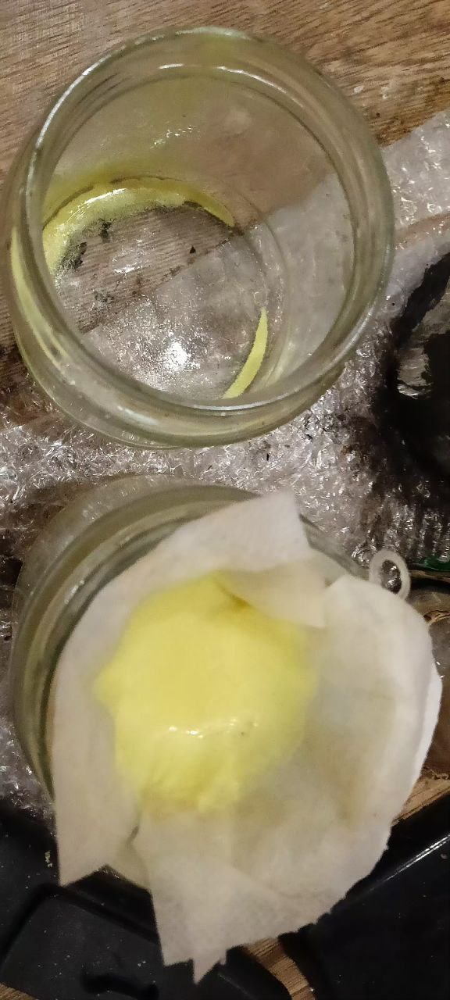
</div>
<br/>
<div class='pair'>
    <p>Fresh iodoform:</p>
    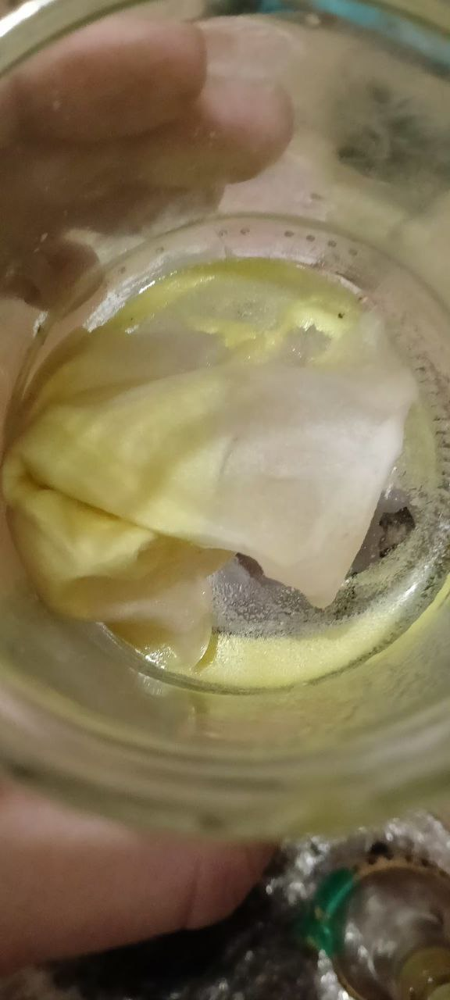
</div>
<br/>

Instructions:
```
Dissolve iodine in alcohol. During recrystallization and drying, a large part will escape into the atmosphere, so do not recrystallize it. Make a weakly alkaline solution with pH 11–14 using carbonate, but not in excess, otherwise the alcohol will separate. A teaspoon for sugar is enough for almost 10 g of iodine. There should be enough water for the alcohol to mix with the solution. Leave it to decolorize.
After about ~15 minutes a precipitate will form. Do not use too much iodine, otherwise you will have to separate it from iodoform later. It is better to add iodine as needed. Then, by sedimentation, it will settle. You need to decant with a syringe, and under no circumstances dry it in a microwave or in light. It is better to leave it as is, with a little water; water stabilizes iodoform.
```

Discussion with Avak on this topic:
```
> Hello! And Happy New Year!

I am glad about your success with iodoform; judging by the photos, that is indeed it. Iodoform is obtained very easily and quantitatively. I obtained it in my time. Iodoform is a very useful substance. With ammonia it gives hydrocyanic acid — this is the best route to cyanides. With amines it gives isonitriles. Hydrolysis of iodoform gives formic acid and formates. With silver nitrite, nitroform is obtained...

>> there is quite a lot you can arrive at independently if you think. It is still unknown how much more can be figured out. In theory iodoform is insoluble in water, so hydrolysis will be slow. Ammonia will most likely give a CCl2-type compound as with chloroform — diiodocarbene. That is, HCI3 + NH3 can in theory give amines through a secondary carbene, through the lone pair on nitrogen a primary one, and so on. In excess iodoform it can already detach hydrogen and iodine to give hydrogen iodide. In this way the valence and charge of nitrogen and carbon are preserved. Thus producing hydrocyanic acid. In general, yes, indeed. And with nitrite it will also partially give nitroform, NO2 and ONO, yes. That's quite good. I thought I would just have to walk around stinking from this. And I also thought about formate when I was making it, but since it is poorly soluble, that reaction will proceed very slowly unless stirred or heated. In general, more than half of my iodoform probably evaporated in the microwave and in the room. A very volatile compound. Thank you for the information!

> Carbenes — yes, they can be obtained from iodoform. The synthesis of hydrocyanic acid from iodoform is a special case of the Hofmann isonitrile reaction. By the way, in my time I made a great video on how to make iodoform; here, download it:
http://www.efkahomepage.ktk.ru/CHI3.avi
The instructions in the video (text) are on the right, read them. 😊
...Continuing the previous topic. About the reaction of ammonia with haloforms. I know that nowadays this reaction is explained by a "carbene" mechanism, but I do not agree with this mechanism for this reaction. I believe that this is a classic reaction of ammonia with alkyl halides (where there is no smell of carbenes!). First of all, if you place a few drops of chloroform in a jar with gaseous ammonia and place this jar in bright sunlight, in a few days these drops will turn into a mixture of ammonium chloride and ammonium cyanide crystals. That is, this reaction proceeds even without alcohol and without alkali. I see the following mechanism. As is known, ammonia can react with alkyl halides in several stages: first a primary amine is formed; then it can react with another molecule of alkyl halide to form a secondary amine; then a tertiary amine and a quaternary ammonium salt can be obtained. But there is a feature: at each of these stages, the formation of an amine leads to the formation of hydrogen halide, which binds the resulting amine into a salt. And the salt does not participate in further reactions. To form secondary and tertiary amines and a quaternary salt, the amines must be liberated in free form, that is, isolated from the resulting salt. Only free amines (not their salts) enter these reactions. That is why alkali is needed (and not for the synthesis of carbenes!). That is: ammonia reacted with an alkyl halide and formed a salt — the hydrohalide of this amine; and then alkali comes in and displaces this amine from this salt. The displaced free amine gets the opportunity to react further — with the next molecule of alkyl halide; and so on up to the formation of a quaternary salt. In the case of haloforms this is the same thing, only the formation of the "secondary" and "tertiary" amine turns out to be intramolecular reactions: first ammonia gives a primary amine with the haloform: a dihalomethylamine, for example HCl2CNH2. This amine is bound by the released hydrogen halide into a salt — a hydrohalide, for example HCl2CNH3+Cl-. Thanks to...

```
<div class='pair'>
    <video width="640" height="360" controls>
      <source src="{{ 'videos/Avak/CHI3_web.mp4' | relative_url }}" type="video/mp4">
      Your browser does not support the video tag.
    </video>
</div>
<br/>
