I made 3 test tubes, 1 test tube with hydrochloric acid for analysis. The second one: isopropyl alcohol with traces of a basic copper salt and hydrochloric acid. The 3rd: an excess of hydrochloric acid and isopropyl alcohol.
The reaction itself is roughly like this:
```
Here HOH+ is my attempt to show the oxonium ion. Here R+ is my attempt to show the carbocation. In the last one the reversibility of the reaction via the Sn2 mechanism, which in general could in theory also go by Sn1 (according to some sources) [ it depends on the haloalkane, primary/secondary/tertiary, as well as the solvent. In the first case the substituted carbon has a different electronegativity, in the second the mechanism can go with protonation or without protonation, as I understood it. ]
R-OH + (H+) <=> R-(HOH+); R+ + HOH; R+ + Cl- => RCl; 
RCl + OH => ROH + Cl-

I may have mixed something up; you can study the reaction in more detail and more accurately in organic chemistry textbooks
```
This is a nucleophilic attack: first protonation, then cleavage of the group and attachment to the carbocation. This is the Sn1 mechanism.
It's worth noting that, from what the sources say, primary ones don't react even with the Lewis acid ZnCl2. Only with sulfuric acid and strong heating. Most likely what's needed is something that shifts the reaction and removes water, or a strong protonating agent. Given that ZnCl2 is needed as a catalyst, and knowing that hydrogen chloride reacts with difficulty, hydrogen iodide reacts easily and hydrogen bromide with more difficulty. Hydrogen fluoride doesn't react at all. That primary is harder, secondary easier and tertiary easier still (because of the carbon atom where the OH group is. They have different electronegativities). So I assumed that if I take an excess of hydrochloric acid and a secondary alcohol, then after waiting a while or heating I'll get a haloalkane.
[reaction](https://orgchem.ru/chem4/o252_1.htm)

Here's the test tube with hydrochloric acid and isopropyl alcohol:

<video width="640" height="360" controls>
  <source src="{{ '/experimets/Alkylhallogenidfromspirit/hclandizopropylspirit_web.mp4' | relative_url }}" type="video/mp4">
  Your browser does not support video.
</video>


Here's the test tube with hydrochloric acid and isopropyl alcohol, with copper salt:

<video width="640" height="360" controls>
  <source src="{{ '/experimets/Alkylhallogenidfromspirit/withcupper_web.mp4' | relative_url }}" type="video/mp4">
  Your browser does not support video.
</video>

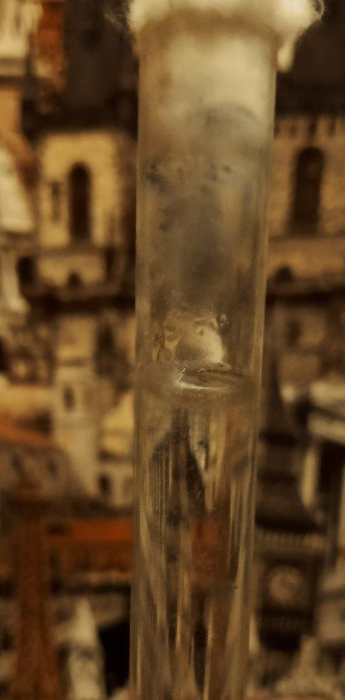


In ordinary hydrochloric acid, even if you shove the test tube into boiling water, no gases are released. The nature of the gas still needs checking, but it is released. At a certain point, after a long reaction, the gas stops being released even after heating. After that I just left the test tube for a while. 

There's some kind of layer, though I have a roughly similar layer in the hydrochloric acid as well. Probably from being stored in plastic for a very long time.

The layer after the reaction of isopropyl alcohol and hydrochloric acid:

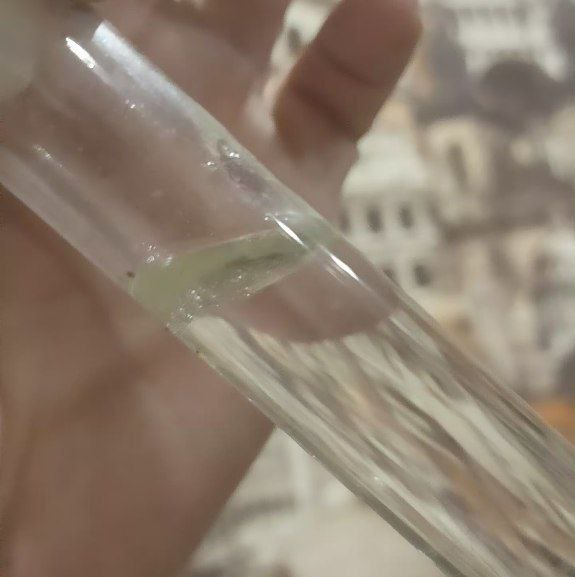

I tried freezing the test tube in the freezer for 20 minutes, then took it out and opened the cotton wool. The cotton wool crumbled, meaning it either hydrolyzed or reacted with sugar — that is, with alcohols and aldehydes at the same time. I tried dissolving it; it forms a colloidal solution. Most likely the polymer chain is breaking down.

<video width="640" height="360" controls>
  <source src="{{ '/experimets/Alkylhallogenidfromspirit/vataposlehcl_web.mp4' | relative_url }}" type="video/mp4">
  Your browser does not support video.
</video>

I compared the layers: the layer in the test tube with isopropyl alcohol and hydrochloric acid is transparent, not the yellow layer that doesn't pour off when tilted. But with hydrochloric acid this layer pours off

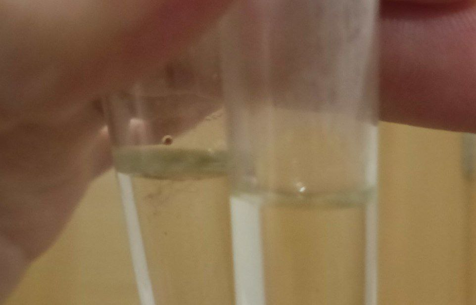

The smell is faintly sweetish, maybe it just seems that way, need more checks.

## attempt 2

The plan was to pour in hydrochloric acid and separate that layer, but after adding about 25 ml I didn't have a layer (maybe I was flustered and poured in isopropyl alcohol too, or this contamination shows only at small volumes. Or this contamination got poured off with the first decanting. Or there are a whole bunch of other options, right down to microscopic impurities on the test tube giving it, which is of course total BS.)

Hydrochloric acid:

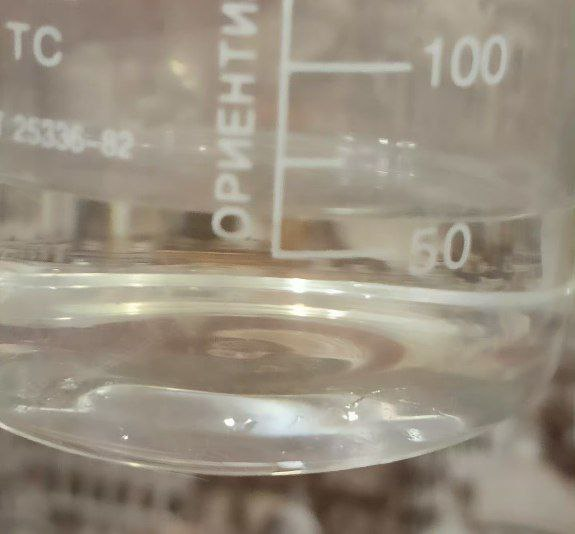

Plus alcohol:

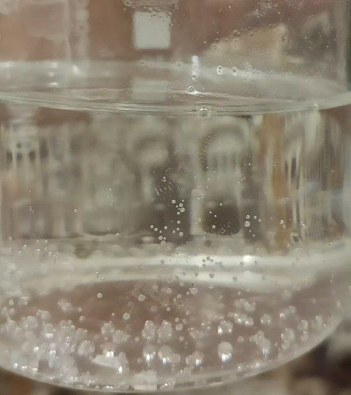

I tried heating it, covering the little cup with a paper cup, but even with the fume hood you can feel either the smell of alcohol or of something unclear. In the room, though, when heated it reminded me of something sweet, but I could have confused it with isopropyl alcohol
Turned off the heat and left it on the balcony; a layer formed

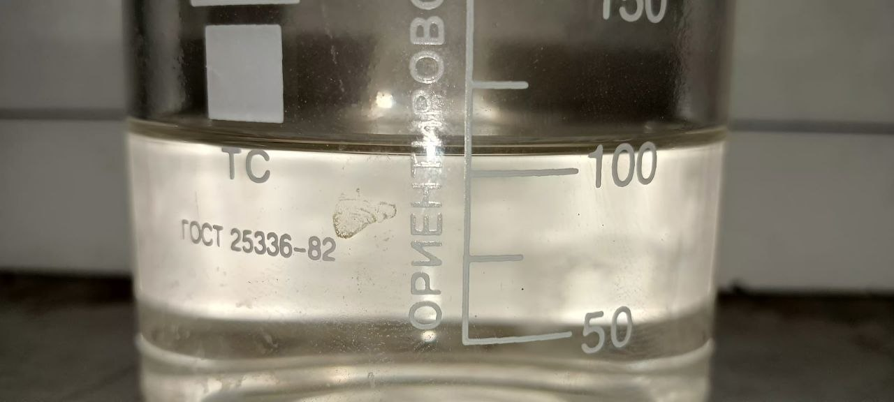

I poured more hydrochloric acid into this layer; the layer was still there and even seemed to grow. I poured in more isopropyl alcohol — the layer shrank. One possibility: isopropyl alcohol dissolves all this very well in itself, and to separate it you need to dilute it with water that already has something dissolved in it, to lower the solubility and separate the layers

I tried adding aqueous iron chloride in trace amounts and leaving it for several hours. The layer, by the way, seemed to grow, and when heated bubbles no longer appear so intensively; instead you can see little balls shooting sharply upward.
Probably without zinc chloride or a similar salt this is a very bad idea and I really should get hold of zinc chloride, because hydrochloric acid on its own, even according to the literature, according to Taylor, enters this reaction very poorly. And the -OH group itself is hard to substitute; only when protonated does it become the base of a strong acid, H3O+.

With the hydrochloric iron solution
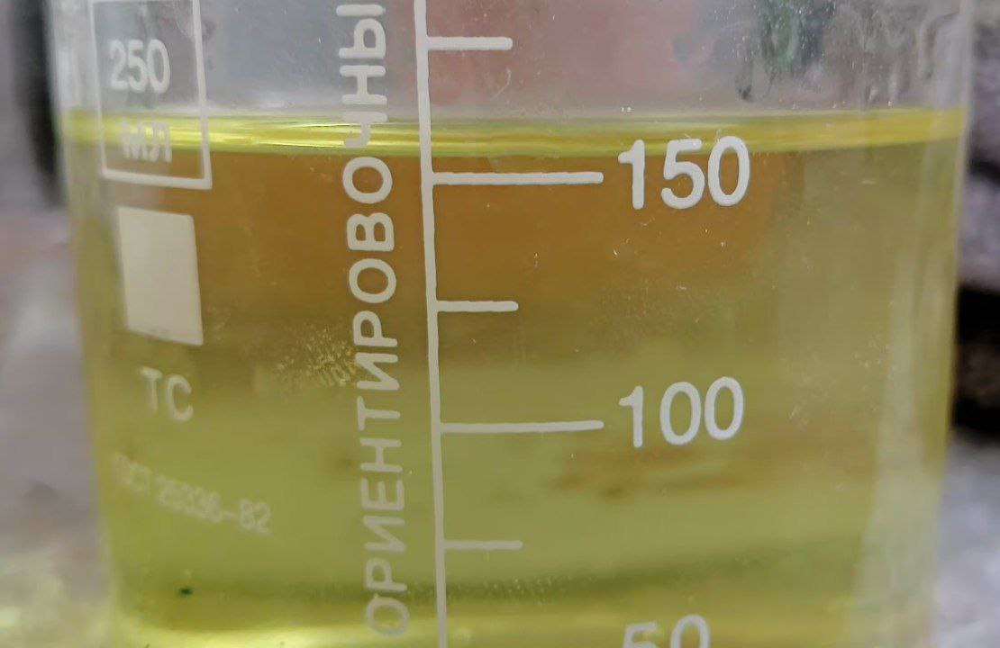

Fact: a layer appears, but it may be caused by contamination of the hydrochloric acid. Maybe it'd be better to try to get isopropyl bromide. I'll think about it after my next paycheck
If you take this layer and compare it with fresh hydrochloric acid, the layer where the hydrochloric acid is simply isn't there at that size, or is barely visible — probably what seems like a layer is just refraction of light. But in the right-hand test tube, where presumably isopropyl 2-chloride is, there is a clearly pronounced layer. Then the first time, it's quite possible I poured in isopropyl alcohol myself and forgot. In any case, what difference does it make if the layer doesn't reappear just from adding hydrochloric acid

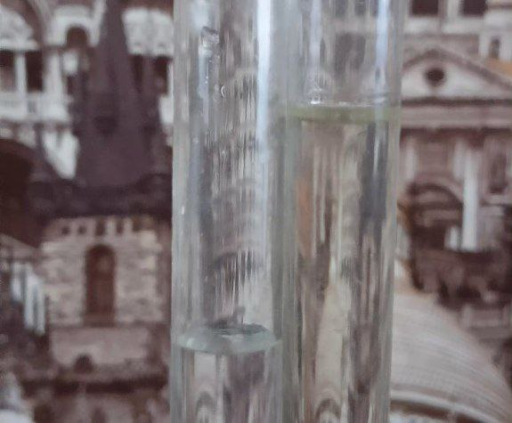


On the balcony that layer after FeCl3 shrinks, doesn't grow. So if this is an alkyl halide at all, it evaporates very easily, even in the cold. And then the reaction doesn't go in the cold. So if it needs to be obtained at all, then in a closed vessel, definitely not an open one. It simply evaporates away. By the way, I feel a slight weakness. Whether that's from isopropyl chloride or from isopropyl alcohol. I moved the mixture into a jar, a closed vessel. If the reaction doesn't go, then everything that could react has reacted. I'll leave it for a day or more.

UDP. It seems the layer also appears when hydrochloric acid acts on cotton wool, in a closed system, after some time.

# Testing 99% ethyl alcohol and sodium bromide

I took sodium bromide, at the edge of a teaspoon. Poured it into a test tube with a sulfuric acid solution, about 40%. By the way, gas started coming out already when I added the alcohol to the sulfuric acid solution.
When added, there was a pinkish glow, plus a yellow layer and the solution yellowed. That's oxidation of hydrogen bromide to bromine. With 85% orthophosphoric acid I didn't notice that. In both cases an upper layer appears. In the case of sulfuric acid, it's most likely diethyl ether.
In the case of 85% orthophosphoric acid it's already ethyl bromide or ethyl alcohol. But it mixed with the 85% orthophosphoric acid. Maybe there's no 99% alcohol in there at all. Though they checked the density, but density is deceptive. And it could have absorbed water long ago. Well, not the point. When heated the layer shrinks from 2 mm to at most 1 mm or disappears altogether (in boiling water)
When cooled the layer grows. The smell is at most faintly sweetish, but the stronger smell is completely unidentifiable. I've never smelled anything like it before, and it produces a mild effect on the psyche. 
For primary alcohols they write that you need to add concentrated sulfuric acid to an already prepared solution of hydrogen bromide. And that you need to obtain it not the way I do it in vitro, but by sending the generated gas through a tube into water. Thereby saturating the solution to ~50% hydrogen bromide. Maybe it's possible with my method too, but so far it makes no sense at all that anything forms.
I checked the test tube — those layers are mostly refraction of light. Just pour in water and you get a 1 mm layer too. So the reaction doesn't go without catalysts/conditions. Worth trying heating the test tubes in the microwave

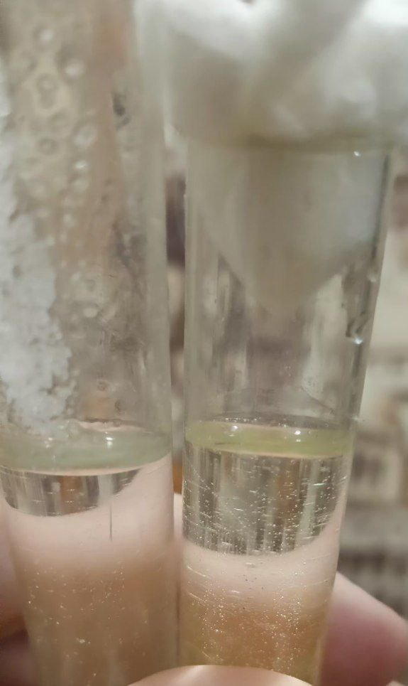
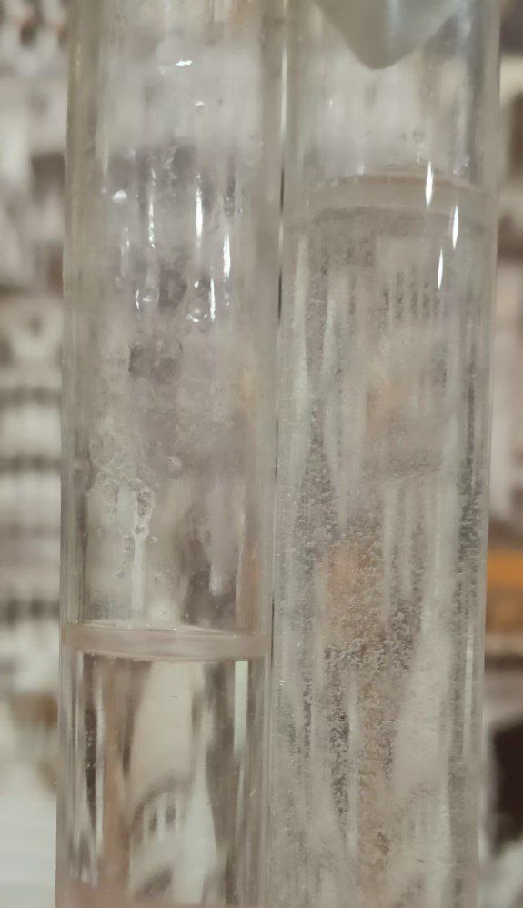
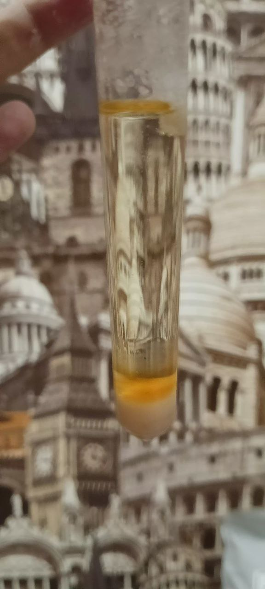

Maybe it's still better to obtain it through phosphorus derivatives (need to try). But this way you could accidentally make some organic phosphate too.
Most likely, without special glassware it will be very difficult to obtain. I'll come back to this later

Avak's comment:
```
https://wipedlifepotato.github.io/experimets/Coffeine/2/crystallization.jpg — this is amazing; gorgeous!!

https://wipedlifepotato.github.io/experimets/Coffeine/2/murexidetest2_web.mp4 — okay.

 About ethyl bromide. I obtained ethyl chloride by distilling vodka with battery electrolyte and table salt. Under normal conditions it's a gas, so I cooled the receiving test tube with ice and water (then it comes out liquid). No refrigerators, just two ordinary test tubes: a distilling tube and a receiving tube; the distilling tube is plugged with a rubber stopper carrying an L-shaped glass gas-outlet tube that goes into the receiving tube, which is loosely plugged with cotton wool and placed in a mug of water and ice. It worked. I tried taking two–three sniffs of the ethyl chloride smell, and after a few seconds I had to lie down urgently, because my body went limp, there was an orange light before my eyes, and an incredibly loud ringing in my ears. The state was almost exactly like when you squat for a long time breathing very deeply and rapidly and then suddenly stand up. This state from ethyl chloride passes quickly (lasts more than a minute) without aftereffects. ...
```
 
# UPD:
I tried obtaining ethyl chloride both by dissolving zinc in hydrochloric acid (a vigorous reaction with the powder, and if the acid is concentrated it even boils over). A layer appears here too, but I think it's from impurities, and I've started noticing the same layers with other substances as well. So these layers are not an indicator of a reaction. I used 96% alcohol and sulfuric acid of density 1.4, and table salt. In all cases there was some smell — a faint one, and a smell of hydrogen chloride — and it even relaxed me a bit, but that's the placebo effect. I tried with vodka too, but the reaction is also weak and I can't convince myself by smelling that I got anything. Realizing that checking by smell isn't very practical, I decided to ignite it. Maybe you could think it's ethylene. But if I used vodka, first the alcohol should have been protonated, then the -OSO3H group attached, which with water would give the alcohol again, with alcohol an ether, and if HSO4- were protonated, ethylene. 
How I did it: I mixed 2 quarter-teaspoonfuls of salt into a test tube, poured in a few drops of vodka so that it all dissolved in the salt, and maybe 1-3 ml of sulfuric acid. Heated it slightly to boiling and left it for a long time. Then I tried igniting the left and right test tubes. I also tried just with vodka, bringing it to a boil, letting it stand 5+- minutes and igniting it — no reaction. And the test tube stood like that for maybe half an hour. I tried mixing vodka with alcohol and heating it the same way and leaving it — no burning. I even left it for several hours and checked — no burning. 
In organic chemistry you can't just take something and have it work purely by one route the way it's drawn on paper. You need conditions and all that. So it turns out ethyl chloride formed, and it seems it barely affects me at these concentrations. 

<video width="640" height="360" controls>
  <source src="{{ 'experimets/Alkylhallogenidfromspirit/maybechlorethan.mp4' | relative_url }}" type="video/mp4">
  Your browser does not support video.
</video>

Someone might think the alcohol burned, but alcohol itself burns with a more yellow flame, here's an example with isopropyl alcohol:

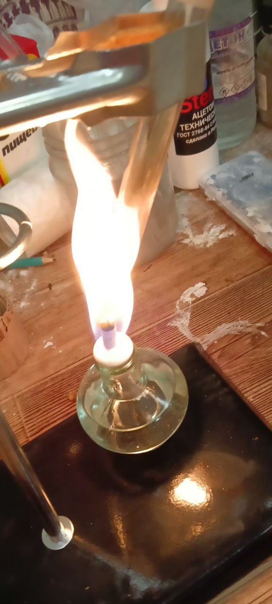

And to obtain ethylene you need a really high concentration, or the yield will be so small...
By the way, speaking of simplifications, here's an example:
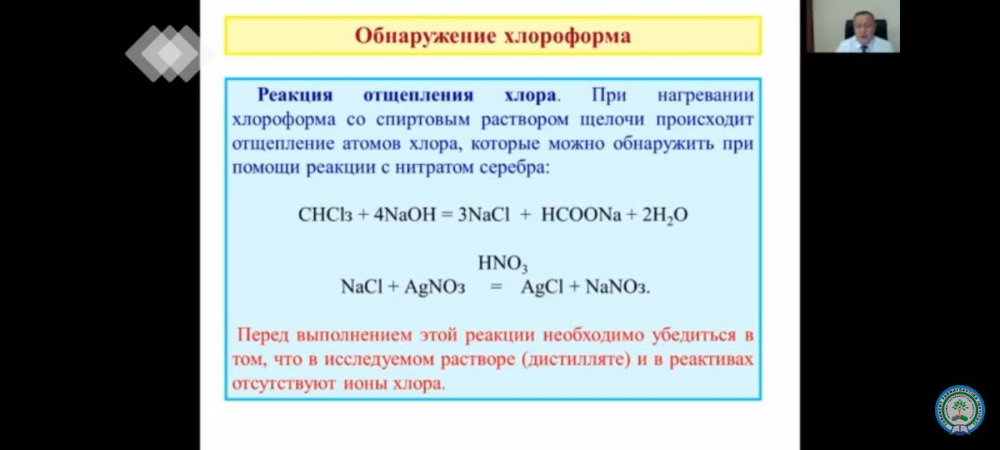

Sure, okay, but he forgot to mention that dichlorocarbene forms there and that you need aqueous alkali, while in alcohol you'll get harsh ethylation. In theory it will even start reacting with the alcohol.
He forgot to mention that first there's hydrolysis and nucleophilic attack on the chlorine by OH- groups, giving two OH groups that yield a chlorinated formaldehyde derivative, which immediately reacts with water to give a carboxylic acid; and that under unspecified conditions there's also the Cannizzaro reaction there; and also that phosgene will be released via dichlorocarbene, which then gives carbon dioxide and hydrogen chloride with water. And in an excess of nitric acid silver chloride might even dissolve in theory, since nitric acid should be stronger. That needs checking.
Well, we go to the forum and see that everything dissolves in nitric acid there: [forum](https://forum.xumuk.ru/topic/216314-%D1%85%D0%BB%D0%BE%D1%80%D0%B8%D0%B4-%D1%81%D0%B5%D1%80%D0%B5%D0%B1%D1%80%D0%B0-%D1%81-%D0%BA%D0%BE%D0%BD%D1%86%D0%B5%D0%BD%D1%82%D1%80%D0%B8%D1%80%D0%BE%D0%B2%D0%B0%D0%BD%D0%BD%D0%BE%D0%B9-%D0%B0%D0%B7%D0%BE%D1%82%D0%BD%D0%BE%D0%B9-%D0%BA%D0%B8%D1%81%D0%BB%D0%BE%D1%82%D0%BE%D0%B9/)
And this is a video lecture. So all the info always needs checking and thinking through. So you need to pick the conditions. With zinc chloride the reaction goes, giving a slightly larger layer, but chloroethane is a gas, so it's not entirely clear how a layer forms there. These are apparently physical phenomena already, not chemical ones.

So, I tried vodka and sodium bromide, sulfuric acid and table salt. If you boil the bromide for a long time, a supersaturated solution appears afterwards, which is also colored yellow, possibly because of a bromine impurity, and it doesn't pour anywhere. And with table salt, if you pour off a little, needle-like crystals appear. An interesting phenomenon. In general, with another test tube, if you just heat it and keep it in ice and make sure the liquid doesn't rise past the tube (not flow over, but specifically distill), then maybe a drop comes out that way, and even then it might be condensate; I hadn't tried igniting it before that. So doing this over a BURNER is a bad idea — it just starts boiling so vigorously that even if it's at the very bottom, it jumps all the way to the end of the test tube and still starts to flow back, or the test tube just starts cracking. Need to try a water bath, but checking with a lighter was the most sensible decision of the last 2 days. 

I noticed that a layer also appears in the liquid from which carbon dioxide is released, so maybe it's gases, but I'm not sure. What works on paper can be more complicated in practice, both in theory and in practice.

My note that I sent to Avak:
```
This is electrolyte, plus table salt, and I poured alcohol into it. A layer appeared. And I realized why the liquid wasn't condensing — it was simply escaping into the room through the holes in the PVC tube
Zinc is a catalyst, that's what they write
As I understand it, it's a Lewis acid and it affects the reaction, but I noticed that the electrolyte also catalyzes the reaction. Then zinc isn't needed, strong conc. hydrochloric isn't needed. Alcohol is needed; sulfuric acid of density 1.4 immediately gives a smell of hydrogen chloride with table salt, and when concentrated alcohol is added, also a layer
Ice takes quite a long time to make; I made it a week earlier and they threw it out. Maybe later I'll gather snow outside. For now I glued the PVC tube with electrical tape, but I nearly broke all the test tubes and spilled all the liquids. Luckily most of it was water; you need to cut the tape with scissors, not tear it even carefully
And on the forum I found that water is still needed, otherwise the reaction doesn't go (it doesn't say why there. I think there's no proton; acids without water don't behave like acids very well) 
...
Seems 96% ethyl alcohol is a bad idea. It gives layers and even distills over a bit. And even slightly sweet, and even slightly kicks. But if you add water, there's VERY little. Seems you need more water in the mixture, as they write on the forum, that if you add water the reaction goes instantly with a tertiary alcohol. But if the mixture is very "dry", the reaction doesn't go. And the alcohol seems to distill over anyway, need to try vodka
With bromoethane the behavior is roughly similar — the alcohol doesn't mix in this, stays on top, and then you can't distill it, it just mixes. Now I'm going to pour everything into a bottle. 96% alcohol doesn't cut it, basically — it dries the mixture out too much
```
(a guess, maybe it does cut it)
About the layer I'm writing about:

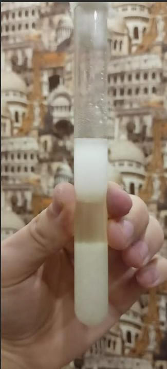
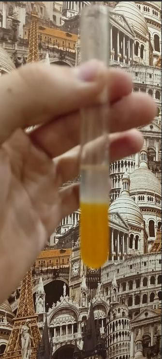

To repeat it, you need to first boil table salt with sulfuric acid, and only then add 96% alcohol. Same with bromide: you get a layer of alcohol that doesn't mix right away. But if you leave it, it mixes. An interesting physical phenomenon

## Attempt, 85% orthophosphoric acid + conc. hydrochloric acid + vodka
I took and poured orthophosphoric acid and hydrochloric acid in excess relative to the orthophosphoric acid. Poured vodka in there and boiled it in a water bath (an iron mug). At first there was abundant gas evolution. When I went to bed there was a tiny little droplet in the test tube:
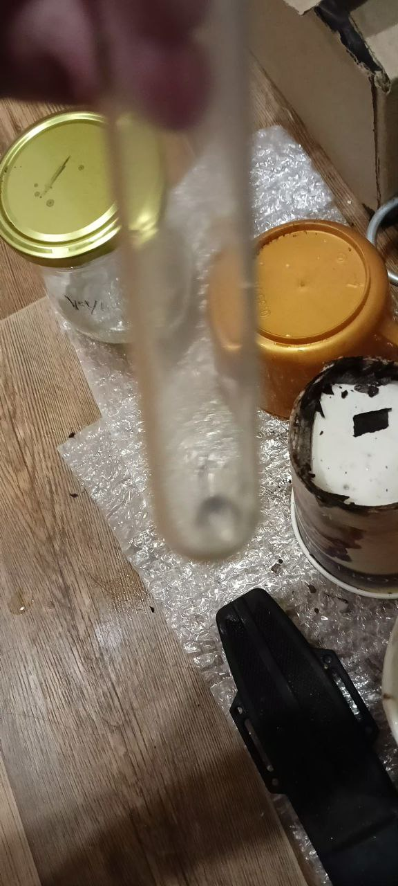

Waking up in the morning, when all the snow had melted, there was nothing at all in the test tube. It was completely empty. Before I went to sleep there was also something like frost and whitening on the walls.
I didn't photograph the empty test tube. In the morning I gathered snow in a cup and heated it to boiling with 1-2 bounces of the liquid, but the liquid clearly didn't flow along the tube; maybe I didn't notice, maybe it did spill. That's exactly why this needs to be done in a water bath. I cooled it and got liquid in the test tube. I poured it onto a metal surface and tried to ignite it; it's hard to ignite, but it does ignite and burns with a very dim bluish flame. Dichloroethane, for example, just flashes and immediately goes out, and if it burns at all, it's in a mixture with something and then gives a greenish flame. By itself it doesn't. 

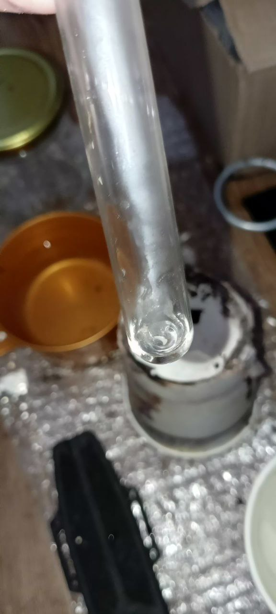

Here's an example of burning:

<video width="640" height="360" controls>
  <source src="{{ 'experimets/Alkylhallogenidfromspirit/1/2_web.mp4' | relative_url }}" type="video/mp4">
  Your browser does not support video.
</video>

<video width="640" height="360" controls>
  <source src="{{ 'experimets/Alkylhallogenidfromspirit/1_web.mp4' | relative_url }}" type="video/mp4">
  Your browser does not support video.
</video>


One could assume it's ethylene, but ethylene in an acidic medium (sulfuric/orthophosphoric) attaches a group to itself and is then hydrolyzed by water to alcohol. One could assume it's alcohol, but the alcohol there is so dilute that an azeotropic mixture is guaranteed. Worth trying again, but with copper wire.

H-OSO3H + H2C=CH2 => H3C-H2C-OSO3H; H3C-H2C-OSO3H + HOH => H3C-H2C-OH + H2SO4; OSO3H = the HSO4- ion. And the alkene is a pi-nucleophile. Hydrogen attaches there and a charge appears on the carbocation, and then HSO4- attaches there. And then nucleophilic attack on the -OSO3H group.
That is, after protonation a positive charge appears on the carbon and the negatively charged one attaches there. And then it's hydrolyzed by water
(might have mixed something up)
At the same time this happens when heated; besides, ethylene is poorly soluble in water. Diethyl ether could also [form], but we have orthophosphoric acid, which will be worse than sulfuric in this respect. So the question of what's burning is still open, needs checking. This smell doesn't act on me strongly enough to say for sure — it's unclear whether it acts at all or not. 
<hr/>
<div class='pair'>
    <p>Iodine (from the experiment obtaining iodoethane): </p>
    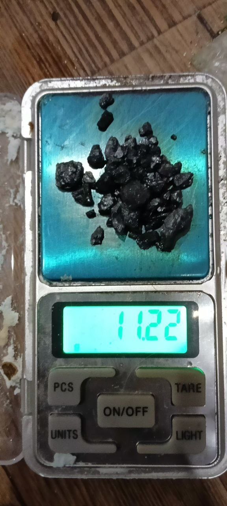
</div>
<br/>
<div class='pair'>
    <p>Paper and iodine: </p>
    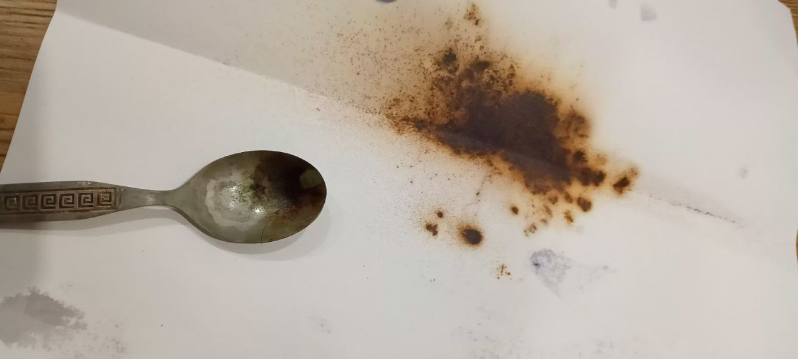
</div>
<br/>

When iodine reacts with phosphorus + 38% vodka a layer appears, or something resembling a layer, and DCM too when mixed in water, like gasoline. After 2 days the iodine partially decolorizes and a precipitate falls out that looks like phosphorus. And the layer itself is visible when illuminated. 

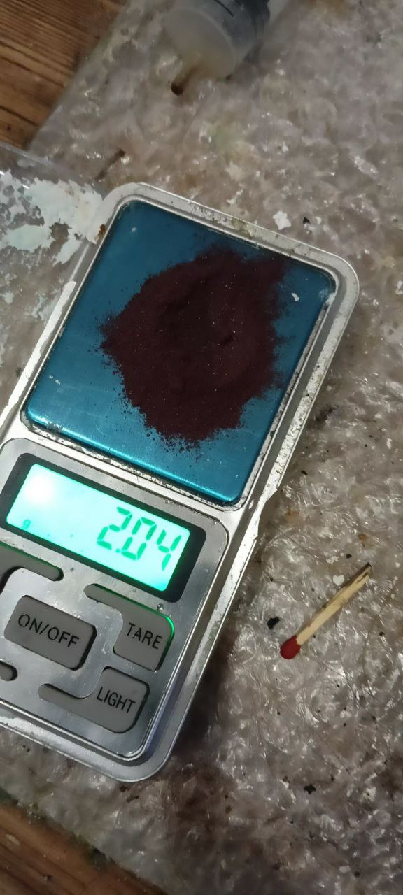
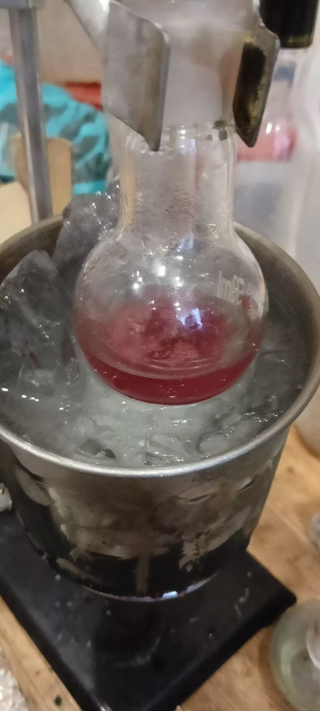
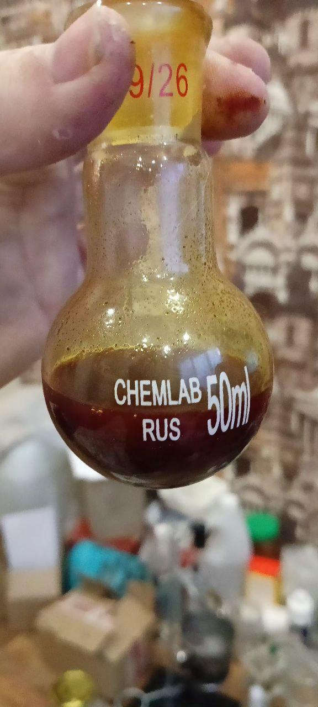
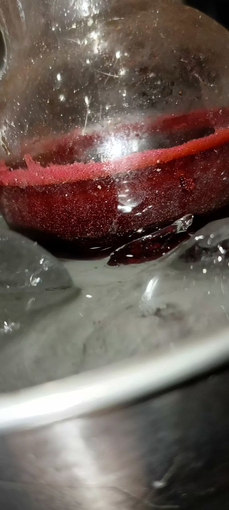
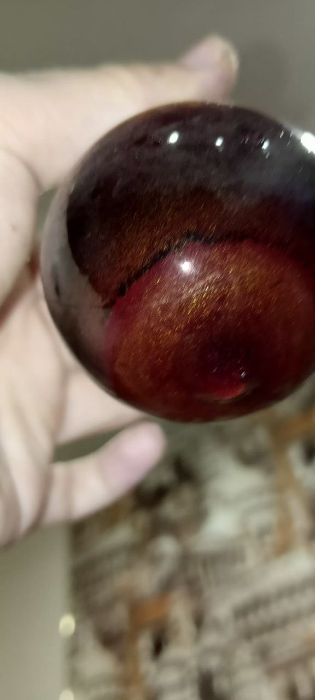
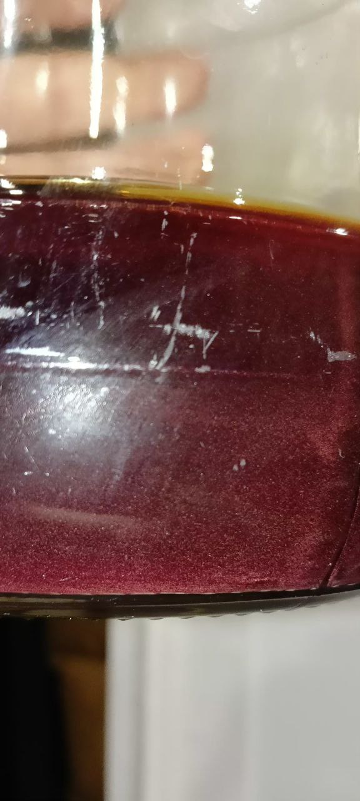
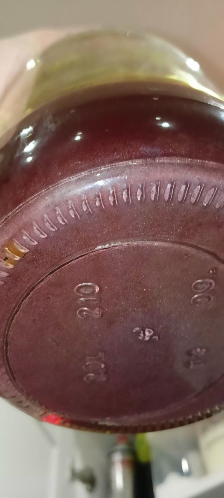
<video width="640" height="360" controls>
  <source src="{{ 'experimets/Alkylhallogenidfromspirit/gas_web.mp4' | relative_url }}" type="video/mp4">
  Your browser does not support video.
</video>

Worth trying more, but now in a test tube and saving reagents. You don't need much for tests, even if it seems the reaction will go successfully.
