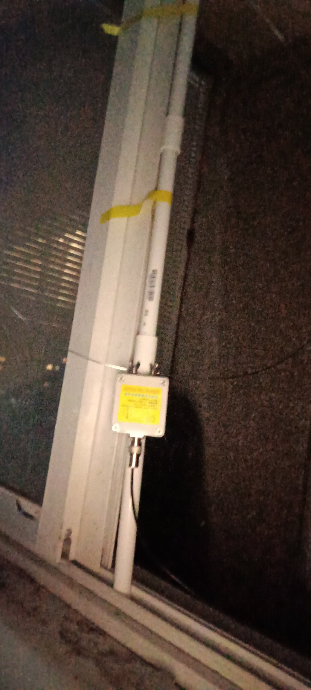

# K180WLA vs YouLoop 250

**K180WLA** is an active antenna, while **YouLoop 250** is a passive one assembled from two SMA cables and mounted on a hoop.

In my experiments with the ATS-20 and RTL-SDR v3, I came to the conclusion that for shortwave (HF) the YouLoop does not provide noticeable advantages — a regular telescopic antenna placed farther away from buildings shows comparable or even better results.

**K180WLA**, when mounted on a pole, placed outside the balcony, and used with its amplifier turned on, provides noticeably better reception of nearby stations.

It is also worth noting that BBC broadcasts can be received with a regular telescopic antenna — the main thing is to get farther away from buildings. So, compared to the YouLoop, the K180WLA is better, but as an active antenna it is mainly useful for reception.

The ATS-20+ gives better sound than SDR. Even with ferrite chokes, SDR does not suppress USB noise very well.
