For the experiment I took 10 packs of "Chik" matches, 50 rubles each. I took technical acetone, cotton wool, and a knife. I soaked the cotton wool in acetone, wiped the striking surface, and a clean layer of cardboard without the composition appeared.
Then I started rubbing it on paper and a trace of the black mass remained, but very little was obtained this way. So I soaked it in acetone and then scraped it off. A mixture with paper was obtained.
I removed most of the paper using a sieve. Very dirty phosphorus was obtained. Initially, the mass of the separated striking surfaces (20 pieces) was 4.63 g.
<br/>
After I collected most of it, I had about 4.07 g of residue (with some error). So in total 0.56 g. Even if we assume that there is 31% phosphorus there, the maximum phosphorus yield is a little over 0.1736 g. Not very profitable, considering that matches are now sold not for 2 rubles, but for 5. So even if there were 50% phosphorus in the matches, you would need to spend 570 rubles at 2 rubles per box to get 100 grams. Given that I was sold matches for 5 rubles, that is already 1425 rubles. And taking into account that according to Wikipedia there is 30.08% phosphorus, then even if 0.7 g was scraped off, at 2 rubles per box you would already need to buy 952+ rubles worth. In fact, 0.56 g was obtained, so 1190+ rubles, and if it were 50% — 714+ rubles. In any case, it is more profitable to buy ready-made 99% pure phosphorus, without impurities, 100 g net weight. The actual phosphorus in 10 boxes comes out to ~0.1736 g by a rough calculation, without taking into account losses and impurities.
<br/>
Messages to Avak Avakyan:
```
Hello! I scraped phosphorus off matches, but it seemed dirty. I used acetone to remove the layer, then rubbed with cotton wool on paper — it separated poorly. So I soaked it and then scraped it off with a knife. There were 10 boxes. I separated the remaining paper with a sieve. I went on the internet and found information that it contains antimonite. So I poured 1.4 density electrolyte onto the powder. Gas was released, but not sulfurous, odorless. I put it in a water bath. Then even more gas was released. So I poured off the rest as the reaction slowed down. I poured hot alkali onto the powder. Gas was released sharply, odorless. I poured sulfuric acid in excess; the alkali before that was very warm and should have dissolved the antimonite at least a little. When adding sulfuric acid into the beaker where I had dipped things, a faint smell of sulfur dioxide appeared. No amorphous yellow antimonite precipitate fell out in the test tube. So I poured off the acid again, poured alkali again, gas again, and did this for a long time, and in the end everything dissolved in the alkali. Gas with white vapor was released sharply. There was a lot of it, I held my breath, poured everything into a bottle, closed it and retreated from the spot. The window was open. So there is no antimonite in the matches? There is phosphorus. Apparently there was no smell, but there was gas — this is phosphine. But I turned off the light. It does not glow.
I can check by dissolving in nitric acid and then throwing it into lime. That would be clearer, but there is no need to check for phosphorus — there is definitely phosphorus there. But antimonite...
A precipitate may have fallen, but these are most likely impurities, not a precipitate. But something did precipitate when acid was added to the solution with alkali. But not a yellow precipitate
...
The gas that appeared with sulfuric acid — I brought a lighter to it, it did not burn. But I did not check with alkali. I think there were trace amounts. And in the beaker where there was a lot of gas, I didn't have time to check, I poured it out immediately without thinking and held my breath (I thought the phosphorus had long since reacted)
...
I did stoichiometric calculations — it would have been possible to stay in the room, it was slightly above the maximum permissible concentration if calculated for the room volume. It's just that you shouldn't breathe at the moment of evaporation. Well, it’s done now. Soon 100 g of pure 99% red phosphorus will arrive from a pyro hobby shop. But the idea was to check how much phosphorus is there, not to obtain pure phosphorus. I also wanted to check for antimonite later. On one not very good forum I saw someone claiming to obtain pure red phosphorus roughly the same way. But I tried — this is nonsense. He either photographed already pure phosphorus or did not scrape it off as I did, but obtained a mass directly in an acetone solution and then poured the mass onto a sheet; otherwise it is hard to explain such purity, even taking that into account. Somehow he got super pure phosphorus even if he scraped it off paper as he writes. Maybe matches in America are different. English-language forum. Well, never mind.
I scraped off 0.56 g, a little remained on the cardboard itself. So in 10 boxes there is no more than 1 g of mass. No more than 0.7 even, roughly speaking. Even if we assume that 50% is phosphorus, when it is clearly less. Then no more than 0.35 g of phosphorus. A box of matches costs from 2 rubles. But now they are sold for 5, before it was 3. Even at 2 rubles, for 10 grams you will spend almost 580 rubles. And it will be very dirty. Meanwhile, 100 grams of 99% pure phosphorus in a pyro shop is 618 rubles (you can even ask for a discount). So it turns out to be more profitable and easier to buy phosphorus than to extract it from matches. But really, from matches, if you need a little, it's possible; if a lot, it is not cost-effective.
In general, the experiment originally consisted only in these calculations. If there were only 0.7 g of pure phosphorus in 10 boxes, without impurities, then matches would be cheaper than buying ready-made.
But in practice, most of it is obvious impurities, and the amount of pure phosphorus is less — even if you obtain a colloid in acetone and then remove the acetone, impurities will remain.
You need to try not scraping onto paper. Because what remained in the beaker after wetting came out fine, without traces of paper and solid. So it turns out you can just scrape into acetone with metal. And then dry it.
If there is antimonite, then how did consumers cook with this, if they acidified it to obtain hydriodic acid so that iodoalkane would turn into alkane? There would then remain some antimony impurities, trace amounts — I think they did not recrystallize anything there, maybe only some did.
https://en.wikipedia.org/wiki/Match
The English Wikipedia says that instead of antimonite they have glass or another abrasive material. In general, I need to try again, but boil in alkali on a burner. But in hot alkali, it should have dissolved at least a little. I think they keep the compositions of matches and their manufacture as secrets, because there is no proper GOST on the surface where the exact composition will be written in ratios.
"Chik" matches are made in Pakistan. So not according to GOST and there may well be no antimonite and the composition is unclear; maybe they don't have antimonite. So other matches are needed.
Or I needed to boil it.
...
In "Fesko" matches it is clearly present. To dissolve properly, you need to heat with a lighter. But even fresh alkali gives a weak coloration, and "Chik" matches did not. Figured it out.
So if you scrape it off and boil it in acid, electrolyte, and then wash and dry the residue, you get free glass with antimonite? According to rumors, there is more of it than phosphorus.
```
<br/>
Reply:
```
Hello!

But all this "top secret" has long been calmly laid out in Wikipedia in the article "Match" (click):
https://ru.wikipedia.org/wiki/%D0%A1%D0%BF%D0%B8%D1%87%D0%BA%D0%B0
There is a table there:

Striking surface composition:
antimonite Sb2S3 — 41.8 %
phosphorus (red) P — 30.8 %
iron oxide Fe2O3 — 12.8 %
bone glue — 6.7 %
ground glass SiO2 — 3.8 %
chalk CaCO3 — 2.6 %
zinc white ZnO — 1.5 %.

Match head composition:
potassium chlorate KClO3 — 46.5 %
ground glass SiO2 — 17.2 %
red lead Pb3O4 — 15.3 %
bone glue — 11.5 %
sulfur S — 4.2 %
zinc white ZnO — 3.8 %
potassium dichromate K2Cr2O7 — 1.5 %.

And it really is so. 😊 True, there is a small inaccuracy: glass has the composition Na2CaSi6O14 (not SiO2).

Thus, the GAS (non-flammable, colorless, odorless) is CO2 from chalk CaCO3. 😊 Alkalis absorb CO2 from the air during storage, forming carbonates; so adding such alkali, saturated with CO2, to electrolyte will also cause foaming (again, the gas is CO2). 😊 Antimonite should dissolve in alkalis even without heating; and acids can displace antimonite from this solution not necessarily as red, but sometimes as brown, sometimes rather dark precipitate. If the solution is very dilute, instead of an antimonite precipitate, colored solutions of thioantimonious acids may be obtained (from yellow to brown).

PHOSPHORUS reacts slowly with alkalis at room temperature, but noticeably when heated:
4P + 3NaOH + 3H2O = 3NaH2PO2 + PH3↑.
This produces an aqueous solution of hypophosphite and phosphine gas, which is TOXIC and can cause POISONING!

Phosphorus can be SUBLIMED (in which case white phosphorus will condense, capable of self-ignition in air). But there is a catch: of the components of the "striking surface", bone glue and paper will produce TAR when heated, so the condensate of WHITE phosphorus will turn out BLACK. 😃 To avoid this result, you can, of course, soak the striking surfaces in water, peel off the coating, and wash it with a large amount of water on a filter.
```

</hr>
<h2>Photos/videos: </h2>

<div class='pair'>
    <p>Reaction with acid with the obtained "powder":</p>
    <video width="640" height="360" controls>
      <source src="{{ '/experimets/matches/reactionacid_web.mp4' | relative_url }}" type="video/mp4">
      Your browser does not support the video tag.
    </video>
</div>
<br/>
<div class='pair'>
    <p>Acetone (photo included for completeness, not really necessary):</p>
    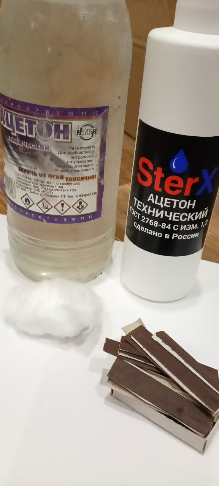
</div>
<br/>
<div class='pair'>
    <p>Obtained antimonite (Sb2S3), precipitate from the reaction of alkali with the striking surface, then dissolved in excess acid and allowed to settle:</p>
    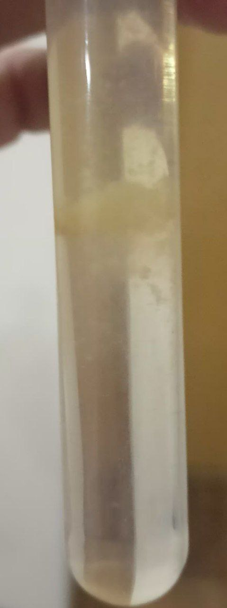
</div>
<br/>
<div class='pair'>
    <p>Freshly obtained antimonite:</p>
    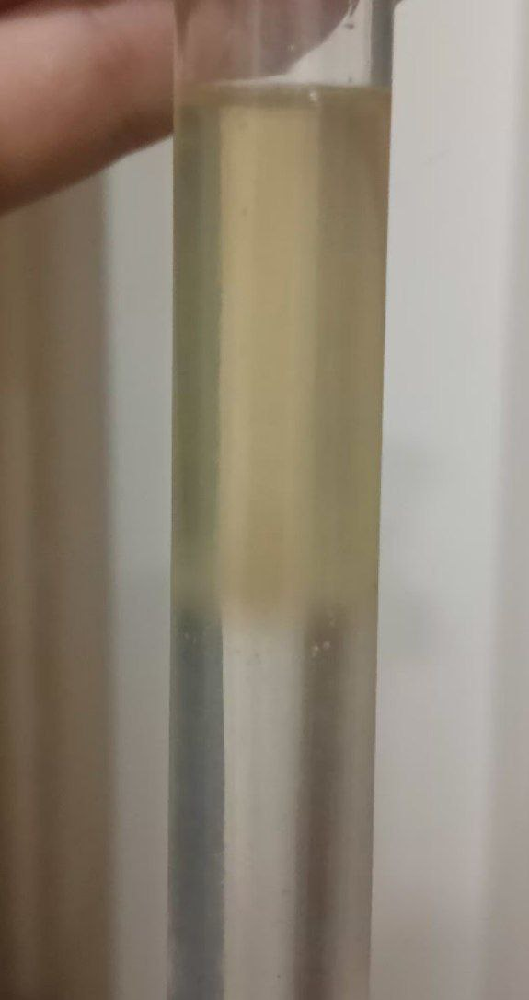
</div>
<br/>
<div class='pair'>
    <p>Forum comment about the policy of a VERY SMART state:</p>
    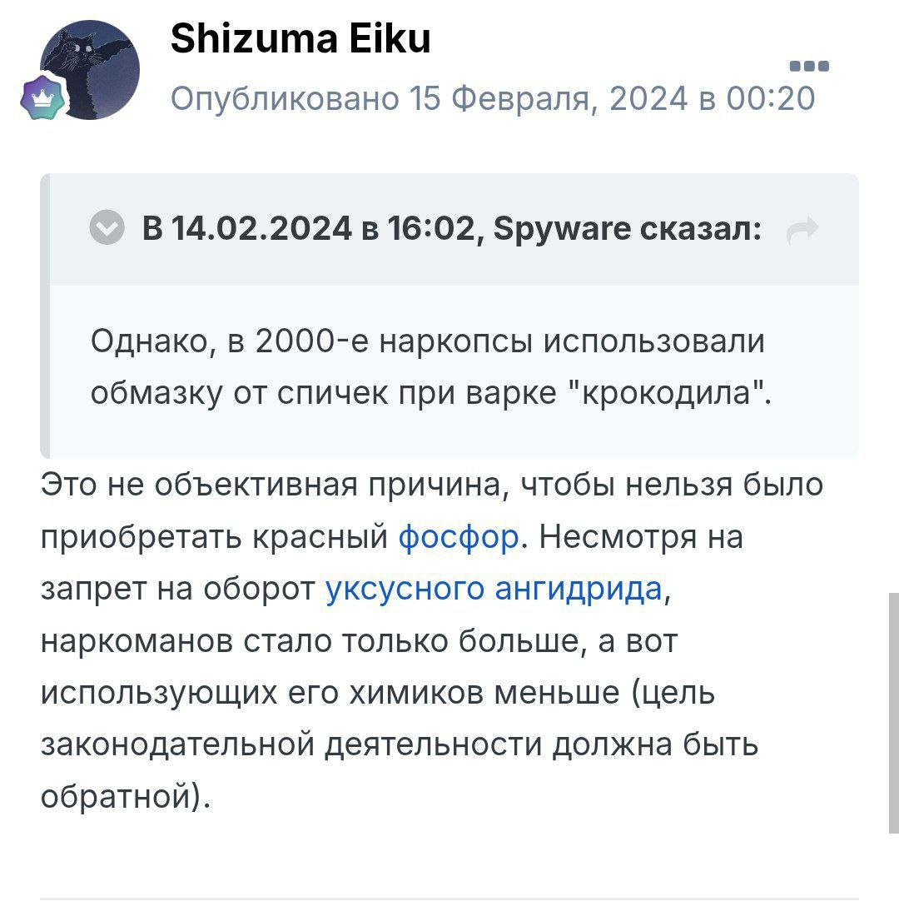
</div>
<br/>
<div class='pair'>
    <p>Forum comment about very smart videos where they obtain red phosphorus by subliming red phosphorus in a light bulb (maybe salt junkies):</p>
    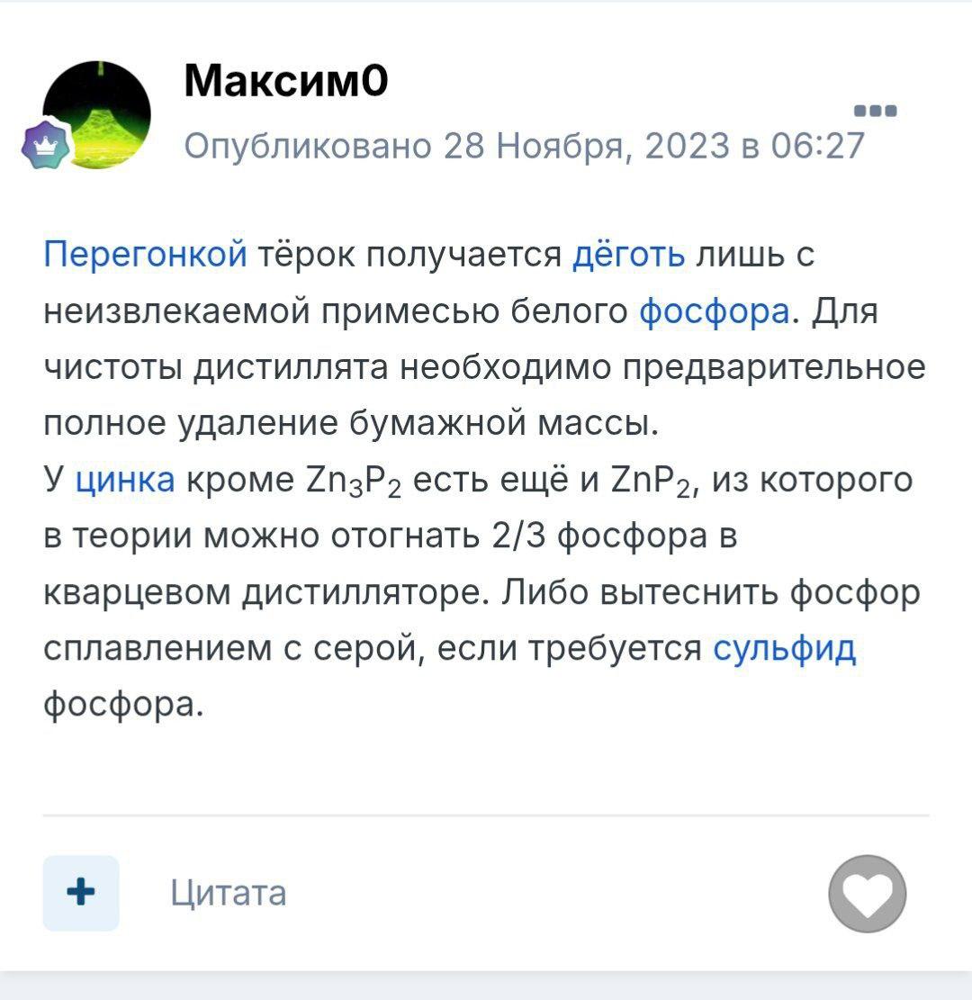
</div>
<br/>
<div class='pair'>
    <p>Dirty phosphorus obtained:</p>
    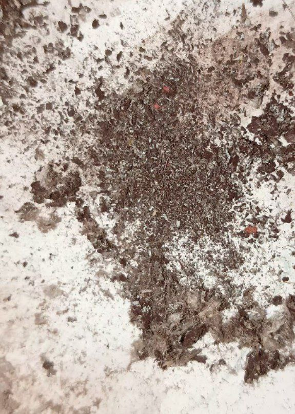
</div>
<br/>
<div class='pair'>
    <p>Dirt in acid/alkali — I don't remember which, but gases were released and it floated up (gases are released in alkali, gases are released in acid, phosphine is possible. In hot alkali they go quite well. I couldn't identify the smell, for some reason there was no smell. I put my nose right up to it, no smell at all):</p>
    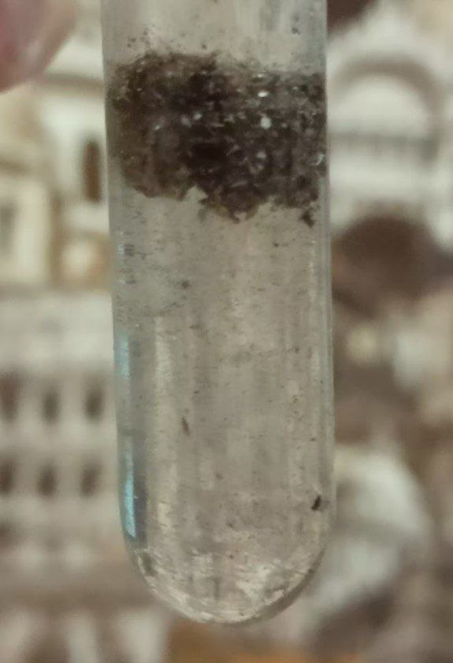
</div>
<br/>
<div class='pair'>
    <p>Dissolving match striking surfaces in caustic soda (NaOH)</p>
    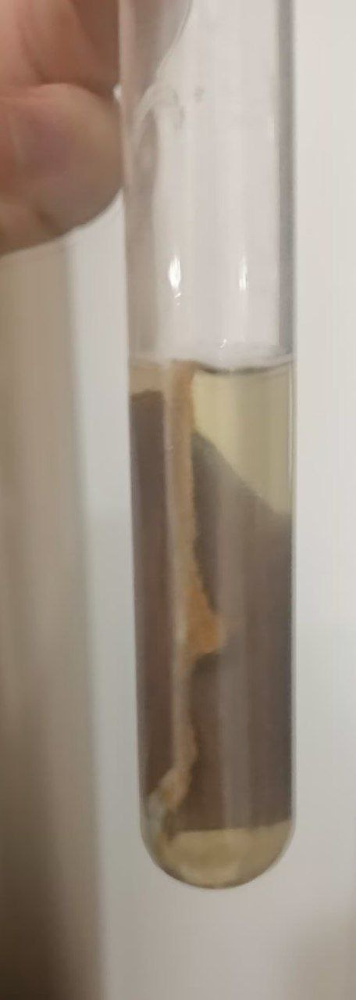
</div>
<br/>
<div class='pair'>
    <p>Residue of striking surfaces</p>
    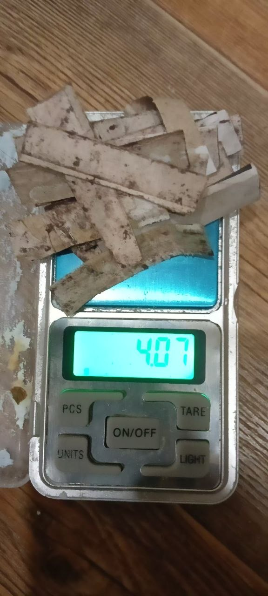
</div>
<br/>
<div class='pair'>
    <p>Residue of phosphorus in the beaker where the striking surface was wetted for separation. Apparently you can make a colloid this way</p>
    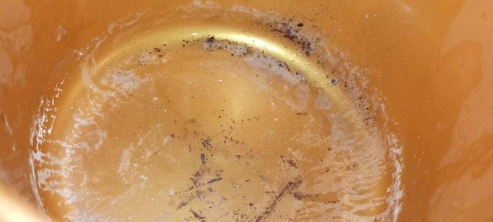
</div>
<br/>
<div class='pair'>
    <p>You can rub with cotton wool like this and smear the phosphorus. I don't know why you would do that.</p>
    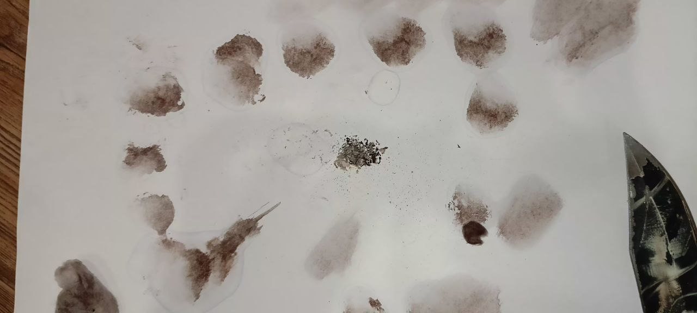
</div>
<br/>
<div class='pair'>
    <p>Empty cardboard after cotton wool with acetone: </p>
    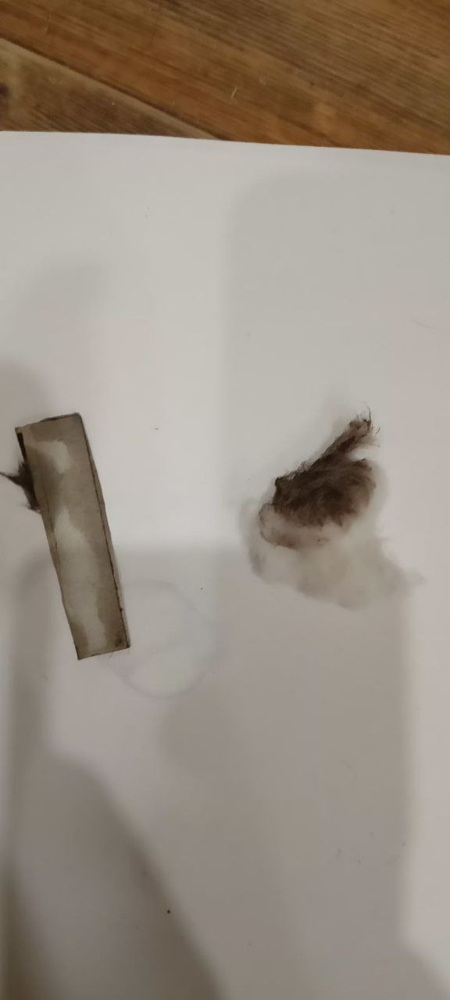
</div>
<br/>
