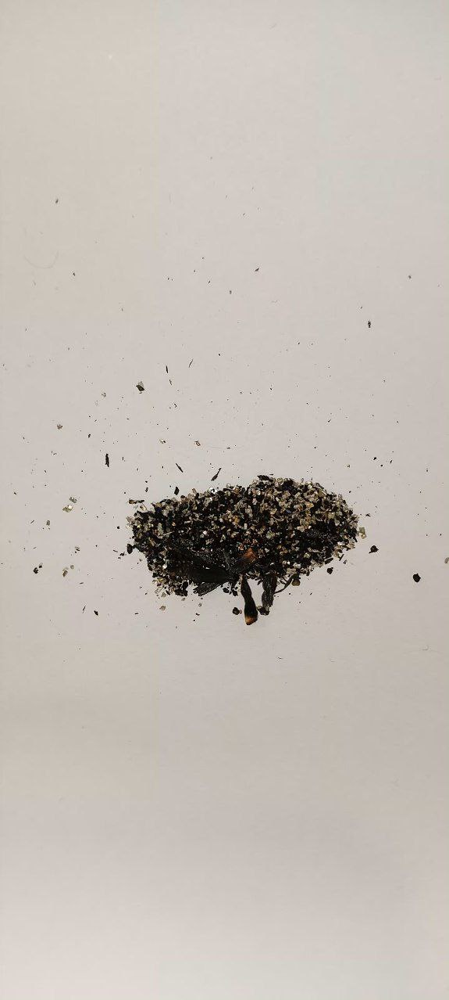

**Important!**
The experiments described in this article can be dangerous and potentially harmful to health and safety. Conduct them only under controlled conditions and with all safety precautions observed. The author is not responsible for any consequences arising from carrying out the described experiments. Do not repeat these experiments without appropriate preparation and permission.

**Legal warning:**
The information presented in this article is intended solely for educational purposes and should not be used to conduct experiments without appropriate permission and compliance with all legislative norms and safety rules. The author is not responsible for any legal consequences arising from the use of this information.

**Warning:**
The experiments described in this article require special preparation and knowledge in chemistry. Do not conduct them without appropriate qualifications and equipment. The author is not responsible for any consequences arising from improper conduct of the experiments.

**Safety warning:**
All experiments described in this article must be carried out in strict accordance with safety rules and under the supervision of a qualified specialist. The author is not responsible for any injuries, damage, or other negative consequences arising from the experiments.

**Warning:**
The experiments described in this article are not intended to be repeated at home. All described procedures must be carried out only in specialized laboratories and under the supervision of qualified personnel. The author is not responsible for any consequences arising from improper or unauthorized conduct of the experiments.

**...**
The composition is not a weapon, not something bad. It simply exists; this is just a demonstration of a thermite-type reaction for educational and informative purposes.

**DO NOT do this indoors**
sulfur compounds, hydrogen sulfide and oxides may be released, which can cause severe intoxication. If some "experts" say to do the reaction at home rather than outside, study fire safety.

The video is a demonstration, without calls or incitement. No weapons.
---

You can often hear from older people how they used to saw some wheels to get magnesium and then mixed it with something.
If you ask them, the accounts differ every time. Sometimes "sulfur" from matches appears, sometimes a turbo lighter, sometimes match heads. Sometimes they say you can't store it for long or it will oxidize.
In general, a whole set of everything — so I went and decided to check it myself.
For the experiment we will need...
After asking around and showing, we came to the conclusion that their magnesium burns in oxygen there and this is not thermite, although according to Beketov's series it will reduce, but not as well as pure manganese(IV) oxide. Some similar compositions are hard to "start", so that's not surprising. Browsing the internet I found that if you grind it, it may even ignite on its own — if that is true, then it is not just magnesium heating up and decomposing to manganate and then to hypomanganate, but rather a thermite reaction. Yes, magnesium can also burn in carbon dioxide, but when heated.
Zinc can also flash, but there you need a burner and temperatures around 1000°C. And dust, pyrophoric iron, can even self-ignite in air.
For the experiment I took ground components (a non-working composition, I took it from the internet, did not calculate it myself at first).

<h2>Photos/videos: </h2>

<div class='pair'>
    <p>After ignition with alcohol, burning and making sounds:</p>
    <video width="640" height="360" controls>
      <source src="{{ 'experimets/metalotermija/test_after_spirit_1_web.mp4' | relative_url }}" type="video/mp4">
      Your browser does not support the video tag.
    </video>
</div>
<br/>
<div class='pair'>
    <p>After ignition with alcohol, burning and making sounds (already better heard, a bit more was taken here): no video</p>
</div>
<br/>
<div class='pair'>
    <p>Test with zinc (as can be seen, as with magnesium, the cause is not the decomposition of permanganate to oxygen. Rather that is secondary, afterwards):</p>
    <video width="640" height="360" controls>
      <source src="{{ 'experimets/metalotermija/test_with_zn_web.mp4' | relative_url }}" type="video/mp4">
      Your browser does not support the video tag.
    </video>
</div>
<br/>
<div class='pair'>
    <p>Test whether the mixture will ignite from a match? (it did not ignite. maybe too little) [without additives]: no video</p>
</div>
<br/>
<div class='pair'>
    <p>Approximate composition from source X/Y: no photo</p>
</div>
<br/>
<div class='pair'>
    <p>Waste after the reaction (if you look, there is a lot of unreacted magnesium; needs to be checked with acid).</p>
    
</div>
<br/>
<hr/>
There is no sulfur in matches; there is chlorate in a mixture with other substances. Beketov's table for understanding thermite reactions:


<hr/>

I am not publishing the composition, but I calculated it stoichiometrically. I did not find it on the internet, I calculated it myself. I am not publishing it to avoid problems. I added one component that helped.
(a rather dangerous mixture)
```
Mg+S = MgS
KMnO4 + Mg => MgO + K2O + MnO2 (May also reach pure manganese. Coefficients not written)

Mn +7 -3e = > Mn+4
Mg 0 + 2e => Mg+2
2*3 = 6

6/2 = 3
6/3 = 2

2KMnO4 + 3Mg => 3MgO + K2O + 2MnO2 (May also reach pure manganese. Coefficients not written)

```
I made such a composition and went with a jar to look for a suitable place — you cannot test this in a residential area, even if you clean up afterwards. Fire safety. I thought of doing it outside, but some elderly people "harassed" me, cursed me for bad luck and called me names. They interrogated me about what I was doing. I said I was testing a mixture and that was enough for them. To avoid being bothered further, I had to test this mixture (without chlorate, there is a different component here) in another place. A blinding flash, nothing to say, but it is indeed hard to ignite even with alcohol. The added component helped. Here are the results:
<div class='pair'>
    <p>Powder: no photo</p>
</div>
<br/>
<div class='pair'>
    <p>Reaction.</p>
    <video width="640" height="360" controls>
      <source src="{{ 'experimets/metalotermija/withsulfur_web.mp4' | relative_url }}" type="video/mp4">
      Your browser does not support the video tag.
    </video>
</div>
<br/>
**Disclaimer**
I am not giving the full composition of the mixture, so as not to be a bad person. Do not do this at home under any circumstances, do not do this at all — it is very bad, and this experiment was done out of scientific curiosity, without calls or incitement, and in general the flash is such that you see spots afterwards. You can end up in the emergency room, so do not do this. Well, and without one element it didn't work at all. In short, now you can roughly understand how this works in practice, for those who are interested.
