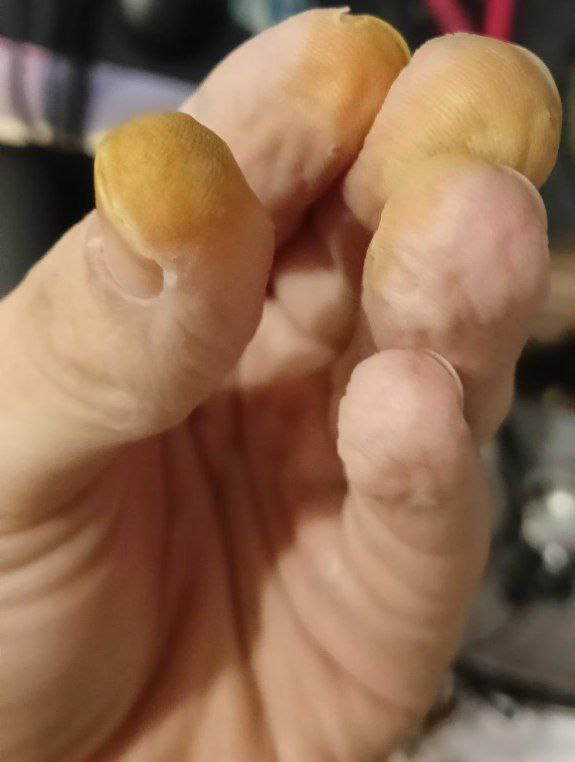
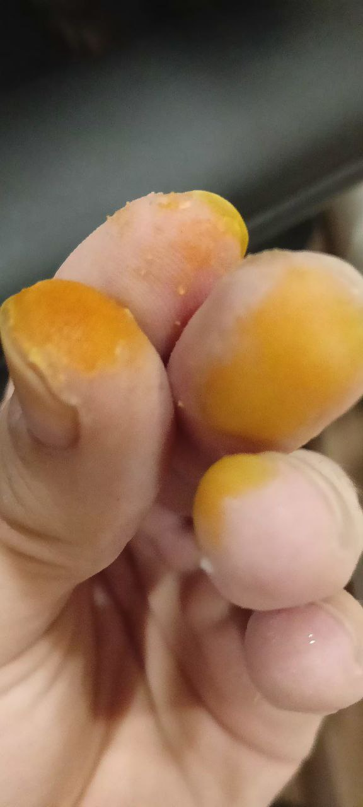

On the first day the burn is barely visible and almost unnoticeable. Even after brief contact and quickly washing hands, it still appears.

Photo on day 2:

Photos on day 4:

On day 4 — either after working with unslaked lime (CaO), or simply on its own — the burn became lighter and could be scraped off with a fingernail of the other hand. On one finger I removed it completely. On the other two I left it.

On day 7:

As you can see, at first the burn appears weakly (but soon becomes noticeable), then its intensity increases sharply, and after that it simply fades. This burn was mild, from very brief contact. Concentrated acid 65% — this was contact with its vapors and nitrogen oxides.

From this it follows that the myth that such a burn remains for many years is not accurate. This is not oleum, which would leave a lifelong hole in the body or cause disability (though of course it also depends on concentration and exposure time). The burn itself resembles the xanthoproteic reaction with proteins. Nitrogen oxides are more dangerous than the acid itself. And nitric oxide (NO) in small doses is actually very useful to the body and is an important biochemical element...

Do you need to follow safety precautions when working with this — definitely. You need a fume hood and gloves, as well as safety goggles and preferably respiratory protection to minimize risks. But the danger of a burn is exaggerated for low concentrations.

**WARNING: this experience is subjective and personal. At higher concentrations there can be much more serious damage than 3 fingers turning yellow, but claiming that a small contact will leave a burn for many years is nonsense (as some people say on Mail.ru).**