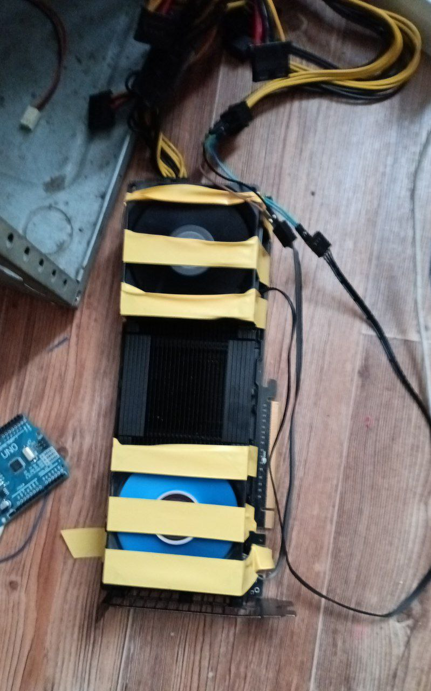

# Tesla K80

- To use the Tesla K80 driver on newer Linux kernels, a patch is needed: https://gist.github.com/joanbm/d0cb8790ca610fbd2c2e43f30707ce18
- Translation of a [Reddit article](https://www.reddit.com/r/pcmods/comments/nhfwh7/guide_using_an_nvidia_tesla_k80_datacenter_gpu)

---

## Guide: how to use an NVIDIA Tesla K80 (datacenter GPU) for gaming on Windows

### What you need and how to prepare

1. **BIOS — enable "Above 4G decoding"**.

2. **Install the NVIDIA driver for Tesla K80 (Windows)** — download the official driver version from NVIDIA's website. ([Reddit][1])

3. **Restart** the computer.

4. **Edit the Windows registry**:

   * Open `regedit`
   * Go to:
     `HKEY_LOCAL_MACHINE\SYSTEM\ControlSet001\Control\Class\{4d36e968-e325-11ce-bfc1-08002be10318}\0001`
   * Back up the key.
   * Delete the `AdapterType` value.
   * Create an `EnableMsHybrid` value (32-bit DWORD) and set it to `1`.
   * **Restart** again.

5. **Switch from compute mode (TCC) to graphics mode (WDDM)**:

   * Run Command Prompt as administrator.
   * Run `nvidia-smi -L` to find your GPU ID.
   * Then run `nvidia-smi -g {ID} -dm 0`, where `{ID}` is the Tesla K80 number.

6. **Restart** once more.

7. **Assign a game to run on the Tesla K80**:

   * Open display settings (right-click on the desktop → Display settings → Graphics settings).
   * Add the game's `.exe` file to the list.
   * Select the game → Options → choose "High performance" → Tesla K80.

8. **(Optional) Overclocking** — the author mentioned you can try to speed it up, but without details. ([Reddit][1])

### Quick summary

| Step | Action |
| --- | --- |
| 1–3 | Enable the BIOS option and install the driver |
| 4   | Edit the registry: delete `AdapterType` + set `EnableMsHybrid = 1` |
| 5–7 | Switch mode and assign the game to the GPU |
| 8   | (Optional) Overclocking |

---

[1]: https://www.reddit.com/r/pcmods/comments/nhfwh7/guide_using_an_nvidia_tesla_k80_datacenter_gpu/?utm_source=chatgpt.com "(Guide) Using an NVIDIA Tesla K80 Datacenter GPU for ..."

### Note

After that, you can simply right-click the game shortcut and choose to run it on the Tesla K80 GPU. Alternatively, you can open the system graphics/performance settings for the application and select the Tesla K80 there. I don't remember the exact menu names, but when you right-click the shortcut you should see an option to run the application on a specific GPU.
